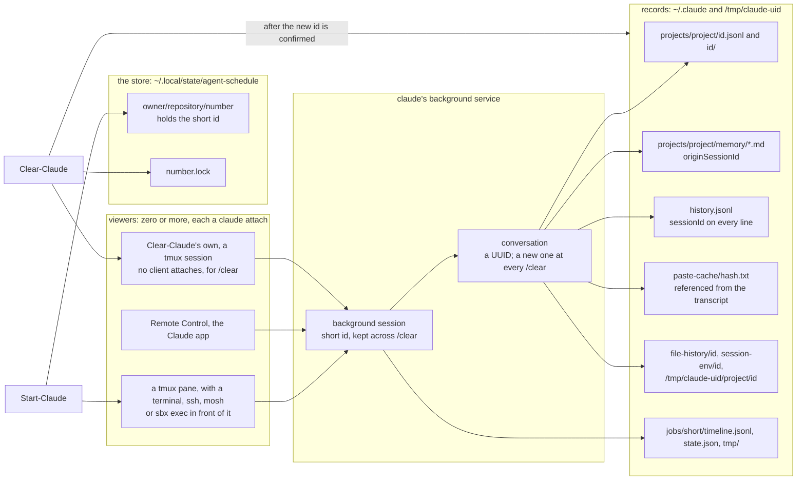

# 1. Session model — every conversation in claude's background, a tmux session of its own for each start

> **Status:** built 2026-10-15, in phase 33 of the [plan][plan-259],
> as 07413ae2, and accepted on the deployed scripts the same day, in phase 34; on Windows, on psmux, in
> David-Noble-at-work/personal#273, 2026-10-19; the variables read and the title held on a wake in
> NobleFactor/noblefactor-ops#260, 2026-10-22; the wake with no flag, and the name by `/rename`, in
> NobleFactor/noblefactor-engprod#384, 2026-10-23; the clear leaving no trace in
> NobleFactor/noblefactor-engprod#414, reopened 2026-10-27, planned. Companion: [`1-session-model.status.md`](1-session-model.status.md).
> Feature:
> [NobleFactor/noblefactor-ops#151](https://github.com/NobleFactor/noblefactor-ops/issues/151).
>
> **Relationship to the neighbors.** [The index](index.md) defines the terms. [2. Command line](2-command-line.md)
> owns Start-Claude's forms, names and store; this section owns how a conversation and its tmux sessions live.
> [3. Agent sandbox](3-agent-sandbox.md) moves this model into a Docker SBX sandbox.

This model replaced claude running in the tmux session's left pane, and the tmux session's id kept in the store
(the plan's questions 76 to 79).

## The model

1. **Every conversation runs in claude's background service** (question 76). None that Start-Claude starts runs in a
   terminal of its own.
2. **Every start opens a new tmux session onto it:** the viewer on the left, the user's shell on the right. No tmux
   session is reused, and the store keeps no tmux id (question 76).
3. **Each tmux session is named for its schedule's repository and number and its own id,** as in
   `devlore-cli#916 $34`, since tmux refuses a second session of one name and never reuses an id while its server
   runs (question 78), and psmux, on Windows, loses a session whose name carries `/` or `|`. One name serves both:
   the owner, 2026-10-16, "I like keeping the tmux session name the same everywhere" (personal#273's plan, question
   1). The id exists once the session does, so the session is made under a name tmux picks and then renamed.
4. **A tmux session ends when its last client goes:** Start-Claude sets `destroy-unattached` on each tmux session it
   opens (question 77). Its panes end with it, and the conversation runs on.
5. **The store keeps the background session's id** (question 78).
6. **A conversation's id, given with `--resume` or held by the store, is met where claude lists it** (question 78):
   - run by a background session: that session is attached, and its id stored;
   - running in the foreground: refused with 75;
   - running nowhere: started with `claude --bg --resume <id>`, which keeps the id, and the id claude prints stored.

   `claude --bg --resume` is never given an id claude already holds as a background session: it starts a copy under
   a new id.
7. **`--detach` starts the background session, or keeps it, and opens no tmux session** (question 78).
8. **Trust is claude's to check** (question 79). In a folder claude does not trust, `claude --bg` starts nothing and
   says what to do (seen 2026-10-15), so Start-Claude passes claude's words through and exits 69, having opened
   nothing. Start-Claude no longer reads claude's trust record.
9. **No startup hook** (question 78). Sync-ClaudeSession retires: the store holds an id claude keeps across `/clear`,
   and no tmux id to forget.
10. **The schedule's variables,** `NFEP_AGENT_SCHEDULE` and `NFEP_AGENT_SCHEDULE_URL`, reach the background session
    through an `env` block in `claude --bg --settings` (question 79; seen reaching a session's startup hook
    2026-10-15), since claude's background service starts a session without the environment of the command that
    starts it (seen 2026-10-14). The tmux session's shell pane gets them too; the viewer has no need of them.
    `star-gh-assignment` reads them (#260, requirements 1 and 2): the schedule's key from `NFEP_AGENT_SCHEDULE`, and
    from the session's name only when it is unset; its link from `NFEP_AGENT_SCHEDULE_URL`, or the link the key makes.
11. **`MOSH_SERVER_NETWORK_TMOUT` is the user's to set,** not Start-Claude's, and Start-Claude(1) names it (question
    77).

## The parts, drawn

The clear's view of the model: one background session, zero or more viewers on it, one conversation at a time, and
the records each leaves. Every box under records is one row of Clear-Claude(1)'s inventory.



## The processes under ssh and under mosh

`├─` and `└─` are parent and child, read with `ps` on 2026-10-15; `──▶` is a connection over a socket. sshd's
processes were read on Danoble-MBP-A (macOS) and on danoble-ud24-1 (Linux), where sshd's listener stands between init
and them. The tmux client's place under ssh is from how Start-Claude attaches, not yet seen live.

```text
Under ssh
launchd (pid 1)
├─ sshd-session: <user> [priv]
│  └─ sshd-session: <user>@<tty>
│     └─ tmux client: tmux attach-session -t <session> ──▶ tmux server
├─ tmux server
│  └─ tmux session: one per start, destroy-unattached on
│     ├─ pane: claude attach <id>, the viewer ──▶ the conversation
│     └─ pane: the user's shell
└─ claude bg-pty-host
   └─ claude bg-spare: the conversation

Under mosh
launchd (pid 1)
├─ mosh-server new … -- Start-Claude …
│  └─ tmux client: tmux attach-session -t <session> ──▶ tmux server
├─ tmux server
│  └─ tmux session: one per start, destroy-unattached on
│     ├─ pane: claude attach <id>, the viewer ──▶ the conversation
│     └─ pane: the user's shell
└─ claude bg-pty-host
   └─ claude bg-spare: the conversation
```

Only the tmux client runs under the connection, so the tmux session outlives it unless `destroy-unattached` ends it.
Under ssh the client goes when sshd closes the terminal: when the connection ends, or when sshd notices it dropped,
which on these hosts, with no `ClientAliveInterval`, can take two hours. Under mosh it goes when mosh-server exits:
when the session's command ends, at Ctrl-^ then a period, when killed, or, with `MOSH_SERVER_NETWORK_TMOUT` set,
that long after its client was last heard from. A client that goes without a word, as when Blink Shell is quit,
leaves mosh-server waiting, the tmux client counted as attached, and the tmux session in place. The conversation is
a tree of its own and runs on in every case.

## A start, step by step

1. **The schedule and its entry.** The schedule comes from `--schedule`, and its entry from the store, read under
   the entry's lock.
2. **What is refused before anything starts:** a start with no terminal and no `--detach`, and, on macOS, a login
   keychain that stays locked. Each refusal says what to do instead.
3. **The background session.** The entry's id is looked up in claude's list, `claude agents --json --all`:
   - a background session of that id, running or stopped, is the schedule's, and `claude attach` restarts a stopped
     one under the same id (seen 2026-10-14); with `--detach`, `claude --bg --resume` of its conversation wakes it
     instead, with no flag: given one, `--name` included, claude starts a copy under a new id, which fails
     (NobleFactor/noblefactor-engprod#384; anthropics/claude-code#104658);
   - one claude lists under another name than the launch's takes the launch's with `/rename`, so that its title holds
     (#260, requirement 3): stopped, as the wake's first prompt; running, typed into a viewer, the one the terminal
     attaches to, or with `--detach` one of the launch's own, closed once claude lists the name. On Windows a running
     one is renamed only when a console attaches, since claude there takes no keys in a viewer no client attaches
     (anthropics/claude-code#104688), unless `NFEP_AGENT_SCHEDULE_DETACHED_RENAME` is set;
   - a conversation's id is met where claude lists it, as item 6 of the model says;
   - with no entry, `claude --bg` starts a new conversation in the startup directory, named for the schedule, with
     Remote Control unless `--no-remote-control` is given, the schedule's variables, and the arguments after `--`,
     which the session keeps. The id it prints is stored, since `--bg` takes no `--session-id`.

   When claude refuses a start, as in a folder it does not trust, its words are passed through, and the start exits
   69 with nothing opened.
4. **With `--detach`,** the start ends here and exits 0.
5. **The tmux session.** A new tmux session, named as item 3 says, with `destroy-unattached` on: the viewer on the
   left, and on the right the shell, which carries the schedule's variables. The terminal is attached to it, or,
   inside tmux, the current client is switched to it, and tmux ends the tmux session the client leaves when
   Start-Claude opened it (seen 2026-10-15). `destroy-unattached` is set once the client is attached: set on a tmux
   session no client has attached, tmux ends it at once (seen 2026-10-15).

## Leaving

- **Leaving the viewer,** with Escape or Ctrl+Z, ends its pane, and the tmux session with it (seen 2026-10-14).
  claude's background session runs on until `claude stop <id>`. `/exit` in a viewer does nothing.
- **Detaching,** with the tmux prefix and then d, leaves the tmux session with no client, so tmux ends it too, and
  whatever runs in its shell pane. No tmux session waits to be come back to: the next start opens a new one.
- **A lost connection** ends the tmux session once its client goes, as the processes above show.

## Typing into a viewer

A command typed into a viewer, `/rename` by Start-Claude or `/clear` by Clear-Claude, goes as text alone, and its
Enter after it. An Enter that arrives with the text, in one `send-keys`, claude takes as part of the command, which
then waits on the input line until someone presses return (NobleFactor/noblefactor-engprod#412; the owner,
2026-10-26: "I don't want to have to hit return myself"). So the text is typed; once the viewer's input line, `❯`,
shows it, and a second more, Enter is pressed by itself; and while the input line still shows the command, Enter is
pressed again, up to three times in all. Start-Claude.ps1 does the same on psmux. Seen 2026-10-27 on claude 2.1.311,
on disposable background sessions (NobleFactor/noblefactor-engprod#414): a bare `/clear` opens the command menu above
the input line, with `/clear` its one entry, and one Enter submits it, the same `id` listing a new `sessionId` 0.6 s
later; `/rename <name>` closes the menu as its name is typed, and one Enter submits it, the new name listed 0.6 s
later; and `claude rm` removes a session's job folder and its listing, leaving its transcripts, its `/tmp` folders and
its prompt lines, among them the typed `/clear`, recorded as a prompt of the conversation it clears.

## Clearing and retiring a conversation

Clear-Claude ([2. Command line](2-command-line.md#clear-claude)) ends a conversation in one of two ways, under the
store's lock for the schedule, so that no start resumes or renames the conversation meanwhile. What follows is the
script as built, `f0211f4` (#417). The promise the owner set on 2026-10-27, "Clear-Claude is supposed to remove ALL
trace of the session's transcript. EVERYTHING.", is not yet met: the plan for meeting it is
[`414-clear-claude-can-remove-a.md`](../../plans/fix/414-clear-claude-can-remove-a.md), a draft set aside on
2026-10-28, and the diagram above is its inventory. Where the two differ, the paragraph says so.

- **Cleared,** the default. The background session and every connection to it go on: each viewer, its tmux pane,
  ssh, mosh or `sbx exec`, and Remote Control. Nothing is removed before the clear is confirmed (#414): the
  conversation's memories, their index lines and the job's scratch are moved into a staging folder with a manifest
  first, since a new conversation reads the memory index as it starts and would find the scratch. Then `/clear` is
  typed into a viewer of Clear-Claude's own, a tmux session no client attaches, as the section above types it.
  `/clear` keeps the background session's short id and gives the conversation a new one (seen 2026-10-14 and
  2026-10-27), so the store stays right. Once claude's list shows the new one, the old conversation's transcript and
  its folder, file history, session environment and temporary output go, with the staged entries, and its prompts
  leave the shared prompt history by a rewrite that keeps the old file open, renames a copy without them into place
  and drains the old file for two quiet seconds; a session that opened the file before the rename and writes later
  than that loses its line. Left behind, as measured on the first real run, 2026-10-27: the job's timeline,
  `jobs/<short id>/timeline.jsonl`, whose lines quote every prompt, and the paste cache. When `/clear` is not taken,
  the staged entries go back, an entry another session wrote over meanwhile left staged and named; when `/clear` was
  typed and claude's list then cannot be read, the outcome is unknown, nothing moves, and the staging folder is named
  for the owner. A signal after the Enter and before that listing restores the staging, though `/clear` may have run.
  The plan replaces the drain with a wait on the file's holders, cuts the timeline and removes the pastes, keeps the
  staging from the Enter on, and writes one recovery record before anything moves.
- **Retired,** with `--retire`. Every viewer is a `claude attach <short id>` process where claude runs, and ending it
  ends whatever stands in front of it, a tmux pane, an ssh or mosh session, or `sbx exec`, live or dead: no viewer's
  terminal need be known. With every viewer ended, the session is stopped and removed, and its records, its job folder
  and the schedule's store entry go, before the prompts and the last check; the plan moves them after. A viewer that
  reattached would have restarted the session under its own id (seen 2026-10-14), so Clear-Claude asks claude's list
  last, and succeeds only on a valid list with the session absent: listed again, it says to run again; a list that
  fails or cannot be read is a failure of its own, never success.

## Moving a foreground conversation into the background

A conversation that runs in the foreground is refused with 75 (item 6). There are two ways to move it, and they
differ:

- **Exit it, then start again.** The start resumes it into the background with `claude --bg --resume <id>`, which
  keeps its id (seen 2026-10-14: "backgrounded · 494d1c62"). The store stays right.
- **`/bg` in claude** moves it to the background under a new id (seen 2026-10-14: `133560b3`), and the old id runs
  nowhere. The store still holds the old one, so the next start resumes the old conversation as a second copy, which
  goes its own way from the one in the background. That follows from the design; it has not been run.

So the refusal says to exit the conversation and start again, and not to `/bg` it (proposed).

## On psmux, on Windows

Start-Claude.ps1 runs this model on psmux, run as `tmux`, its alias (personal#273's plan, requirement 4). Four things
differ from tmux:

- **Names:** psmux can no longer find a session whose name carries `/` or `|`, by name or by id, so the name item 3
  gives serves both.
- **Pane targets carry their session,** as `$35:0.1`, since psmux looks a bare pane id up in another session.
- **Leaving the viewer ends its session through the viewer's own command,** `claude attach <id>; tmux kill-session`,
  since psmux never runs the `pane-died` hook Start-Claude sets on tmux.
- **`destroy-unattached` is set before the attach,** since psmux runs no command chained after `attach-session`, and
  keeps a session so set until a client comes, where tmux would end it at once.

It narrates and refuses as PowerShell does (personal#273's plan, question 6): what it does goes to the verbose stream,
and a refusal is a terminating error whose category follows the status Start-Claude gives the same refusal. With no
console and no `-Detach` it starts nothing, and inside psmux the current client switches to the new session.

## Running in a sandbox

The owner, 2026-10-15: "I am very pleased to say that we will be using Docker's SBX in the future." The design is
[3. Agent sandbox](3-agent-sandbox.md), the owner's draft and its open items, and the work is
NobleFactor/noblefactor-ops#305. What this design keeps there, and what changes:

- **Kept:** the store, keyed by schedule and holding the background session's id, on the host, with its lock; a tmux
  session of its own for each start, on the host, its viewer beside a shell, with `destroy-unattached` on; the
  refusals, claude's trust refusal among them.
- **Changed:** claude's background session runs inside the schedule's sandbox, and each tmux session's two panes
  reach into it through SBX: `claude attach <id>`, which finds claude's socket itself, and a private shell in the
  workspace. The store gains the sandbox's identifier. The main clones are read-only there, and edits are made in
  ephemeral worktrees.
- **Open:** trust, logins and the three kinds of claude configuration in a sandbox, among
  [the draft's open items](3-agent-sandbox.md#open); and how Clear-Claude, which must act where claude runs, through
  `sbx exec`, learns which sandbox that is.

## Open

One, 2026-10-28: **where the clear should live.** Clear-Claude keeps a staging manifest, a recovery record, state
names and a cleanup inventory in bash, which is a workflow engine written by hand. The operation graph in devlore-cli
(`pkg/op`) has the pieces already: compensable actions unwound as a saga, receipts and recovery stacks that persist as
a trace and resume, and providers that observe a resource against its record, which is `writ reconcile` and would be
the clear's sweep. What it lacks is one thing the clear needs: a result whose outcome is learned later. Sending the
Enter that submits `/clear` is neither success nor failure until claude's listing is read, and the engine today would
unwind the staging on a listing failure and resubmit `/clear` on resume. The owner's thought, 2026-10-28: the result
is a thing that answers questions, is the effect in place, can it be reversed, is it as recorded, whether the resource
or its provider answers; "cannot tell" is an answer that stops the run, and a unit that cannot be reversed and is in
place makes the run forward-only from there. Recorded as open design work in devlore-cli's
[2.6-execution-policies.md](https://github.com/NobleFactor/devlore-cli/blob/develop/docs/architecture/2.6-execution-policies.md).
Until that exists, the clear's home is a question of language, not engine: a `star` extension command in Starlark,
over the runtime's file, shell, json and platform modules, with devlore-test for its cases, is the candidate, as the
owner's `star gh` commands already are. Start-Claude holds little that needs undoing and stays where it is. Nothing
decided; the owner, 2026-10-28: "do nothing on that. it is food for thought."

Closed before it: Remote Control on a background session, 2026-10-15, when the owner saw `24b62a42`, which the new
code had started with `--remote-control`, listed in the Claude app.


[plan-259]: https://github.com/David-Noble-at-work/personal/blob/main/docs/plans/chore/259-start-claude-documents-claude.md
