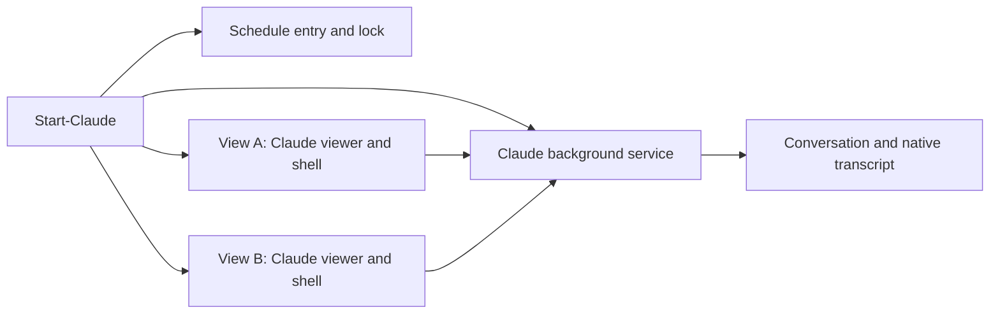

# Claude session lifecycle

[Up: Agent schedules](index.md)

Start-Claude runs the conversation in Claude's background service. Each attached invocation opens a new tmux view: a Claude viewer on the left and a shell on the right. The conversation survives the end of that view.

## 1. Identity and ownership

| Resource | Owner | Identity and lifetime |
| --- | --- | --- |
| Schedule and ordered work | GitHub | Repository-qualified Schedule issue and its project's Step rows |
| Local schedule binding | Launcher | One entry and lock per schedule; stores the background-session short ID |
| Background session | Claude | Native short ID retained across a conversation clear |
| Conversation and transcript | Claude | Native conversation UUID; a clear creates a new conversation UUID |
| Terminal view | Launcher and tmux | New tmux session for each attached start; never stored as the schedule binding |

Each Schedule binds to at most one conversation, and each bound conversation belongs to at most one Schedule. Refuse a conflicting association with status 73 rather than replace it.

A background-session ID and a conversation UUID are different identifiers. The launcher discovers their relationship through `claude agents --json --all`; it does not infer it from terminal text.

Every attached start creates a fresh tmux session. The launcher first accepts a tmux-generated name, then renames the session to `<repository>#<number> $<tmux-id>`. A view with no schedule uses its ID for its name. Names contain neither `/` nor `|`, so the same convention works with psmux.

## 2. Components

The launcher stores the native background-session short ID at `${XDG_STATE_HOME:-~/.local/state}/agent-schedule/<owner>/<repository>/<number>`. A neighboring lock serializes access to that binding. It stores no tmux ID and requires no startup synchronization hook.

Claude owns trust validation. The launcher does not read Claude's private trust files. If Claude refuses an untrusted directory, the launcher passes through its explanation, exits with 69, and opens no terminal view.

## 3. Start and resume

1. Resolve the schedule, startup directory and binding under the schedule's lock.
2. Refuse a launch with no terminal unless `--detach` is set. On macOS, require the login keychain to be available; explain an unlock failure.
3. Query `claude agents --json --all` to establish the native session state.
4. Reuse, wake or create the background session according to the table below. Save its short ID before presenting it as the schedule's session.
5. With `--detach`, return the short ID without opening tmux.
6. Otherwise create the two-pane view and attach or switch the terminal client to it. Return its short ID when that client leaves.

| Discovered state | Action |
| --- | --- |
| Recorded background session is running | Attach to it; do not pass its conversation ID to `claude --bg --resume`, which can create a copy |
| Recorded background session is stopped | Attach to wake the same session; with `--detach`, wake its conversation through `claude --bg --resume <id>` with no additional flags |
| Requested conversation runs in the foreground | Refuse with 75 |
| Requested conversation is inactive | Start it with `claude --bg --resume <id>` and store the returned background-session ID |
| No binding or requested conversation exists | Start a new background conversation in the selected directory and store its returned ID |
| Native listing fails or cannot be read | Report the failure; do not infer that the session is absent |

A stopped-session wake receives no launch flags, including `--name`: those flags can create a copy. Restore its name through `/rename` as the wake's first prompt. New conversations receive launch arguments and Remote Control unless `--no-remote-control` is selected. A successful detached launch exits with 0; native start failures exit with 69 and open no view.

Pass `NFEP_AGENT_SCHEDULE` and `NFEP_AGENT_SCHEDULE_URL` through the native launch settings' `env` block, and also to the companion shell. Do not depend on the background service inheriting the launcher's process environment. The assignment skill reads the key from `NFEP_AGENT_SCHEDULE`, using the native session name only when it is unset. It uses `NFEP_AGENT_SCHEDULE_URL` when present and otherwise derives the URL from the key.

## 4. Names and viewer input

The background-session name is `<owner>/<repository>#<number> | <host> | <repository> | <branch> | <title>`, also used by Remote Control. Restore a stopped session's name through its first prompt; rename a running session through a viewer. Close a launcher-owned temporary viewer after native discovery confirms the name.

Send `/rename` text and its Enter separately. Wait until the command appears on the viewer's input line, wait one further second, then send Enter. If the input line still holds the command, repeat Enter up to three times in total. The confirmation is the native session listing, not a successful send operation.

On Windows, a running session is renamed through a viewer with an attached console. `NFEP_AGENT_SCHEDULE_DETACHED_RENAME` enables the separate detached-rename path; its behavior requires qualification against the installed native host.

## 5. End a view or connection

The launcher sets `destroy-unattached` on each tmux view. When its last client leaves, tmux ends the view and its shell. The next start creates another view of the same conversation.

| Event | Effect |
| --- | --- |
| Leave the Claude viewer with Escape or Ctrl+Z | End that viewer and its tmux view; keep the background session |
| Detach the last tmux client | End that tmux view and its shell |
| Lose a transport connection | End the view when its tmux client actually exits; the transport may delay that exit |
| Run native `claude stop <id>` | Stop the background session rather than merely close a view |

In this attachment model, `/exit` in a viewer is not the session-stop operation. View closure and explicit native stop have different consequences.

### 5.1 SSH and mosh

The terminal connection owns a tmux client, not the Claude background process. The tmux server and Claude background service have independent process lifetimes.

An SSH disconnection ends the client when sshd closes its terminal. A silent network loss may take longer to detect. A mosh client that disappears can leave mosh-server and its tmux client waiting; exiting mosh-server ends that connection. `MOSH_SERVER_NETWORK_TMOUT` is a user-controlled setting, not a timeout selected by Start-Claude.

A lost device connection therefore does not prove that its view has ended. Neither connection loss nor the absence of a viewer proves that the background conversation has stopped.

### 5.2 Foreground conversations

To preserve an existing foreground conversation, exit it and resume its ID into the background. Native `/bg` can assign a different identity while leaving the stored reference unchanged; a later launch could then resume a second copy. The launcher refuses an active foreground conversation instead of making that choice for the user.

## 6. Deployment

On macOS and Linux, set `destroy-unattached` after the first client attaches; setting it on an unattached new tmux session would destroy the session before use. Inside tmux, switch the current client to the new view rather than nest an attachment. An old view created by this launcher ends when switching leaves it without clients.

On Windows, Start-Claude.ps1 uses psmux through its `tmux` alias. Qualify pane targets with their session, such as `$35:0.1`. End the tmux session from the viewer's own command because this psmux path does not provide the required `pane-died` behavior. Set `destroy-unattached` before attachment because psmux does not run a chained command after `attach-session`. With no console and no `-Detach`, refuse the launch.

The [sandbox proposal](3-agent-sandbox.md) defines a guest execution boundary for Claude and each shell. Its unresolved storage and credential choices are distinct from the standalone lifecycle described here.

## 7. Quality and risks

The important guarantees are conversation reuse, serialized binding access, independent views, explicit trust failures and visible foreground conflicts. Qualification must exercise attach and detached paths, stopped-session wake, two concurrent views, connection loss, name restoration and each supported platform.

Native host versions can change the meaning of resume flags, viewer input and attachment. A stored ID alone does not establish that resumption is safe. Preserve native discovery errors and report uncertain state rather than treating an unreadable listing as absence.

## 8. Decisions and delivery references

The [decision record](1-session-model.decisions.md) explains persistent native sessions, ephemeral views and native discovery. The [delivery references](1-session-model.status.md) identify implementation and verification records. The [pre-rewrite source](../../engineering/review/sources/rewrite-2026-11-19/1-session-model.md.txt) preserves the original requirements and observations.| Native observation | Launcher behavior |
| --- | --- |
| Recorded background session is running | Attach to it; never pass its conversation ID to `claude --bg --resume`, which can create a copy |
| Recorded background session is stopped | Attach to wake the same background session; with `--detach`, wake its conversation through `claude --bg --resume <id>` without additional flags |
| Selected conversation runs in the foreground | Refuse with 75 |
| Selected conversation is inactive | Start it with `claude --bg --resume <id>` and store the returned background-session ID |
| No binding exists for a first Schedule launch | Start a new background conversation in the selected directory and store the ID that Claude returns |
| Native listing cannot be read | Report the failure; do not infer absence |

A stopped-session wake receives no extra flags, including `--name`: those flags can create a copy. Restore its display name through `/rename` as the wake's first prompt.

A stopped-session wake receives no launch flags, including `--name`: those flags can create a copy. Restore its display name through `/rename` as the wake's first prompt. A new conversation receives Remote Control unless `--no-remote-control` is selected. A successful detached launch exits with 0; native start failures exit with 69 and open no view.
