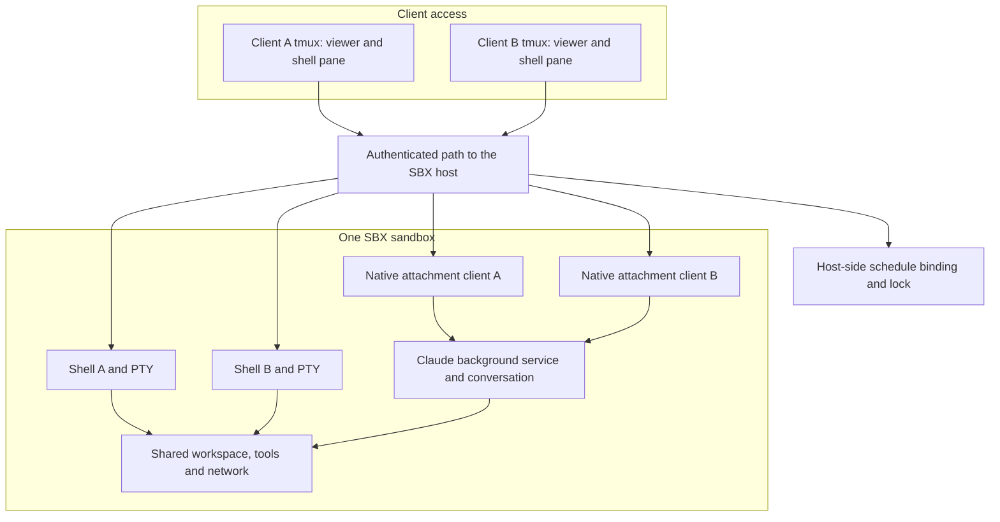

<a id="3-shared-claude-session-with-private-terminals-in-docker-sbx"></a>

# Claude sessions in an SBX sandbox

[Up: Agent schedules](index.md)

This deployment proposal places a shared Claude background session and each client's shell inside one SBX sandbox. Each client has a separate terminal view of the same conversation. Attaching another client must create neither another sandbox nor another Claude conversation.

<a id="purpose"></a>
<a id="design-decisions"></a>

## 1. Scope and constraints

The proposal applies the [standalone session model](1-session-model.md) to an SBX environment. Client tmux layouts stay outside the sandbox; no guest tmux server is required. SBX supplies the execution and PTY transport, while Claude supplies its native session and attachment protocol.

The [agentic developer workstation](../agentic-developer-workstation.md) defines the broader five-role environment, editor access and durable Schedule workspace. This proposal does not substitute its single-session topology for that workstation architecture.

<a id="architecture"></a>

## 2. Components and placement



Arrows show connections, not process ancestry. An off-box client uses the remote-access path to the SBX host. A guest Unix socket is not a directly usable remote address.

<a id="session-identity-and-lookup"></a>

## 3. Binding and native discovery

The host-side record associates the schedule or logical session with the sandbox ID, guest user and home, native background-session identity and workspace directory. Its lock coordinates first creation and later attachment. Adding sandbox metadata requires a structured, versioned record.

Discovery and attachment run inside the guest as the intended user. The preferred integration invokes native `claude attach <id>` there, allowing Claude to resolve its own socket. The alternative of reading private session files requires a separate decision; no private directory or socket format is part of the launcher contract.

Rediscover native runtime state when attaching after a restart. A cached socket path is not evidence that a session is ready. The [decision companion](3-agent-sandbox.decisions.md) records the discovery choice as proposed.

<a id="startup-and-attachment-flow"></a>
<a id="start-the-background-session"></a>

## 4. Startup and attachment

1. Resolve the host-side binding and serialize creation for that logical session.
2. Ensure its sandbox is running under the recorded identity.
3. Start or resume the native background session inside the guest.
4. Confirm native readiness and persist the binding.
5. Release creation coordination and make the session available for attachment.

The native background machinery owns the conversation lifetime. Backgrounding a host-side SBX invocation alone does not establish independence from the launching terminal.

<a id="attach-a-client"></a>

For each attached client, resolve the recorded sandbox and native session, open its client tmux layout, attach a native viewer through SBX, and start a separate interactive guest shell with a PTY in the recorded workspace. Repeated clients address the same native session. Native simultaneous-input rules apply; another viewer must never be serviced by another conversation.

Exact SBX launch and PTY commands depend on the installed version and require qualification. The following shapes describe responsibilities rather than executable syntax.

```text
Viewer pane: SBX_EXEC(sandbox, native_attach(background_session_id))
Shell pane:  SBX_EXEC_WITH_PTY(sandbox, shell, cwd=workspace)
```

<a id="shared-and-private-state"></a>

## 5. Shared state and isolation

| Shared by all clients | Separate for each client |
| --- | --- |
| Conversation, native service and workspace | Viewer connection and client tmux layout |
| Filesystem, tools, network and sandbox Docker daemon | Shell process and PTY |
| Files and shell history unless configured otherwise | Shell-local variables and working directory |

A separate shell is not a security boundary. Clients can change shared resources. If independent shell history is required, configure distinct history files or disable its persistence.

<a id="what-the-draft-does-not-capture-configuration-and-worktrees"></a>

### 5.1 Configuration and work storage

Separate configuration by responsibility: source-controlled resources deployed with writ, machine-specific settings such as trust, and ephemeral runtime state. Claude's native directories mix those classes, so the guest layout must map them deliberately. Transcript durability must be specified separately from disposable runtime files.

Canonical clones are protected from development writes. Editing occurs in secondary work locations. A read-only mount of a canonical clone cannot also accept the Git metadata writes made by ordinary linked worktrees; the writable Git storage arrangement remains a design choice.

Sandbox teardown must preserve unpushed work or refuse removal. The storage choice must state which work survives sandbox replacement. The workstation's durable workspace requirements apply when this launcher is integrated into that environment.

<a id="lifecycle-and-failure-behavior"></a>

## 6. Lifecycle and recovery

| Event | Required result or unresolved boundary |
| --- | --- |
| Another client attaches | Reuse the native conversation; create its separate shell |
| Client closes its terminal pane | End that shell according to PTY behavior; preserve other clients and Claude |
| Transport disappears | Preserve the shared native session; shell survival depends on its tmux and execution connection |
| Native session restarts | Re-establish readiness and attach through native discovery |
| Sandbox stops | Guest processes stop; restoration depends on the recorded session and durable storage |
| Sandbox is removed | Remove only state classified as disposable; preserve required work |

The sandbox draft's persistent-detach behavior differs from the standalone launcher's `destroy-unattached` view policy. That choice remains open; do not promise that a private shell survives detachment until the selected policy is qualified. A separate persistent PTY service would be additional scope.

Trust and credentials must work inside the guest. A Linux guest cannot rely on the host's macOS login keychain. The design must specify credential delivery, Remote Control access and workspace trust before unattended startup can be promised.

<a id="validation-before-rollout"></a>

## 7. Quality scenarios

| Scenario | Evidence required |
| --- | --- |
| Two clients attach | Both view one native conversation and have distinct shell processes and working directories |
| A client writes a file | The other shell and Claude see the shared file |
| One client disconnects | Claude and the other client's shell remain usable |
| On-box and off-box attachment | Both paths reach the intended sandbox and native identity |
| Concurrent first starts | One sandbox binding and one native conversation result |
| Native restart | Attachment discovers the restored native endpoint |
| Interactive terminal use | Resize, input, output and PTY commands work through SBX |
| Sandbox teardown | Required work remains recoverable |

<a id="implementation-details-to-verify"></a>
<a id="open"></a>

## 8. Risks and open choices

Qualification must establish the exact SBX transport, native multi-client behavior, guest execution identity, readiness checks and background-process survival. Configuration partitioning, transcript durability, credential delivery, writable Git storage and terminal-detach policy remain unresolved. Preserve discovery failures as failures rather than treat them as proof that a new conversation is needed.

<a id="minimal-implementation-changes"></a>
<a id="where-it-fits"></a>

## 9. Decisions and delivery references

The [decision companion](3-agent-sandbox.decisions.md) identifies proposed choices and alternatives. The [delivery references](3-agent-sandbox.status.md) retain the owning issue, original draft and rollout work. Implementation steps belong in that work's plan.
