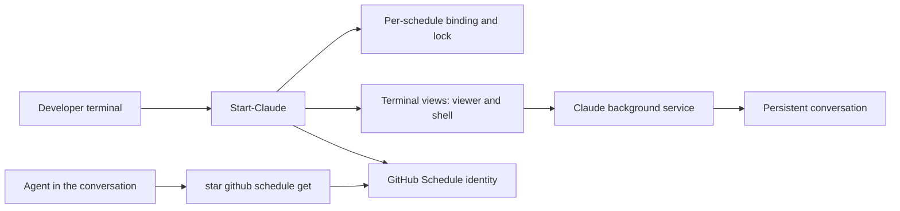

# Agent schedules

An agent schedule binds a GitHub Schedule to a persistent agent conversation. A developer can open several terminal views of that conversation, leave them, and return without starting another conversation.

## 1. Purpose and scope

The Schedule issue defines the intended result and completion criteria. Its team's Schedules project owns the ordered Step rows. Read those rows with `star github schedule get <owner>/<repository>#<number>`; a local launcher does not keep a second work list.

This architecture covers the standalone Claude launcher, a proposed assignment command interface, and a proposed SBX deployment of that launcher. The [agentic developer workstation](../agentic-developer-workstation.md) defines the broader environment with five role sessions and editor-based access.

| Part | Responsibility | Design |
| --- | --- | --- |
| Session model | Separate conversation lifetime from terminal views | [Session lifecycle](1-session-model.md) |
| Launcher | Resolve a schedule or conversation and open a view | [Command interface](2-command-line.md) |
| Assignment commands | Manage and inspect durable assignments across agent hosts | [Assignment interface proposal](2.1-agent-schedule-commands.md) |
| Sandbox deployment | Run the shared Claude session and client shells in SBX | [Sandbox proposal](3-agent-sandbox.md) |

The two proposals describe intended interfaces and unresolved choices. They do not establish that those interfaces have been delivered. [Delivery records](1-session-model.status.md) link the implementation plans and preserved evidence.

## 2. Goals and constraints

Opening another view must reuse the intended conversation. Losing a terminal must not stop that conversation. Concurrent starts for one schedule must not create competing bindings.

The standalone launcher supports Unix terminals and Windows psmux. It uses Claude's public background-session and attachment interfaces. Claude owns its conversation storage and trust checks; the launcher owns the schedule binding and terminal layout.

The assignment and sandbox proposals must preserve those boundaries. They must also distinguish a missing view, a stopped process, an unavailable runtime and a lost conversation. None of those states proves that scheduled work is complete.

## 3. Context and components

The diagram shows responsibilities and connections, not process ancestry. Claude's background service owns the conversation process. Each launcher invocation owns a separate terminal view. GitHub remains authoritative for the work and its progress.

## 4. Runtime and deployment

A start resolves the schedule and acquires its binding lock. It discovers the native session, reuses or resumes it, records the background-session ID, then opens a viewer and companion shell unless attachment was disabled. [Session lifecycle](1-session-model.md) defines the refusal and reconnection paths.

On macOS and Linux, the launcher and tmux run on the machine receiving the terminal connection. On Windows, PowerShell and psmux provide the equivalent interface. The [sandbox proposal](3-agent-sandbox.md) places Claude and the shells inside SBX while retaining client terminal layouts outside it.

## 5. Shared concepts

| Term | Meaning |
| --- | --- |
| Schedule key | Repository-qualified GitHub issue reference, such as `owner/repository#916` |
| Background session | Native Claude service entry identified by its short ID |
| Conversation | Native conversation and transcript identity; its UUID differs from the background-session ID |
| Binding | Local association between a schedule key and a background session |
| View | A terminal client attached to the background session, with a companion shell |
| Assignment | Proposed durable record connecting a schedule, execution location and configured agent |

The standalone binding lives at `${XDG_STATE_HOME:-~/.local/state}/agent-schedule/<owner>/<repository>/<number>`. The assignment proposal specifies a separate structured store; its adoption requires an explicit storage decision. Neither store replaces native transcripts or GitHub progress.

## 6. Decisions, quality and risks

Significant choices and unresolved alternatives are in the [session](1-session-model.decisions.md), [command](2-command-line.decisions.md), [assignment](2.1-agent-schedule-commands.decisions.md) and [sandbox](3-agent-sandbox.decisions.md) decision records.

| Situation | Required result |
| --- | --- |
| Two starts target the same bound schedule | Both reach the same native session |
| One viewer closes | The conversation and other viewers remain available |
| A stored conversation is running in the foreground | The launcher refuses a competing background start |
| An assignment cannot be resumed | The proposed interface reports failure without creating a replacement |
| GitHub is unavailable during assignment inspection | Local state remains useful; progress is explicitly unavailable |
| Two sandbox clients connect | They share one conversation and have separate shell processes |

Native CLI behavior, psmux differences, uncertain connection loss and sandbox credential provisioning require version-specific qualification. A source record of an earlier test does not establish support on another installed version.

## 7. References

The chapter decision companions explain significant choices. [Delivery records](1-session-model.status.md) link the implementation plans and source evidence. The [rewrite review](../../engineering/review/rewrite-review.md) maps requirements and documentation coverage.
