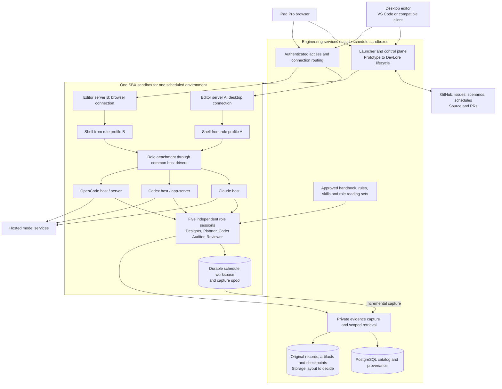
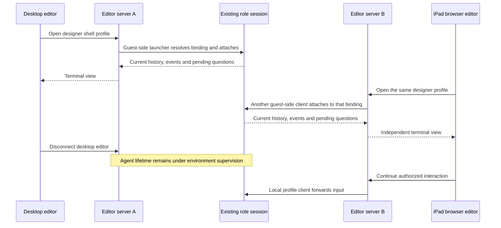

# Agentic Developer Workstation

Build a human-directed development environment in which five specialist agents work through
Claude, Codex, and OpenCode inside an SBX sandbox. The developer connects through desktop VS Code,
another compatible editor, or an iPad browser editor, opens role views from shell profiles,
and continues the same work across
devices, PRs, interruptions, and compactions.

| Document control | Value |
| --- | --- |
| Revision | 0.5 — disaster recovery and owner-approved session succession |
| Owner | NobleFactor Engineering Productivity |
| Design work | [Workstation architecture and delivery plan (#521)](https://github.com/NobleFactor/noblefactor-engprod/issues/521) |
| Plan | [Approved documentation plan](../plans/doc/521-workstation-design.md) |
| Delivery | [Roadmap and planner handoff](../roadmaps/agentic-developer-workstation.md) |
| Status | Proposed system architecture; the documentation plan is approved, while this revised design awaits owner review |
| Initial deployment | Hosted models, existing hardware, and SBX; no initial model hosting or hardware purchase |

## 1. Problem

Engineering work currently depends too heavily on the terminal and conversation in front of
the developer. An agent may have useful context, unfinished investigations, pending questions,
and unintegrated changes when the developer needs to leave the machine. Opening another
interface does not necessarily attach to that running agent. Device changes can become
session replacement, duplicated work, or a manual reconstruction of context.

The work itself outlives an individual branch. A schedule grows or shrinks through the owner's
amendments as design, planning, coding, and testing expose new information. The team works one
or more steps at a time and commits and merges frequently. Resetting all agents or replacing
the environment at every merge would discard useful continuity.

Conversation summaries also lose evidence: why an approach was rejected, which revision a
test exercised, what was uncertain, and whether a claimed success had supporting output.
Compaction makes that loss more likely. The [Engineering evidence archive (#490)](https://github.com/NobleFactor/noblefactor-engprod/issues/490)
addresses access to original evidence during ordinary reasoning and before compaction.

Finally, a working collection of tools does not by itself establish a development methodology.
We need to walk realistic scenarios, observe where the process and its tools fail, and turn
accepted findings into reviewed procedures, rules, skills, and implementation work. Design
begins before those implementation schedules exist.

## 2. Goals and scope

| ID | Goal | Observable result |
| --- | --- | --- |
| R1 | Preserve human direction | Assignments, approvals, amendments, and consequential actions retain their authority and provenance |
| R2 | Keep continuity at schedule scope | Short PR cycles preserve the environment, role identities, unfinished work, and useful sessions |
| R3 | Support five roles and all three hosts | Designer, planner, coder, auditor, and reviewer have independent contexts; Claude, Codex, and OpenCode run inside SBX |
| R4 | Support remote multi-device work | Compatible desktop and iPad editors launch shell profiles inside SBX to view the same running roles |
| R5 | Make evidence useful while working | Scoped retrieval returns originals, exact citations, context, and explicit gaps |
| R6 | Load current governing instructions | Each role loads its approved, measured reading set at startup and after compaction |
| R7 | Deliver accepted engineering changes | Early compliance feedback, exact-snapshot checks, independent closing review, and owner sign-off support correct changes |
| R8 | Converge on DevLore lifecycle management | DevLore ultimately manages the environments and services without losing their durable identities |
| R9 | Start with available resources | Hosted models run through the existing accounts/access; the initial system uses the available machines |
| R10 | Establish the methodology | Reviewed scenario evidence produces documented procedures and supporting tools that the team can actually use |

The initial hardware available is a Mac mini and a Minisforum system. Use of the Minisforum
shares capacity with centralized logging. Its logging-system design is outside this work.
Placement, resource reservations, and supported software versions require qualification.

[Local inference and capacity qualification (#515)](https://github.com/NobleFactor/noblefactor-engprod/issues/515)
remains a separate future track. Model serving, GPU sizing, procurement comparisons, and new
hardware are not prerequisites or completion gates for this hosted-model roadmap.

This design integrates [Agent-assisted engineering (#456)](https://github.com/NobleFactor/noblefactor-engprod/issues/456),
the evidence archive, and [Engineering handbook, agent rules and skills (#526)](https://github.com/NobleFactor/noblefactor-engprod/issues/526).
It does not independently redefine their policies or replace GitHub as the planning authority.

## 3. Our solution

A committed schedule has one logical development environment and one SBX sandbox. All five
role sessions and the editor servers used to view them run inside that sandbox. PR worktrees,
assignments, terminal views, and device connections have shorter lifetimes. A replacement
sandbox can restore the same logical environment; it must not create a competing writable copy.

Shared engineering services live outside schedule sandboxes: the control plane, access
entry point, approved policy distribution, and private evidence archive. They remain available
when a schedule sandbox stops. The control plane prototypes existing host/sandbox contracts
first and ultimately relies on DevLore for lifecycle management.

The developer chooses a schedule and opens whichever roles are useful. Multiple editor-server
instances inside its sandbox provide independent desktop and browser connections. The editor
starts a shell/terminal profile inside SBX; that profile invokes the common role-view launcher,
which attaches to the role's existing session through the host-driver model. Closing a view
releases its attachment, while authorized agent work can continue.

The developer-facing path is editor connection, shell profile, role-view launcher, and native
session. Developer devices do not connect directly to the role hosts. VS Code is the initial
editor; another editor participates through a compatible environment connection and the
ability to start the same guest-side shell profiles.

Before a schedule exists, the designer works from the existing epic/feature and versioned
design assets. The design and roadmap are handed to the planner, who proposes issues,
dependencies, and one or more schedules. Section 7 identifies the remaining decision about
representing and transitioning a pre-schedule runtime environment.

## 4. Development workflow

### 4.1 Persistent specialists

| Role | Work it leads | Authority boundary |
| --- | --- | --- |
| Designer | Problem, goals, architecture, interfaces, workflow, and roadmap | Proposes design; edits authorized design assets |
| Planner | Issue decomposition, dependencies, proposed schedules, and amendments | Proposes commitments; applies only authorized tracker changes |
| Coder | Implementation, debugging, tests, and correction of findings | Writes the assigned workspace within current authorization |
| Compliance auditor | Standards checks, early findings, and final compliance evidence | Reads identified source/policy and records findings; does not rewrite the implementation it audits |
| Reviewer | Correctness, regression risk, design fit, and verification | Reviews identified inputs independently and participates in closing review |

These are separate persistent contexts, not a mandatory sequence of disposable agents.
A designer can revisit an interface during coding, and a planner can reassess dependencies
after a test exposes work. Roles and review independence remain owned by
[Roles (#460)](https://github.com/NobleFactor/noblefactor-engprod/issues/460) and
[Agent-assisted engineering (#456)](https://github.com/NobleFactor/noblefactor-engprod/issues/456).
Select hosts/model families to meet the independent-review contract, not merely different role names.

### 4.2 Begin with design before scheduling

The developer brings a problem to the designer. The designer reads current requirements,
existing work, and relevant evidence, then produces a proposed architecture, workflow,
roadmap, scenarios, and bounded open decisions. An existing epic/feature identifies the work;
a committed execution schedule is not required to formulate these assets.

The owner reviews the design. The handoff identifies accepted requirements, proposals still
open, interface owners, dependencies, acceptance demonstrations, and the first useful increment.
The roadmap is not a schedule commitment.

### 4.3 Move from designer to planner

The planner turns the reviewed assets into Tasks/Bugs under their owning Features, preserves
dependencies across those owners, and proposes one or more bounded schedules. Each issue
receives its plan before its work begins, according to the
[development process](../guides/development-process.md#plans).

A scenario describes the experience to exercise. A schedule orders the issues that advance
or walk it. [Portable tooling (#152)](https://github.com/NobleFactor/noblefactor-engprod/issues/152)
is the concrete example: a developer moves between machines while the work spans several
feature owners and dependency gates. Its [project-membership record](https://github.com/NobleFactor/noblefactor-engprod/issues/152#issuecomment-6661940131)
shows discovered work moving to Triage or schedules while its provenance is retained.
The older Thread-label language in the scenario body is historical.

The proposed first schedule walks selected scenarios and records the gaps in both tooling
and method. Its steps are walkthrough Tasks/Bugs linked to the persistent Scenario records,
rather than Scenario issues placed into step positions. The
[issue standard](../issue-standards.md#scenarios) supplies classification and movement rules.
The [Scenarios project](https://github.com/orgs/NobleFactor/projects/27/views/2) is the team's
working collection; the proposed scenarios in the roadmap are not claims about its live rows.

### 4.4 Start and work a scheduled environment

After the owner accepts a schedule, the developer selects it in the launcher. The control
plane resolves its stable environment, starts or resumes the associated SBX sandbox, and
resolves each role's native host/session binding. Concurrent connections must discover that
same binding instead of starting duplicate agents.

Before its first tool call, each role loads the governing common and role-specific reading
set and the assignment's source, plan, permissions, and checkpoint. Shorter reading sets
are introduced through reviewed [agent entry points (#528)](https://github.com/NobleFactor/noblefactor-engprod/issues/528),
not by silently dropping current required reading. The incident record is evidence, not a
compulsory startup document.

The developer selects designer and coder shell profiles in the connected editor, opens their
role views, inspects source and diffs, and gives bounded
assignments. The coder implements and tests; the designer resolves questions; the planner
proposes amendments when work changes. The auditor reviews coherent edit batches and tracks
findings through correction and recheck. Pending approvals remain visible when the developer
is away; disconnection grants no additional authority.

The current engineering process still governs Git operations, plans, PRs, and periods when
repository writes are prohibited. An editor connection or passing check cannot confer approval.

### 4.5 Leave the desktop and continue from an iPad

The developer leaves desktop VS Code with two roles visible. Their editor connection may
remain open or disconnect. The sandbox and role sessions remain available under supervision.

On the iPad, the developer authenticates to the launcher, selects the same environment,
and opens a browser editor connection backed by another editor-server instance in that
sandbox. Selecting the same designer or coder profile starts a guest-side attachment client
for the existing role session. The iPad connects to its editor backend; the attachment client
connects to the agent host from inside SBX. Each device can have its own layout, terminal
dimensions, and shell.

The new views show current conversation/progress, pending questions, and the assigned source
state. They do not fork conversations merely because another device is attached. Multiple
views are a requirement; input ordering, duplicate submission handling, and approval routing
are host-driver contracts to qualify, not an assumed single-controller policy.

### 4.6 Compact, recover, and continue

During normal work, a role searches relevant prior evidence and follows citations to originals.
Before a supported compaction, capture outstanding evidence, consult earlier sources, and
review a durable checkpoint while the role still has useful context. Preserve decisions and
rationale, rejected alternatives, uncertainty, verification references, pending operations,
unfinished work, and next action. After compaction, reload the current reading set and
continue with the same session identity.

Routine disconnection, sleep, process restart, and repairable resume failures recover the
original session. Reconcile interrupted operations before repeating them. Closing a viewing
laptop disconnects that device; an environment on another machine can continue authorized
work. Sleep of the machine running SBX suspends local execution when that machine actually
sleeps; it does not establish a durable application checkpoint. A failed resume alone does
not establish that the conversation is lost.

Disaster recovery addresses loss of native session state, including accidental deletion,
corruption, or destruction of its storage. Attempt to restore the original session from
retained state and available backups. When restoration is exhausted, present the evidence,
proposed successor, and known gaps for the owner's explicit approval. Establish the successor
as the role's sole authoritative session before it can act, then load current role reading,
inspect the worktree, and reconstruct context from the plan, checkpoints, and archived
originals. Preserve the original identity, approval, and succession record. The roadmap's
S8 scenario walks this transition; section 5.6 defines its recovery contract.

[Checkpoint integration (#494)](https://github.com/NobleFactor/noblefactor-engprod/issues/494)
owns the record; host drivers own provider operations; continuity integration coordinates
their boundary. Automatic compaction and crashes may bypass a cooperative hook, so continuous
capture and explicit gaps remain necessary. Native-state restoration and evidence-based
reconstruction are distinct recovery paths; reconstruction cannot promise complete context.

### 4.7 Merge increments and finish the work

A tested increment goes through the current approval and PR process. Final compliance evidence
must identify the exact candidate snapshot; a later source, policy, dependency, or check-environment
change can invalidate it. Frequent merges update the schedule's current state without resetting
useful roles or deleting its environment.

A Feature closes through the independent audit/review and owner's sign-off owned by
[closing review (#457)](https://github.com/NobleFactor/noblefactor-engprod/issues/457).
Passing an early audit, commit gate, or CI is not that closing review.

When the schedule satisfies its exit criteria, reconcile unfinished work and pending operations,
preserve its work products and evidence, and release runtime resources through the lifecycle
manager. Schedule completion, feature closure, sandbox shutdown, and evidence retention remain
distinct decisions.

## 5. System architecture

### 5.1 Components and placement

This diagram describes logical responsibilities. The shared services may initially be
colocated with the SBX host; their separation does not require another machine.

A role binds to one native session on a selected host. The five contexts can be distributed
across the three host implementations. The diagram does not require fifteen agents or
prescribe one daemon process per session.

### 5.2 Identity, authority, and lifetime

| Object | Owner and lifetime |
| --- | --- |
| Design context | Existing epic/feature and versioned assets before schedule commitment; runtime representation remains open |
| Schedule | GitHub's durable commitment and execution order |
| Development environment | Stable schedule-scoped identity; one active SBX binding, recoverable across replacement |
| Role/agent | Logical specialist identity within the environment |
| Native session | Host-owned conversation/execution context; preserve its identity through routine recovery; owner-approved successor after disaster recovery exhausts restoration |
| Assignment | Bounded objective, issue/step, source, permissions, and recorded outcome |
| PR worktree | One increment's source scope; its process lifetime is shorter than the schedule's |
| Editor instance | Connection service inside SBX, with independently configured endpoints and runtime state |
| Shell/terminal profile | Editor launch configuration selecting a logical role and the common guest-side role-view entry point |
| View | Per-client attachment and presentation; may be released and recreated |
| Evidence/checkpoint | Durable, scoped record independent of device, session process, and sandbox lifetime |

GitHub holds planning authority. The control plane stores runtime bindings, operation intent,
observed outcomes, and reconciliation state. It does not become another backlog or schedule.
Persist operation identity before consequential actions; an unknown remote-write outcome
requires readback rather than blind repetition.

Each environment/role has at most one authoritative native session at a time. Persist the
original/successor relationship when disaster recovery requires replacement. A stopped,
unreachable, or missing session remains a recovery case; opening a profile must not silently
allocate a replacement conversation or erase the existing binding.

### 5.3 Common host-driver contract

[Agent hosts (#459)](https://github.com/NobleFactor/noblefactor-engprod/issues/459)
owns the Claude/Codex/OpenCode driver model, rooted in the existing OpenCode work. Extend
that contract rather than implement another adapter inside the launcher.

The native attachment clients run inside SBX, launched from editor shell profiles. Their
host protocols are internal integration paths, not endpoints developer devices must reach.
Control-plane automation uses the existing SBX/driver management boundary independently
of the human's editor connection.

Every driver reports support and failure behavior for start/discover, attach/detach,
history/events, submit/interrupt, approvals, policy loading, checkpoint/compaction, resume,
and replacement. Unsupported operations are explicit. A native background process is
independent of viewer connections only after that exact configuration has been tested.

Drivers distinguish temporary unavailability, repairable resume failures, and evidence that
native-state restoration is exhausted. A timeout or unavailable dependency cannot by itself
authorize replacement. Qualify restoration and approved succession independently for each host.

| Host | Documented foundation | Qualification required in SBX |
| --- | --- | --- |
| Claude | [Remote Control](https://code.claude.com/docs/en/remote-control) synchronizes a locally running session across connected devices; the owner also reports multiple native views | Native attachment, concurrent views, approval visibility, disconnection, and recovery on the pinned release |
| Codex | [App-server](https://learn.chatgpt.com/docs/app-server) separates the backend from clients, provides remote TUI connections and thread-event subscriptions | Multiple native TUIs on one live thread, approval routing, retained execution with no human views, and failure recovery |
| OpenCode | [CLI background service](https://opencode.ai/docs/cli/) separates clients from a server that owns sessions and tool execution | Role configuration, simultaneous clients of one session, capture/compaction, and recovery on the pinned release |

Codex's documented idle unload after the last subscriber requires an explicit continuity
strategy, such as a retained driver subscription. That is a proposed integration, not a
qualified guarantee. Do not infer unlimited simultaneous native TUI support from protocol
subscriptions alone.

Pin each host, model/provider configuration, instruction set, and tool/check environment.
Existing subscriptions and metered access remain subject to their actual authorization;
quota exhaustion must not silently select a new billable fallback.

### 5.4 Editor instances and attachment views

The editor service owns connection handling, terminal processes, and host attachment clients.
The native host owns the role session. A browser/terminal view is not the role's lifetime owner.

Profiles for designer, planner, coder, auditor, and reviewer invoke a common role-view entry
point in the sandbox. A profile identifies the logical role and guest workspace; the launcher
resolves the environment's current authoritative host/session binding and starts the local
attachment client. Opening another profile view does not allocate a new agent. Session
creation and replacement remain lifecycle operations, separate from viewing.

Each editor uses its own profile configuration format and a compatible connection backend.
The role-view entry point and binding contract remain editor-independent. Profiles reference
the role and launcher rather than embedding mutable session IDs or credentials in device
configuration. Each launch gets its own terminal process and presentation.

This is the target contract to qualify for each host. A new logical editor connection can
receive an independent editor instance; a transient network reconnect should resolve its
existing instance/binding rather than repeatedly allocate servers.

Microsoft's [Remote Tunnels documentation](https://code.visualstudio.com/docs/remote/tunnels/#can-multiple-users-or-clients-access-the-same-remote-instance-simultaneously)
limits an instance to one user/client at a time. The proposed topology supports independent
instances in the same sandbox. [Coder code-server](https://coder.com/docs/code-server/ipad)
is another browser-editor candidate, with [different extension availability](https://coder.com/docs/code-server/FAQ).
Product/backend selection, profile configuration, concurrent instances, distinct server
state, transport, and iPad behavior must be demonstrated before declaring the topology qualified.

Run the endpoint near the workspace. Authenticate and route connections through the approved
access path. Publish the editor connection endpoints; keep native agent-host listeners on
guest-local interfaces or protected Unix sockets, without publishing them to developer devices.
Profiles inherit only their authorized guest context and credential references. Qualify
keyboard shortcuts, interruption, clipboard, focus, resizing, browser
suspension, and reconnection on the actual iPad. Client-local layout need not be mirrored.

### 5.5 Shared evidence archive and policy

The [Engineering evidence archive (#490)](https://github.com/NobleFactor/noblefactor-engprod/issues/490)
runs outside schedule sandboxes under a separate service identity and durable storage
boundary. Its API serves authorized people and roles across schedules. PostgreSQL is the
preferred catalog/provenance/full-text platform. Physical placement of large originals
remains the archive's design decision.

A protected permanent spool captures available transcripts, tool-call/results, attachments,
and work artifacts incrementally. Preserve originals, source identity/ranges, hashes,
parser versions, capture watermarks, and explicit gaps before deriving indexes or summaries.
Capture is idempotent; distinguish local durable acknowledgment from backup recoverability.

Retrieval provides scoped search, bounded results, exact-source reads, citation resolution,
and surrounding-context expansion. Authorization applies to snippets, counts, artifacts,
and expanded context. Ordinary readers have read-only access; agents receive neither raw
archive mounts nor unrestricted database credentials. Retention, redaction, deletion,
backup, and index rebuilding remain owned by the archive features.

During disaster recovery, the archive supplies checkpoints and original evidence for rebuilding
a successor's working context. Restoring the original conversation requires usable native
session state; indexed evidence alone does not guarantee that state is recoverable. Retain the recovery
decision, approval, original/successor identities, evidence citations, capture watermarks, and
known gaps. If the needed evidence is unavailable or insufficient, report the limitation
rather than infer a complete history.

[Engineering handbook, agent rules and skills (#526)](https://github.com/NobleFactor/noblefactor-engprod/issues/526)
owns current procedural authority. Its measured role reading sets and host entry points
are consumed by the workstation. Historical evidence explains decisions; extracted claims
become accepted policy only through review. The handbook draft under review is not adopted
merely by being referenced here.

### 5.6 Workspaces, verification, and recovery

Canonical host clones stay protected. Each schedule uses a durable private workspace;
PR worktrees may share metadata within that private clone, not writable metadata with the
canonical clone. Source, drafts, prototypes, research, tests, findings, and checkpoints are
permanent from creation under [SBX requirements (#458)](https://github.com/NobleFactor/noblefactor-engprod/issues/458).
Reproducible caches and disposable runtime scratch are classified separately.

The auditor reads identified immutable input. The reviewer verifies a separate identified
snapshot/working area, with permissions enforcing the required independence. Distinct prompts
inside a shared sandbox are not a filesystem security boundary. All role hosts stay inside
the schedule sandbox; required target-specific test runners can return identified results
from qualified external target environments.

Compliance receipts bind source/base, policy, dependencies, check environment, coverage,
and verdict. Fence mutations while integrating or construct an immutable candidate; verify
that the actual integrated content is the reviewed content. Missing, stale, failed, or
inconclusive evidence blocks the required gate. Explicit overrides retain scope and rationale.

[Docker sandbox persistence](https://docs.docker.com/ai/sandboxes/usage/#what-persists)
depends on storage type and removal behavior. Qualify the chosen mounts/volumes, credential
handling, port access, and export/restore path. A sandbox template is not a complete backup.
Restore compatible workspace, configuration, archive, checkpoint, and binding manifests;
preserve evidence IDs and citations. Cross-compilation does not replace target runtime tests.

| Event | Required behavior |
| --- | --- |
| Client disconnect or editor failure | Release/recover views; preserve role execution within existing authority |
| Viewing laptop sleeps | Reconnect to the same session; an environment on another machine may continue working |
| Machine running SBX sleeps | Recover local execution and original sessions after wake; reconcile interrupted network/tool operations |
| Pending approval while away | Keep the question and exact scope visible; grant no new permission |
| Role process crash or repairable resume failure | Preserve work and binding; repair/restart and resume the original session; reconcile uncertain operations |
| Native session state lost, including accidental deletion | Attempt original-session restoration; require explicit owner approval and fencing before successor reconstruction |
| Compaction | Use supported checkpoint integration and reload current reading; report unsupported paths or gaps |
| Hosted model/network outage | Preserve state and report unavailability; use only authorized access/fallback |
| Archive outage | Use bounded permanent spooling, expose lag/gaps, and block transitions that require unsecured evidence |
| Host reboot or sandbox recreation | Recover durable work and role bindings; do not assume live processes survived |
| Lost GitHub response | Verify the resulting object before retrying a write |
| Disk/resource pressure | Enforce reservations and quotas; preserve work and report the affected capability |

Basic supervision, credentials, capture health, and recovery accompany the first prototype.
The host must remain awake and reachable for live remote work. Restoration has separately
reviewed loss windows and recovery objectives; this draft sets no numerical guarantees.

#### Disaster recovery and session succession

The invariant is one authoritative native session per environment/role at a time. After a
disaster, restoring the original conversation is the first recovery path. A successful
restoration retains its session identity. Diagnose configuration, credentials, connectivity,
storage mounts, and host compatibility before declaring restoration exhausted.

If restoration cannot succeed, retain a recovery record identifying the schedule/environment,
role, original session, incident, attempted remedies, available backups, and evidence coverage.
Present the proposed successor's host/configuration and context gaps for explicit owner
approval. An editor profile or automatic retry cannot grant that approval.

Prevent the old runtime and binding from authorizing further actions before giving the
successor tool or write authority. If this fencing cannot be established, keep replacement
blocked. Serialize the transition and preserve its operation identity so concurrent profile
opens and lost creation responses cannot authorize competing successors. Reconcile an unknown
creation outcome before retrying. A later return of the old session does not restore its authority.

Record the original and successor native IDs, binding revision, owner approval, cutover time,
and evidence used. Reload the approved role reading set, inspect the surviving plan and
worktree, and reconcile pending operations against actual outcomes. Use archive citations and
checkpoints to reconstruct decisions and next actions; report missing context explicitly.
Views attach to the successor through the current binding. Retain the original identity in
the historical record even when its native conversation data is lost.

The roadmap's S8 walkthrough qualifies this contract for Claude, Codex, and OpenCode. It is
a disaster-recovery requirement, including self-inflicted loss, with no claim about incident
frequency or a host's exact error wording. Ordinary suspension and reconnection remain
original-session recovery scenarios.

### 5.7 Initial physical deployment

| Machine | Candidate responsibility | Constraint |
| --- | --- | --- |
| Mac mini | SBX execution and colocated engineering services if the platform qualifies | Measure the combined role, editor, build, and service load |
| Minisforum | Shared engineering services or alternative execution placement if supported | Shares CPU, memory, storage, and I/O with centralized logging |
| Developer devices | Desktop VS Code and iPad browser clients | Development state remains in the environment and durable services |

The first proof uses an existing qualified machine. Separate logical services do not imply
dedicated hardware. Platform support, resource budgets, network access, backup destination,
and final placement are bounded implementation decisions. This design does not assume a
particular machine specification or redesign centralized logging.

## 6. Qualification and completion

The [roadmap](../roadmaps/agentic-developer-workstation.md#5-delivery-waves-and-gates)
defines the delivery sequence. Qualify the complete workflow: accepted changes, correction
effort, human interventions, continuity, useful evidence retrieval, and independent review.

Required demonstrations include all three host paths, five independent roles in one SBX
environment, simultaneous desktop/iPad role views, iterative schedule amendments and PR cycles,
pre-compaction evidence use, original-session restart/restore, disaster recovery with
owner-approved succession and visible gaps, and eventual DevLore lifecycle management.
Accept the documented methodology and its use on real work alongside the working platform.

Measure accepted-change latency, blocking intervals, repeated investigations, correction
cycles, capture gaps, and recovery outcomes. Agree numerical quality, response-time, and
recovery thresholds with the owner before using them as acceptance gates.

Owner acceptance of a buildable baseline and first actionable increment completes the
architecture handoff under Workstation architecture and delivery plan (#521). Delivery
and acceptance of the entire environment are later roadmap outcomes.

## 7. Decisions to resolve through the roadmap

| ID | Open decision | Resolution owner and evidence |
| --- | --- | --- |
| D1 | Pre-schedule runtime and transition into one or several schedules | Designer/planner under #521/#517; walk design-to-planning without inventing a schedule prerequisite |
| D2 | Editor/backend product, shell profiles, independent instances, transport, and per-client routing | #517/#520; demonstrate simultaneous desktop/iPad access and profile-launched role views inside SBX |
| D3 | Exact host capabilities and input/approval behavior | #459 with #517; publish versioned capability and failure demonstrations for each host |
| D4 | Original-artifact layout, retention, and recovery acknowledgments | #490/#492/#496; scoped retrieval and a complete restore |
| D5 | Initial placement and resource budgets | #518/#520; qualify the existing machines and shared-service contention |
| D6 | DevLore lifecycle integration surface and migration | DevLore lifecycle owner with #517/#520; reviewed interface, dependency work, adoption and rollback demonstration |

These decisions stay explicit for review. The roadmap identifies when each must be resolved.
Implementation plans, schedule commitments, policy adoption, publication, and purchases
retain their existing approval processes.
