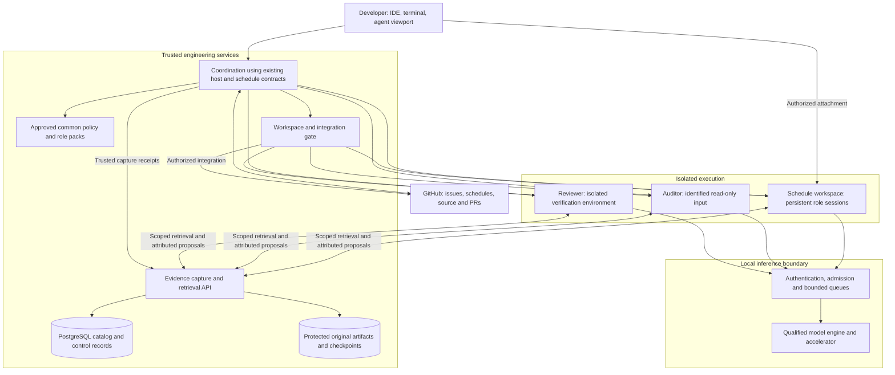
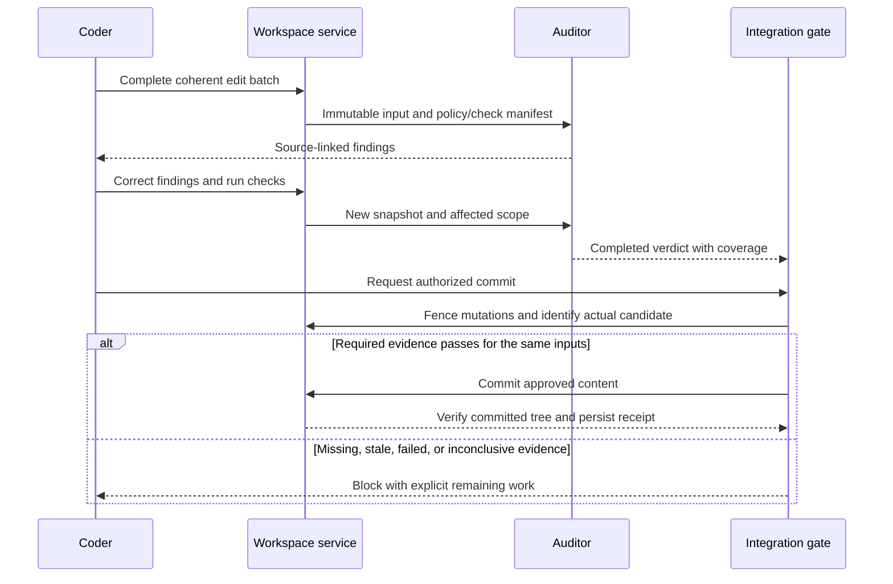
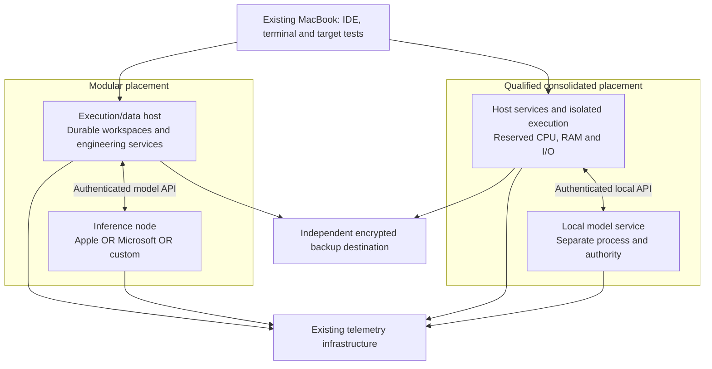

# Agentic Developer Workstation
## System architecture and build-out

| Document control | Value |
| --- | --- |
| Revision | 0.2 — PR #505 review |
| Prepared | November 11, 2026, Pacific time |
| Owner | NobleFactor Engineering Productivity |
| Primary user | Engineering Productivity developer |
| Scope | Human interaction, agent roles, execution, compliance, evidence, inference, hardware, and operation |
| Roadmap | [Roadmap and epic decomposition](../roadmaps/agentic-developer-workstation.md) |
| Related work | Agent-assisted engineering #456; engineering evidence archive #490; issue filing #338/#504 |
| Approval | The owner approved the roadmap as a draft and authorized review/revision. This RFC and the PR remain drafts. |
| Implementation status | Proposed system design; no claim that the integrations are already deployed or qualified |

**Design objective:** Build an owned, human-directed development environment in which specialized agents work persistently and safely, retrieve and reason over original evidence, and deliver correct, tested, compliant changes with less waiting and less repair.

The workstation is a logical working environment, not necessarily one computer. Draft approval does not authorize a purchase, merge, policy change, or amendment of an existing schedule. Numerical targets and implementation choices below remain proposals unless explicitly identified as established owner requirements.

**Evidence boundary.** Inputs are the owner's decisions, a private partial consumption report, historical architecture documents, current repository requirements, and the cited primary technical documentation. No uncommitted files in the owner's local workspace were inspected. No candidate machine was benchmarked in preparing this RFC. Specifications establish capabilities and constraints, not Claude/Codex-equivalent engineering results. Detailed private traces and transcripts are not included in this public document.

## Contents

1. [Problem and evidence](#1-problem-and-evidence)
2. [Requirements and scope](#2-requirements-and-scope)
3. [Logical system architecture](#3-logical-system-architecture)
4. [Developer workflow and role design](#4-developer-workflow-and-role-design)
5. [Workspace, builds, and cross-platform execution](#5-workspace-builds-and-cross-platform-execution)
6. [Compliance and integration](#6-compliance-and-integration)
7. [Evidence archive and resumable state](#7-evidence-archive-and-resumable-state)
8. [Software bill of materials and implementation responsibilities](#8-software-bill-of-materials-and-implementation-responsibilities)
9. [Model service and workload management](#9-model-service-and-workload-management)
10. [Physical architecture and hardware](#10-physical-architecture-and-hardware)
11. [Operations, safety, and failure handling](#11-operations-safety-and-failure-handling)
12. [Qualification and acceptance](#12-qualification-and-acceptance)
13. [Staged build-out](#13-staged-build-out)
14. [Decisions and remaining design work](#14-decisions-and-remaining-design-work)

## Executive design position

Separate three functional responsibilities:

1. **Human interaction and control:** direct schedules, inspect source and diffs, approve consequential actions, and attach to useful persistent sessions.
2. **Agent execution and engineering services:** protected workspaces, role sessions, builds/tests, independent compliance/review, durable checkpoints, and private evidence retrieval.
3. **Model inference:** a qualified local endpoint with its own admission, health, and resource management. Sandboxed agents call the endpoint; they do not own the GPU.

Keep these logically separate even when colocated. Preserve the existing MacBook's frontend/test role, the Mac mini's media role, and the MS-01's infrastructure role unless the owner explicitly changes them. A separate execution/data host is a reference topology, not a prerequisite imposed by choosing Apple. Physical placement is decided by target architecture, isolation, contention, durability, and operating cost.

OpenCode is the target host for the local workflow; the common host-driver work remains owned by #459. PostgreSQL is the owner's preferred evidence datastore. Proposed coordination must extend existing engprod host, sandbox, and schedule contracts rather than introduce parallel implementations.

Use **continuous compliance feedback plus a final exact-snapshot gate**. The objective is to reduce the time and effort needed to produce compliant code. The gate does not replace independent feature-closing review or owner sign-off under #456/#457.

Start evidence preservation and a minimal model-qualification path in parallel. Do not wait for a complete evidence platform or new DevLore product subsystem to test the core local-engineering requirement. Hardware selection follows a qualified model/runtime/workload; no vendor winner is approved here.

---

## 1. Problem and evidence

### 1.1 Engineering continuity depends too heavily on conversations

The owner currently works through long-lived sessions without the planned persistent specialist roles. Decisions, failed experiments, rejected alternatives, corrections, constraints, and unfinished investigations accumulate among routine tool output. Compaction or session replacement can omit a detail whose relevance becomes apparent later.

Reading the entire incident log at every startup is an expensive substitute for reviewed policy. Relying only on a summary creates the opposite risk: preserving the conclusion but losing its rationale or qualification.

**Required outcome:** retain original evidence outside the conversation; maintain reviewed common and role-specific policy; make relevant evidence available before compaction and during ordinary reasoning. This is an active engineering capability, not merely a recovery facility, and is the purpose of #490.[^I1]

### 1.2 Late compliance findings increase repair work

A pre-commit-only review can discover a repeated coding or architectural error after the implementation depends on it. Reviewing every transient edit can instead produce stale findings, false alarms, and unnecessary inference.

**Design hypothesis:** review coherent edit batches, prioritize mistakes whose repair cost grows as work spreads, and reuse completed review only when its inputs still match. Measure correction time, repeated violations, unnecessary findings, and escaped violations. Continuous activity alone is not success.

### 1.3 Existing designs have different scopes

| Input | Retained contribution | Reconciliation |
| --- | --- | --- |
| Sandboxed Agent Architecture, November 7 | Separate role contexts, protected workspaces, independent audit/review, staged-snapshot checking | Extend for continuous feedback, local inference, and durable evidence |
| Durable Schedule Ownership, November 7 | Human continuity across issues, PRs, sessions, and sandboxes | Integrate runtime assignments without another planning authority |
| Acquisition Recommendation, November 7 | Execution-host and cross-platform test requirements | Remote-inference assumptions do not size the new local model service |
| DevLore Agent Subsystem, draft 0.2 | Distinct identities/lifetimes and result reconciliation | Reuse concepts without requiring product-side implementation completion |
| Repository agent-schedule designs | Background agent/viewer separation and sandbox connection model | Qualify current provider behavior instead of copying old host internals |

These are design inputs, not certifications of the proposed deployment.[^I2][^I3][^I4][^I5]

### 1.4 What usage evidence does and does not establish

The private consumption report covers only some sessions and some hosts. Most reported token accounting is cached rereading, and elapsed session spans include inactive time. That supports investigating prefix reuse and context selection; it does not establish peak concurrency, acceptable response time, or a single dominant bottleneck.[^U1]

Do not divide output by a multi-day session lifetime to infer active-user responsiveness. Retained schedules, warm contexts, admitted requests, helper-model work, and generated reasoning have different demands. Shorter role instructions can reduce orientation overhead, but the proposed per-role context sizes have not been measured. Neither a 200K cap nor the total historical transcript volume is the basis for the hardware specification.

### 1.5 External evidence and its limits

| Published evidence | Supports | Does not establish |
| --- | --- | --- |
| OpenCode profiles, permissions, session and compaction interfaces | A candidate host with adapter integration | Guaranteed persistent role ownership or lossless compaction |
| Docker local sandbox architecture and OS prerequisites | A candidate execution boundary | Safe default mounts, durable work across removal, or required multi-session behavior |
| PostgreSQL full-text search and row security | Provenance, filtered retrieval, and access-control building blocks | Relevant search results or complete recovery without implementation tests |
| vLLM prefix caching and scheduling documentation | Separating cache residency from active inference | Removal of generation cost or guaranteed priority isolation |
| Manufacturer hardware specifications | Memory, power and expansion constraints | End-to-end engineering quality, latency, or value |

Sources are listed at the end. A deployment manifest and acceptance record must establish the exact supported combination.[^S1][^S3][^S4][^S5][^S6][^S7][^S8][^S13]

## 2. Requirements and scope

### 2.1 Owner requirements

| ID | Requirement |
| --- | --- |
| R1 | Optimize elapsed time and human effort to a correct, tested, compliant change. Performance takes precedence over minimizing purchase price. |
| R2 | Target engineering capability comparable to the owner's Claude/Codex workflow, using open-weight models through OpenCode. Demonstrate it on representative work. |
| R3 | Retain human control over goals, policy, schedule changes, and consequential authorization; preserve iterative design/plan/code/test work. |
| R4 | Preserve useful persistent, resumable role-specific sessions. Checkpoints enable compaction/replacement without requiring a fresh session on every interaction. |
| R5 | Every role complies with common policy and its applicable role-specific policy. Replace compulsory full-log reading only through reviewed policy derivation. |
| R6 | Retrieve original evidence before compaction and reason over it at any time; preserve sources and identify gaps. |
| R7 | Preserve schedule continuity independently of session and compute lifetimes. Several schedules do not imply continuously generating agents. |
| R8 | Protect source, credentials, approved documents, audit results, and private evidence from unauthorized change or disclosure. |
| R9 | No implicit paid-inference fallback. The target runs on local models; external tools and any paid evaluation are separately authorized. |
| R10 | Linux is a preference, not a requirement excluding macOS or Windows. |
| R11 | Do not buy additional GPUs merely to preserve accumulated conversation history. |
| R12 | Use $50,000 as a planning ceiling, not a spending target or purchase authorization. |
| R13 | Work products in every state survive a reboot and are kept on permanent storage, as required by #458. |

The proposed budget convention includes incremental hardware, tax, shipping, backup, power protection, networking, and installation. This all-in allocation and any numerical performance/recovery thresholds still need approval.

### 2.2 Non-goals and product boundary

This is not an autonomous company, a training cluster, a replacement for GitHub, or a new general workflow engine. It does not redesign triage or permit agents to approve their own policy. Kubernetes, vector search, GPU passthrough, and a universal knowledge ontology are not prerequisites.

The workstation is engprod's environment for developing DevLore and other software. DevLore's AI brief separates product BYOM capabilities from its customer-zero development environment. Local inference here does not change the product's no-production-hosting boundary.[^I2]

### 2.3 Ownership and approval boundaries

The [roadmap](../roadmaps/agentic-developer-workstation.md#2-epic-structure-and-ownership) is the canonical epic/feature map. It proposes two new epics alongside #456 and #490, not an epic above existing epics.

| Existing responsibility | Workstation obligation |
| --- | --- |
| #456/#460: roles, authority, common methodology | Consume approved definitions and policy; do not independently rewrite them |
| #459 and existing driver work: agent-host operations | Integrate one driver contract; add missing capabilities there rather than build another driver |
| #458 and existing sandbox work: isolation and durable work | Meet those contracts in the selected workspace/test deployment |
| #490/#494: checkpoint record, evidence and provenance | Coordinate safe checkpoint/compaction boundaries using that record |
| #456/#457: feature-closing audit, review, owner sign-off | Preserve closing review even when pre-commit evidence passes |
| #338/#504: issue filing and complete GitHub classification | Use a supported implementation and verify native metadata; a prose link is not a parent relationship |

**Review recommendation:** A3 in the new integration epic owns development-time findings and the exact-snapshot commit gate. #456 retains methodology and feature-closing authority. No existing issue is reparented or re-scoped by editing this RFC. Boundary changes require the corresponding issue/design review.

## 3. Logical system architecture

### 3.1 Components and trust boundaries



Arrows describe logical interactions, not blanket network permissions or process ancestry. Separate the capture writer, ordinary retrieval reader, and reviewed-publication authority. Do not mount the complete archive or model store into an agent sandbox.

**Coordination is a responsibility, not yet a mandated new daemon.** Inventory existing engprod commands and #459 adapters first. A small Go CLI/service may fill demonstrated gaps, but it must not duplicate host lifecycle, sandbox ownership, or GitHub planning. The deployment may share PostgreSQL infrastructure while keeping control records, evidence records, and service permissions distinct.

### 3.2 Authoritative state

| Object | Authority and lifetime |
| --- | --- |
| Schedule | GitHub planning record across issues, PRs, agents, and machines |
| Assignment | Durable scope, agent/role, workspace, authorization and outcome record |
| Agent | Logical role identity independent of a process |
| Session binding | One authoritative session and binding revision per logical agent |
| Workspace | Assigned branch/PR scope; retained until integrated, archived, or explicitly discarded |
| Current policy/design | Approved versioned artifacts, not a conversation or retrieved historical instruction |
| Audit/review receipt | Completed verdict for identified inputs, policy and check environment |
| Role checkpoint | Unfinished-work state, uncertainty and source references, not a replacement for approved source/policy |
| Historical evidence | What was captured, with provenance and completeness; not automatic truth |
| Inference cache | Restricted disposable optimization; not the durable record of work |

Use stable schedule, assignment, agent, workspace, snapshot, checkpoint, request and trace IDs. Binding replacement must fence or stop the old writer before a replacement can mutate work. A lease timeout or a new session identifier alone does not prove the old process has stopped.

### 3.3 Semantic contracts

These are interface requirements, not final endpoint names:

| Interface | Required behavior |
| --- | --- |
| Host adapter | Start/attach, submit, interrupt, observe events, compact, resume; expose capability and failure status |
| Workspace integration | Provision a protected clone, authorize/fence writers, snapshot, commit approved inputs, preserve unfinished work |
| Evidence service | Capture, search, read a source range, expand context, resolve citations, validate checkpoint references |
| Compliance service | Evaluate an identified input, produce structured findings, track correction/supersession, complete a verdict |
| Inference service | Authenticated streaming/tool calls, health and identity, admission, cancellation, usage |
| Git/GitHub integration | Perform only authorized writes, reconcile uncertain outcomes, verify resulting objects and metadata |

Persist intent before consequential operations. Record operation ID, observed outcome and evidence. A timeout after a remote write is an unknown outcome until reconciled, not permission to submit another write. Retries must not create duplicate issues, sessions, commits, or assignments. #504 provides a concrete acceptance case.[^I6]

## 4. Developer workflow and role design

### 4.1 Persistent specialists

| Role | Responsibility | Default authority |
| --- | --- | --- |
| Planner | Schedule implications, sequencing, dependencies, progress | Read state; propose changes; apply only authorized schedule mutations |
| Designer | Architecture, interfaces, constraints and rationale | Read source/evidence; edit assigned design artifacts under coordinated authority |
| Coder | Implement, debug, test, correct findings | Write assigned workspace; cannot weaken governing policy or approve itself |
| Compliance auditor | Standards evaluation and early/final findings | Read identified source/policy; write findings, not implementation |
| Reviewer | Correctness, design fit, regression and test assessment | Inspect a separate snapshot; run verification in its own durable working environment |

Retain useful role sessions across assignments and interruptions. Documents support cross-role communication, not a mandatory sequence of disposable agents. A design question can reopen during coding or testing.

OpenCode profiles are an implementation building block; qualify persistent primary sessions and explicit resumption for long-lived roles rather than assuming a fresh-context subagent satisfies continuity.[^S1] Distinct conversations may share model weights without sharing their private context. Requirements for a different model family or independent runtime in a closing review remain governed by #456/#459; do not assume using one model everywhere satisfies them.

Planner, designer and coder may share filesystem visibility when authorized. Different prompts in the same environment are not a security boundary. Use distinct identities/environments and mediated writes when technical separation is required.

### 4.2 Ordinary work cycle

The developer chooses a schedule and bounded assignment. Coordination resolves policy/role versions, checkpoint, source revision, workspace and permissions, then attaches or resumes the appropriate session.

The coder inspects, edits, builds and tests. The designer handles architectural questions; the planner evaluates schedule effects. Coherent snapshots trigger compliance feedback. The coder remains the implementation writer and resolves findings; the auditor does not race it by editing the same files.

The human can inspect diffs and status, attach a viewport, or use a terminal. A lost viewer connection is not implicit cancellation. Human edits participate in mutation coordination; an emergency intervention invalidates affected receipts and is recorded.

Retain decisions and their rationale in authoritative engineering artifacts. Checkpoints carry unfinished work and pointers to evidence, not an independently evolving set of rules.

### 4.3 Policy and context assembly

Proposed order: stable common policy, role instructions, stable project constraints, assignment/checkpoint, then changing evidence. Record what versions were actually supplied. Load governing policy from a trusted revision, not a mutable branch that can weaken its own checks.

Replacing the incident log with compact policy requires review. Keep references to incidents and exceptions. Make mechanically enforceable restrictions permissions/tool controls where feasible; prompt instructions alone do not provide isolation.

Prefix reuse depends on matching token prefixes and preceding state, including tools and formatting. Verify rendered requests and cache behavior for the selected runtime; do not give roles excessive tools to improve cache sharing. Prefix reuse saves repeated prompt computation, not the generation of the new answer.[^S8]

## 5. Workspace, builds, and cross-platform execution

### 5.1 Isolation and permanent work storage

Begin with one development environment per actively executing schedule and separate audit/review environments where required. Retained sessions do not each require a permanently running VM.

**Proposed workspace default:** provision independent clones in a schedule-specific durable storage boundary. Keep canonical main clones protected. PR worktrees may share metadata within that private clone, never writable metadata with the protected host clone. Coordinate source, index and commit mutations.

**Work products are permanent from creation.** Drafts, prototypes, research, source edits, verification artifacts, audit findings and checkpoints must not exist solely in `/tmp`, a temporary job directory, or a disposable sandbox layer. This applies #458's requirement rather than postponing durability until shutdown.[^I8]

Docker documents workspace layouts with different persistence properties, including private clones and host-backed mounts.[^S5] Choose and test the layout, not merely the agent launch command. A proposed durable per-schedule volume should survive host reboot and sandbox recreation, while not exposing other workspaces or protected Git metadata. Where a clone remains managed inside the sandbox, qualify its export/recovery path before valuable work uses it; removing the sandbox must not be the first opportunity to preserve its work.

Reproducible caches and runtime scratch are classified separately from work products. A test may need temporary intermediate files, but its source, meaningful outputs and evidence are written to the permanent working area. Clean up only what the retention contract explicitly identifies as disposable.

Use local SSD storage for active source and build I/O. A remote IDE/backend or shell should operate near the workspace; avoid a network-mounted build tree unless measured performance and correctness justify it.

### 5.2 Builds and target testing

Pin toolchains, dependencies and execution images per repository. Return test results with source identity, environment versions, exit status and durable logs. A test runner can write to its own working directory without permission to change the approved input snapshot.

Retain the existing MacBook/Parallels target-testing role. Cross-compilation is not runtime verification. Linux ARM64, Linux x86-64, Windows ARM64/x86-64 and macOS coverage are explicit requirements to confirm, not interchangeable labels. Add target capacity for gaps rather than assume an ARM inference appliance replaces an x86-64 test host.

Enforce quotas and protect trusted executables/configuration from poisoned shared caches. Resource isolation covers CPU, RAM, disk I/O and subprocess counts, not only the GPU.

### 5.3 Sandbox qualification

Use a pinned Docker `sbx` release as the first integration candidate. Its documentation lists Apple silicon/macOS and Ubuntu/KVM paths; Windows local requirements list Intel/AMD rather than ARM.[^S4] This supports evaluating Apple colocation and prevents assuming native N1X local sandboxes without separate evidence. It does not prove nested virtualization, cross-architecture execution or a particular driver is supported.

Qualify role-session coexistence, persistent mounts, credentials, network restrictions, lifecycle and outage behavior. If `sbx` cannot meet a required contract, propose a conventional managed VM through the existing isolation work. Do not silently substitute an ordinary container for the intended kernel boundary or create a second sandbox manager.

## 6. Compliance and integration

### 6.1 Reduce the total cost of compliance

Combine prevention, early feedback and a final check:

- Approved common/role policy, worked examples and deterministic checks prevent predictable mistakes.
- Review completed edit batches, not every incomplete file write. Earlier findings should prevent high-cost propagation.
- Reuse completed results only when their covered inputs still match the exact integration candidate.

Batch localized findings where interruption would cost more than immediate repair. High-propagation violations warrant prompt attention. Bound auditor queues; cancel obsolete work but retain the fact that an unresolved finding existed until it is resolved, waived, or explicitly superseded.

Separate deterministic failures from model judgments. Record the rule, evidence, affected source, suggested correction and uncertainty. The coder corrects implementation; the auditor verifies. Independent review examines actual source and test evidence, not just the coder's summary.

### 6.2 Audit request and receipt

A request identifies repository, base revision, candidate snapshot/tree, policy versions, relevant dependencies/configuration, required checks, environment, model/runtime manifest and request ID. A receipt records pass, violation or inconclusive; coverage, evidence and timestamps; and any supersession or authorized override.

A pass is reusable only when all relevant inputs and required coverage match. A change to an interface, dependency, policy, base revision, trusted check configuration or reviewed content can invalidate more than a changed-file diff. Short output is not proof of complete review.

Git's tree object can identify staged content, but it is not a lock or authorization mechanism.[^S9]



Prevent time-of-check/time-of-use races by fencing writers across verification/commit or by constructing and checking an immutable commit before publication. Verify the committed tree and effective check manifest. A local hook is an integration convenience, not enforcement against a process allowed to bypass it. Trusted integration/CI must validate the actual candidate using protected policy and credentials.

Auditor failure and timeout are inconclusive, not pass. Overrides require explicit authority and recorded scope/reason. Common authorization still controls who can commit, push or merge.

### 6.3 Keep three decisions separate

| Decision | Authority |
| --- | --- |
| Early compliance finding | Advisory correction evidence under A3; it is not approval of future edits |
| Commit/integration permission | Exact-snapshot gate under A3 plus existing authorization and trusted checks |
| Feature closure | Independent audit/review and owner's sign-off under #456/#457 |

Passing the first two does not close a Feature. A3 consumes closing-review methodology without replacing its owner or silently broadening #457's scope.

Measure detection-to-correction time, correction iterations, recurring and escaped violations, false-positive burden, and final blocking delay. Compare continuous feedback against the current process on actual changes. An auditor that is busier but increases repair work fails the objective.

## 7. Evidence archive and resumable state

### 7.1 Storage proposal

PostgreSQL is the preferred catalog/search platform. The proposed initial layout keeps provenance, normalized events, access metadata and reviewed records in PostgreSQL, with large originals in protected content-addressed storage. **This is a design proposal for #490/#492, not a separately approved storage decision.** Final physical layout must satisfy the same recovery and authorization contracts.

Use indexed full-text search plus exact identifier/path matching; symbols and issue IDs must not rely only on stemming. Add semantic retrieval only when demonstrated retrieval failures justify it.[^S6]

| Conceptual record | Purpose |
| --- | --- |
| Source | Provider, source host/session, repository association, format and capture policy |
| Capture | Immutable capture identity/hash, time, watermark, completeness and parser version |
| Artifact | Original transcript, tool result, attachment or snapshot with location, digest, size and access scope |
| Event | Normalized message or call/result pair with ordering and exact original locator |
| Evidence link | Supporting/contradicting source relation for a checkpoint, finding, policy or decision |
| Derived record | Proposed, accepted or superseded conclusion/checkpoint with references to its inputs |

These are semantic distinctions, not final SQL tables or a universal ontology. Derived representations must be rebuildable without rewriting the original evidence. Hashes detect modification; they do not prove a claim was true.

### 7.2 Capture and consistency

Import the available Claude Code, Codex, OpenCode and supplied-export records, including exposed tool outputs and attachments. Do not promise reconstruction of missing artifacts or inaccessible internal reasoning. Report coverage, gaps, parser failures and uncertain associations.

Capture incrementally to a protected permanent spool with idempotency keys, offsets and backpressure. On a new parser version, produce new derived records. A host-side collector must distinguish observed execution results from an agent's statement about them; neither should be misrepresented as tamper-proof evidence.

Publish a blob/catalog reference only after the artifact is durably stored and its integrity checked. Use pending/committed ingestion state to reconcile failures and harmless orphaned blobs. Database and artifact backup manifests must agree. Define acknowledgments separately for local persistence and off-host recoverability; a local capture receipt is not a claim that a remote backup is current.

### 7.3 Retrieval during active work

Provide scoped search, exact-range reads, surrounding-context expansion and citation resolution. Return bounded evidence with provenance, completeness and status, preserving paired commands/results and nearby qualifications. An agent may compare past work and propose conclusions at any time, including before compaction.

The ordinary evidence reader is read-only. Capture credentials and acceptance/publication credentials are distinct. Proposed conclusions do not become current policy automatically. A historical instruction is evidence to interpret, not authority to execute.

Apply authorization consistently to search results, snippets, counts, artifacts and citation expansion. PostgreSQL row policies are useful defense in depth; retrieval roles must not be superusers, table owners or `BYPASSRLS` roles. Validate pooled-connection identity and clear request-specific authorization state between requests.[^S7]

### 7.4 Checkpoint and compaction protocol

A checkpoint identifies assignment/scope, current source snapshot, policy and role versions, decisions/rationale, rejected approaches, verification, outstanding findings, uncertainty, pending operations and next action. It references the durable capture watermark and resolvable source evidence. It explicitly identifies what is unfinished or unknown.

```mermaid
sequenceDiagram
    participant S as Role session
    participant C as Coordination
    participant E as Evidence service
    participant H as Host adapter
    C->>H: Reach supported safe boundary; quiesce mutations
    H-->>C: In-flight outcomes or explicit unknowns
    C->>E: Flush available evidence to permanent storage
    E-->>C: Durable watermark and gaps
    S->>E: Retrieve relevant prior evidence
    E-->>S: Sources and context
    S-->>C: Proposed checkpoint with unfinished work
    C->>E: Store checkpoint and validate citations
    E-->>C: Durable checkpoint identity
    C->>H: Request supported compaction or replacement
    H-->>C: Observe completion or explicit failure
    C->>H: Reconcile binding and authorize continuation
```

#490/#494 owns the evidence/checkpoint record; #459 owns provider operations; A1 orchestrates the boundary and authoritative session binding. Keep these ownership responsibilities separate even when implemented in one process.

Start before the context is exhausted and reserve enough budget for retrieval/checkpoint construction. Observe completion rather than equate request acceptance with success. OpenCode documents lossy compaction and asynchronous completion.[^S3]

Do not clear the old binding on an unconfirmed transition or allow both old and replacement sessions to write. Resolve unknown tool operations before reissuing them. Continuous capture remains necessary because crashes or automatic provider compaction may bypass a cooperative checkpoint. Unsupported interception is a documented limitation, not a guaranteed lossless hook.

Compaction does not authorize evidence deletion. Retention/redaction/deletion is separately approved and includes indexes, derived records, caches and backups. Cite the version actually used rather than silently resolving a historical reference to a changed summary.

### 7.5 Privacy and recovery

Keep originals private and encrypted at rest with restricted service and backup credentials. Secret-screen normal retrieval; preserve controlled access to originals where authorized. Redaction records must not repeat the secret in logs. Never publish raw sessions to public repositories.

Reviewed policy, evidence and session state are portable across model and hardware replacement. The model server's disk/cache is not their sole home. Archive restoration must preserve citation identity and authorization, not only database row counts.

## 8. Software bill of materials and implementation responsibilities

| Component | Initial candidate | Responsibility / qualification |
| --- | --- | --- |
| Human frontend | Existing GoLand/Gateway or VS Code; terminal/SSH; agent viewport | A1 integrates authenticated attachment, source identity and editing authority |
| Work tracking | GitHub issues, Schedule projects, branches and PRs | Reuse current engprod tools; verify native state; do not build another planning database |
| Agent host | A pinned qualified OpenCode release | #459 driver contract; A1 orchestration; preserve optional Claude/Codex adapters without implicit hosted fallback |
| Coordination | Existing engprod tooling plus demonstrated gaps | Durable assignments and bindings; Go CLI/service is a proposal, not a mandatory parallel control plane |
| Execution isolation | Qualified Docker `sbx` or approved managed-VM alternative | #458 isolation; A2 workspace/test integration; permanent work storage |
| Policy/role packs | Versioned text and manifests | #456/#460 and engineering documentation; deterministic rendering and approval identity |
| Deterministic checks | Repository-pinned format, lint, static and test tools | Trusted policy/configuration; permanent identified results |
| Compliance integration | A3 triggers, findings workflow and gate | Reuse methodology and exact-snapshot evidence; no self-approval |
| Evidence catalog | PostgreSQL 18 baseline, supported pinned patch | #492 schema/search/provenance; #496 access and recovery |
| Original evidence | Protected content-addressed storage proposal | #490 owns final layout, capture, retention and restoration |
| NVIDIA inference | Qualified CUDA/vLLM candidate; alternative only with evidence | B2 exact device/checkpoint/kernel/parser support |
| Apple inference | Qualified MLX-based server; evaluate vllm-metal where supported | B2 tests tool calls, concurrency, memory and cache behavior |
| N1X inference | Qualified native Windows ARM64 recipe or supported alternative | B2 exact platform and workload; do not infer compatibility from CUDA alone |
| Telemetry | OpenTelemetry Collector to appropriate existing stores | A4 correlation, redaction and operational retention; not the evidence authority |
| Supervision | Host-native service management and pinned containers as appropriate | Health, startup order, shutdown, quotas, rollback and recoverable configuration |

Existing issues are statements of ownership/requirements, not evidence their software is complete. The first implementation inventory must identify built, reusable, missing and experimental capabilities. New code belongs under the owning feature rather than being duplicated here.

Pin the runtime, provider package, model revision, tokenizer, chat template, parsers, reasoning/sampling settings and policies as one qualified manifest. Use the installed schema rather than old configuration snippets.[^S1][^S2]

Audit every auxiliary model path: compaction, small-model helpers, embeddings, search/fetch helpers, plugins and fallback. The local-only operating profile carries no paid-model credentials and restricts unintended provider egress. Authorized external tools are explicit exceptions, not evidence that inference has become hosted.

## 9. Model service and workload management

### 9.1 Qualification is model plus engine plus harness

Evaluate a compact candidate and a higher-capability candidate early. Qwen3.8-27B and GLM-5.3-Flash conversions are concrete research candidates, not selected winners or guarantees of equivalence.[^S10][^S11]

Each qualified deployment identifies exact weights/hashes, license, precision, runtime, templates, tools and settings. Test repository understanding, architecture constraints, sustained tool use, error recovery and compliance. A benchmark on another harness or full-precision checkpoint is screening evidence only.

Different conversions can have different sizes and supported kernels. The original research reported approximately 204 GB of files for one NVIDIA GLM conversion; that is a historical on-disk observation, not a measured runtime requirement or proof of two-card fit.[^S12] Recheck the chosen revision, bytes/GiB, each device's allocation, buffers and context state. A smaller community conversion requires its own quality and deployment evidence.

### 9.2 Capacity and admission

Measure the working set per serving instance:

`weights + runtime/workspace buffers + resident context/state + operating headroom`

Shared weights are not multiplied by every agent session. Independent model replicas do duplicate weights. Cache sharing is counted only when observed and permitted. Retained agents, warm contexts, admitted generations and queued requests are separate populations.

Start with one interactive request, then a coder plus auditor, then realistic overlap and stress. Four or eight requests are test conditions, not committed simultaneous-agent requirements. Do not size from the number of GitHub schedules.

Prioritize work blocking the developer, followed by active coding and then background work, with bounded queues and starvation protection. Existing long requests may not be preemptible. A priority field alone is not latency isolation. Measurements must justify reserving a separate replica or GPU.

Chunked prompt processing, cache pressure and batching trade throughput against latency.[^S13] Report per-request distributions as well as aggregate output. A better average must not conceal an unacceptable blocking audit or interactive wait.

### 9.3 Cache and model lifecycle

Keep the useful model set resident when the workload warrants it. Reloads, model switches and cold starts are measured work. Cache correctness, isolation and eviction are qualification tests. Provider sessions and archive state must survive cache loss.

Treat cache material as potentially sensitive. Apply scope boundaries and supported cache-key isolation; do not assume physical sharing is acceptable for every role or repository. If needed, sacrifice reuse to preserve access separation.

Disk offload, persistent KV caches, speculative decoding and nonstandard kernels are optional deployment changes. Each requires new correctness, memory and task-quality measurements. They are not automatic remedies for undersized hardware. Apple concurrency and cache support must be checked for the actual model/engine pair, not inferred from a platform announcement.[^S14]

## 10. Physical architecture and hardware

### 10.1 Existing responsibilities

| System | Intended role |
| --- | --- |
| MacBook Pro M3 Max, 128 GB | Human frontend, interactive development and existing macOS/Parallels target tests |
| Mac mini M4 Pro, 64 GB | Existing media services; not silently reassigned |
| MS-01 infrastructure host | Existing utilities and telemetry subject to headroom |

These are owner-reported responsibilities, not a fresh inventory or approved reassignment.[^I3]

### 10.2 Deployment alternatives, not mandatory purchases



The modular reference uses a Linux execution/data host plus an inference node. A consolidated custom host is an alternative. Apple colocation is also eligible because its sandbox platform has a documented macOS path; qualify target-architecture coverage and model/build contention first.[^S4] A Microsoft inference appliance can be paired with execution elsewhere; do not assume its Windows ARM64 host satisfies the listed local sandbox prerequisites.

Separate logical services do not require a separate physical box for each. Neither Docker support nor a large unified-memory pool proves that colocating builds, database work and inference will meet latency targets. Benchmarks include the complete placement, not an otherwise idle inference engine.

### 10.3 Execution/data-host target

For a separate x86-64 host, quote the following starting point rather than treating it as a measured minimum:

| Resource | Planning target | Qualification |
| --- | --- | --- |
| CPU | Approximately 16 high-performance cores and virtualization support | Sustained concurrent builds/tests and sandbox load |
| Memory | 128 GB expandable; ECC where supported | Guest/service reservations, bursts and actual build profiles |
| Storage | 2 TB TLC NVMe for system/work; additional protected data volume when sizing requires it | Quotas separate build/model caches from work/evidence; backup is independent |
| Network | Wired 2.5GbE initially, expansion path if useful | API traffic plus measured model/backup transfer needs |
| OS | Supported, pinned release for the selected isolation stack | Ubuntu/KVM is a candidate; do not infer Debian equivalence without validation |
| Recovery | Independent backup destination and tested restore | Database, artifacts, checkpoints and unintegrated work |

An illustrative reservation for two active schedule environments is 32 GB, plus 16 GB for auditor/reviewer, 16 GB for database/control services and 16 GB for host headroom: about 80 GB. This is a planning example, not a promise of concurrent-request capacity. CPU and I/O contention still need measurement.

The earlier MS-A2/96 GB proposal remains an execution candidate if its sustained behavior and headroom suffice. Do not purchase it automatically alongside a consolidated host. Validate whether existing execution infrastructure already supplies the required target coverage.

### 10.4 Inference configurations to qualify

| | Apple | Expandable custom | Microsoft |
| --- | --- | --- | --- |
| Candidate | Mac Studio M5 Ultra, 36-core CPU / 80-core GPU, 256 GB, 2 TB SSD | Threadripper PRO/WRX90-class host, 128–256 GB ECC, one or two RTX PRO 6000 Blackwell Max-Q 96 GB cards | Surface RTX Spark Dev Box, 128 GB, Windows 11 Pro; storage verified at quote |
| Published constraint | Shared memory; Apple lists 1.2 TB/s bandwidth | 96 GB per GPU; NVIDIA lists 300 W per Max-Q GPU | 128 GB unified memory; do not borrow another Spark's bandwidth |
| Serving candidate | Qualified MLX-based engine | Qualified CUDA engine and exact conversion | Qualified Windows ARM64 deployment |
| Main benefit to test | Large single memory pool and integrated host | Replaceable accelerators; independent serving or partitioned-model expansion | Compact local inference for a qualifying smaller working set |
| Main risk to qualify | Tool/parser support, context overhead, overlapping work | Per-card fit, link topology, kernels, power/cooling and integration | Model quality/fit and mixed-load responsiveness |
| Growth path | 512 GB only for an identified need; later replace/resell or add a node | Add cards only for demonstrated model capacity or concurrency | Add a node or replace appliance |

The manufacturers' capacities are not task-performance results.[^S15][^S16][^S17] The narrower vendor N1X recipe cited in the original draft demonstrates one local model deployment, not Surface-specific multi-agent or Claude/Codex equivalence.[^S18]

### 10.5 Custom reference build and expansion

A Threadripper PRO 9965WX/WRX90-class platform is a reference for a consolidated expandable host, not an approved shopping list. Obtain exact CPU/BIOS/memory compatibility and the board's electrical lane allocation; physical slot count alone is insufficient.[^S19][^S20]

| Component | Qualification target |
| --- | --- |
| Host memory | 256 GB is a candidate for consolidation; 128 GB only after runtime, ingestion, builds and recovery tests. Populate channels using a vendor-qualified configuration. |
| Accelerators | One for a fully resident qualified model; two for a proven partitioned deployment or an independently useful second service. |
| Disks | Separate capacity/quotas for system, work, model cache and protected evidence; choose additional volumes from measured I/O and retention needs. |
| PSU and cables | Native connectors and sustained/transient headroom for the installed configuration; no assumed four-card guarantee from a 1,600 W label. |
| Chassis and cooling | Qualified board/card fit, airflow, acoustic limits and sustained CPU/GPU temperatures. |
| UPS/circuit | Size by complete wall load, VA, runtime and safe shutdown; validate the finished electrical installation. |

Two GPUs partitioning one model are not an independent coder GPU and auditor GPU. Adding a GPU may also require a new PSU, circuit, chassis or runtime topology. Four-card readiness does not establish compatibility with an unannounced future GPU.

### 10.6 Selection and budget

No vendor winner or minimum accelerator count is approved. Select from configurations that meet the same engineering-quality requirement:

- Custom must earn its premium through measured blocked-time, overlap or a concrete expansion need.
- Apple must meet the model/runtime/latency requirement; extra memory is valuable for a demonstrated working set, not intrinsically a faster GPU.
- Microsoft remains eligible for a qualifying model that fits; Windows preference is not an exclusion criterion.

Compare complete installed systems, including any incremental execution node, storage, backup, power protection, network, tax, installation and support. Do not compare a GPU-only price against a complete appliance, or charge one alternative for infrastructure already available to the other. A quote and availability check are outstanding procurement work.

### 10.7 Energy and net ownership

Measure whole-system idle, prompt-processing, generation and mixed-load wall power. GPU limits, CPU TDP, PSU rating and wall draw are different quantities.

`annual energy cost = sum(watts × hours) / 1000 × applicable marginal tariff`

`net ownership cost = purchase + upgrades + energy + support − net resale proceeds`

Use the actual PSE plan/rate at procurement. Compare both equal operating time and energy per accepted task. Use conservative/base/optimistic net resale for Apple and custom components; neither has a guaranteed residual percentage. Record the value of blocked developer time separately from hardware cost and do not hide repair effort in a token-price estimate.

Every substantial expansion reopens topology, thermal, power and recovery qualification. Procurement approval is a distinct decision from roadmap approval.

## 11. Operations, safety, and failure handling

### 11.1 Security and dependency controls

Keep model/control services off the public Internet. Use authenticated private transport and least-privilege identities. Agent shells do not receive database owner credentials, broad SSH-agent forwarding, the host Docker socket, cloud secrets or the host home directory by default.

Model/code downloads are executable supply-chain inputs. Pin hashes/revisions and required runtime code; separate installation privileges from inference and agent privileges. Retrieved content and model output cannot grant tools, rewrite common policy or authorize external actions.

Inventory account, licensing, update and network dependencies even for locally executed services. Docker's installation guide includes sign-in; test operation under the owner's actual outage requirements rather than advertise the system as dependency-free.[^S4] Select an approved alternative if a dependency conflicts with the required operating mode.

### 11.2 Observability

Use the existing telemetry environment where suitable, with OpenTelemetry Collector as a candidate collection boundary.[^S21] Correlate assignments, sessions, source snapshots, model requests, tool calls, audit results and checkpoints without routinely logging secret prompts.

Measure developer-blocking intervals, input/cache/output/reasoning accounting, tool/test time, correction cycles, queue depth, cache evictions, memory/I/O pressure, capture lag and backup age. Preserve the operation/audit records needed for correctness regardless of telemetry sampling. Evidence and operational telemetry have different authority and retention.

### 11.3 Failure behavior

| Event | Required response |
| --- | --- |
| Viewer disconnect | Continue only within current assignment authority; reconnect to the same binding |
| Inference outage | Preserve work and request outcome; report unavailable; no paid fallback |
| Cache eviction | Recompute from durable context; loss affects speed, not engineering truth |
| Agent crash | Preserve workspace; reconcile pending operations before replacement |
| Sandbox replacement/removal | Verify durable work and recovery bindings; refuse destructive action until safe or explicitly authorized discard |
| Archive outage | Use bounded permanent spooling; report watermark/gaps; block controlled destructive transitions when required evidence cannot be secured |
| Automatic unsupported compaction | Preserve available capture and latest checkpoint; report limitations, never claim a lossless transition |
| Auditor timeout | Inconclusive; retain findings and block the required gate |
| Lost GitHub response | Read back/reconcile; do not issue a duplicate create |
| Disk pressure / stale backup | Enforce quotas, stop unsafe destructive operations and notify the developer |

### 11.4 Backup, restore and rollback

Use PostgreSQL-aware backups and tested recovery; base backups plus the required WAL history support point-in-time recovery.[^S22] Preserve a compatible manifest of database, artifacts, policy/configuration, checkpoints and unintegrated work. A second disk in the same machine is not protection from host failure.

Ordinary reboot survival is a requirement for permanent work products. Disaster recovery has a separate loss window. Initial proposals are an off-host backup lag of at most 15 minutes for protected state and core-service restoration within four hours; these are unapproved targets until demonstrated. A local-durable acknowledgment must not imply zero-loss protection against destruction of the host.

Test citation resolution, authorization and session/workspace reconciliation after restore to another machine. A software/model upgrade must have an identified rollback or forward-recovery plan. Rebuildable caches are less important than source, evidence and unfinished work.

## 12. Qualification and acceptance

### 12.1 Evaluate complete engineering behavior

Use a private task set derived from authorized actual work: multi-file Go changes, configuration/scripting, architecture-sensitive changes, debugging with failures, seeded standards violations, and recovery across interruption/compaction. Preserve starting revision, instructions, policies, tests and acceptance evidence.

Compare the complete manifest: model/precision, reasoning budget, host, tools, policy, serving engine and hardware. Hold comparable inputs constant or explain differences. A full-precision leaderboard result or a single short decode benchmark does not certify a quantized deployment.

Separate tasks used to tune policies/prompts from held-out acceptance tasks. Report sample sizes, variability, rejected attempts, human corrections, and failure categories. Do not count a failed task as fast because it stopped early. A small sample cannot establish a stable p95 or prove universal correctness.

Use available hosted records as baseline evidence when comparable. New paid evaluation requires authorization. The production target is local inference without implicit billable fallback, not a ban on explicitly approved qualification methods.

### 12.2 Proposed acceptance dimensions

All numerical limits require owner agreement before a procurement comparison is scored. The review does not turn the earlier suggested 25% latency margin, five-second warm gate or 15-minute backup objective into an approved requirement.

| Dimension | Required evidence |
| --- | --- |
| Engineering quality | Accepted task outcomes, architectural correctness and human repair burden compared with the agreed baseline; explain important failure classes |
| Critical policy | Seeded critical violations are detected; uncertain cases surface; no silent permission expansion or fail-open |
| Development latency | Actual time to accepted change and blocked intervals, with cold/warm, queue, reasoning, tools and correction separated |
| Continuous compliance | Earlier useful detection or less repair effort without unacceptable noise; compare complete correction cycles |
| Final gate | Valid evidence is reused only for identical relevant inputs; stale/missing evidence blocks. A five-second metadata path is a candidate target, not a five-second model-review promise. |
| Concurrency | A coder plus ongoing audit/review meets agreed latency with bounded queues and memory; additional loads are stress conditions |
| Continuity | Reboot, lost connections, process failures and compaction preserve durable work; unknown operations are reconciled rather than blindly repeated |
| Evidence | Representative source questions return correct passages and citations; private scopes and secrets remain protected; gaps are explicit |
| Ownership/offline operation | With assets staged, ordinary local tasks function under the agreed WAN-outage conditions; unavoidable external dependencies are documented |
| Operations | Sustained wall-power/thermal tests, quota tests, backup restore, upgrade rollback and no uncontrolled service growth |

Reject a configuration failing essential quality/safety requirements before ranking speed or cost. Do not multiply a benchmark score by tokens per second and call the result Claude/Codex equivalence. Disclose any accepted tradeoff through the owner's decision process.

### 12.3 Early feasibility and procurement gate

A thin OpenCode/task harness and a minimal authenticated local endpoint are sufficient to begin model feasibility work. They do not require the full coordinator, archive UI or a completed product subsystem. Use durable private fixtures and existing isolation for those experiments.

Before purchasing an expensive configuration, obtain evidence for its exact serving pair, working set and overlap load, plus a complete quote and electrical/thermal layout. An integrator test or separately authorized evaluation can supply evidence; neither relying only on the existing laptop nor testing every possible SKU is required.

Document bounded unanswered questions and their risk owners. Acquire when a candidate meets the approved need; do not defer indefinitely for an unspecified future chip. Post-installation acceptance must confirm the delivered system, not merely repeat a vendor's specification.

## 13. Staged build-out

The [roadmap](../roadmaps/agentic-developer-workstation.md#5-delivery-waves-and-gates) is the single delivery/dependency outline. Its waves are: preserve evidence and establish a baseline; integrate a minimal durable workstation; measure compliance and models; select deployment; accept the installed system; scale only for demonstrated needs.

Evidence capture and model feasibility begin in parallel. Model qualification does not wait for all workstation features; preserving the engineering record does not wait for a GPU purchase. Basic access control, durable work and recovery accompany every increment rather than arriving after the main features.

Reuse #456's roles/host/isolation/closing-review work and #490's canonical Features #491–#496. The proposed A1–A4 and B1–B4 boundaries are in the roadmap. Filing new native issue hierarchies, changing schedule membership and authorizing purchases are separate operations not performed by this RFC.

Introduce one useful capability at a time while preserving the working environment. Measure the combined coder, build/test, audit, evidence and inference path before scaling. Do not approve extra GPUs merely to avoid discarding obsolete context.

## 14. Decisions and remaining design work

### 14.1 Draft positions

| ID | Position in this draft |
| --- | --- |
| D1 | Engprod owns the workstation; DevLore product scope is unchanged |
| D2 | Separate execution, durable state and inference logically; qualify physical modularity or colocation |
| D3 | Retain useful role sessions with common policy and source-linked checkpoints |
| D4 | Protect main clones and coordinate writers within durable private workspaces |
| D5 | A3 integrates continuous feedback and exact-snapshot commit control; #456 retains methodology and closing review |
| D6 | PostgreSQL is preferred; protected external artifacts are a proposal for the archive's own design review |
| D7 | Context is workload-specific; inference caches are disposable restricted state |
| D8 | Quality and end-to-end performance qualify hardware; net ownership and expansion are evaluated afterward |
| D9 | Extend existing host/sandbox contracts; introduce a new service only for a demonstrated implementation gap |

### 14.2 Bounded open questions

Resolve the model/checkpoint and engine; runtime capability matrix; safe compaction/replacement behavior; final archive layout; approved numerical quality/latency/recovery thresholds; exact trusted integration mechanism; initial placement; and complete hardware quote/electrical design. Each belongs to the feature and gate identified in the roadmap.

Draft approval preserves these as explicit open decisions. It does not turn tentative defaults into requirements or permit silently relaxing the owner's engineering-quality objective.

### 14.3 PR #505 review changes

Revision 0.2 records draft approval, assigns unambiguous ownership at existing epic boundaries, and keeps a single roadmap for delivery sequencing. It strengthens permanent-work storage and checkpoint acknowledgments, adds writer fencing and unknown-outcome reconciliation, separates early feedback/commit permission/feature closure, removes mandatory separate-host assumptions for Apple, and brings model feasibility forward. Sources remain evidence of individual capabilities, not a finished deployment or hardware winner.

**Final design position:** faster inference and more memory are useful when they improve the engineering work. They do not replace durable evidence, controlled execution, reviewed policy, independent verification or human authority.

---

## Sources and evidence register

Sources are mutable unless a revision is identified. This revision rechecked the cited Docker installation/architecture, OpenCode agents/compaction, Apple/Microsoft platform pages, NVIDIA Max-Q/model card, Qwen card, PostgreSQL row-security and vLLM prefix-caching documentation. Other references are carried from revision 0.1 and must be revalidated when implementing the relevant component. No external benchmark or complete-system test was reproduced in this review.

[^U1]: Owner decisions and a private partial agent-session consumption report supplied in this conversation. Underlying provider records were not independently retrieved. Keep raw conversations and detailed usage traces private unless separately approved for publication.

[^I1]: [#490 — Engineering evidence archive](https://github.com/NobleFactor/noblefactor-engprod/issues/490), with canonical Features #491–#496. Its original requirements govern capture, retrieval, checkpoints and privacy.

[^I2]: [DevLore AI design brief](https://github.com/NobleFactor/devlore-cli/blob/develop/docs/devlore-ai-design-brief.md), sections 1–4; source blob reviewed for revision 0.1: `a43baea29a995539a66414ce87e631d9080b5721`.

[^I3]: Historical Library copies of `devlore_sandboxed_agent_architecture.md`, `devlore_durable_schedule_ownership_argument.md`, and `devlore_final_acquisition_recommendation.md`, November 7, 2026. They are not certifications of current local files or deployed hardware.

[^I4]: Historical Library copy of `devlore-agent-subsystem-design.md`, draft 0.2. Product-side resource/session distinctions and reconciliation concepts.

[^I5]: Existing [session model](https://github.com/NobleFactor/noblefactor-engprod/blob/develop/docs/architecture/agent-schedule/1-session-model.md) and [sandbox draft](https://github.com/NobleFactor/noblefactor-engprod/blob/develop/docs/architecture/agent-schedule/3-agent-sandbox.md). Provider-specific details require current qualification.

[^I6]: [#504 — Complete issue-filing enforcement](https://github.com/NobleFactor/noblefactor-engprod/issues/504) and [#338 — Filing command/skill](https://github.com/NobleFactor/noblefactor-engprod/issues/338). Requirements do not by themselves prove a command is implemented.

[^I7]: [#456 — Agent-assisted engineering](https://github.com/NobleFactor/noblefactor-engprod/issues/456), [#457 — Closing review](https://github.com/NobleFactor/noblefactor-engprod/issues/457), [#459 — Agent hosts](https://github.com/NobleFactor/noblefactor-engprod/issues/459), and [#460 — Roles](https://github.com/NobleFactor/noblefactor-engprod/issues/460). Existing owners, not duplicate components to create.

[^I8]: [#458 — SBX environment and permanent work](https://github.com/NobleFactor/noblefactor-engprod/issues/458). The reboot-survival requirement covers drafts, prototypes, research and tests as well as completed source.

[^S1]: [OpenCode agents](https://opencode.ai/docs/agents/): profile configuration and authority; validate session semantics separately.

[^S2]: [OpenCode providers](https://opencode.ai/docs/providers/): use a pinned release's schema and compatible-provider implementation.

[^S3]: [OpenCode compaction](https://opencode.ai/docs/compaction): lossy summary behavior and asynchronous completion.

[^S4]: [Docker Sandboxes installation](https://docs.docker.com/ai/sandboxes/install): platform prerequisites, virtualization and sign-in.

[^S5]: [Docker Sandboxes architecture](https://docs.docker.com/ai/sandboxes/architecture/): workspace layouts, persistence, removal and networking.

[^S6]: [PostgreSQL 18 text-search tables/indexes](https://www.postgresql.org/docs/18/textsearch-tables.html). Relevance and schema here are proposals.

[^S7]: [PostgreSQL 18 row security](https://www.postgresql.org/docs/18/ddl-rowsecurity.html): enforcement and owner/superuser bypass behavior.

[^S8]: [vLLM automatic prefix caching](https://docs.vllm.ai/en/stable/features/automatic_prefix_caching/) and [cache design](https://docs.vllm.ai/en/stable/design/prefix_caching/).

[^S9]: [Git write-tree](https://git-scm.com/docs/git-write-tree): staged-content identity, not a complete audit or synchronization mechanism.

[^S10]: [Qwen3.8-27B model card](https://huggingface.co/Qwen/Qwen3.8-27B). Candidate identity, not a DevLore acceptance result.

[^S11]: [NVIDIA GLM-5.3-Flash-NVFP4 model card](https://huggingface.co/nvidia/GLM-5.3-Flash-NVFP4). Exact runtime and artifact still require qualification.

[^S12]: [NVIDIA conversion files](https://huggingface.co/nvidia/GLM-5.3-Flash-NVFP4/tree/main). Revision 0.1 recorded approximately 204 GB and revision marker `1d00738`; do not reuse that observation as a current runtime allocation.

[^S13]: [vLLM optimization/tuning](https://docs.vllm.ai/en/stable/configuration/optimization/): latency, memory and throughput tradeoffs.

[^S14]: [vllm-metal documentation](https://docs.vllm.ai/projects/vllm-metal/en/latest/). Support is model/runtime-specific; qualify the exact release.

[^S15]: [Apple Mac Studio specifications](https://www.apple.com/mac-studio/specs/): M5 Ultra configuration, memory, bandwidth and storage.

[^S16]: [NVIDIA RTX PRO 6000 Blackwell Max-Q](https://www.nvidia.com/en-us/products/workstations/professional-desktop-gpus/rtx-pro-6000-max-q/): memory and GPU power, not whole-system draw.

[^S17]: [Microsoft Surface RTX Spark Dev Box](https://www.microsoft.com/en-us/surface/devices/surface-rtx-spark-dev-box): platform and OS; verify ordered configuration and availability.

[^S18]: [NVIDIA N1X inference recipe](https://nvidia.github.io/local-ai-inference-recipes/hardware/rtx-spark/index.html). A particular Windows ARM64 deployment; not general concurrent-workload qualification.

[^S19]: [AMD Threadripper PRO 9965WX](https://www.amd.com/en/products/processors/workstations/ryzen-threadripper/9000-wx-series/amd-ryzen-threadripper-pro-9965wx.html). Candidate host platform.

[^S20]: [ASUS WRX90E-SAGE SE specifications](https://www.asus.com/us/motherboards-components/motherboards/workstation/pro-ws-wrx90e-sage-se/techspec/). Confirm BIOS, memory, electrical lanes and actual build layout.

[^S21]: [OpenTelemetry Collector](https://opentelemetry.io/docs/collector/). Backend and correlation choices remain implementation work.

[^S22]: [PostgreSQL 18 continuous archiving/PITR](https://www.postgresql.org/docs/18/continuous-archiving.html). Validate database/artifact consistency and complete restore.

The document follows the repository's [Documentation Standards](https://github.com/NobleFactor/noblefactor-engprod/blob/develop/docs/documentation-standards.md): `type: RFC`, `status: Draft`. Revision 0.2 changes only the design and roadmap on PR #505's draft branch; it does not change existing issue hierarchies or approve procurement.
