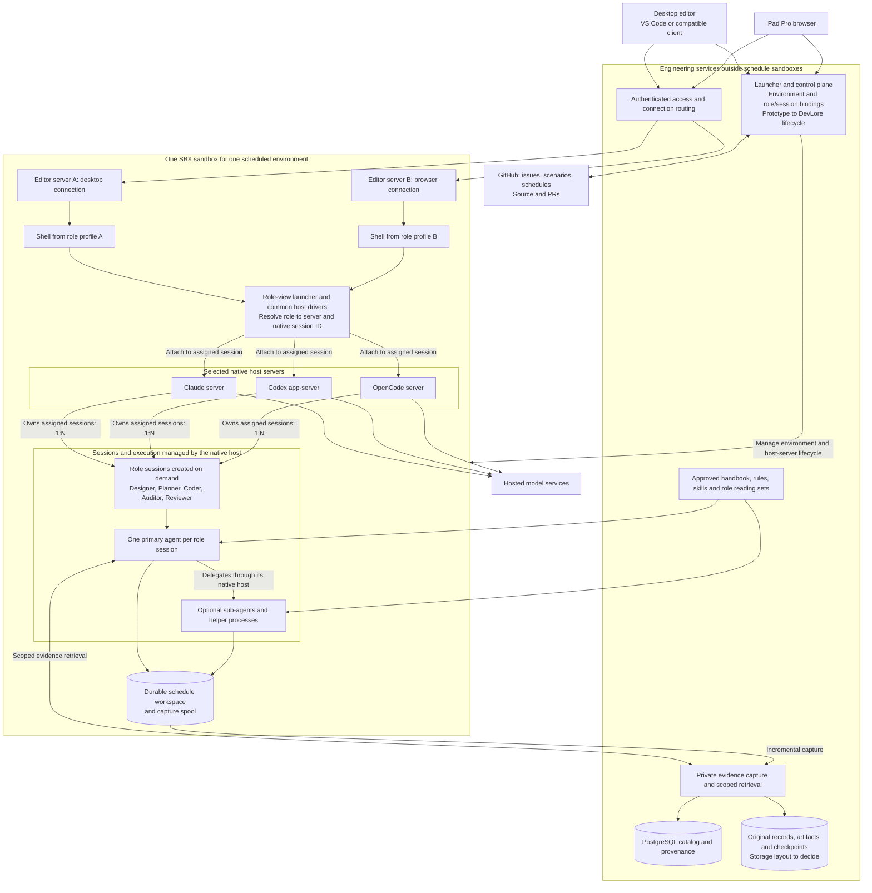
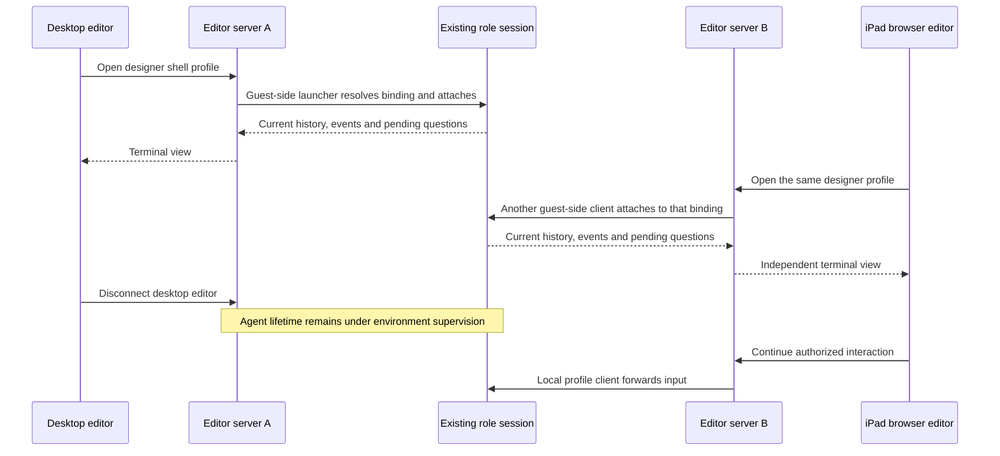
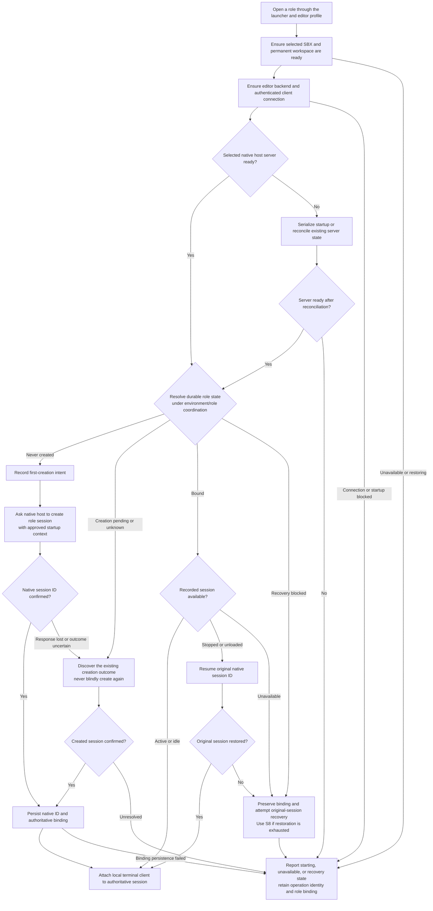
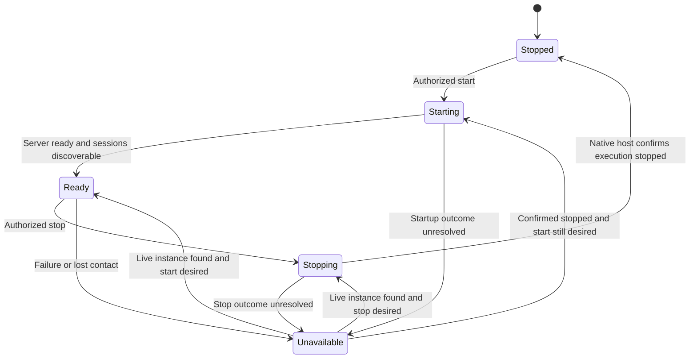

# Agentic Developer Workstation

Build a human-directed development environment in which five specialist agents work through
Claude, Codex, and OpenCode inside an SBX sandbox. The developer connects through desktop VS Code,
another compatible editor, or an iPad browser editor, opens role views from shell profiles,
and continues the same work across
devices, PRs, interruptions, and compactions.

| Document control | Value |
| --- | --- |
| Revision | 0.7 — specified interaction paths, ownership, and outcomes |
| Owner | NobleFactor Engineering Productivity |
| Design work | [Workstation architecture and delivery plan (#521)](https://github.com/NobleFactor/noblefactor-engprod/issues/521) |
| Plan | [Approved documentation plan](../plans/doc/521-workstation-design.md) |
| Delivery | [Roadmap and planner handoff](../roadmaps/agentic-developer-workstation.md) |
| Status | Proposed system architecture; the documentation plan is approved, while this revised design awaits owner review |
| Initial deployment | Hosted models, existing hardware, and SBX; no initial model hosting or hardware purchase |

## 1. Problem

Engineering work currently depends too heavily on the terminal and conversation in front of
the developer. An agent may have useful context, unfinished investigations, pending questions,
and unintegrated changes when the developer needs to leave the machine. Opening another
interface does not necessarily attach to that running agent. Device changes can become
session replacement, duplicated work, or a manual reconstruction of context.

The work itself outlives an individual branch. A schedule grows or shrinks through the owner's
amendments as design, planning, coding, and testing expose new information. The team works one
or more steps at a time and commits and merges frequently. Resetting all agents or replacing
the environment at every merge would discard useful continuity.

Conversation summaries also lose evidence: why an approach was rejected, which revision a
test exercised, what was uncertain, and whether a claimed success had supporting output.
Compaction makes that loss more likely. The [Engineering evidence archive (#490)](https://github.com/NobleFactor/noblefactor-engprod/issues/490)
addresses access to original evidence during ordinary reasoning and before compaction.

Finally, a working collection of tools does not by itself establish a development methodology.
We need to walk realistic scenarios, observe where the process and its tools fail, and turn
accepted findings into reviewed procedures, rules, skills, and implementation work. Design
begins before those implementation schedules exist.

## 2. Goals and scope

| ID | Goal | Observable result |
| --- | --- | --- |
| R1 | Preserve human direction | Assignments, approvals, amendments, and consequential actions retain their authority and provenance |
| R2 | Keep continuity at schedule scope | Short PR cycles preserve the environment, role identities, unfinished work, and useful sessions |
| R3 | Support five roles and all three hosts | Designer, planner, coder, auditor, and reviewer have independent contexts; Claude, Codex, and OpenCode run inside SBX |
| R4 | Support remote multi-device work | Compatible desktop and iPad editors launch shell profiles inside SBX to view the same running roles |
| R5 | Make evidence useful while working | Scoped retrieval returns originals, exact citations, context, and explicit gaps |
| R6 | Load current governing instructions | Each role loads its approved, measured reading set at startup and after compaction |
| R7 | Deliver accepted engineering changes | Early compliance feedback, exact-snapshot checks, independent closing review, and owner sign-off support correct changes |
| R8 | Converge on DevLore lifecycle management | DevLore ultimately manages the environments and services without losing their durable identities |
| R9 | Start with available resources | Hosted models run through the existing accounts/access; the initial system uses the available machines |
| R10 | Establish the methodology | Reviewed scenario evidence produces documented procedures and supporting tools that the team can actually use |

The initial hardware available is a Mac mini and a Minisforum system. Use of the Minisforum
shares capacity with centralized logging. Its logging-system design is outside this work.
Placement, resource reservations, and supported software versions require qualification.

[Local inference and capacity qualification (#515)](https://github.com/NobleFactor/noblefactor-engprod/issues/515)
remains a separate future track. Model serving, GPU sizing, procurement comparisons, and new
hardware are not prerequisites or completion gates for this hosted-model roadmap.

This design integrates [Agent-assisted engineering (#456)](https://github.com/NobleFactor/noblefactor-engprod/issues/456),
the evidence archive, and [Engineering handbook, agent rules and skills (#526)](https://github.com/NobleFactor/noblefactor-engprod/issues/526).
It does not independently redefine their policies or replace GitHub as the planning authority.

## 3. Our solution

A committed schedule has one logical development environment and one SBX sandbox. Native
host servers, role sessions, and the editor servers used to view them run inside that sandbox.
The five roles have independent sessions created on demand. PR worktrees, assignments,
terminal views, and device connections have shorter lifetimes. A replacement sandbox can
restore the same logical environment; it must not create a competing writable copy.

Shared engineering services live outside schedule sandboxes: the control plane, access
entry point, approved policy distribution, and private evidence archive. They remain available
when a schedule sandbox stops. The control plane prototypes existing host/sandbox contracts
first and ultimately relies on DevLore for lifecycle management.

The developer chooses a schedule and opens whichever roles are useful. Multiple editor-server
instances inside its sandbox provide independent desktop and browser connections. The editor
starts a shell/terminal profile inside SBX; that profile invokes the common role-view launcher,
which requests start-or-attach through the host-driver model. First use creates the role's
session and persists its binding; later views attach to or resume that same conversation.
Closing a view releases its attachment, while authorized agent work can continue.

The developer-facing path is editor connection, shell profile, role-view launcher, and native
session. Developer devices do not connect directly to the role hosts. VS Code is the initial
editor; another editor participates through a compatible environment connection and the
ability to start the same guest-side shell profiles.

Before a schedule exists, the designer works from the existing epic/feature and versioned
design assets. The design and roadmap are handed to the planner, who proposes issues,
dependencies, and one or more schedules. Section 7 identifies the remaining decision about
representing and transitioning a pre-schedule runtime environment.

## 4. Development workflow

### 4.1 Persistent specialists

| Role | Work it leads | Authority boundary |
| --- | --- | --- |
| Designer | Problem, goals, architecture, interfaces, workflow, and roadmap | Proposes design; edits authorized design assets |
| Planner | Issue decomposition, dependencies, proposed schedules, and amendments | Proposes commitments; applies only authorized tracker changes |
| Coder | Implementation, debugging, tests, and correction of findings | Writes the assigned workspace within current authorization |
| Compliance auditor | Standards checks, early findings, and final compliance evidence | Reads identified source/policy and records findings; does not rewrite the implementation it audits |
| Reviewer | Correctness, regression risk, design fit, and verification | Reviews identified inputs independently and participates in closing review |

These are separate persistent contexts, not a mandatory sequence of disposable agents.
A designer can revisit an interface during coding, and a planner can reassess dependencies
after a test exposes work. Roles and review independence remain owned by
[Roles (#460)](https://github.com/NobleFactor/noblefactor-engprod/issues/460) and
[Agent-assisted engineering (#456)](https://github.com/NobleFactor/noblefactor-engprod/issues/456).
Select hosts/model families to meet the independent-review contract, not merely different role names.

### 4.2 Begin with design before scheduling

The developer brings a problem to the designer. The designer reads current requirements,
existing work, and relevant evidence, then produces a proposed architecture, workflow,
roadmap, scenarios, and bounded open decisions. An existing epic/feature identifies the work;
a committed execution schedule is not required to formulate these assets.

The owner reviews the design. The handoff identifies accepted requirements, proposals still
open, interface owners, dependencies, acceptance demonstrations, and the first useful increment.
The roadmap is not a schedule commitment.

### 4.3 Move from designer to planner

The planner turns the reviewed assets into Tasks/Bugs under their owning Features, preserves
dependencies across those owners, and proposes one or more bounded schedules. Each issue
receives its plan before its work begins, according to the
[development process](../guides/development-process.md#plans).

A scenario describes the experience to exercise. A schedule orders the issues that advance
or walk it. [Portable tooling (#152)](https://github.com/NobleFactor/noblefactor-engprod/issues/152)
is the concrete example: a developer moves between machines while the work spans several
feature owners and dependency gates. Its [project-membership record](https://github.com/NobleFactor/noblefactor-engprod/issues/152#issuecomment-6661940131)
shows discovered work moving to Triage or schedules while its provenance is retained.
The older Thread-label language in the scenario body is historical.

The proposed first schedule walks selected scenarios and records the gaps in both tooling
and method. Its steps are walkthrough Tasks/Bugs linked to the persistent Scenario records,
rather than Scenario issues placed into step positions. The
[issue standard](../issue-standards.md#scenarios) supplies classification and movement rules.
The [Scenarios project](https://github.com/orgs/NobleFactor/projects/27/views/2) is the team's
working collection; the proposed scenarios in the roadmap are not claims about its live rows.

### 4.4 Start and work a scheduled environment

After the owner accepts a schedule, the developer selects it in the launcher. The control
plane resolves its stable environment and starts or resumes the associated SBX sandbox.
Opening a role profile resolves its selected host server and durable session binding. Start
the server if needed and create only a role that has never been created; otherwise attach
to or resume the recorded native session. Concurrent opens must converge on that same
binding instead of starting duplicate agents. A shared host server manages its sessions'
execution processes and optional sub-agents.

Before its first tool call, each role loads the governing common and role-specific reading
set and the assignment's source, plan, permissions, and checkpoint. Shorter reading sets
are introduced through reviewed [agent entry points (#528)](https://github.com/NobleFactor/noblefactor-engprod/issues/528),
not by silently dropping current required reading. The incident record is evidence, not a
compulsory startup document.

The developer selects designer and coder shell profiles in the connected editor, opens their
role views, inspects source and diffs, and gives bounded
assignments. The coder implements and tests; the designer resolves questions; the planner
proposes amendments when work changes. The auditor reviews coherent edit batches and tracks
findings through correction and recheck. Pending approvals remain visible when the developer
is away; disconnection grants no additional authority.

The current engineering process still governs Git operations, plans, PRs, and periods when
repository writes are prohibited. An editor connection or passing check cannot confer approval.

### 4.5 Leave the desktop and continue from an iPad

The developer leaves desktop VS Code with two roles visible. Their editor connection may
remain open or disconnect. The sandbox and role sessions remain available under supervision.

On the iPad, the developer authenticates to the launcher, selects the same environment,
and opens a browser editor connection backed by another editor-server instance in that
sandbox. Selecting the same designer or coder profile starts a guest-side attachment client
for the existing role session. The iPad connects to its editor backend; the attachment client
connects to the agent host from inside SBX. Each device can have its own layout, terminal
dimensions, and shell.

The new views show current conversation/progress, pending questions, and the assigned source
state. They do not fork conversations merely because another device is attached. Multiple
views are a requirement; input ordering, duplicate submission handling, and approval routing
are host-driver contracts to qualify, not an assumed single-controller policy.

### 4.6 Compact, recover, and continue

During normal work, a role searches relevant prior evidence and follows citations to originals.
Before a supported compaction, capture outstanding evidence, consult earlier sources, and
review a durable checkpoint while the role still has useful context. Preserve decisions and
rationale, rejected alternatives, uncertainty, verification references, pending operations,
unfinished work, and next action. After compaction, reload the current reading set and
continue with the same session identity.

Routine disconnection, sleep, process restart, and repairable resume failures recover the
original session. Reconcile interrupted operations before repeating them. Closing a viewing
laptop disconnects that device; an environment on another machine can continue authorized
work. Sleep of the machine running SBX suspends local execution when that machine actually
sleeps; it does not establish a durable application checkpoint. A failed resume alone does
not establish that the conversation is lost.

Disaster recovery addresses loss of native session state, including accidental deletion,
corruption, or destruction of its storage. Attempt to restore the original session from
retained state and available backups. When restoration is exhausted, present the evidence,
proposed successor, and known gaps for the owner's explicit approval. Establish the successor
as the role's sole authoritative session before it can act, then load current role reading,
inspect the worktree, and reconstruct context from the plan, checkpoints, and archived
originals. Preserve the original identity, approval, and succession record. The roadmap's
S8 scenario walks this transition; section 5.6 defines its recovery contract.

[Checkpoint integration (#494)](https://github.com/NobleFactor/noblefactor-engprod/issues/494)
owns the record; host drivers own provider operations; continuity integration coordinates
their boundary. Automatic compaction and crashes may bypass a cooperative hook, so continuous
capture and explicit gaps remain necessary. Native-state restoration and evidence-based
reconstruction are distinct recovery paths; reconstruction cannot promise complete context.

### 4.7 Merge increments and finish the work

A tested increment goes through the current approval and PR process. Final compliance evidence
must identify the exact candidate snapshot; a later source, policy, dependency, or check-environment
change can invalidate it. Frequent merges update the schedule's current state without resetting
useful roles or deleting its environment.

A Feature closes through the independent audit/review and owner's sign-off owned by
[closing review (#457)](https://github.com/NobleFactor/noblefactor-engprod/issues/457).
Passing an early audit, commit gate, or CI is not that closing review.

When the schedule satisfies its exit criteria, reconcile unfinished work and pending operations,
preserve its work products and evidence, and release runtime resources through the lifecycle
manager. Schedule completion, feature closure, sandbox shutdown, and evidence retention remain
distinct decisions.

## 5. System architecture

### 5.1 Components and placement

This diagram describes logical responsibilities. The shared services may initially be
colocated with the SBX host; their separation does not require another machine.



A role binds to one authoritative native session on one selected host. The five role contexts
are distributed across the selected host servers and created on demand; the shared session
group in the diagram represents that distribution, not a copy of every role on every host.

Each native server can manage multiple independent top-level sessions. Each session has a
primary agent and may delegate to sub-agents. The native host owns its internal execution
and helper-process lifecycle; the exact mapping from agents to operating-system processes
is host-specific. The control plane manages host-server lifecycle and durable role bindings
through the common drivers. Editor services own their terminal/attachment clients.
Additional views do not require another host server or another role session.

### 5.2 Identity, authority, and lifetime

| Object | Owner and lifetime |
| --- | --- |
| Design context | Existing epic/feature and versioned assets before schedule commitment; runtime representation remains open |
| Schedule | GitHub's durable commitment and execution order |
| Development environment | Stable schedule-scoped identity; one active SBX binding, recoverable across replacement |
| Role/agent | Logical specialist identity within the environment |
| Native host server | Claude, Codex, or OpenCode instance managing its assigned sessions and internal execution; may outlive individual views and serve multiple roles |
| Native session | Host-owned conversation/execution context; preserve its identity through routine recovery; owner-approved successor after disaster recovery exhausts restoration |
| Assignment | Bounded objective, issue/step, source, permissions, and recorded outcome |
| PR worktree | One increment's source scope; its process lifetime is shorter than the schedule's |
| Editor instance | Connection service inside SBX, with independently configured endpoints and runtime state |
| Shell/terminal profile | Editor launch configuration selecting a logical role and the common guest-side role-view entry point |
| View | Per-client attachment and presentation; may be released and recreated |
| Evidence/checkpoint | Durable, scoped record independent of device, session process, and sandbox lifetime |

GitHub holds planning authority. The control plane stores runtime bindings, operation intent,
observed outcomes, and reconciliation state. It does not become another backlog or schedule.
Persist operation identity before consequential actions; an unknown remote-write outcome
requires readback rather than blind repetition.

Each environment/role has at most one authoritative native session at a time. Persist the
original/successor relationship when disaster recovery requires replacement. A stopped,
unreachable, or missing session remains a recovery case; opening a profile must not silently
allocate a replacement conversation or erase the existing binding.

### 5.3 Common host-driver contract

[Agent hosts (#459)](https://github.com/NobleFactor/noblefactor-engprod/issues/459)
owns the Claude/Codex/OpenCode driver model, rooted in the existing OpenCode work. Extend
that contract rather than implement another adapter inside the launcher.

The native attachment clients run inside SBX, launched from editor shell profiles. Their
host protocols are internal integration paths, not endpoints developer devices must reach.
Control-plane automation uses the existing SBX/driver management boundary independently
of the human's editor connection. The drivers discover or start the selected host server,
then address a role session by its native ID. They do not recreate the host's internal
process manager or start a fresh daemon for every terminal view.

Serialize server startup by environment/host-instance identity and session creation by
environment/role identity. Persist creation intent and reconcile uncertain outcomes before
retrying. A driver must identify the created session after a lost response or report an
unresolved operation; it cannot blindly create another conversation.

Qualify native startup auto-creation and per-role configuration on a shared server.
A server-created conversation counts as a role only after its identity and approved role
configuration are associated with that authoritative binding.

Every driver reports support and failure behavior for start/discover, attach/detach,
history/events, submit/interrupt, approvals, policy loading, checkpoint/compaction, resume,
and replacement. Unsupported operations are explicit. A native background process is
independent of viewer connections only after that exact configuration has been tested.

Drivers distinguish temporary unavailability, repairable resume failures, and evidence that
native-state restoration is exhausted. A timeout or unavailable dependency cannot by itself
authorize replacement. Qualify restoration and approved succession independently for each host.

| Host | Documented foundation | Qualification required in SBX |
| --- | --- | --- |
| Claude | [Remote Control](https://code.claude.com/docs/en/remote-control) server mode manages multiple sessions; interactive and explicit single-session modes also exist | Shared-server role configuration, native editor-launched attachment, concurrent views, approval visibility, disconnection, and recovery on the pinned release |
| Codex | [App-server](https://learn.chatgpt.com/docs/app-server) manages multiple independent threads and provides remote TUI connections and thread-event subscriptions | Separate role contexts on one server, multiple native TUIs on one live thread, approval routing, retained execution with no human views, and failure recovery |
| OpenCode | [CLI background service](https://opencode.ai/docs/cli/) shares one server across clients; the server owns sessions and tool execution | Separate role contexts/configuration on one server, simultaneous clients of one session, capture/compaction, and recovery on the pinned release |

Codex's documented idle unload after the last subscriber requires an explicit continuity
strategy, such as a retained driver subscription. That is a proposed integration, not a
qualified guarantee. Do not infer unlimited simultaneous native TUI support from protocol
subscriptions alone.

Pin each host, model/provider configuration, instruction set, and tool/check environment.
Existing subscriptions and metered access remain subject to their actual authorization;
quota exhaustion must not silently select a new billable fallback.

### 5.4 Editor instances and attachment views

The editor service owns connection handling, terminal processes, and host attachment clients.
The native host owns the role session. A browser/terminal view is not the role's lifetime owner.

Profiles for designer, planner, coder, auditor, and reviewer invoke a common role-view entry
point in the sandbox. A profile identifies the logical role and guest workspace; the launcher
resolves the environment's authoritative host/session binding and requests start-or-attach.
The first open may request lifecycle creation of a never-created role; later opens start
local attachment clients for that same session. A stopped or unloaded session is resumed
under its original ID. Replacement remains an explicitly approved disaster-recovery
operation, separate from first creation and viewing.

Each editor uses its own profile configuration format and a compatible connection backend.
The role-view entry point and binding contract remain editor-independent. Profiles reference
the role and launcher rather than embedding mutable session IDs or credentials in device
configuration. Each launch gets its own terminal process and presentation.



This is the target contract to qualify for each host. A new logical editor connection can
receive an independent editor instance; a transient network reconnect should resolve its
existing instance/binding rather than repeatedly allocate servers.

Microsoft's [Remote Tunnels documentation](https://code.visualstudio.com/docs/remote/tunnels/#can-multiple-users-or-clients-access-the-same-remote-instance-simultaneously)
limits an instance to one user/client at a time. The proposed topology supports independent
instances in the same sandbox. [Coder code-server](https://coder.com/docs/code-server/ipad)
is another browser-editor candidate, with [different extension availability](https://coder.com/docs/code-server/FAQ).
Product/backend selection, profile configuration, concurrent instances, distinct server
state, transport, and iPad behavior must be demonstrated before declaring the topology qualified.

Run the endpoint near the workspace. Authenticate and route connections through the approved
access path. Publish the editor connection endpoints; keep native agent-host listeners on
guest-local interfaces or protected Unix sockets, without publishing them to developer devices.
Profiles inherit only their authorized guest context and credential references. Qualify
keyboard shortcuts, interruption, clipboard, focus, resizing, browser
suspension, and reconnection on the actual iPad. Client-local layout need not be mirrored.
Section 5.8 details the initial-state combinations, startup activity, and interaction catalog.

### 5.5 Shared evidence archive and policy

The [Engineering evidence archive (#490)](https://github.com/NobleFactor/noblefactor-engprod/issues/490)
runs outside schedule sandboxes under a separate service identity and durable storage
boundary. Its API serves authorized people and roles across schedules. PostgreSQL is the
preferred catalog/provenance/full-text platform. Physical placement of large originals
remains the archive's design decision.

A protected permanent spool captures available transcripts, tool-call/results, attachments,
and work artifacts incrementally. Preserve originals, source identity/ranges, hashes,
parser versions, capture watermarks, and explicit gaps before deriving indexes or summaries.
Capture is idempotent; distinguish local durable acknowledgment from backup recoverability.

Retrieval provides scoped search, bounded results, exact-source reads, citation resolution,
and surrounding-context expansion. Authorization applies to snippets, counts, artifacts,
and expanded context. Ordinary readers have read-only access; agents receive neither raw
archive mounts nor unrestricted database credentials. Retention, redaction, deletion,
backup, and index rebuilding remain owned by the archive features.

During disaster recovery, the archive supplies checkpoints and original evidence for rebuilding
a successor's working context. Restoring the original conversation requires usable native
session state; indexed evidence alone does not guarantee that state is recoverable. Retain the recovery
decision, approval, original/successor identities, evidence citations, capture watermarks, and
known gaps. If the needed evidence is unavailable or insufficient, report the limitation
rather than infer a complete history.

[Engineering handbook, agent rules and skills (#526)](https://github.com/NobleFactor/noblefactor-engprod/issues/526)
owns current procedural authority. Its measured role reading sets and host entry points
are consumed by the workstation. Historical evidence explains decisions; extracted claims
become accepted policy only through review. The handbook draft under review is not adopted
merely by being referenced here.

### 5.6 Workspaces, verification, and recovery

Canonical host clones stay protected. Each schedule uses a durable private workspace;
PR worktrees may share metadata within that private clone, not writable metadata with the
canonical clone. Source, drafts, prototypes, research, tests, findings, and checkpoints are
permanent from creation under [SBX requirements (#458)](https://github.com/NobleFactor/noblefactor-engprod/issues/458).
Reproducible caches and disposable runtime scratch are classified separately.

The auditor reads identified immutable input. The reviewer verifies a separate identified
snapshot/working area, with permissions enforcing the required independence. Distinct prompts
inside a shared sandbox are not a filesystem security boundary. All role hosts stay inside
the schedule sandbox; required target-specific test runners can return identified results
from qualified external target environments.

Compliance receipts bind source/base, policy, dependencies, check environment, coverage,
and verdict. Fence mutations while integrating or construct an immutable candidate; verify
that the actual integrated content is the reviewed content. Missing, stale, failed, or
inconclusive evidence blocks the required gate. Explicit overrides retain scope and rationale.

[Docker sandbox persistence](https://docs.docker.com/ai/sandboxes/usage/#what-persists)
depends on storage type and removal behavior. Qualify the chosen mounts/volumes, credential
handling, port access, and export/restore path. A sandbox template is not a complete backup.
Restore compatible workspace, configuration, archive, checkpoint, and binding manifests;
preserve evidence IDs and citations. Cross-compilation does not replace target runtime tests.

| Event | Required behavior |
| --- | --- |
| Client disconnect or editor failure | Release/recover views; preserve role execution within existing authority |
| Viewing laptop sleeps | Reconnect to the same session; an environment on another machine may continue working |
| Machine running SBX sleeps | Recover local execution and original sessions after wake; reconcile interrupted network/tool operations |
| Pending approval while away | Keep the question and exact scope visible; grant no new permission |
| Role process crash or repairable resume failure | Preserve work and binding; repair/restart and resume the original session; reconcile uncertain operations |
| Native session state lost, including accidental deletion | Attempt original-session restoration; require explicit owner approval and fencing before successor reconstruction |
| Compaction | Use supported checkpoint integration and reload current reading; report unsupported paths or gaps |
| Hosted model/network outage | Preserve state and report unavailability; use only authorized access/fallback |
| Archive outage | Use bounded permanent spooling, expose lag/gaps, and block transitions that require unsecured evidence |
| Host reboot or sandbox recreation | Recover durable work and role bindings; do not assume live processes survived |
| Lost GitHub response | Verify the resulting object before retrying a write |
| Disk/resource pressure | Enforce reservations and quotas; preserve work and report the affected capability |

Basic supervision, credentials, capture health, and recovery accompany the first prototype.
The host must remain awake and reachable for live remote work. Restoration has separately
reviewed loss windows and recovery objectives; this draft sets no numerical guarantees.

#### Disaster recovery and session succession

The invariant is one authoritative native session per environment/role at a time. After a
disaster, restoring the original conversation is the first recovery path. A successful
restoration retains its session identity. Diagnose configuration, credentials, connectivity,
storage mounts, and host compatibility before declaring restoration exhausted.

If restoration cannot succeed, retain a recovery record identifying the schedule/environment,
role, original session, incident, attempted remedies, available backups, and evidence coverage.
Present the proposed successor's host/configuration and context gaps for explicit owner
approval. An editor profile or automatic retry cannot grant that approval.

Prevent the old runtime and binding from authorizing further actions before giving the
successor tool or write authority. If this fencing cannot be established, keep replacement
blocked. Serialize the transition and preserve its operation identity so concurrent profile
opens and lost creation responses cannot authorize competing successors. Reconcile an unknown
creation outcome before retrying. A later return of the old session does not restore its authority.

Record the original and successor native IDs, binding revision, owner approval, cutover time,
and evidence used. Reload the approved role reading set, inspect the surviving plan and
worktree, and reconcile pending operations against actual outcomes. Use archive citations and
checkpoints to reconstruct decisions and next actions; report missing context explicitly.
Views attach to the successor through the current binding. Retain the original identity in
the historical record even when its native conversation data is lost.

The roadmap's S8 walkthrough qualifies this contract for Claude, Codex, and OpenCode. It is
a disaster-recovery requirement, including self-inflicted loss, with no claim about incident
frequency or a host's exact error wording. Ordinary suspension and reconnection remain
original-session recovery scenarios.

### 5.7 Initial physical deployment

| Machine | Candidate responsibility | Constraint |
| --- | --- | --- |
| Mac mini | SBX execution and colocated engineering services if the platform qualifies | Measure the combined role, editor, build, and service load |
| Minisforum | Shared engineering services or alternative execution placement if supported | Shares CPU, memory, storage, and I/O with centralized logging |
| Developer devices | Desktop VS Code and iPad browser clients | Development state remains in the environment and durable services |

The first proof uses an existing qualified machine. Separate logical services do not imply
dedicated hardware. Platform support, resource budgets, network access, backup destination,
and final placement are bounded implementation decisions. This design does not assume a
particular machine specification or redesign centralized logging.

### 5.8 Interaction lifecycle

Opening a role means ensuring its environment and editor access, resolving the selected
native server, and starting or attaching to the one authoritative role conversation.
Server readiness, conversation existence, active agent work, and visible terminal views
are separate states. This section defines the target interaction contract to qualify.

#### States that matter

| Dimension | States to distinguish | Why it matters |
| --- | --- | --- |
| Environment and SBX | Stopped, starting/restoring, ready, unavailable, retired | The editor and native hosts need the selected environment and its permanent workspace |
| Editor server | Absent/stopped, starting, ready, failed | A browser or desktop client being open does not establish that its backend is ready |
| Client connection | Disconnected, connecting/authenticating, connected | An editor server can continue without any connected developer device |
| Selected native host server | Stopped, starting, ready, unreachable, failed | One server can own several roles; an unreachable server is not proven absent |
| Durable role binding | Never created, creation in progress, bound, recovery blocked | Only confirmed first creation may allocate a new role conversation |
| Session execution | Unloaded/stopped, idle, working, awaiting approval, interrupted, unavailable | An existing conversation may need resume or repair while preserving its native identity |
| Terminal view | None, attaching, attached, disconnected; possibly several views | Opening or closing presentation does not create or end the role conversation |

Authorization, approved profile/configuration, pending operations, and service availability
are checked alongside these states. Failure of one check reports a specific blocked capability;
it does not grant authority, select a different host, or erase the role's binding.
A retired environment requires an authorized lifecycle decision before work resumes.

#### Interaction ownership and durable records

The lifecycle/driver boundary coordinates these interactions. It initially uses the
prototype integration and ultimately DevLore. The actions below describe contracts, not
new CLI verbs or another permanent control-plane implementation.

| Owner | Authoritative responsibility | Information retained for these interactions |
| --- | --- | --- |
| GitHub | Schedule, issue, plan, and accepted source/workflow authority | Existing native planning records; the runtime stores references |
| Lifecycle manager/control plane | Environment and host-server desired state, active runtime binding, role-to-session binding, and consequential operation intent/outcome | Stable target IDs, binding revisions, configuration references, operation IDs, actor/authority references, and observed results |
| Native host server | Conversation history, turn execution, approvals, and session-owned sub-agents/helper processes | Native session/turn/request IDs and execution outcomes, exposed through its driver |
| Editor service | Backend instance, client connection, shell/terminal process, and attachment lifetime | Environment/client/backend/view IDs and the role/session binding used for attachment |
| Capture/archive services | Preserved originals, capture completeness, source-linked checkpoints, and recovery evidence | Original locators, hashes, watermarks, explicit gaps, and archive receipts |

Before a consequential create/start/stop/submit/approve action, retain an operation ID,
target identity, expected binding revision, actor and authority reference, requested
action, and pending state. Complete the record with the observed native result and its
evidence references. An uncertain result remains unknown until reconciled. A repeated
request with the same operation ID returns or reconciles that operation; a different ID
cannot bypass the coordination on the same environment/host or environment/role target.

A terminal attachment carries the resolved role, server, native session ID, and binding
revision. Recheck that revision when attaching or submitting an action. If recovery has
superseded it, resolve the current binding before continuing. Displayed execution state
comes from the native host; the lifecycle record does not replace its conversation engine.
The local capture-spool storage engine remains undecided.

#### Eight stable startup combinations

For this table, **E** means the selected editor server is ready, **D** means the selected
native host server is ready, and **B** means the role already has a recorded native-session
binding. B describes persistent conversation identity, not whether a process is running.
An absent binding is eligible for creation only when the authoritative record establishes
that the role was never created. Missing or uncertain state requires reconciliation.

The launcher first makes the selected SBX environment and workspace ready. The developer's
role request then proceeds through an editor and its guest-side profile; no row exposes a
native host endpoint directly to the developer device.

| E | D | B | Required path for opening the role |
| --- | --- | --- | --- |
| No | No | No | Start editor; profile ensures host server; create role session once, persist binding, attach |
| No | No | Yes | Start editor; profile restarts host server; resume recorded session, attach |
| No | Yes | No | Start editor; profile creates role session on existing host server, persists binding, attaches |
| No | Yes | Yes | Start editor; profile attaches to or resumes recorded session on existing host server |
| Yes | No | No | Existing editor/profile starts host server, creates role session once, persists binding, attaches |
| Yes | No | Yes | Existing editor/profile restarts host server, resumes recorded session, attaches |
| Yes | Yes | No | Existing editor/profile creates role session once, persists binding, attaches |
| Yes | Yes | Yes | Existing editor/profile attaches to or resumes recorded session; create no new role conversation |

Every row ends with an attachment to the authoritative role session, or an explicit
starting, unavailable, or recovery state. Starting and unknown states are reconciled
before following a stable row. Reuse the intended editor/host instance where it exists;
allocate an independent editor instance only when the chosen backend/client routing needs it.

#### Start-or-attach activity



Server/session creation belongs to the lifecycle/driver boundary even when a profile
initiates it. Native hosts create and supervise their own session execution processes.
Load required role instructions before tool use at first startup and after relevant
recovery/compaction. A disconnected initiating view does not cancel a creation operation
whose outcome still needs reconciliation.

#### Interaction catalog

| Walkthrough | Interaction | Required outcome |
| --- | --- | --- |
| [I1](#i1-prepare-the-environment-and-editor) | Select environment and connect editor | Reuse or restore the intended environment/backend; roles remain on demand |
| [I2](#i2-create-or-resume-a-role-including-concurrent-opens) | First use, resume, concurrent opens, and lost creation replies | One authoritative role conversation or one retained unresolved operation |
| [I3](#i3-attach-reconnect-and-release-terminal-views) | Attach, reconnect, detach, and close the last view | Independent views preserve conversation identity, work, and pending inputs |
| [I4](#i4-work-and-approvals-across-views) | Submit work, answer approvals, and complete assignments | Identified ordering and approval outcomes shared across views |
| [I5](#i5-stop-suspend-and-resume-at-the-intended-scope) | Stop/resume a view, editor, role, host, or SBX; retire an environment | Affect the intended scope and preserve retained identities/work |
| [I6](#i6-recover-failures-while-preserving-identity) | Recover connectivity, services, storage, binding, and native state | Reconcile outcomes; restore original identities or use approved S8 succession |
| [I7](#i7-configuration-native-session-controls-and-delegation) | Change configuration, use native session controls, and delegate | Preserve the role binding and attribute child work to its parent |

The host-driver qualification must distinguish several views of one conversation from
several conversations on one server. A shared server restart can affect all roles assigned
to it. Native delegated sub-agents remain children of their session; they do not silently
replace another top-level role or change its binding. Retrieval/capture outages and other
service failures retain the behavior defined in section 5.6.

#### I1. Prepare the environment and editor

**Start:** the developer selects an environment from the launcher, or reconnects a known
editor connection. SBX, its workspace, and the editor backend can each be stopped or absent.

1. Authenticate the developer and resolve the stable environment/schedule identity and
   requested client connection. Check that opening it is within the current authority.
2. The lifecycle manager reads the environment's desired state and active runtime binding.
   If ready, reuse it. If confirmed stopped and authorized to start, record startup intent,
   restore the permanent workspace, and start that same environment. If already starting,
   join the existing operation and report its progress. If unreachable, discover its state
   before creating another runtime. A retired environment requires authorized reactivation.
3. Resolve the client's intended editor backend. Reuse it after a transient reconnect;
   start it if stopped. For an additional device, use another backend instance when the
   selected product's client limits require one. Record its identity and routing.
4. Make the workspace and reviewed role profiles available, verify backend readiness, and
   establish the authenticated editor connection. The developer can browse the workspace
   before opening any agent role.

**Finish:** an editor is connected to the selected environment. Native host servers and
role sessions are unchanged until requested. Failed authentication, unavailable storage,
or uncertain startup returns a named pending/blocked state with the operation identity.
Retrying the connection reconciles the same operation and intended backend.

#### I2. Create or resume a role, including concurrent opens

**Start:** a connected editor opens a role profile. The role may never have been created,
may have a stopped/unloaded conversation, or may already be working.

1. The profile passes logical environment/role identity and reviewed configuration to the
   common guest-side entry point. Resolve the selected host-server instance and ensure
   it is ready under environment/host coordination; concurrent roles can share that startup.
2. Under environment/role coordination, read the durable binding and any creation intent.
   A bound role uses its native ID. A never-created role records one first-creation intent.
   An in-progress or uncertain creation joins reconciliation of that existing intent.
3. Ask the native host to create the never-created role with its required startup context,
   or discover a session already produced by that intent. Associate any native startup
   auto-creation with an identified, approved role before treating it as that role.
4. Persist the confirmed native session ID and authoritative binding before returning it
   as ready. If the host created the session but binding persistence fails, keep the
   operation pending and reconcile it before another creation is allowed.
5. For an existing conversation, attach if live or resume the original native ID if
   unloaded/stopped. Load required instructions before tool use at startup/recovery.
   Preserve active work and approvals. Resume failure enters I6; it is not first creation.
6. Return the same binding to each waiting open request, then create its individual
   terminal attachment through I3.

An abandoned request, expired coordination claim, or coordinator restart changes who
reconciles the operation; it does not establish that creation never happened. If a host
cannot identify the outcome after a lost reply, report an unresolved operation and keep
creation blocked until its outcome can be established.

```mermaid
sequenceDiagram
    participant A as Editor profile A
    participant B as Editor profile B
    participant L as Lifecycle and host driver
    participant H as Native host server
    A->>L: Open coder
    B->>L: Open the same coder
    L->>L: Coordinate server startup and resolve role state
    L->>L: Persist one first-creation intent
    L->>H: Create role for that intent with startup context
    alt Native session ID confirmed
        H-->>L: Native session ID
        L->>L: Persist authoritative role binding
        L-->>A: Binding to the recorded native ID
        L-->>B: The same binding
    else Creation reply lost
        L->>L: Retain pending intent and unknown outcome
        L->>H: Discover the outcome of that creation
        alt Existing session identified
            H-->>L: Confirmed native session ID
            L->>L: Persist or reuse its binding
            L-->>A: Binding to the confirmed native ID
            L-->>B: The same binding
        else Outcome remains unresolved
            L-->>A: Creation pending; retain operation ID
            L-->>B: The same pending operation
        end
    end
```

**Finish:** one authoritative role conversation and separate attachments, or one retained
pending/recovery operation. No waiting view can turn an uncertain creation into another
conversation.

#### I3. Attach, reconnect, and release terminal views

**Start:** the role has a binding, and a desktop or iPad editor opens or reconnects a view.

1. The editor creates a terminal and invokes the guest-side attachment client with the
   logical role. Resolve and validate the current native ID and binding revision.
2. The driver attaches to that conversation and obtains current history/status and pending
   questions. Reconcile available history with the live event stream using the host's
   supported cursors or state refresh. Report unavailable intervals instead of inventing
   replayed output. The view shows current work without resubmitting the assignment.
3. Additional terminals/devices follow the same path, each with independent presentation
   and the same role binding. A binding changed by approved recovery is resolved again
   before an attachment or action can continue.
4. On terminal closure or connection loss, release only that attachment. If its editor
   backend also stops, reconnect through I1. Neither event changes the role's desired
   execution state or grants additional authority.
5. When the last human view closes, supervision and the qualified driver continuity path
   preserve authorized work. An idle runtime may unload while the native conversation
   remains stored. A later open resumes that original ID.

```mermaid
sequenceDiagram
    participant A as Desktop editor and profile
    participant B as iPad editor and profile
    participant D as Role attachment driver
    participant H as Native host server
    A->>D: Attach to coder
    D->>H: Attach to recorded native ID
    H-->>D: History, current status and pending questions
    D-->>A: Current role view
    A--xD: Connection lost
    Note over D,H: Role work and authority remain unchanged
    B->>D: Open the same coder profile
    D->>H: Resolve current binding and attach
    H-->>D: Current state and available history
    D-->>B: Independent view of the same conversation
    A->>D: Reconnect with known role/view identity
    D->>H: Reconcile history and live events
    D-->>A: Refreshed view; preserve uncertain submissions
```

**Finish:** attached views agree on conversation identity and observed work/approval state.
A disconnect never becomes a replay of an input whose execution outcome is unknown.

#### I4. Work and approvals across views

**Start:** one or more views are attached to an idle, working, or approval-blocked role.

| Action or observed state | Concrete interaction and resulting state |
| --- | --- |
| Open a view while the role is working | Read current progress/history; keep the same active assignment and native ID |
| Submit new input | Record submission identity and binding revision; forward through the host's supported ordering/queue contract; return accepted, queued, rejected, or unknown |
| Lose the submission reply | Read back the native turn/result where identifiable; keep an unknown outcome visible when it cannot be determined; do not automatically resubmit |
| Two views submit different inputs | Let the native host order, queue, or reject work through its published contract; show each request's result without imposing an invented single-controller restriction |
| Approval appears | Display the same native request ID, action/scope, and current outcome in every authorized attached view |
| A view answers approval | Validate its authority, current binding, and exact pending request; coordinate the answer and record the host's decision |
| Another view answers an already resolved request | Return the recorded result or stale-request response and refresh the view; do not authorize another action |
| Approval answer has an uncertain outcome | Reconcile the native request before retrying; retain pending/unknown state and grant no additional permission |
| All views disconnect with approval pending | Preserve the question and its scope; execution remains blocked where approval is required |
| Assignment completes | Record its outcome and verification references; return the conversation to its observed idle/waiting state without ending the role |

```mermaid
sequenceDiagram
    participant H as Native host server
    participant D as Host driver and approval coordination
    participant A as Role view A
    participant B as Role view B
    H-->>D: Approval Q with exact scope
    D-->>A: Q pending
    D-->>B: The same Q pending
    A->>D: Answer Q under current authority and binding
    D->>D: Record answer intent and coordinate Q
    D->>H: Submit answer to Q
    H-->>D: Q resolved; action may proceed
    D-->>A: Q resolved
    D-->>B: Q resolved
    B->>D: Late answer to Q
    D-->>B: Already resolved; show recorded outcome
```

**Finish:** all views can recover the accepted ordering and approval outcomes. An expired
request, changed action/scope, or superseded binding returns a stale/conflict result and
the current question. Approval resolution and subsequent action completion are separate
observations. Host differences remain explicit in the driver capability record.

#### I5. Stop, suspend, and resume at the intended scope

A lifecycle request names the target and desired state. The scope determines what stops:

| Target | What stops or disconnects | What remains |
| --- | --- | --- |
| One terminal view | Its terminal/attachment | Role conversation, authorized work, other views, and host server |
| One editor backend | Its client connections and terminal clients | Native host servers, conversations, durable work, and other editor instances |
| One role's execution | Its supported active-turn interruption/pause through the native host | Conversation/native ID, other role sessions, and the shared host server |
| One native host server | Execution managed by that server; every assigned role is accounted for | Role identities/history and permanent workspace; editors and other host servers |
| SBX runtime | Its editor and native host services and local execution | Stable environment/role bindings, permanent work, spool/checkpoints, and shared external services |
| Environment retirement | New work and released runtime resources under the accepted lifecycle decision | Retained work, evidence, and historical bindings under their retention policy |

For a planned server/environment stop:

1. Persist the target, desired state, operation ID, and current binding generation.
   Prevent older automatic reconnect/start requests from reversing this stop.
2. Identify affected roles and pending work. Preserve available evidence and checkpoints;
   record unfinished or uncertain operations. If required preservation is unavailable,
   report why the transition is blocked or incomplete.
3. Use native host/driver stop or interruption operations. Each native host manages its
   own children and helper processes; the control plane supervises the selected server
   resource rather than guessing which worker PIDs to terminate.
4. Observe the result before reporting stopped. If contact is lost or children may still
   act, report unknown/stopping and reconcile or fence the old runtime before replacement.
   A forced stop requires its own explicit authorization and records the exposed loss window.
5. A fresh authorized start/resume reconciles the same retained resources and native IDs.
   Reload current reading and inspect pending outcomes before continuing bounded work.
   Pending approvals remain pending; a deliberate stop is not reversed by a stale view retry.

The following states describe a host-server resource. Its conversation identities survive
these process transitions:



**Finish:** the requested scope is stopped or resumed, or a specific unresolved transition
is reported. Stopping one view cannot report that an entire environment is stopped.
Unplanned suspension, machine failure, and crashes use I6 because they may bypass preparation.

#### I6. Recover failures while preserving identity

| Failure | Recovery interaction | Result visible to the developer |
| --- | --- | --- |
| Viewing device disconnects or sleeps | Reconnect the intended editor/backend and follow I3 | Same role/native ID, refreshed state, and unresolved inputs still identified |
| Editor backend fails | Lifecycle manager restores that backend/profile path; views reattach | Workspace and roles retain identity; affected views show reconnect progress |
| Native server is unreachable | Discover the existing instance and operation outcome before restarting | Unavailable/unknown until observed; no competing daemon or new conversation |
| Native server is confirmed stopped/crashed | Honor desired state; restart it if authorized, discover retained sessions, and reconcile interrupted work | Original native IDs resume; pending approvals and uncertain actions retain their status |
| SBX or its machine restarts | Restore the permanent workspace and active environment binding, then required services and original sessions | Recovery progress and restored identities; no assumption that old processes survived |
| Runtime replacement is needed | Reconcile/fence the old active environment binding before activating its replacement | One authoritative runtime with the retained environment/role IDs |
| Workspace or local capture storage is unavailable/full | Report the failed durability capability; block writes/transitions that require it until preserved work is secure | Existing state remains inspectable where possible; no claim of successful preservation |
| Archive/PostgreSQL connection fails | Capture into the bounded permanent spool; retry delivery and reconcile receipts on return | Capture lag/coverage and blocked archive-dependent operations; backlog delivery preserves evidence identity |
| Model/provider access fails | Preserve conversation/work; restore authorized access and reconcile the interrupted turn | Role remains identifiable with an explicit unavailable/interrupted state; no implicit fallback |
| Authentication expires | Reauthenticate the affected client/service within its existing scope | Connection or capability restored without enlarging the role's permissions |
| Binding state is missing or ambiguous | Restore binding records/manifests and compare native identities and operation receipts | Recovery blocked until the authoritative role can be established; absence is not first creation |
| Native conversation cannot be restored | Follow S8: evidence of exhausted restoration, explicit owner approval, fencing, and recorded succession | Successor identity and original relationship, reconstructed context, and explicit gaps |

A restored native process does not prove that a previously issued tool or remote write did
nothing. Reconcile actual source/remote outcomes before repeating the operation. Recovery
returns the role to its observed idle, working, or approval-blocked state within existing
authority. It does not manufacture missing history or automatically repeat the last prompt.

#### I7. Configuration, native session controls, and delegation

A role profile selects a logical role and reviewed configuration. On open, compare that
configuration with the existing binding and the server's supported per-session settings.
Compatible reviewed changes apply through the supported host path while preserving native
identity. Conflicts return the current configuration and a required lifecycle/design decision;
they cannot silently change hosts, overwrite the binding, or create a replacement.

Role-bound attachment clients address the recorded native session ID. Native new/fork/switch
actions cannot silently change that role binding. The driver must pin the managed attachment
or otherwise enforce its conversation identity at the supported host boundary. If the
native attachment path cannot enforce this contract, report it as unsupported and implement
a qualified controlled attachment path under the host feature before declaring completion.

Native delegation is a separate interaction. The primary agent asks its native host to
create/manage a child under its existing assignment and approved permissions. Preserve
parent/child native identities and capture available child evidence. A delegated child is
not another top-level role binding, and its completion does not end the primary conversation.
The control plane observes these relationships without replacing the native process manager.

**Finish:** reviewed configuration and managed views still resolve to the authoritative
role conversation; delegated work is attributable to its parent and remains within scope.

## 6. Qualification and completion

The [roadmap](../roadmaps/agentic-developer-workstation.md#5-delivery-waves-and-gates)
defines the delivery sequence. Qualify the complete workflow: accepted changes, correction
effort, human interventions, continuity, useful evidence retrieval, and independent review.

Required demonstrations include all three host paths, five independent roles in one SBX
environment, shared host-server session separation, all eight stable startup combinations,
simultaneous desktop/iPad role views, the I1–I7 interaction outcomes, concurrent first opens
and lost-response reconciliation, scoped stop/resume, cross-view approval resolution,
iterative schedule amendments and PR cycles,
pre-compaction evidence use, original-session restart/restore, disaster recovery with
owner-approved succession and visible gaps, and eventual DevLore lifecycle management.
Accept the documented methodology and its use on real work alongside the working platform.

Measure accepted-change latency, blocking intervals, repeated investigations, correction
cycles, capture gaps, and recovery outcomes. Agree numerical quality, response-time, and
recovery thresholds with the owner before using them as acceptance gates.

Owner acceptance of a buildable baseline and first actionable increment completes the
architecture handoff under Workstation architecture and delivery plan (#521). Delivery
and acceptance of the entire environment are later roadmap outcomes.

## 7. Decisions to resolve through the roadmap

| ID | Open decision | Resolution owner and evidence |
| --- | --- | --- |
| D1 | Pre-schedule runtime and transition into one or several schedules | Designer/planner under #521/#517; walk design-to-planning without inventing a schedule prerequisite |
| D2 | Editor/backend product, shell profiles, independent instances, transport, and per-client routing | #517/#520; demonstrate simultaneous desktop/iPad access, all eight startup combinations, and profile-launched role views inside SBX |
| D3 | Exact host capabilities, shared-server configuration, and input/approval behavior | #459 with #517; qualify session separation, creation discovery, native session-switch handling, and versioned failure behavior |
| D4 | Original-artifact layout, retention, and recovery acknowledgments | #490/#492/#496; scoped retrieval and a complete restore |
| D5 | Initial placement and resource budgets | #518/#520; qualify the existing machines and shared-service contention |
| D6 | DevLore lifecycle integration surface and migration | DevLore lifecycle owner with #517/#520; reviewed interface, dependency work, adoption and rollback demonstration |

These decisions stay explicit for review. The roadmap identifies when each must be resolved.
Implementation plans, schedule commitments, policy adoption, publication, and purchases
retain their existing approval processes.
