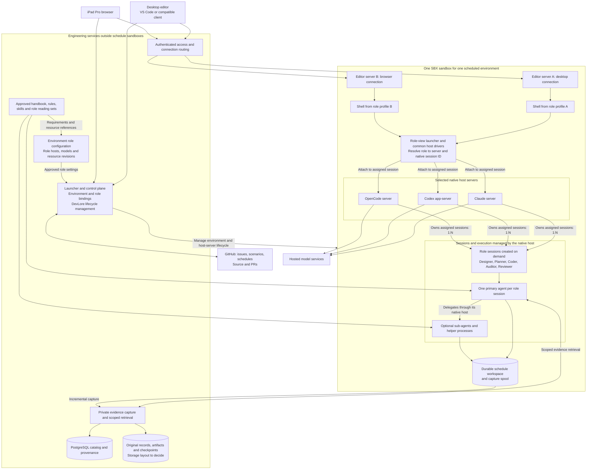
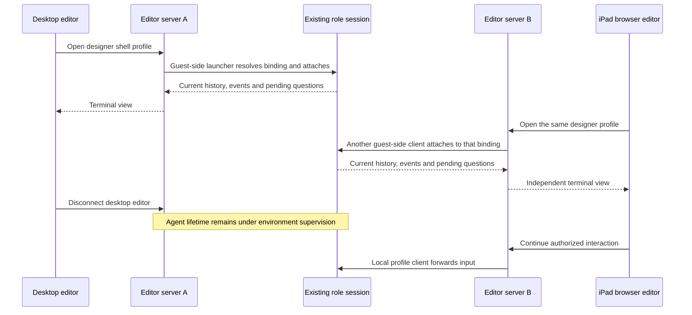
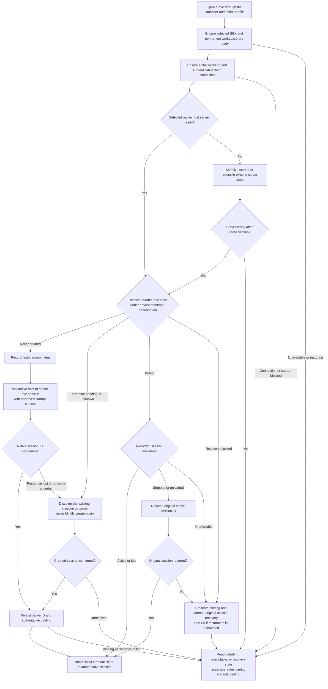
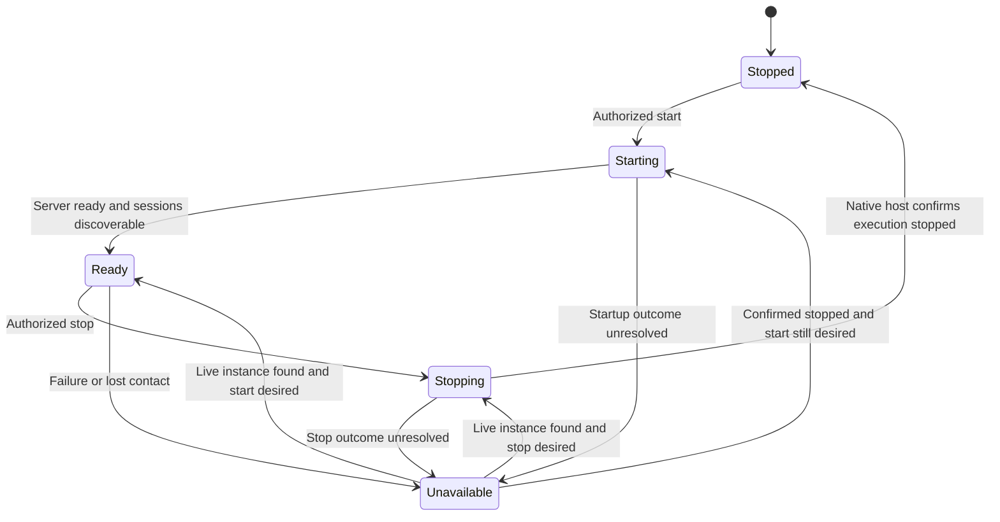

# Agentic developer workstation

The workstation gives a developer five persistent agent roles inside a schedule's SBX sandbox. Desktop and iPad editors open views of those roles through shell profiles. Work, conversation identity and evidence survive short PR cycles and device changes.

This is a proposed system design. The [roadmap](../roadmaps/agentic-developer-workstation.md) defines delivery and qualification; the [decision companion](agentic-developer-workstation.decisions.md) records significant choices and open questions.

<a id="1-problem"></a>

## 1. Problem and goals

Engineering work outlives the terminal, device and branch used to start it. A device change can interrupt an investigation, hide a pending question or cause another session to repeat work. Frequent merges can discard useful context if the environment is tied to a PR.

A schedule changes as design, implementation and tests reveal work. The developer needs continuity across those amendments while retaining control over assignments, approvals and consequential actions.

Conversation summaries alone cannot preserve the original reasons, rejected alternatives, uncertainty or verification results. The system needs durable work, access to original evidence and a documented development method exercised through realistic scenarios.

<a id="2-goals-and-scope"></a>

### 1.1 Role assignments

David Noble owns the architecture. The approved Schedule assignments name the contributors and review scopes. For the shared-role amendment, [Handbook adoption (#551)](https://github.com/NobleFactor/noblefactor-engprod/issues/551) assigns Codex as Coder; the Owner appoints the Antigravity technical Reviewer and Claude Code Compliance auditor to assess the architecture and affected assets. No Observer assignment is recorded. These document assignments do not select the hosts used by the designed system.

<a id="11-goals"></a>

### 1.2 Capabilities

| ID | Goal | Observable result |
| --- | --- | --- |
| R1 | Preserve human direction | Assignments, approvals, amendments and consequential actions retain their authority and source |
| R2 | Keep continuity across a schedule | PR cycles preserve its environment, role identities, unfinished work and useful sessions |
| R3 | Support five roles on three hosts | Designer, planner, coder, compliance auditor and reviewer have separate contexts on Claude, Codex or OpenCode inside SBX |
| R4 | Work across devices | Desktop and iPad editors open profiles onto the same running roles |
| R5 | Use original evidence while working | Scoped retrieval returns exact sources, citations, surrounding context and visible gaps |
| R6 | Load governing instructions | Roles load the approved common and role reading sets at startup and after compaction |
| R7 | Deliver accepted engineering changes | Early findings, checks of the exact candidate, independent closing review and Owner sign-off support delivery |
| R8 | Use DevLore for lifecycle management | Environment and service operations preserve their durable identities |
| R9 | Use available resources | Hosted models and existing machines support the initial deployment |
| R10 | Establish the methodology | Reviewed scenario evidence produces procedures and supporting tools that work on real assignments |

### 1.3 Quality goals

The architecture prioritizes five qualities.

1. Preserve authority: each consequential action has the correct assignment and approval; reconnecting never grants authority.
2. Preserve identity: views, PR cycles, and compatible restarts retain the assigned role's native session.
3. Preserve evidence: retained originals, citations, and explicit gaps support verification and recovery.
4. Protect access: authenticated editor access and scoped evidence reads preserve service and credential boundaries.
5. Recover visibly: restore the original session first; any approved successor retains the original identity, attempted recovery, and known gaps.

### 1.4 Stakeholders

These stakeholders need different outcomes from the workstation.

| Stakeholder | Interest and architectural concern |
| --- | --- |
| David Noble, engineering Owner | Retain final authority, inspect evidence, and continue work across devices and schedules |
| Engineers using the environment | Find the correct role and worktree, preserve unfinished work, and understand recovery outcomes |
| Technical reviewers and compliance auditors | Inspect an exact candidate with applicable requirements, sources, and verification limits |
| Environment and archive operators | Restore services and data, enforce access, and manage capacity on the shared machines |
| DevLore and native-host maintainers | Provide explicit lifecycle and host interfaces without hiding unsupported capabilities |

<a id="2-constraints-and-scope"></a>

## 2. Constraints

The initial deployment uses hosted models and existing access. The available machines are a Mac mini and a Minisforum system; the Minisforum shares capacity with centralized logging. Platform support, versions and resource budgets require qualification. Logging-system design is outside this work.

[Local inference and capacity qualification (#515)](https://github.com/NobleFactor/noblefactor-engprod/issues/515) owns any later model serving, benchmarks, hardware selection or procurement. Those outcomes are separate from this roadmap's completion criteria.

GitHub remains authoritative for issues, schedules, scenarios, source and PRs. The shared [engineering process](../engineering/process.md) governs approvals, plans, Git operations and repository writes. Runtime access and passing checks grant no additional authority.

All role hosts run inside the schedule sandbox. Review independence requires appropriate model families and permissions; different role names or prompts inside one sandbox do not create a filesystem security boundary.

<a id="3-system-context"></a>

## 3. Context and scope

| External system or owner | Relationship |
| --- | --- |
| Developer devices | Connect to the launcher and authenticated editor services |
| GitHub | Supplies planning and source authority; receives approved issue, schedule and PR changes |
| Hosted model services | Serve the selected native hosts within authorized account access and quotas |
| [Agent-assisted engineering (#456)](https://github.com/NobleFactor/noblefactor-engprod/issues/456) | Owns roles, host drivers, sandbox requirements and closing-review methodology |
| [Engineering evidence archive (#490)](https://github.com/NobleFactor/noblefactor-engprod/issues/490) | Owns capture, catalog and provenance, retrieval, checkpoints, protection and recovery |
| [Engineering handbook, agent rules and skills (#526)](https://github.com/NobleFactor/noblefactor-engprod/issues/526) | Owns governing process, role reading sets, host entry points, standards and skills |
| [Agentic workstation integration (#514)](https://github.com/NobleFactor/noblefactor-engprod/issues/514) | Owns the integrated developer experience, continuity, workspaces, compliance and operations |
| DevLore | Owns the lifecycle resource and control-plane contracts used to manage environments and services |

The human access path is device → editor backend inside SBX → role shell profile → guest-side role-view launcher → native session. Native host listeners remain private to SBX. Control-plane management uses the SBX/driver boundary independently of an editor connection.

<a id="3-our-solution"></a>

## 4. Solution strategy

A committed schedule has one logical environment and one active SBX sandbox. The environment keeps its identity across a replacement runtime. It holds on-demand role sessions, selected native host servers, editor backends and a durable private workspace. PR worktrees, assignments, terminals and device connections have shorter lifetimes.

A durable binding maps each environment/role to one selected host-server instance and native conversation ID. First use creates a never-created role once; subsequent views attach to or resume that conversation. Routine recovery preserves its native identity. Replacement follows the [approved succession contract](#84-session-succession).

Native host servers own their sessions, primary agents and delegated execution. The control plane manages server lifecycle and durable bindings through the common drivers. Editors own terminal clients and presentation. Additional views reuse the same role session.

The launcher, access routing, policy distribution and private archive run outside schedule sandboxes. Their logical separation permits them to remain available when a sandbox stops; they may share a physical machine with SBX.

A design runs on a schedule with separate design and roadmap issues. The Designer supplies the design, its architecture decisions, and a roadmap directly from the approved problem and scope. The Planner uses these assets to prepare implementation issues, plans, and schedules and remains a consultant throughout. [D1](agentic-developer-workstation.decisions.md#d1) covers continuity from a design schedule into implementation schedules.

<a id="5-system-architecture"></a>

<a id="51-components-and-placement"></a>

<a id="5-components"></a>

## 5. Components and interfaces



The role-session group represents five contexts distributed among selected hosts. It does not require a copy of every role on every host. A native server can serve several roles; its internal mapping of agents to operating-system processes is host-specific.

<a id="41-persistent-specialists"></a>

### 5.1 Roles

Each specialist leads this work within the stated authority.

| Role | Work it leads | Authority boundary |
| --- | --- | --- |
| Designer | Design documents, their architecture decisions, and a roadmap | Proposes design; edits authorized design assets |
| Planner | Schedules, issue plans, dependencies, amendments, and ongoing planning advice | Proposes commitments; applies only authorized tracker changes |
| Coder | Implementation, debugging, tests, and correction of findings | Writes the assigned workspace within current authorization |
| Compliance auditor | Standards checks, early findings, and final compliance evidence | Reads identified source and policy and records findings; does not rewrite the implementation it audits |
| Reviewer | Correctness, regression risk, design fit, and verification | Reviews identified inputs independently and participates in closing review |

Roles remain available for iterative work. A designer can revisit an interface during coding, and a planner can amend proposed work after a test exposes a dependency. [Roles (#460)](https://github.com/NobleFactor/noblefactor-engprod/issues/460) and the closing-review contract define authority and independence.

<a id="53-common-host-driver-contract"></a>

### 5.2 Native host drivers

[Agent hosts (#459)](https://github.com/NobleFactor/noblefactor-engprod/issues/459) owns the common Claude, Codex and OpenCode driver model. The role-view launcher consumes that contract.

Drivers discover or start the selected server, then address a role by native ID. Serialize server startup by environment/host identity and role creation by environment/role identity. Persist creation intent before asking the host to create a session. After a lost reply, discover the result or report an unresolved operation before another creation is allowed.

Qualify native startup auto-creation and per-session configuration. A server-created conversation becomes a role only after its identity and approved configuration are associated with the authoritative binding.

Each driver reports support and failure behavior for discovery and startup, attachment and detachment, history and events, input and interruption, approvals, policy loading, checkpoints and compaction, resume and replacement. It distinguishes temporary unavailability, repairable resume faults and exhausted native-state restoration. Unsupported behavior remains visible.

| Host | Primary reference | Qualification needed |
| --- | --- | --- |
| Claude | [Remote Control](https://code.claude.com/docs/en/remote-control) documents multi-session server and single-session modes | Approved per-role configuration, editor-launched native attachments, simultaneous views, approvals, disconnection and recovery |
| Codex | [App-server](https://learn.chatgpt.com/docs/app-server) supplies independent threads and event subscriptions | Shared-server context separation, simultaneous native TUIs on one thread, approval/input handling, no-view execution and recovery |
| OpenCode | [Background service](https://opencode.ai/docs/cli/#background-service) owns sessions and execution for shared clients | Per-role configuration, simultaneous views of one session, capture, compaction and recovery |

The documented foundations do not demonstrate the proposed SBX/editor integration. Codex can unload a thread after its last subscriber leaves; qualify a continuity strategy, such as a retained driver subscription. Protocol subscriptions alone do not prove simultaneous native TUI support.

Pin host releases, model and provider settings, instructions and tool and check environments. Restore only authorized model access. Quota exhaustion or a connection failure cannot silently select a billable fallback.

<a id="54-editor-instances-and-attachment-views"></a>

### 5.3 Editors and profiles

Designer, planner, coder, auditor and reviewer profiles identify a logical role, guest workspace and common role-view entry point. Bindings resolve mutable host/session IDs; device configuration does not embed those IDs or credentials. Each open creates its own terminal presentation.

An editor service owns its backend, device connections, terminals and attachment clients. A transient reconnect resolves the intended backend. An additional device can use another independently configured backend inside the same sandbox.



[VS Code Remote Tunnels](https://code.visualstudio.com/docs/remote/tunnels/#can-multiple-users-or-clients-access-the-same-remote-instance-simultaneously) limits a server instance to one user/client at a time. Independent instances are the proposed topology for simultaneous devices. [Coder code-server's iPad support](https://coder.com/docs/code-server/ipad) is another candidate, with [different extension availability](https://coder.com/docs/code-server/FAQ). Product choice, coexistence, routing and separate runtime state remain [D2](agentic-developer-workstation.decisions.md#d2).

Publish authenticated editor endpoints. Keep native agent endpoints on guest-local interfaces or protected Unix sockets. Profiles receive only their authorized context and credential references. Qualify actual iPad keyboard shortcuts, interruption, clipboard, focus, resizing, suspension and reconnect behavior. Layouts and terminal dimensions remain client-local.

<a id="55-shared-evidence-archive-and-policy"></a>

### 5.4 Evidence and policy services

The [archive design](engineering-evidence-archive.md) and [roadmap](../roadmaps/engineering-evidence-archive.md) define the proposed capture, custody, retrieval and recovery contracts for review. The archive runs outside schedule sandboxes with its own service identity and durable storage. PostgreSQL is the preferred catalog, provenance and full-text platform. Placement of large originals remains the archive owner's decision.

A protected permanent capture spool holds available transcripts, tool calls/results, attachments and work artifacts incrementally. Preserve originals, source identity/ranges, hashes, parser versions, capture watermarks and explicit gaps before deriving indexes or summaries. Capture is idempotent. Local durable acknowledgment and backup recoverability are separate facts.

Retrieval offers scoped search, bounded results, exact-source reads, citation resolution and surrounding-context expansion. Authorization covers snippets, counts, artifacts and expanded context. Ordinary readers have read-only access; agents use the scoped API rather than raw archive mounts or unrestricted database credentials. The archive owns retention, redaction, deletion, backup and index rebuilding.

The handbook supplies approved common and role reading sets and host entry points. Evidence explains prior work; extracted claims become policy through review. [Role entry points (#528)](https://github.com/NobleFactor/noblefactor-engprod/issues/528) owns measured startup/post-compaction reading. Required reading changes through that review process.

<a id="environment-role-configuration"></a>

### 5.5 Environment role configuration

Each environment has a versioned configuration applied to its active SBX sandbox. It identifies the Schedule, each role's approved host and model settings, its workspace, and references to common context, role instructions, and skills. Shared defaults support consistent setup; environment choices remain subject to the shared requirements.

| Record | Responsibility and location |
| --- | --- |
| Shared policy and defaults | The handbook's [compliance policy](../engineering/agent-operation.md#compliance-auditing) and shared role resources define responsibilities, audit scope, independence, triggers, and authority; policy distribution runs outside schedule sandboxes |
| Environment role configuration | The control plane retains the approved configuration and its source revision outside the sandbox and makes the applicable settings and resources available inside it |
| Role binding and observed state | The control plane retains the selected daemon, original conversation ID, binding revision, actual model, and loaded resource evidence for each role within an environment |
| External review and audit records | The PR introducing the changes holds the external reviews, findings, and corrective verification; review text is kept outside repository commits |

The control plane uses DevLore to manage the environment and selected native hosts. Each role resolves through one authoritative binding for each role within its environment. Host selection is a setting in that binding, not a second identity under which another copy of the role can be created. Additional terminal views attach to the same native conversation.

Configuration states the intended model; the host reports the model actually used. Record provider, model identifier, and family against the affected work. The Compliance auditor must use a different model family from every builder of the candidate. A distinct host name or role label does not establish that independence. If the configured auditor is ineligible or its model is unknown, report the conflict to the Owner and retain the existing binding. The Owner may authorize a [one-off audit](#compliance-audit-flow) by an eligible third model family for the identified candidate, preserving the assigned auditor's conversation and binding.

Reviewed settings changes follow [I7](#i7-configuration-native-session-controls-and-delegation). Compatible changes preserve conversation identity. A different host preference does not authorize a new role conversation or bypass [session succession](#84-session-succession). The [configuration decision](agentic-developer-workstation.decisions.md#w8) records the responsibilities. [Developer control (#517)](https://github.com/NobleFactor/noblefactor-engprod/issues/517) owns configuration formats, revisions, and durable bindings; [Agent hosts (#459)](https://github.com/NobleFactor/noblefactor-engprod/issues/459) owns application through the native hosts. Their implementation plans define delivery.

### 5.6 Management and access services

The launcher resolves a Schedule to its environment and shows the available roles and editor connections. The control plane retains environment configuration, role bindings, and pending lifecycle operations outside the sandbox. It calls DevLore and the host drivers to carry out authorized lifecycle requests; it does not acquire the Owner's authority.

The access service authenticates device connections, selects an editor backend, and routes each connection to that backend inside SBX. It exposes editor access, not native agent-host listeners. Separate backend instances retain their own terminals and client state while their role views resolve the same role binding.

The policy service distributes versioned references to common instructions, role material, and skills. Configuration selects the applicable resources; loading evidence records what a session actually read. The evidence services retain originals and provide scoped retrieval under the archive's independently owned contract.

<a id="58-interaction-lifecycle"></a>

## 6. Runtime and development workflow

The runtime distinguishes environment readiness, editor access, server readiness, conversation identity, execution and views. The following interactions define the required outcomes; the [roadmap's acceptance cases](../roadmaps/agentic-developer-workstation.md#interaction-acceptance-cases) define their demonstrations.

<a id="4-development-workflow"></a>

### 6.1 Development workflow

<a id="42-begin-with-design-before-scheduling"></a>

<a id="43-move-from-designer-to-planner"></a>

#### 6.1.1 Design and planning

The Owner approves a design schedule with at least two issues: design and roadmap. The Designer works from the agreed problem and scope and produces the design, its architecture decisions, and roadmap directly, without a plan for writing them. The Owner reviews these assets. The handoff identifies accepted requirements, remaining proposals, interface owners, dependencies, and the first useful increment.

The planner proposes Tasks and Bugs under their owning Features, retains cross-owner dependencies, and creates one or more bounded schedules through the approved process. Each implementation issue receives its plan before implementation begins.

A Scenario describes an experience; a Schedule orders the Tasks/Bugs that advance or walk it. [Portable tooling (#152)](https://github.com/NobleFactor/noblefactor-engprod/issues/152) and its [project-membership record](https://github.com/NobleFactor/noblefactor-engprod/issues/152#issuecomment-6661940131) illustrate a journey spanning owners while discovered work moves into Triage or schedules with its origin retained. Apply the [current Scenario model](../issue-standards.md#scenarios).

The first proposed implementation schedule walks selected scenarios and records gaps in tooling and method. Its steps are Tasks and Bugs linked to persistent Scenario records. The [Scenarios project](https://github.com/orgs/NobleFactor/projects/27/views/2) is the team's collection; roadmap scenario IDs identify proposed narratives, not filed records.

<a id="44-start-and-work-a-scheduled-environment"></a>

#### 6.1.2 Scheduled work

The developer selects an Owner-approved schedule. The control plane resolves its environment and starts or resumes SBX. Opening a role profile resolves its server and role binding through I1/I2.

Before tool use, the role loads required common and role instructions and its source, plan, permissions and checkpoint. The incident record supplies evidence rather than compulsory startup reading.

The developer opens useful roles, inspects source/diffs and gives bounded assignments. The coder implements/tests; the designer answers design questions; the planner proposes scope changes; the auditor records findings and rechecks corrections; the reviewer assesses identified results independently. Disconnection leaves the same authority and pending approvals in force.

<a id="45-leave-the-desktop-and-continue-from-an-ipad"></a>

#### 6.1.3 Change devices

A developer can leave two role views open on desktop VS Code and open the same environment in an iPad browser editor. A guest-side profile attaches to the existing role's native session. Both devices can show current conversation, progress, source state and pending questions while keeping independent layouts.

Several views do not fork a conversation. Their input ordering, duplicate handling and approval routing follow the qualified driver contract rather than an assumed single-controller restriction.

<a id="46-compact-recover-and-continue"></a>

#### 6.1.4 Compaction and continuity

During work, roles retrieve relevant prior evidence and follow citations to originals. Before a supported compaction, capture outstanding evidence, consult prior sources and review a durable checkpoint containing decisions/reasons, rejected alternatives, uncertainty, verification references, pending operations, unfinished work and the next action.

After compaction, reload current reading and continue the same session. [Checkpoint integration (#494)](https://github.com/NobleFactor/noblefactor-engprod/issues/494) owns the record; host drivers supply provider operations. Crashes and automatic compaction may bypass cooperative hooks, so continuous capture and explicit gaps remain necessary.

<a id="47-merge-increments-and-finish-the-work"></a>

#### 6.1.5 Merge and completion

A tested increment follows the approval and PR process. Final compliance evidence identifies the exact candidate; changed source, policy, dependencies or check environment can invalidate it. Frequent merges preserve useful sessions and the schedule environment.

[Closing review (#457)](https://github.com/NobleFactor/noblefactor-engprod/issues/457) owns the independent audit/review and Owner sign-off needed for Feature closure. Early audit, a commit gate or CI does not establish that closure.

At schedule completion, reconcile unfinished work and pending operations, preserve work/evidence and release runtime resources under lifecycle authority. Schedule completion, Feature closure, shutdown and retention are separate decisions.

<a id="states-that-matter"></a>

<a id="interaction-ownership-and-durable-records"></a>

### 6.2 States and operation records

| Dimension | States to distinguish | Why it matters |
| --- | --- | --- |
| Environment and SBX | Stopped, starting/restoring, ready, unavailable, retired | The editor and native hosts need the selected environment and its permanent workspace |
| Editor server | Absent/stopped, starting, ready, failed | A browser or desktop client being open does not establish that its backend is ready |
| Client connection | Disconnected, connecting/authenticating, connected | An editor server can continue without any connected developer device |
| Selected native host server | Stopped, starting, ready, unreachable, failed | One server can own several roles; an unreachable server is not proven absent |
| Durable role binding | Never created, creation in progress, bound, recovery blocked | Only confirmed first creation may allocate a new role conversation |
| Session execution | Unloaded/stopped, idle, working, awaiting approval, interrupted, unavailable | An existing conversation may need resume or repair while preserving its native identity |
| Terminal view | None, attaching, attached, disconnected; possibly several views | Opening or closing presentation does not create or end the role conversation |

Check authority, approved configuration, pending operations and service availability alongside these states. An unreachable service is not proven absent; a retired environment requires authorized reactivation.

| Owner | Authoritative responsibility | Information retained for these interactions |
| --- | --- | --- |
| GitHub | Schedule, issue, plan, and accepted source/workflow authority | Existing native planning records; the runtime stores references |
| Lifecycle manager and control plane | Environment and host-server desired state, active runtime binding, role binding, and consequential operation intent and outcome | Stable target IDs, binding revisions, configuration references, operation IDs, actor and authority references, and observed results |
| Native host server | Conversation history, turn execution, approvals, and session-owned sub-agents/helper processes | Native session/turn/request IDs and execution outcomes, exposed through its driver |
| Editor service | Backend instance, client connection, shell and terminal process, and attachment lifetime | Environment, client, backend, and view IDs and the role binding used for attachment |
| Capture/archive services | Preserved originals, capture completeness, source-linked checkpoints, and recovery evidence | Original locators, hashes, watermarks, explicit gaps, and archive receipts |

Before consequential create/start/stop/submit/approve actions, retain an operation ID, target, expected binding revision, actor and authority reference, requested action and pending state. Record the observed native result and evidence. Repeated requests with the same operation ID resolve that operation. A different ID cannot evade coordination on the same server or role.

Each attachment carries role, server, native ID and binding revision. Validate the revision when attaching or acting; resolve a superseded binding again. Execution status comes from the native host. Unknown outcomes remain visible until readback establishes what happened.

<a id="eight-stable-startup-combinations"></a>

### 6.3 Startup combinations

Make SBX and its permanent workspace ready first. In this table, E means the intended editor backend is ready, D means the selected native server is ready, and B means a role has a recorded conversation binding. B describes stored identity rather than a running process.

| E | D | B | Required path for opening the role |
| --- | --- | --- | --- |
| No | No | No | Start editor; profile ensures host server; create role session once, persist binding, attach |
| No | No | Yes | Start editor; profile restarts host server; resume recorded session, attach |
| No | Yes | No | Start editor; profile creates role session on existing host server, persists binding, attaches |
| No | Yes | Yes | Start editor; profile attaches to or resumes recorded session on existing host server |
| Yes | No | No | Existing editor/profile starts host server, creates role session once, persists binding, attaches |
| Yes | No | Yes | Existing editor/profile restarts host server, resumes recorded session, attaches |
| Yes | Yes | No | Existing editor/profile creates role session once, persists binding, attaches |
| Yes | Yes | Yes | Existing editor/profile attaches to or resumes recorded session; create no new role conversation |

Only an authoritative never-created state permits first creation. Reconcile starting, missing and uncertain records before using a stable row. Reuse intended instances; allocate another editor backend only when its product/client routing requires one. Each path ends in an attachment or an explicit pending, unavailable or recovery state.

<a id="start-or-attach-activity"></a>

<a id="interaction-catalog"></a>

### 6.4 Environment and role startup

<a id="i1-prepare-the-environment-and-editor"></a>

#### 6.4.1 I1. Prepare the environment and editor

Authenticate the developer and resolve the requested environment/schedule and editor connection. Read desired state and the active runtime binding. Reuse a ready environment; join an existing startup; start a confirmed stopped environment when authorized. Discover an unreachable runtime before replacing it.

Restore the permanent workspace and intended editor backend. Reconnect to an existing backend after a transient loss; allocate another for an additional device when required. Record backend identity/routing, make reviewed profiles available and establish the authenticated connection.

The developer can browse work before starting any role. Authentication, storage or startup failures return a specific pending/blocked state and operation ID. Repeated opens reconcile that operation and backend.

<a id="i2-create-or-resume-a-role-including-concurrent-opens"></a>

#### 6.4.2 I2. Create or resume a role

The profile supplies logical environment and role identity. Resolve its approved environment configuration, ensure server readiness under environment and host coordination, then read binding and creation intent under environment and role coordination.

For a never-created role, record one intent and request creation with approved context. Associate any native startup-created session with that intent and role configuration. Persist the confirmed native ID and binding before reporting ready. If creation succeeds but binding persistence fails, retain the pending operation and reconcile it before another creation.

For a bound role, attach if live or resume its original ID if stopped/unloaded. Preserve active work and approvals, load required instructions before tools, and send resume faults to I6. Return one binding to waiting opens and create their separate attachments.

An abandoned request, expired coordination claim or coordinator restart changes who reconciles the operation; it does not prove creation never happened. If the driver cannot determine a lost creation outcome, keep creation blocked with the same operation ID.

```mermaid
sequenceDiagram
    participant A as Editor profile A
    participant B as Editor profile B
    participant L as Lifecycle and host driver
    participant H as Native host server
    A->>L: Open coder
    B->>L: Open the same coder
    L->>L: Coordinate server startup and resolve role state
    L->>L: Persist one first-creation intent
    L->>H: Create role for that intent with startup context
    alt Native session ID confirmed
        H-->>L: Native session ID
        L->>L: Persist authoritative role binding
        L-->>A: Binding to the recorded native ID
        L-->>B: The same binding
    else Creation reply lost
        L->>L: Retain pending intent and unknown outcome
        L->>H: Discover the outcome of that creation
        alt Existing session identified
            H-->>L: Confirmed native session ID
            L->>L: Persist or reuse its binding
            L-->>A: Binding to the confirmed native ID
            L-->>B: The same binding
        else Outcome remains unresolved
            L-->>A: Creation pending; retain operation ID
            L-->>B: The same pending operation
        end
    end
```



<a id="i3-attach-reconnect-and-release-terminal-views"></a>

### 6.5 I3. Views and reconnect

An editor terminal invokes the guest-side client with the logical role. Resolve and validate the binding, attach to its native ID, and obtain available history, current status and pending questions. Reconcile history and live events using supported cursors or state refresh; identify unavailable intervals.

Additional views follow the same path with independent presentation. Approved recovery can change the binding, which must be resolved before further actions. Closing a terminal releases that attachment. Editor failure reconnects through I1; neither event changes role authority or desired execution.

When the last human view closes, supervision and the qualified continuity path preserve authorized work. An idle runtime may unload while its conversation remains stored; a later open resumes its original ID. Reconnection does not resubmit assignments or inputs with unknown outcomes.

```mermaid
sequenceDiagram
    participant A as Desktop editor and profile
    participant B as iPad editor and profile
    participant D as Role attachment driver
    participant H as Native host server
    A->>D: Attach to coder
    D->>H: Attach to recorded native ID
    H-->>D: History, current status and pending questions
    D-->>A: Current role view
    A--xD: Connection lost
    Note over D,H: Role work and authority remain unchanged
    B->>D: Open the same coder profile
    D->>H: Resolve current binding and attach
    H-->>D: Current state and available history
    D-->>B: Independent view of the same conversation
    A->>D: Reconnect with known role/view identity
    D->>H: Reconcile history and live events
    D-->>A: Refreshed view; preserve uncertain submissions
```

<a id="i4-work-and-approvals-across-views"></a>

### 6.6 I4. Work and approvals

| Action or observed state | Concrete interaction and resulting state |
| --- | --- |
| Open a view while the role is working | Read current progress/history; keep the same active assignment and native ID |
| Submit new input | Record submission identity and binding revision; forward through the host's supported ordering/queue contract; return accepted, queued, rejected, or unknown |
| Lose the submission reply | Read back the native turn/result where identifiable; keep an unknown outcome visible when it cannot be determined; do not automatically resubmit |
| Two views submit different inputs | Let the native host order, queue, or reject work through its published contract; show each request's result without imposing an invented single-controller restriction |
| Approval appears | Display the same native request ID, action/scope, and current outcome in every authorized attached view |
| A view answers approval | Validate its authority, current binding, and exact pending request; coordinate the answer and record the host's decision |
| Another view answers an already resolved request | Return the recorded result or stale-request response and refresh the view; do not authorize another action |
| Approval answer has an uncertain outcome | Reconcile the native request before retrying; retain pending/unknown state and grant no additional permission |
| All views disconnect with approval pending | Preserve the question and its scope; execution remains blocked where approval is required |
| Assignment completes | Record its outcome and verification references; return the conversation to its observed idle/waiting state without ending the role |

Every attached authorized view identifies the same native approval request, action/scope and result. Validate an answer's authority, binding and exact pending request. Coordinate its submission; a late answer returns the recorded result or a stale-request response. Expired requests, changed scope and superseded bindings cannot authorize another action.

```mermaid
sequenceDiagram
    participant H as Native host server
    participant D as Host driver and approval coordination
    participant A as Role view A
    participant B as Role view B
    H-->>D: Approval Q with exact scope
    D-->>A: Q pending
    D-->>B: The same Q pending
    A->>D: Answer Q under current authority and binding
    D->>D: Record answer intent and coordinate Q
    D->>H: Submit answer to Q
    H-->>D: Q resolved; action may proceed
    D-->>A: Q resolved
    D-->>B: Q resolved
    B->>D: Late answer to Q
    D-->>B: Already resolved; show recorded outcome
```

Approval resolution and action completion are separate observations. Host differences remain explicit in the capability record.

<a id="i5-stop-suspend-and-resume-at-the-intended-scope"></a>

### 6.7 I5. Stop and resume

A lifecycle request names its target and desired state.

| Target | What stops or disconnects | What remains |
| --- | --- | --- |
| One terminal view | Its terminal/attachment | Role conversation, authorized work, other views, and host server |
| One editor backend | Its client connections and terminal clients | Native host servers, conversations, durable work, and other editor instances |
| One role's execution | Its supported active-turn interruption/pause through the native host | Conversation/native ID, other role sessions, and the shared host server |
| One native host server | Execution managed by that server; every assigned role is accounted for | Role identities/history and permanent workspace; editors and other host servers |
| SBX runtime | Its editor and native host services and local execution | Stable environment/role bindings, permanent work, spool/checkpoints, and shared external services |
| Environment retirement | New work and released runtime resources under the accepted lifecycle decision | Retained work, evidence, and historical bindings under their retention policy |

For a planned server/environment stop, persist target, desired state, operation ID and binding generation. Prevent stale reconnect/start requests from reversing it. Identify affected roles, preserve available evidence/checkpoints and record unfinished or uncertain operations.

Use native stop/interruption controls and let each host manage its children. Confirm the observed result before reporting stopped. Lost contact or potentially active children require reconciliation or revocation of the old runtime's authority. A forced stop needs explicit approval and a recorded loss window.

A fresh authorized start reconciles the retained resources and original native IDs. Reload reading and inspect pending outcomes before continuing. Pending approvals stay pending. Unplanned suspension and crashes use I6.



<a id="i6-recover-failures-while-preserving-identity"></a>

### 6.8 I6. Failure recovery

| Failure | Recovery interaction | Result visible to the developer |
| --- | --- | --- |
| Viewing device disconnects or sleeps | Reconnect the intended editor backend and follow I3 | Same role/native ID, refreshed state, and unresolved inputs still identified |
| Editor backend fails | Lifecycle manager restores that backend/profile path; views reattach | Workspace and roles retain identity; affected views show reconnect progress |
| Native server is unreachable | Discover the existing instance and operation outcome before restarting | Unavailable/unknown until observed; no competing daemon or new conversation |
| Native server is confirmed stopped/crashed | Honor desired state; restart it if authorized, discover retained sessions, and reconcile interrupted work | Original native IDs resume; pending approvals and uncertain actions retain their status |
| SBX or its machine restarts | Restore the permanent workspace and active environment binding, then required services and original sessions | Recovery progress and restored identities; no assumption that old processes survived |
| Runtime replacement is needed | Reconcile/fence the old active environment binding before activating its replacement | One authoritative runtime with the retained environment/role IDs |
| Workspace or local capture storage is unavailable/full | Report the failed durability capability; block writes/transitions that require it until preserved work is secure | Existing state remains inspectable where possible; no claim of successful preservation |
| Archive/PostgreSQL connection fails | Capture into the bounded permanent spool; retry delivery and reconcile receipts on return | Capture lag/coverage and blocked archive-dependent operations; backlog delivery preserves evidence identity |
| Model/provider access fails | Preserve conversation/work; restore authorized access and reconcile the interrupted turn | Role remains identifiable with an explicit unavailable/interrupted state; no implicit fallback |
| Authentication expires | Reauthenticate the affected client/service within its existing scope | Connection or capability restored without enlarging the role's permissions |
| Binding state is missing or ambiguous | Restore binding records/manifests and compare native identities and operation receipts | Recovery blocked until the authoritative role can be established; absence is not first creation |
| Native conversation cannot be restored | Follow S8: evidence of exhausted restoration, explicit owner approval, fencing, and recorded succession | Successor identity and original relationship, reconstructed context, and explicit gaps |

Read actual source/remote outcomes before repeating interrupted effects. Recovery returns the role to its observed idle, working or approval-blocked state within existing authority. It does not automatically replay the last prompt.

<a id="i7-configuration-native-session-controls-and-delegation"></a>

### 6.9 I7. Configuration and delegation

Compare profile configuration with the binding and supported per-session settings. Apply compatible reviewed changes through the host while preserving identity. Conflicts report the current configuration and required lifecycle/design decision; they cannot silently switch hosts or allocate a replacement.

Managed clients address the recorded native ID. Native new/fork/switch controls must not silently change a role binding. Pin the attachment or enforce identity at a supported host boundary. An attachment path unable to do so remains unsupported until a controlled path qualifies.

Native delegation creates children under the primary session's assignment and permissions. Preserve parent/child identities and available evidence. A child does not become another top-level role or end its parent on completion. The control plane observes this work through the driver.

<a id="compliance-audit-flow"></a>

### 6.10 Compliance audits

[Continuous compliance (#519)](https://github.com/NobleFactor/noblefactor-engprod/issues/519) owns audit routing and commit-trigger implementation under the [handbook compliance policy](../engineering/agent-operation.md#compliance-auditing). The role-context work supplies policy and shared role resources.

An audit is requested on demand or through an enabled commit trigger after the existing pre-commit checks pass. The shared compliance policy governs which requests are required and when blocking is enabled. The request identifies the exact changes, base and candidate versions, builder model evidence, applicable requirements, and check results. The request resolves the environment's Compliance auditor through its existing role binding and checks independence before the assessment begins.

If that auditor helped build the candidate or its independence cannot be established, report the conflict. The Owner may authorize a one-off audit by an eligible third model family independent of every builder. Give that auditor a request-specific assignment rather than a second persistent environment and role binding. Keep the assigned auditor's conversation and binding unchanged. Record the approval, exact candidate and base, original binding reference, actual auditor and model, and results with the audit request and introducing PR. If no eligible auditor is available, report the audit as unresolved; do not change the binding or claim an independent pass.

The auditor derives the assets to inspect from the authoritative [compliance scope and evidence requirements](../engineering/agent-operation.md#compliance-auditing). The request carries the exact candidate and base revisions, adopted requirements, and check results. The auditor follows the changes into all affected assets and records the method, findings, and limits. Deterministic checks establish mechanical facts; the auditor evaluates obligations that require context.

Record the reviewed versions, actual auditor model, requirement revisions, findings, and corrective verification with the PR that introduces the changes. Reports produced before a PR exists remain outside Git and are attached when that PR is opened. External review text is not committed to the repository. Changed inputs require the affected checks and findings to be rechecked; unresolved mandatory findings and missing required evidence remain visible to the Owner.

<a id="57-initial-physical-deployment"></a>

## 7. Deployment

| Machine | Candidate placement | Qualification |
| --- | --- | --- |
| Mac mini | SBX and colocated shared services | Platform support and combined role/editor/build/service load |
| Minisforum | Shared services or SBX if supported | CPU, memory, storage and input and output headroom alongside centralized logging |
| Developer devices | Desktop editor and iPad browser clients | Authentication, supported input/clipboard behavior and reconnect |

The first proof uses a qualified existing machine. Logical services do not require dedicated hardware. Resolve platform support, network access, quotas, backup destination, and resource reservations before relying on the placement. The SBX machine must remain awake and reachable for live remote work.

[Sandbox persistence](https://docs.docker.com/ai/sandboxes/usage/#what-persists) depends on storage and removal behavior. Qualify the selected mounts/volumes, credentials, ports and export/restore paths. Target-specific test runners can return identified results from qualified external environments; cross-compilation does not replace runtime tests.

## 8. Shared concepts

<a id="52-identity-authority-and-lifetime"></a>

### 8.1 Identity and authority

These objects retain distinct ownership and lifetimes.

| Object | Owner and lifetime |
| --- | --- |
| Design context | Design schedule, owning Epic and Feature, design and roadmap issues, and versioned assets |
| Schedule | GitHub's durable commitment and execution order |
| Development environment | Stable schedule-scoped identity; one active SBX binding, recoverable across replacement |
| Role/agent | Logical specialist identity within the environment |
| Native host server | Claude, Codex, or OpenCode instance managing its assigned sessions and internal execution; may outlive individual views and serve multiple roles |
| Native session | Host-owned conversation/execution context; preserve its identity through routine recovery; owner-approved successor after disaster recovery exhausts restoration |
| Assignment | Bounded objective, issue/step, source, permissions, and recorded outcome |
| PR worktree | One increment's source scope; its process lifetime is shorter than the schedule's |
| Editor instance | Connection service inside SBX, with independently configured endpoints and runtime state |
| Shell/terminal profile | Editor launch configuration selecting a logical role and the common guest-side role-view entry point |
| View | Per-client attachment and presentation; may be released and recreated |
| Evidence/checkpoint | Durable, scoped record independent of device, session process, and sandbox lifetime |

GitHub owns planning. The control plane retains runtime bindings, desired/observed state and operation reconciliation; it does not become another backlog. At most one native session per environment/role is authoritative. Missing or unreachable state enters recovery without erasing the binding.

<a id="56-workspaces-verification-and-recovery"></a>

### 8.2 Durable work and verification

Canonical clones remain protected. A schedule uses a private durable workspace; its PR worktrees may share that private clone's metadata while keeping canonical metadata protected. [SBX requirements (#458)](https://github.com/NobleFactor/noblefactor-engprod/issues/458) makes source, drafts, prototypes, research, tests, findings and checkpoints permanent from creation. Classify reproducible caches and disposable scratch separately.

Auditors read identified immutable inputs; reviewers verify separate identified snapshots/working areas. Permissions enforce the required independence. Compliance receipts bind source/base, policy, dependencies, check environment, coverage and verdict. Revoke mutation authority during integration or construct an immutable candidate, then verify that integrated content matches reviewed content. Missing, stale, failed or inconclusive evidence blocks its required gate. Explicit overrides retain scope and reasons.

### 8.3 Capture and restoration

An archive outage uses bounded permanent spooling with visible lag/coverage. Block transitions requiring evidence that is not securely preserved. On return, reconcile delivery receipts and preserve evidence identity. The local spool storage engine remains undecided. Evaluate integrity, performance, reliability, security and maintenance for each store; [W8](agentic-developer-workstation.decisions.md#w8) records the Owner's withdrawal of the earlier storage-uniformity preference.

Machine sleep suspends local execution when it occurs; it is not an application checkpoint. A viewing laptop's sleep only affects its view when SBX runs elsewhere. Restore compatible workspace, configuration, archive, checkpoint and binding manifests after reboot or runtime replacement. A sandbox template alone is not a complete backup, and live processes are not assumed to survive.

Restoration has separately reviewed loss windows and recovery objectives. This design sets no numerical guarantees.

<a id="disaster-recovery-and-session-succession"></a>

### 8.4 Session succession

Restore the original native conversation first. Diagnose configuration, credentials, connectivity, mounts and host compatibility before treating restoration as exhausted. A failed resume or timeout alone does not establish loss.

When restoration is exhausted, retain the incident, original schedule, environment, role, and native session identity, attempted remedies, backups, and evidence coverage. Present a proposed successor, its host and configuration, and known gaps for explicit Owner approval.

Before the successor can act, prevent the old runtime and binding from authorizing further actions. This revocation is called fencing. If fencing cannot be established, replacement remains blocked. Serialize cutover and reconcile unknown creation outcomes before retrying.

Record original/successor IDs, binding revision, approval, cutover time and evidence. Reload current role instructions, inspect the plan/worktree and reconcile pending operations. Reconstruct decisions and next actions from checkpoints and cited originals, reporting missing context. The archive supports reconstruction but cannot guarantee recoverable native state or complete context.

Views resolve the new binding; a returning old runtime does not regain authority. Retain original identity even when its conversation is lost. [Scenario S8](../roadmaps/agentic-developer-workstation.md#s8--disaster-recovery-after-loss-of-a-native-session) qualifies this contract for each host.

<a id="9-significant-decisions"></a>

## 9. Architecture decisions

Use the [decision-record standard](../standards/documentation.md#decision-records) and [decision template](../templates/decision.md) for significant choices.

The [decision companion](agentic-developer-workstation.decisions.md) records editor access, native server ownership, session succession, environment role configuration, and one-off independent audits. It also records the proposed schedule and runtime and shared-archive choices and links the unresolved D1–D6 questions.


<a id="6-qualification-and-completion"></a>

<a id="10-quality-and-acceptance"></a>

## 10. Quality requirements

The following scenarios measure the identity, authority, evidence, and recovery requirements. Counts and identity comparisons come from the stated contracts; latency, capacity, and recovery-loss budgets require separately reviewed qualification.

| Quality | Stimulus and environment | Required response | Measure |
| --- | --- | --- | --- |
| Identity continuity | Desktop and iPad open the same role in one environment | Both views resolve the retained role binding | Two views report the same native session ID; no additional role session is created |
| Concurrent creation | Two views request a role with no prior binding, and one create reply is lost | Serialize creation and reconcile the unknown result before retry | Exactly one retained role binding; no second creation while the first outcome is unknown |
| Authority | An unapproved action arrives through a second view | The host and control plane preserve the existing authorization boundary | Zero consequential actions execute under a grant created solely by attachment |
| Evidence integrity | A scoped query returns a source excerpt | Return the exact original range and its identity, or an explicit gap | Every returned citation resolves to matching retained content; missing content is never labeled complete |
| Audit scope | A candidate changes a value described in unchanged help, completions, or man pages | Include those affected assets in the audit | Every affected fixture asset appears in the assessment; each correction is rechecked against the identified candidate |
| Independent audit | Builders include the bound auditor's model family | Use an Owner-approved eligible auditor for one candidate or report an unresolved request | Zero verified independent passes without actual model-family evidence |
| Session recovery | Restore original native state, or exhaust that restoration and approve a successor | Retain the original ID and recovery evidence; fence the old authority before cutover | A restored session retains its ID; succession has one active binding, recorded approval, and no active old authorization |
| Configuration consistency | A role reads revised resources | Record supplied and read revisions separately | Every claimed loaded resource has matching version and read evidence; publication alone yields no loading claim |

Qualify all three host paths and five independent roles in one SBX environment. Demonstrate shared-server context separation, all eight startup combinations, I1–I7 outcomes, simultaneous desktop and iPad views, concurrent creation and lost-response reconciliation, approvals across views, and stop/resume at the intended scope.

Exercise schedule amendments and repeated PR merges, evidence use before compaction, startup/post-compaction reading, original-session restoration, approved succession with visible gaps, and DevLore lifecycle management. Accept the methodology and its use on real assignments alongside the platform.

Exercise audit requests on demand and after pre-commit checks, including a changed asset that makes an unchanged help page, completion, or man page stale. Demonstrate a candidate with several builder model families, an ineligible bound auditor, and an Owner-approved one-off audit that preserves the existing role binding. Demonstrate an unresolved request when no eligible auditor is available, and keep PR review records outside commits.

Measure accepted-change latency, blocking intervals, human interventions, repeated investigations, correction cycles, confirmed audit findings, false positives, known missed defects, capture gaps, and recovery results. Agree numerical quality, response, and recovery thresholds with the Owner before using them as gates. Universal blocking audits require Owner approval of accuracy evidence and activation; model confidence alone cannot enable them.

Architecture handoff acceptance establishes a buildable baseline and first actionable increment for Workstation architecture and delivery plan (#521). System delivery is established through the [roadmap gates](../roadmaps/agentic-developer-workstation.md#5-delivery-waves-and-gates), with each host/editor path's capability evidence.

<a id="7-decisions-to-resolve-through-the-roadmap"></a>

## 11. Risks and open choices

### 11.1 Prioritized technical risks

The ordering reflects the consequence of failure. Qualification must establish likelihood and operating limits.

| Priority | Risk | Consequence and response | Owner |
| --- | --- | --- | --- |
| 1 | Lost evidence or authorization leakage | Recovery or review could rely on incomplete or unauthorized material; preserve originals, explicit gaps, and scoped access | Engineering evidence archive (#490) and Protected workspaces (#518) |
| 2 | Duplicate or stale role authority | Competing sessions could act on one assignment; retain one role binding, reconcile lost replies, and fence succession | Developer control (#517) and Agent hosts (#459) |
| 3 | Unproven auditor accuracy | False positives delay work and missed defects give false assurance; use observed findings and misses before approving universal blocking | Continuous compliance (#519) |
| 4 | No eligible independent auditor | A candidate built by several model families can leave an audit unresolved; use the approved one-off path when an eligible family exists | Continuous compliance (#519), with Owner assignment |
| 5 | Shared-machine contention | Sandbox and archive load can interfere with centralized logging; qualify placement and resource budgets | Protected workspaces (#518) and Operations (#520) |

### 11.2 Technical debt and open choices

The local role-launcher prototypes retain host-specific discovery and local assignment handling. They are control-plane experiments, not the durable DevLore-managed service. Developer control (#517) owns replacing that temporary duplication with the common role-binding and lifecycle contracts. Host qualification must expose unsupported behavior before that integration.

These open choices require the named owners and evidence.

| ID | Open decision | Resolution owner and evidence |
| --- | --- | --- |
| D1 | Continuity from a design schedule into implementation schedules | Designer and Planner under #517; preserve source and evidence identity and one sandbox per schedule |
| D2 | Editor/backend product, shell profiles, independent instances, transport, and per-client routing | #517/#520; demonstrate simultaneous desktop and iPad access, all eight startup combinations, and profile-launched role views inside SBX |
| D3 | Exact host capabilities, shared-server configuration, and input/approval behavior | #459 with #517; qualify session separation, creation discovery, native session-switch handling, and versioned failure behavior |
| D4 | Original-artifact layout, retention, and recovery acknowledgments | #490/#492/#496; scoped retrieval and a complete restore |
| D5 | Initial placement and resource budgets | #518/#520; qualify the existing machines and shared-service contention |
| D6 | DevLore lifecycle interface | DevLore lifecycle owner with #517/#520; reviewed resource and control-plane contracts |

Unknown creation/write outcomes, missing binding state, stale views, capture gaps, shared-server failures and resource contention can compromise continuity. The runtime contracts retain identity and explicit blocked states rather than silently duplicate work. Each chosen host/editor path needs evidence; a documented API does not establish a deployed capability.

Auditor accuracy is unproven. False positives could delay useful work, while missed defects could give false assurance. Owner-requested audits gather confirmed findings, false positives, and independently known misses; universal blocking remains deferred until the Owner approves the evidence and activation.

An independent auditor may be unavailable when several model families have built a candidate. An Owner-approved one-off audit uses an eligible third family while retaining the assigned binding. Without an eligible auditor, the request remains unresolved; availability cannot establish independence.

The [roadmap](../roadmaps/agentic-developer-workstation.md#8-decisions-and-dependencies-to-resolve) assigns resolution gates and owners to D1–D6. Purchases, implementation plans, schedule commitments and policy adoption retain their own approval processes.

### 11.3 Open architecture questions

<a id="d1"></a>

#### 11.3.1. D1: Continuity between design and implementation schedules

Design runs on a schedule with separate design and roadmap issues. The Designer delivers the design, its architecture decisions, and roadmap directly. The [role-deliverables decision](../engineering/review/decisions.md#decision-64) records this requirement.

The remaining open choice is how runtime references and evidence carry from that design schedule into one or several implementation schedules. Preserve source identities, approved access, and one active sandbox per schedule; do not silently move a role session between schedules.

Designer and Planner work under [Developer control (#517)](https://github.com/NobleFactor/noblefactor-engprod/issues/517) resolves that continuity contract through [S1 and Wave 0](../roadmaps/agentic-developer-workstation.md#6-scenario-walkthroughs-and-qualification-obligations).

<a id="d2"></a>

#### 11.3.2. D2: Editor backend and connection path

Choose the editor backend, profile format, transport, client routing, and independently configured runtime state for simultaneous desktop and iPad access.

VS Code Remote Tunnels and Coder code-server are candidates. [Microsoft documents one client per server instance](https://code.visualstudio.com/docs/remote/tunnels/#can-multiple-users-or-clients-access-the-same-remote-instance-simultaneously); [code-server documents iPad use](https://coder.com/docs/code-server/ipad) and its [extension differences](https://coder.com/docs/code-server/FAQ). These references do not qualify the proposed topology.

Developer control (#517) and Operations (#520) must demonstrate all eight startup combinations, coexistence and resource budgets, private native endpoints and actual iPad interaction before G2. The [editor contract](agentic-developer-workstation.md#54-editor-instances-and-attachment-views) defines the required behavior.

<a id="d3"></a>

#### 11.3.3. D3: Host capabilities and identity enforcement

Resolve the pinned hosts' shared-server role configuration, simultaneous views, history, input, and approval behavior, native session controls, and failure recovery.

[Claude Remote Control](https://code.claude.com/docs/en/remote-control), [Codex app-server](https://learn.chatgpt.com/docs/app-server) and [OpenCode's background service](https://opencode.ai/docs/cli/#background-service) provide documented foundations. Actual editor-to-session paths, creation discovery, supported hooks, and no-view continuity need evidence. Codex's last-subscriber unload behavior requires an explicit continuity strategy.

Agent hosts (#459) with Developer control (#517) owns the [capability matrix](../roadmaps/agentic-developer-workstation.md#host-capability-matrix-the-planner-must-obtain). Report unsupported or inconclusive behavior rather than infer that a common interface has erased provider differences.

<a id="d4"></a>

#### 11.3.4. D4: Archive storage and recovery acknowledgments

Resolve original-artifact placement, catalog and provenance boundaries, retention, authorization, capture acknowledgments, and restoration. The local capture-spool storage engine is also undecided.

The [archive design](engineering-evidence-archive.md) and [roadmap](../roadmaps/engineering-evidence-archive.md) propose a persistent local SQLite outbox and a PostgreSQL shared archive. Evaluate each store by integrity, performance, reliability, security, and maintenance cost. [W8](agentic-developer-workstation.decisions.md#w8) withdraws the earlier storage-uniformity preference; technical suitability takes priority, and Owner preferences guide otherwise suitable choices with balanced tradeoffs. The proposed engines, artifact layout, retention, authorization, receipts, and recovery contract require their recorded acceptance and qualification; this correction selects no engine.

Archive owners (#490/#492/#496), integrated with continuity and checkpoints, establish minimal durability in Wave 1 and the full contract before G3. Demonstrate citation-preserving restore and distinguish recoverable native state from evidence-based reconstruction, including S8's gaps and approval trace.

<a id="d5"></a>

#### 11.3.5. D5: Placement and resource budgets

Select qualified placement on the existing Mac mini and Minisforum and establish CPU, memory, storage, input and output, quotas, backup destination, and acceptance thresholds.

Colocation avoids an initial hardware purchase, but shared load must leave capacity for the Minisforum's centralized logging. Logical service boundaries do not require separate machines. Platform support and actual workloads determine whether each candidate placement is usable.

Protected workspaces (#518) and Operations (#520) own qualification for the first deployment and repeat it at G6. The [deployment view](agentic-developer-workstation.md#57-initial-physical-deployment) preserves the candidates without assuming machine specifications.

<a id="d6"></a>

#### 11.3.6. D6: DevLore lifecycle interface

Identify the reviewed DevLore resource and control-plane interface and the product-side owners and dependencies for environments and shared services.

The final lifecycle implementation belongs to DevLore. Prototypes consume existing host and SBX contracts and must preserve an adoption path rather than become a competing permanent manager. The exact product interface remains open.

The DevLore lifecycle owner with Developer control (#517) and Operations (#520) resolves the interface early. [Wave 5](../roadmaps/agentic-developer-workstation.md#5-delivery-waves-and-gates) owns the adoption work, including retained identity, pending operations, upgrades and recovery and rollback evidence.

## 12. Glossary

These terms name the environment, role, access, and evidence concepts used in this design.

| Term | Meaning |
| --- | --- |
| SBX sandbox | Isolated runtime containing the environment's native hosts, editors, and workspace mounts |
| Schedule | Committed, ordered work in GitHub whose Steps and scope can change through approved amendments |
| Role | Designer, Planner, Coder, Reviewer, or Compliance auditor assignment with its own context |
| Control plane | Service retaining environment configuration, role bindings, and authorized lifecycle operations |
| Role-view launcher | Guest-side program that resolves a role binding and attaches a native client |
| Runtime | Active sandbox and service execution, separate from the retained environment identity |
| Creation intent | Durable record of a pending native-session creation, used to reconcile an unknown reply |
| Binding revision | Version of a retained role binding, used to identify the selected mapping |
| Candidate | Exact asset revisions submitted for a check, review, or commit |
| Session succession | Owner-approved replacement after original-session recovery is exhausted, preserving prior identity and evidence |
| Native-state restoration | Recovery using the native host's conversation state, distinct from reconstruction using archive evidence |
| Provenance | Source identity and transformation evidence connecting retained material to its origin |
| Qualification | Evidence that a named host, version, and platform meet the assigned requirements on the intended execution path |
| Environment | Durable schedule-scoped identity and its active SBX binding |
| Design schedule | Schedule that delivers a design, its architecture decisions, and a roadmap through separate design and roadmap Tasks |
| One-off audit | Owner-approved audit of one candidate by an eligible independent model family while retaining the assigned auditor's session and binding |
| Native host | Claude, Codex or OpenCode service owning conversation execution |
| Native session | Host-owned conversation identified by a persistent native ID |
| Role binding | Durable mapping from one role in one environment to its selected host server and native session; runtime flows also call this the binding |
| Environment role configuration | Versioned host and model choices, workspace, and shared resource references for the environment's roles |
| Assignment | Bounded objective, issue/step, source, permissions, and recorded outcome |
| Editor backend | Guest-side service accepting editor connections and owning terminals |
| View | One attachment's presentation of a role session |
| Capture spool | Protected durable queue awaiting archive delivery |
| Watermark | Record of how far a source has been captured |
| Fencing | Preventing an old runtime or binding from authorizing further actions |
| Checkpoint | Source-linked record of context, pending work and next action |

<a id="13-delivery-references"></a>

## 13. Delivery references

The [role-context plan](../plans/doc/558-role-entry-points.md) owns shared policy and role documentation. The [roadmap](../roadmaps/agentic-developer-workstation.md#3-integration-features) assigns configuration delivery to Developer control (#517), native-host integration to Agent hosts (#459), and commit-trigger implementation to Continuous compliance (#519); each needs its own approved implementation plan.
