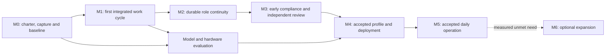

# Agentic Developer Workstation: Roadmap and Feature Boundaries

[Design set](index.md) · [System design](system-design.md) · [Publication plan](../../plans/doc/456-workstation-design-roadmap.md)

## Purpose and status

Deliver the complete human-directed engineering environment described by the system design: persistent specialist agents, safe execution, earlier compliance correction, retrievable original evidence, and qualified local inference on an operable workstation.

**Proposal:** coordinate three peer epics. Reuse two already filed; propose one additional epic. This roadmap is not a new issue type, not an epic above other epics, and not a committed schedule. Existing issue ownership remains unchanged until a reviewed amendment is recorded in GitHub.

The owner asked for a draft design, a roadmap, and a substantial feature set, with more than one epic where justified. Features below are deliverable capabilities, not a list of libraries, database tables, individual hooks, or one-command tasks. Each will be decomposed into Tasks and Bugs when its design and first delivery slice are ready.

No new epic or feature issues are filed by publishing this proposal. Existing #491-#496 remain the canonical evidence features; do not recreate the closed duplicate set #497-#502.

## 1. Three peer epics

| Epic | Status | Owns | Explicit boundary |
| --- | --- | --- | --- |
| **A. Agent-assisted engineering** | Existing [#456](https://github.com/NobleFactor/noblefactor-engprod/issues/456) | Human/agent methodology, roles, host integration, isolated workspaces, compliance and independent review | Does not own model weights, inference capacity, or the evidence store |
| **B. Engineering evidence archive** | Existing [#490](https://github.com/NobleFactor/noblefactor-engprod/issues/490) | Capturing, preserving, retrieving, and reasoning over evidence; source-linked checkpoints and reviewed rationale | Does not own session scheduling, source mutations, current policy approval, or hardware procurement |
| **C. Local inference and workstation operations** | **Proposed; no issue number assigned** | Model/hardware qualification, managed inference, repeatable deployment, and operating the assembled workstation | No DevLore product-hosted production inference; no replacement for A's workflow or B's evidence semantics |

All three deliver reusable internal engineering capabilities and are proposed as Product epics under engprod's Area definition. Individual installation, measurement, or one-off procurement tasks can be Engineering. Apply Area to each issue's own deliverable, not mechanically inherit it. No expenditure is authorized by a Product classification.

Two existing adjacent bodies of work remain separate: [#330, Issue tracking](https://github.com/NobleFactor/noblefactor-engprod/issues/330), supplies correct native planning metadata and filing; [#420, engineering-document consolidation](https://github.com/NobleFactor/noblefactor-engprod/issues/420), supplies the reviewed shared-document structure. This program consumes them without absorbing their schedules or duplicating their implementation.

### Why these boundaries

The capabilities can deliver value and evolve independently. The archive can support today's sessions before local inference is selected. Controlled role execution can use an already authorized endpoint during rollout. A model server can be replaced without losing the evidence or rewriting the engineering workflow.

One giant epic would mix three different completion tests: whether agents work correctly, whether engineering evidence remains retrievable, and whether the complete local platform meets its performance and operating requirements. More epics are not warranted merely because the architecture has more components. Split C further only if distinct ownership or release obligations emerge.

## 2. Epic A: Agent-assisted engineering

Retain #456's five existing features. Their current descriptions chiefly establish methodology. The extensions proposed below do not silently convert those descriptions into approved code designs. Review and amend scope before implementation.

| Feature | Identity | Substantial deliverable | Completion evidence |
| --- | --- | --- | --- |
| A1. Independent feature-closing review | Existing [#457](https://github.com/NobleFactor/noblefactor-engprod/issues/457) | Defined audit/review method, findings disposition, owner's sign-off, and correct feature closure | A real feature closes through the approved method with independent findings and sign-off recorded |
| A2. Isolated engineering workspaces and test execution | Existing [#458](https://github.com/NobleFactor/noblefactor-engprod/issues/458); workspace/test scope expansion proposed | Protected canonical repositories, controlled private execution, identified source snapshots, coordinated writers, and target-specific test results | Two clients use the intended environment; attempted unauthorized writes fail; unintegrated work survives interruption; target checks execute on their stated platform |
| A3. Persistent agent hosts and session coordination | Existing [#459](https://github.com/NobleFactor/noblefactor-engprod/issues/459); durable assignment/coordinator scope expansion proposed | A host-adapter contract; role/session bindings; attach, interrupt, resume and replacement; reconciliation of uncertain outcomes; OpenCode-first delivery without redesigning GitHub scheduling | Disconnect, host restart, delayed operation result, and session replacement recover the same unfinished assignment without duplicate external mutations |
| A4. Common policy and role-specific working contracts | Existing [#460](https://github.com/NobleFactor/noblefactor-engprod/issues/460) | Reviewed common policy for all roles; planner/designer/coder/auditor/reviewer instructions; permitted actions, context assembly, handoff and escalation contracts | Role sessions use recorded policy versions; a coding discovery returns to design/planning without forced handoffs; incident rationale remains retrievable |
| A5. Review readiness and GitHub integration | Existing [#461](https://github.com/NobleFactor/noblefactor-engprod/issues/461) | Correct routing of a finished feature to independent review, with existing issue-tracking tooling providing native types, relationships, and project placement | Closing the last leaf brings the feature to review once, without falsely closing it or creating duplicate work |
| A6. Continuous compliance and snapshot-bound integration | **Proposed new Feature under #456; no issue number** | Early review of coherent edit batches, stable findings, correction and recheck, deterministic checks, and a final gate bound to the exact candidate snapshot and policy | Earlier detection demonstrably reduces repair effort; obsolete findings are superseded explicitly; changed content invalidates approval; timeouts are inconclusive; unauthorized bypass cannot publish the change |

### A6 is not a duplicate of A1

A1 governs the independent review that closes a Feature. A6 improves the ordinary edit/test/correct cycle and validates a specific candidate change. Early compliance does not replace independent feature closure. A1 can consume A6's receipts as evidence while independently checking coverage and remaining risks.

### Coordination is not a new general workflow engine

A3 owns only the minimum machinery needed to bind roles, sessions, assignments, workspaces and outcomes reliably. GitHub remains the planning authority. Use existing engprod interfaces where they meet the contract. If coordinator scope exceeds A3's coherent host/session responsibility, present that split for review rather than silently building a new orchestration product.

## 3. Epic B: Engineering evidence archive

Keep the six features already filed and their native parentage. Their integration into the workstation is made explicit here; this roadmap does not rewrite their issue bodies.

| Feature | Identity | Substantial deliverable | Completion evidence |
| --- | --- | --- | --- |
| B1. Capture and historical import | [#491](https://github.com/NobleFactor/noblefactor-engprod/issues/491) | Available original session records, paired tool calls/results, artifacts, source identities, incremental capture and coverage/gap reports | Repeat import without duplicates; interrupted capture resumes from its watermark; missing history remains explicit |
| B2. PostgreSQL catalog and provenance | [#492](https://github.com/NobleFactor/noblefactor-engprod/issues/492) | Stable artifact/event/capture identities, exact source locators, review/revision relationships and rebuildable indexing | A derived record resolves to the correct original bytes/passages after re-indexing and parser migration |
| B3. Retrieval for people and agents | [#493](https://github.com/NobleFactor/noblefactor-engprod/issues/493) | Scoped full-text and identifier search, bounded passages, surrounding-context expansion and citation resolution during ordinary work | An agent retrieves a rejected approach, the original failure, and relevant qualifications without replaying entire sessions or crossing access boundaries |
| B4. Pre-compaction review and resumable checkpoints | [#494](https://github.com/NobleFactor/noblefactor-engprod/issues/494) | Durable capture acknowledgment, retrieval before compaction, checkpoint content and source links, explicit incomplete state and host integration | A resumed or replacement role continues unfinished work and can recover details omitted from its checkpoint; unsupported or failed compaction paths are visible |
| B5. Reviewed decisions and policy traceability | [#495](https://github.com/NobleFactor/noblefactor-engprod/issues/495) | Evidence-backed rationale, rejected alternatives, conflicts and supersession; links between reviewed policy and original incidents | A current rule traces to reviewed rationale and original evidence; a proposed interpretation cannot silently become approved policy |
| B6. Privacy, recovery, and archive operation | [#496](https://github.com/NobleFactor/noblefactor-engprod/issues/496) | Protected originals, secret-screened scoped retrieval, retention/deletion, complete backups and restoration | Restore database and artifacts together with citations and permissions intact; verify governed redaction/deletion and unauthorized-access failures |

Privacy, safe capture and a minimal backup apply from the first imported record, not only when B6 closes. B1-B3 can deliver a useful searchable archive before automated compaction integration or a complete decision catalog exists.

## 4. Epic C: Local inference and workstation operations

**Proposed epic title:** Local inference and workstation operations.

**Outcome:** The developer can perform the accepted engineering workload against an owned, locally hosted model through the real agent harness, with measured quality/latency and a maintainable, recoverable system. The result includes approved model/runtime manifests, deployment materials, acceptance evidence and operating procedures—not merely a list of hardware parts.

Four substantial features are proposed. No native GitHub issue numbers have been assigned.

### C1. Qualified model and hardware profiles

**Delivers:** A reproducible evaluation harness and versioned profiles binding an exact model revision, license, precision, tokenizer/template, serving engine, tool parser, agent harness, resource envelope and configuration to measured engineering results. Profiles cover supported Apple, custom and Microsoft candidates without presuming a winner. The selection record includes complete-system quotes, power/layout requirements, capacity, net ownership cost and explicit expansion triggers.

**Evidence:** Representative multi-file coding, design-sensitive debugging, compliance and interruption tasks evaluated through OpenCode; quality failures, human repair effort, blocked time, cold/warm input processing and overlapping requests recorded separately. Results identify the exact configuration and sample size. Published benchmarks are supporting evidence, not substituted for this workload. Procurement is authorized only after the owner accepts a qualifying profile and complete quote.

**Boundary:** No model training, no promise that a leaderboard score proves equivalence, no forced purchase merely to benchmark. Paid evaluation and hardware orders remain separately authorized. This feature defines and measures compatibility; C2 implements serving and C3 deploys the approved profile.

### C2. Managed local inference service

**Delivers:** Authenticated model endpoints with streaming/tool-call behavior, model identity, bounded admission, cancellation, health reporting, explicit unavailable states, and tested cache behavior. Pinned release manifests include auxiliary models and all inference paths. Interactive work and blocking checks receive an explicit service policy without starving background work.

**Evidence:** One active coder with ongoing auditor and background reviewer meets C1's accepted profile; overload queues or rejects explicitly; cancellation and restart preserve operation identity; local-only tests reveal no unintended paid fallback or model-provider egress. Cache-on/cache-off tests establish correctness. Separate contexts do not leak across unauthorized scopes.

**Boundary:** Session meaning, durable checkpoints, source mutation and review authority remain in A/B. KV state is disposable. C2 need not support every serving engine on day one; it supports the selected qualified path and its documented alternatives.

### C3. Repeatable workstation provisioning and physical deployment

**Delivers:** Versioned deployment assets and an approved bill of materials for execution, data and inference services, including either modular placement or validated custom consolidation. Cover images, toolchains, service identities, network/storage boundaries, target-test connections, secrets installation, backup destination, power/UPS/cooling and host recovery. Preserve the existing frontend/media/infrastructure roles unless the owner changes them.

**Evidence:** The selected system can be deployed and redeployed from pinned assets; agent, workspace, evidence and model boundaries match the design; CPU/RAM/I/O contention is measured under mixed work; no private credentials appear in released configuration. The finished hardware passes integrator/installer and thermal/power checks before daily use.

**Boundary:** Model/backend compatibility belongs to C1/C2, sandbox semantics to A2 and evidence retention to B6. A purchase is not the completion of this feature. One-off installation/procurement work can be Engineering tasks under this Product feature.

### C4. Observable, recoverable daily operation and acceptance

**Delivers:** Correlated operations/assignment traces, health and capacity views, upgrade/rollback procedures, clean shutdown, end-to-end failure recovery and a daily-use acceptance run. Measure repair time and developer waiting alongside accelerator utilization. Document which dependencies require outside connectivity and which repository tasks operate offline.

**Evidence:** Repeated real assignments survive disconnect, model outage, agent/sandbox restart and a lost external-write response without losing accepted work or duplicating effects. Restore from independent backup and resolve archived citations. An update can be rolled back to a known qualified profile. The owner accepts the complete workflow against C1's criteria after a bounded daily-use evaluation.

**Boundary:** B6 owns archive backup semantics and tests; C4 verifies their place in whole-system recovery. A6 owns compliance correctness; C4 measures its latency and repair burden in operation. No endless optimization backlog is required to close the initial feature: accepted release scope and residual issues are recorded explicitly.

## 5. Interface ownership and dependency rules

| Contract or record | Owner | Consumers | Integration boundary |
| --- | --- | --- | --- |
| Role/session binding and operation IDs | A3 | A2, A6, B1/B4, C2/C4 | The host adapter reports what happened; the archive does not schedule agents |
| Approved policy/role version | A4 | All roles, A6, B5, C1 | B5 supplies rationale; only the authorized review process changes policy |
| Source snapshot, mutation lease, verification artifact | A2 | A6, A1, B1, C1/C4 | A writable worktree is never the immutable input to a completed audit |
| Audit request, findings, completed receipt | A6 | Coder, A1, B1/B5, C4 | A receipt applies only to identified inputs and policy; A1 retains independent review |
| Capture watermark, evidence locator, citation | B1/B2 | B3/B4/B5, A3/A6 | Collection and indexing cannot invent missing original evidence |
| Checkpoint record and capture precondition | B4 | A3 | B4 defines what is durable; A3 performs host-specific compaction and observes completion |
| Qualified model/runtime profile | C1 | C2/C3/C4 | Engine capability is qualified through the real harness, not inferred from an API name |
| Deployment/recovery manifest | C3 | A2/A3, B6, C4 | Logical services survive replacement of the physical inference node |

Define the smallest usable version of these contracts before implementing their adapters. Consumers may develop against fixtures; they do not need to wait for a complete upstream epic. Use canonical issue dependencies when work is filed; diagrams and tables do not replace GitHub's native relationships.

## 6. Delivery roadmap: useful vertical slices

Milestones are proposed outcomes, not calendar commitments or new GitHub schedules. They cut across epics and include only the slice needed for that outcome. A feature can contribute to multiple milestones while retaining one owner and one native parent.

| Milestone | Usable outcome | Main feature contributions | Exit evidence / gate |
| --- | --- | --- | --- |
| **M0. Charter, preserve, and establish the baseline** | Reviewed boundaries and acceptance approach; surviving evidence protected; existing work continues | A4, B1/B6, C1 | Capture manifest with gaps; initial protected backup; accepted evaluation tasks; owner resolves the explicit policy/scope differences below |
| **M1. First evidence-backed local work cycle** | One persistent OpenCode coder in a controlled workspace calls a qualified evaluation endpoint, changes code, runs tests, and retrieves a cited prior result | Thin slices of A2/A3/A4, B1/B2/B3, C1/C2 | Demonstrate correct attachment, scoped writing, identified test results, durable capture and useful retrieval. This is an integration demonstration, not a claim of complete parity |
| **M2. Durable specialist continuity** | Designer/planner/coder collaborate iteratively; an agent consults evidence before compaction and resumes its unfinished work | A3/A4, B3/B4/B5 | Disconnect, compaction/replacement and source revision changes preserve relevant decisions, uncertainty and work; no mandatory session reset at each handoff |
| **M3. Earlier compliance with trustworthy integration** | Coherent edits receive actionable feedback; corrections are rechecked; the final gate reuses only matching results; independent review remains intact | A1/A2/A5/A6, B1/B5, C2 | Measure detection-to-correction time and false positives; demonstrate stale-approval rejection, inconclusive timeout and a real independently closed feature |
| **M4. Qualified acquisition and deployment** | Choose the model/runtime/hardware configuration from the actual role/evidence/compliance workload and deploy it | C1/C2/C3, A2/A3 | Owner accepts quality, latency, capacity and total-cost evidence; quote and installation reviewed; no order is authorized by this draft |
| **M5. Accepted daily-use workstation** | The owned local environment is maintainable, observable and recoverable, with known limitations | C4, B6, all applicable A/B/C features | Bounded daily-use evaluation, fault tests, restore with citations, rollback and required offline behavior pass; owner signs off the delivered release |
| **M6. Measured expansion, when justified** | A specific unmet quality/capacity/latency need is addressed without discarding workflow or evidence | Follow-up work derived from C1/C4 | A measured constraint and an approved upgrade profile justify added/replaced hardware; no expansion merely to retain old conversations |

### Parallel work and the shortest path

Evidence capture and model-quality evaluation begin in parallel with policy review. Do not wait for a complete archive to assess a candidate model, and do not wait for final hardware to preserve evidence. M1 requires a usable evaluation endpoint, not a production hardware purchase. Its permitted source is explicit; there is no automatic paid fallback.

Full model/hardware qualification uses the role and compliance workload as it becomes available. Evaluation may iterate before M3 completes, but a benchmark against only an isolated model is insufficient for M4 acceptance. M6 is optional follow-on work, not a reason to keep the initial epics permanently open.

The diagram expresses evidence dependencies, not a rigid agent workflow. Design, planning, coding and testing remain iterative throughout.

## 7. Decisions that need explicit reconciliation

The proposal intentionally does not rewrite approved guides. Before implementation, record the owner's disposition of these differences:

| Question | Existing record | Proposed direction | Required decision |
| --- | --- | --- | --- |
| Session scope | The development-process guide includes one-session-per-issue language | Persistent role sessions can span assignments and survive compaction | Reconcile the guide and role contracts with the owner's current requirement; retain explicit assignment boundaries |
| Clone/worktree ownership | The guide protects one canonical layer clone and discourages duplicate unmanaged clones | Sandboxes may require private clones or mediated Git to prevent writes to canonical metadata | Define managed sandbox replicas as a controlled exception or choose mediation; do not silently introduce untracked clones |
| Closing review versus continuous review | #457 specifies the feature-closing method | A6 adds early compliance and a change-level integration gate | Approve A6's separate scope and its receipt/coverage relationship with A1 |
| Methodology versus implementation | #456 records methodology-first design, with lower-level work not yet filed | A2/A3 require concrete workspace/adapter/coordinator implementations | Amend scope or split only where necessary after reviewing the contracts |
| Evidence storage | #490 leaves large-artifact storage unresolved | The system draft proposes PostgreSQL metadata plus private content-addressed files | Approve, revise, or reject this storage layout before schema and backup implementation |
| Acceptance and budget | Owner requires competitive engineering performance; the design proposes numerical thresholds and an all-in budget treatment | Measured quality and developer-blocking time govern procurement | Approve thresholds, workload suite, total-cost accounting and any exceptions; no implicit weakening of quality |

A finding of disagreement is not permission for an agent to select the authoritative side and rewrite policy. This roadmap exposes the differences for review while preserving both the current process and the draft.

## 8. Issue filing, scheduling, and closure

The proposed hierarchy is:

- Epic A: existing #456, with existing Features #457-#461 and proposed A6.
- Epic B: existing #490, with existing Features #491-#496.
- Epic C: proposed local inference and workstation operations, with proposed Features C1-C4.

That is **three peer epics and sixteen substantial features**: eleven existing features and five proposed additions. The counts describe the reviewed mapping, not a claim that every proposed issue has been created. A broader parent epic would violate the existing Epic-to-Feature-to-Task/Bug hierarchy; the roadmap supplies the cross-epic view instead.

After owner review, file approved additions through the supported canonical filing path. Verify native type, Area, parent relationships and Triage membership by read-back. Prose references and labels must not stand in for the organization's native hierarchy. The current connector's missing mutations are not a reason to repeat the #504 incident by bulk-filing incomplete records.

Every new item enters Triage: engprod unless an approved existing process explicitly permits another path. Epics and features leave Triage after classification rather than becoming Schedule/Backlog steps. Tasks and Bugs are scheduled by their owner; existing committed schedules are amended only explicitly. No work is inserted into the issue-tracking wrap-up or another active schedule by this publication.

Retain coarse features until their first slice is designed. Then decompose into PR-sized Tasks with acceptance evidence and native blocked-by links. Do not file a speculative hundred-task implementation tree merely to make the roadmap look complete.

A feature closes under the established independent audit/review/sign-off method. An epic closes when its accepted feature scope is complete. M5's integrated acceptance additionally verifies that the parts compose into a usable workstation; separate component closure alone is insufficient.

## 9. First review and first commitment

The first owner review should settle the three epic boundaries, A6's distinct scope, the ownership contracts, and the explicit process differences. It should retain or revise the proposed feature acceptance tests before assigning dates or buying equipment.

The first implementation commitment should deliver a useful vertical slice: safe capture, a minimal searchable evidence path, and one controlled persistent role with measurable model behavior. The archive's full history import, every adapter, all five roles, every backend, and final hardware need not be finished before the owner receives value.

Publication of this draft is complete when the repository contains the design set and roadmap with valid navigation and explicit status. Adoption is a separate act. Runtime deployment, native issue filing, schedule commitment, procurement and merge approval are not inferred from the document's existence.

## Sources and related work

The system design contains the external technical source register. This roadmap adds delivery proposals grounded in the existing issue record, not new performance or compatibility claims.

- [Epic #456: Agent-assisted engineering](https://github.com/NobleFactor/noblefactor-engprod/issues/456), including Features #457-#461.
- [Epic #490: Engineering evidence archive](https://github.com/NobleFactor/noblefactor-engprod/issues/490), including canonical Features #491-#496.
- [Epic #330: Issue tracking](https://github.com/NobleFactor/noblefactor-engprod/issues/330), with [#338](https://github.com/NobleFactor/noblefactor-engprod/issues/338) and [#504](https://github.com/NobleFactor/noblefactor-engprod/issues/504) relevant to complete, verified filing.
- [Task #420: Engineering-document consolidation](https://github.com/NobleFactor/noblefactor-engprod/issues/420), adjacent work whose reviewed policy is not superseded here.
- [Development process](../../guides/development-process.md) and [issue standards](../../issue-standards.md), for native hierarchy, triage, schedule ownership and closure.
