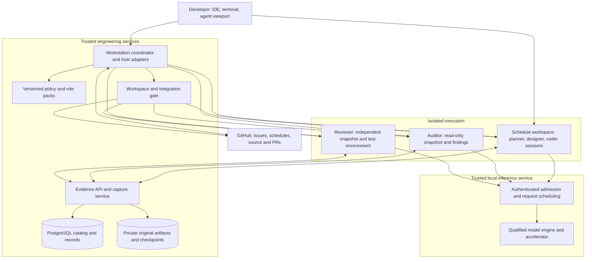
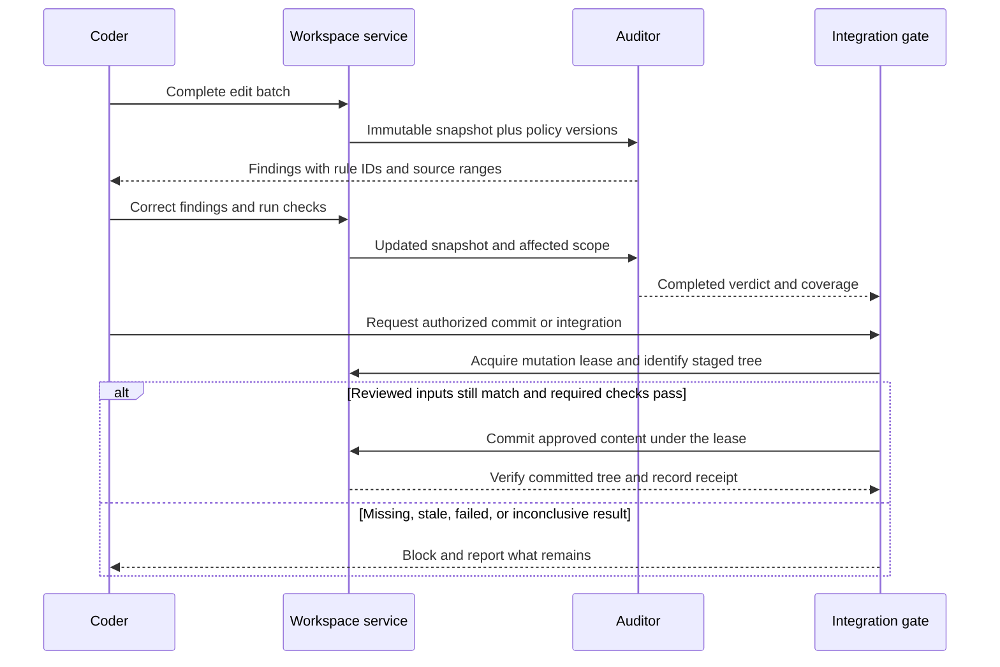
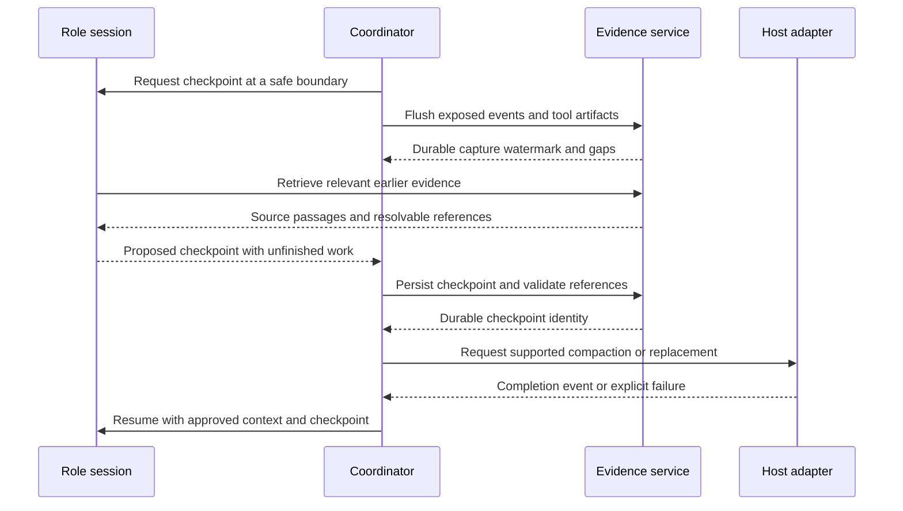
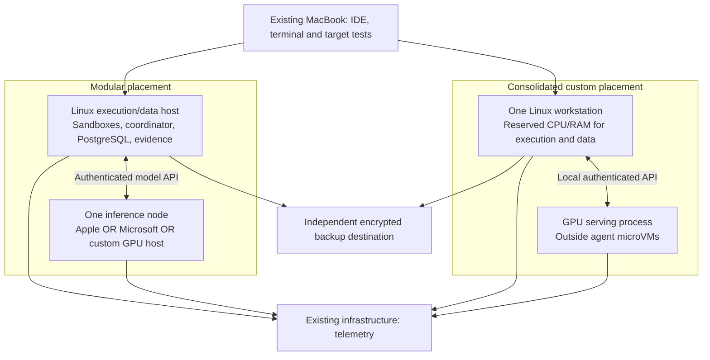

# Agentic Developer Workstation
## System architecture and build-out

[Design set](index.md) · [Delivery roadmap and feature boundaries](roadmap.md) · [Publication plan](../../plans/doc/456-workstation-design-roadmap.md)

| Document control | Value |
| --- | --- |
| Revision | 0.2 — repository draft for owner review; roadmap added as a companion |
| Prepared | November 11, 2026, Pacific time |
| Owner | NobleFactor Engineering Productivity |
| Primary user | David Noble |
| Scope | The complete development environment: human interaction, agent roles, execution, compliance, evidence, inference, hardware, and operation |
| Related work | Agent-assisted engineering #456; engineering evidence archive #490; issue-tracking filing improvements |
| Implementation status | Proposed system design, not a claim that the components or integrations are already deployed |

**Design objective:** Build an owned, human-directed development environment in which specialized agents can work persistently and safely, recover and reason over the evidence behind their work, and deliver correct, tested, compliant changes with less waiting and less repair.

The workstation is a logical working environment. It need not be one physical computer.

**Evidence boundary.** This draft uses the owner's decisions and supplied consumption report, the available Library architecture documents, current GitHub requirements, and primary product documentation. It does not claim to have inspected uncommitted files in `~/Workspace/NobleFactor`, benchmarked the candidate machines, or validated the proposed deployment. Published capabilities, owner requirements, and new design proposals are distinguished below. Earlier speculative prices, speed rankings, and claims of Claude/Codex equivalence are not carried forward as established facts.

**Publication boundary.** This repository revision preserves the conversation-produced design as a review proposal. Its external specifications and software/version claims are dated research inputs carried forward from that draft, not reverified by publication. The companion roadmap proposes ownership and delivery; it does not amend existing issue scope, approve architecture, schedule work, or authorize purchases. Conflicts with current process remain explicit review questions in the roadmap.

## Contents

1. [Problem and evidence](#1-problem-and-evidence)
2. [Requirements and scope](#2-requirements-and-scope)
3. [Logical system architecture](#3-logical-system-architecture)
4. [Developer workflow and role design](#4-developer-workflow-and-role-design)
5. [Workspace, builds, and cross-platform execution](#5-workspace-builds-and-cross-platform-execution)
6. [Compliance and integration](#6-compliance-and-integration)
7. [Evidence archive and resumable state](#7-evidence-archive-and-resumable-state)
8. [Software bill of materials and implementation responsibilities](#8-software-bill-of-materials-and-implementation-responsibilities)
9. [Model service and workload management](#9-model-service-and-workload-management)
10. [Physical architecture and hardware](#10-physical-architecture-and-hardware)
11. [Operations, safety, and failure handling](#11-operations-safety-and-failure-handling)
12. [Qualification and acceptance](#12-qualification-and-acceptance)
13. [Staged build-out](#13-staged-build-out)
14. [Decisions and remaining design work](#14-decisions-and-remaining-design-work)

## Proposed architecture

Adopt a modular architecture with three functional boundaries:

1. **Human interaction and control:** the developer directs schedules, inspects source and diffs, approves consequential actions, and attaches to persistent agents.
2. **Agent execution and engineering services:** isolated workspaces, OpenCode sessions, builds/tests, compliance and review, durable checkpoints, and a private PostgreSQL-backed evidence archive.
3. **Model inference:** a separately managed local serving endpoint. Agent sandboxes consume inference over an authenticated API; they do not own or pass through the GPU.

Keep the existing MacBook as the developer frontend and cross-platform test device. Preserve the Mac mini's media-server role and the MS-01's infrastructure role. Use a dedicated execution/data host when inference is supplied by an Apple or Microsoft appliance. An expandable custom Linux workstation may initially combine execution and inference, provided resource isolation and workload tests demonstrate that the combination does not degrade interactive work.

OpenCode is the target agent host. PostgreSQL is the selected catalog and search platform. Common policy, role instructions, authoritative engineering artifacts, original evidence, and resumable checkpoints have different responsibilities and must remain distinct.

Use **continuous compliance feedback plus a final immutable-snapshot gate**. The purpose is to reduce the cost of bringing code into compliance, not simply shorten the pre-commit check.

Hardware is qualified against the selected model, checkpoint, serving engine, and real development workload. This design specifies configuration candidates and purchase criteria; it does not declare a hardware winner from memory capacity or peak throughput alone.

---

## 1. Problem and evidence

### 1.1 The current workflow loses useful engineering context

Today the owner works through long-lived sessions without the planned separation into persistent specialist roles. Useful information accumulates among routine tool output: decisions, constraints, failed experiments, rejected alternatives, owner corrections, and unfinished investigations. Compaction and session replacement can hide or omit that material.

Reading an entire incident log at each restart is an expensive substitute for a reviewed operational policy. It combines current rules with the narrative that produced them. A summary alone creates the opposite problem: it may preserve a conclusion while losing the reason, evidence, or qualification needed to apply it correctly.

**Required change:** retain original evidence outside the conversation, maintain reviewed common and role-specific policy, and let agents retrieve the relevant evidence before compaction and during ordinary reasoning. The archive is an active engineering resource, not merely a recovery facility. This is the central requirement of engprod #490.[^I1]

### 1.2 Compliance discovered late creates avoidable repair work

A pre-commit-only auditor may discover a repeated coding or architectural mistake after it has spread through an implementation. Continuous review can find that mistake earlier, but reviewing every transient edit can generate noise, stale findings, and unnecessary inference.

**Design hypothesis:** review coherent edit batches, prioritize violations with a high cost of propagation, and reuse valid review results at commit time. Measure repair time and false-positive burden to test that hypothesis.

### 1.3 Existing documents solve different problems

| Existing material | Retained contribution | Change needed for this design |
| --- | --- | --- |
| Sandboxed Agent Architecture, November 7 | Separate role contexts, protected workspaces, independent audit/review, exact staged-snapshot checking | Add continuous feedback, local inference, and evidence-backed checkpoints |
| Durable Schedule Ownership, November 7 | Schedule-level human continuity across issues, PRs, sessions, and sandboxes | Define the interfaces between that planning record and runtime assignments |
| Final Acquisition Recommendation, November 7 | Execution-host and test-lab requirements | Its remote-inference assumption does not size a local model server |
| DevLore Agent Subsystem, draft 0.2 | Separate identities and lifetimes; recovery and result reconciliation | Reuse concepts without making completion of the product subsystem a prerequisite |
| Repository agent-schedule designs | Background agent/viewer separation and sandbox connection fundamentals | Replace host-specific assumptions with tested OpenCode integration |

These are input designs, not proof of a finished deployment.[^I2][^I3][^I4][^I5]

### 1.4 What the supplied consumption report establishes

The owner's report covers 52 sessions, but only four contain token totals; it excludes Codex and some local sessions. It reports approximately 1.372 billion tokens, of which 98.2% are cached rereads, and 2.60 million generated tokens including reasoning. Its elapsed spans include inactive time.[^U1]

This supports investment in prefix reuse, selective retrieval, and durable role state. It does **not** establish peak concurrency, required prompt-processing speed, or acceptable response latency. Nor does it prove that context rather than generation speed is the sole bottleneck.

The proposed reduction from about 36,500 orientation tokens to about 5,000 is a target, not a measured replacement policy. Its approximately 31,500-token saving addresses only a small part of the largest historical contexts. Most of the intended benefit must come from better selection and management of accumulated working information.

### 1.5 What external evidence supports

| Evidence | Supported design choice | Limit |
| --- | --- | --- |
| OpenCode documents named agent profiles, permissions, local-compatible providers, session operations, and compaction | Use it as the agent runtime, behind versioned adapters | A named profile or child subagent is not automatically a persistent role with durable ownership |
| Docker documents local microVM sandboxes and private-clone workspaces | Isolate executable agent work rather than rely on instructions alone | Host support, mounts, credentials, and lifecycle behavior must be qualified |
| PostgreSQL documents indexed full-text search and row-security policies | Use PostgreSQL for provenance, filtered retrieval, and access control | Search relevance and complete backup require explicit design and tests |
| vLLM documents prefix reuse and concurrency/memory tradeoffs | Separate cached-state capacity from active-request capacity | Cache reuse does not eliminate generation work |
| Published hardware specifications establish memory and expansion boundaries | Define concrete deployment candidates | Specifications do not demonstrate task quality or developer productivity |

The corresponding primary sources are listed at the end.[^S1][^S2][^S3][^S4][^S5][^S6][^S7][^S8]

## 2. Requirements and scope

### 2.1 Owner requirements

| ID | Requirement |
| --- | --- |
| R1 | Optimize elapsed time and human effort to a correct, tested, compliant change. Performance takes precedence over minimizing acquisition cost. |
| R2 | Target software-engineering capability comparable to the owner's Claude/Codex workflow, using locally hosted open-weight models through OpenCode. Equivalence must be demonstrated, not inferred from hardware. |
| R3 | Keep the human in control of goals, policy, schedule changes, and consequential authorizations. Preserve the iterative design/plan/code/test process. |
| R4 | Preserve persistent, resumable role-specific sessions. Checkpoints allow compaction or replacement without losing unfinished work. A new session is not required for each interaction. |
| R5 | Every role follows common policy, with additional role-specific instructions. Replace compulsory full-log reading only through reviewed policy derivation. |
| R6 | Make original evidence retrievable before compaction and available for reasoning at any time. Preserve sources and explicitly identify missing evidence. |
| R7 | Preserve schedule-level continuity. Several schedules underway do not imply the same number of running sandboxes or simultaneous generations. |
| R8 | Protect source, credentials, authoritative documents, review results, and private evidence from unauthorized mutation or disclosure. |
| R9 | Do not trigger paid inference fallback implicitly. The target workflow must operate with local inference; external tools remain separately authorized. |
| R10 | Treat Linux as a preference, not a disqualifying requirement. macOS and Windows remain eligible where they serve the workload. |
| R11 | Do not buy extra GPUs merely to preserve accumulated conversational history. |
| R12 | Treat $50,000 as a planning ceiling, not a spending target. Include the complete incremental system and installation in the budget; obtain owner approval for any exception. |

R12 provisionally counts tax, shipping, backup, power protection, and installation within the ceiling to avoid an unexpected overrun. The owner has not approved a detailed budget allocation.

### 2.2 Non-goals

This is not a general autonomous company, an LLM training cluster, or a replacement for GitHub. It does not redesign triage, require a fully automated planner, or authorize agents to revise policy themselves. It does not require a vector database, Kubernetes, GPU passthrough into agent sandboxes, or a new enterprise knowledge ontology.

The workstation is engprod infrastructure for building DevLore and other software. DevLore's current AI brief deliberately distinguishes product capabilities from its own development environment and states that the product does not host production inference. Local inference here belongs to the developer environment; it does not alter that product boundary.[^I2]

## 3. Logical system architecture

### 3.1 Components and trust boundaries

Arrows describe permitted logical interactions, not blanket network access or process ancestry. Authentication, authorization, and per-role tool permissions constrain them. The archive and model service are not mounted wholesale into a sandbox.

**The coordinator is proposed engprod tooling, not a claim about an existing service.** Initially it can be a small Go service/CLI with host adapters and durable operation records. Reuse existing engprod commands where they satisfy the contracts. Keep scheduling in GitHub; do not build a parallel planning database or a new general workflow engine.

### 3.2 Ownership and authoritative state

| Object | Authority and lifetime |
| --- | --- |
| Schedule | GitHub planning record; persists across issues, PRs, agents, and machines |
| Assignment | Coordinator record linking scope, agent, role, workspace, authorization, and outcome |
| Agent | Logical role identity; independent of a runtime process |
| Session binding | One authoritative live session per logical agent; replacement creates a new binding revision |
| Workspace | Assigned PR/branch scope; source mutations serialized; retained until safely integrated, archived, or explicitly discarded |
| Current policy and design | Approved versioned artifacts, not conversation memory |
| Audit/review result | Evidence tied to an identified snapshot and applicable policy/tool versions |
| Role checkpoint | Unfinished-work state with source references; supplements, not replaces, authoritative source and policy |
| Historical evidence | Original captured records plus provenance; authority about what was recorded, not automatic truth |
| Inference cache | Disposable optimization; losing it affects speed, not project meaning or evidence |

Use stable identifiers for schedule, assignment, agent, session, workspace snapshot, audit request, checkpoint, and trace. A schedule must not be keyed only by a transient session UUID.

### 3.3 Component contracts

These are proposed semantic operations, not final command names or promises about upstream API paths:

| Interface | Essential behavior |
| --- | --- |
| Agent host adapter | Start/attach, submit assignment, interrupt, observe events, checkpoint, compact, resume; report unsupported operations |
| Workspace service | Provision isolated clone, grant mutation lease, snapshot, verify approved content, preserve unintegrated work |
| Evidence service | Capture, search, read source range, expand context, resolve citation; separate reviewed publication from ingestion |
| Compliance service | Evaluate snapshot, return structured findings, track supersession, issue completed verdict |
| Model endpoint | Stream generation/tool calls, expose health and identity, apply admission policy, report usage and cancellation |
| Integration adapter | Perform only authorized Git/GitHub mutations; reconcile uncertain outcomes and verify resulting native metadata |

Each consequential operation has an operation ID, persisted intent, observed outcome, and retry/reconciliation behavior. A timeout after a GitHub write or agent tool operation is an unknown outcome until checked—not permission to repeat the mutation blindly. Issue #504 is an immediate acceptance case for this requirement.[^I6]

## 4. Developer workflow and role design

### 4.1 Persistent specialists, not a rigid pipeline

| Role | Primary responsibility | Default authority |
| --- | --- | --- |
| Planner | Maintain schedule implications, sequencing, dependencies, and progress | Read engineering state; propose schedule updates; apply only authorized changes |
| Designer | Resolve architecture and interface questions; preserve rationale | Read source/evidence; propose or edit assigned design artifacts under a write lease |
| Coder | Implement and debug the assigned change; run checks; correct findings | Write only the assigned workspace; no authority to weaken governing policy or approve itself |
| Compliance auditor | Evaluate common and coding standards; provide early findings and final verdict | Read identified source/policy; write findings, not implementation |
| Reviewer | Evaluate correctness, regression risk, tests, and design fit independently | Read a review snapshot; run tests in an isolated scratch environment; write review results |

The roles have separate useful sessions. They may share a model-serving instance without sharing their conversations. OpenCode's documented fresh-context subagent behavior is not sufficient by itself for the persistent-role requirement; qualify primary sessions and explicit resumption for each long-lived role.[^S1]

Planner, designer, and coder can share filesystem visibility within a schedule execution environment. They are not security-isolated from one another merely by having separate prompts. Where their authority must be technically separated, use separate processes/OS identities or sandboxes and mediated writes.

### 4.2 The ordinary work cycle

The developer selects a schedule and assignment. The coordinator resolves the approved policy/role pack, latest relevant checkpoint, workspace revision, and required permissions. It reattaches useful sessions rather than starting fresh by default.

The coder inspects, edits, builds, and tests. Design questions return to the designer; schedule effects return to the planner. Coherent snapshots trigger compliance feedback. The coder remains the implementation writer and resolves findings. Independent review examines the actual change and evidence, not only the coder's summary.

The developer can inspect status and diffs through the IDE, attach an agent viewport, and open a terminal in the relevant environment. A dropped viewer connection does not imply cancellation of authorized work. A human edit participates in the same workspace mutation coordination; an explicit emergency override must invalidate affected results.

### 4.3 Policy and context assembly

Proposed order: stable common policy, role instructions, stable project constraints, assignment/checkpoint, and changing evidence. Record the versions actually supplied to the agent. Do not let the mutable branch redefine its own mandatory checks.

Derive common policy from incident history through review. Retain links to incidents and exceptions. A shorter policy is not approved merely because an agent generated it. Enforcement belongs in restricted credentials, tools, and execution boundaries wherever feasible.

Prefix reuse depends on matching token prefixes and preceding state, not only byte-identical document bodies. Verify the rendered prompt, including tools, in the selected runtime; do not sacrifice permission separation for cache sharing.[^S8]

## 5. Workspace, builds, and cross-platform execution

### 5.1 Isolation and repository handling

Begin with one development environment per actively executing schedule, plus isolated auditor/reviewer environments as needed. Do not allocate a VM for every retained session.

**Proposed safe default:** provision independent clones within the schedule's storage boundary; protect the canonical main clones. Create PR-specific worktrees only inside that private clone. Do not share writable Git metadata with a protected host clone. Storage optimizations must preserve that property.

Docker's documented clone mode mounts the source read-only and gives the agent a private clone. Its sandbox-local state survives stops, but removal destroys sandbox-local data. Accordingly, workspace durability requires explicit export/checkpointing before deletion; a sandbox lifetime is not a backup policy.[^S5]

Keep active source and build caches on local SSDs. Remote browsing should use an IDE/backend or terminal on the execution host, rather than putting a build workspace on a network filesystem. Docker specifically warns that remote workspace mounts add filesystem latency.[^S5]

### 5.2 Build and test environments

Pin toolchains and sandbox images per repository. Run unit tests and ordinary Linux builds close to the source. Run target-specific checks on real target environments: cross-compilation is not evidence of runtime behavior.

Retain the MacBook's Parallels/macOS test role. Add Windows x86-64 or other target capacity only when a concrete test requirement is not covered. Test runners receive immutable inputs and return identified artifacts, logs, exit status, and environment versions.

A process that runs tests may write scratch data without gaining permission to alter the approved input snapshot. Cache directories must not allow an untrusted job to replace trusted policy or tool executables.

### 5.3 Sandbox support boundary

Use a pinned Docker `sbx` release as the initial integration target. Docker currently documents local Linux support on Ubuntu 24.04 or later with KVM; its Windows local prerequisites list Intel/AMD rather than ARM. Therefore, do not assume the N1X appliance can also serve as the local sandbox host. It can remain an inference-only node.[^S4]

Multiple persistent OpenCode role sessions in one sandbox, exported state, host access, and pre-compaction behavior are integration tests—not assumed properties of an agent-specific launch template. A conventional managed KVM VM is the fallback isolation implementation if `sbx` cannot meet a required contract. Do not silently substitute an ordinary container for the intended kernel boundary.

## 6. Compliance and integration

### 6.1 Optimize time to compliant code

Use three cooperating mechanisms:

- Prevent violations with approved common/role policy, examples, and deterministic format/lint/static checks.
- Review coherent edit batches continuously, not every transient file write.
- Verify the exact staged or integration snapshot before authorizing the resulting change.

Architectural or repeated-pattern violations receive prompt feedback. Localized style findings are batched unless a deterministic correction is safe and authorized. Cancel obsolete requests and explicitly supersede findings when the reviewed snapshot changes. Findings cannot disappear merely because a newer request was queued.

### 6.2 Audit request and receipt

An audit request records repository, base revision, candidate tree/snapshot, relevant policy hashes, role/assignment, applicable checks, model/runtime identity, and request ID. A completed receipt records **pass**, **violation**, or **inconclusive**, with rule IDs, evidence ranges, coverage limitations, and timestamps.

A cached pass is reusable only for the same relevant inputs. A change in interfaces, dependency/configuration files, governing policy, base revision, or covered content can require broader re-evaluation. Reviewing a small diff is not permission to ignore affected unchanged code.

Git's `write-tree` represents the index as a tree object. That identity can bind a receipt to staged content, but it is not alone a synchronization mechanism.[^S9]

The gate must prevent a time-of-check/time-of-use race: serialize mutations across snapshot verification and commit, or construct/verify an immutable commit before any authorized publication. Local hooks are convenience integration points, not sufficient enforcement against an agent that can bypass them. Protected integration/CI verifies the actual candidate commit and trusted policy. Existing authorization requirements still govern who may commit, push, and merge.

Timeouts and auditor failures return inconclusive, not pass. Emergency overrides require explicit authority and a recorded reason; they are not hidden fail-open behavior.

### 6.3 Measures of success

Measure time from detection to accepted correction, correction iterations, unnecessary findings, recurring violations, escaped violations, and final commit-blocking delay. Separate the time spent running an audit from the time spent repairing its findings. A continuously busy auditor that increases rework is a failed optimization.

## 7. Evidence archive and resumable state

### 7.1 Storage and access design

Use PostgreSQL for provenance, normalized events, structured records, permissions, and full-text search. Store large original artifacts in a private content-addressed filesystem initially, with PostgreSQL holding their identity and location. This avoids placing every binary/tool-output blob in database rows while preserving one queryable catalog.

PostgreSQL's `tsvector` and GIN indexing support the initial text retrieval path. Supplement natural-language search with exact identifier/path matching; code symbols and issue numbers must not depend solely on stemming. Embeddings are optional later work, justified by retrieval failures rather than assumed necessary.[^S6]

| Proposed record | Purpose |
| --- | --- |
| Source | Provider, originating host, repository, session identity, source format, and capture policy |
| Capture | Immutable version/capture, content hash, timestamp, source offset/watermark, completeness, parser version |
| Artifact | Original transcript, tool output, attachment, document or snapshot; location, digest, size, access scope |
| Event | Normalized message/tool-call/result with ordering and exact original locator |
| Evidence link | Typed relationship from a checkpoint, finding, decision, or policy to supporting or contradicting evidence |
| Derived record | Proposed/accepted/superseded conclusion, summary, decision rationale, or checkpoint with input references |

These are conceptual entities, not approved SQL migrations. Some can share physical tables. The schema must preserve original-versus-derived distinctions without requiring a universal ontology.

### 7.2 Capture and durability

Import available historical Claude Code, Codex, OpenCode, and supplied export records. Capture only information actually exposed by those sources; do not promise recovery of omitted tool output or inaccessible model internals. Missing records and uncertain associations are explicit.

Ongoing capture uses supported exports/events and a private local spool. Use idempotency keys and source offsets to handle retries, partial records, and process restarts. Do not rewrite an original capture when its parser changes; create a new derived representation.

Write an artifact, verify its digest, then publish its catalog reference. Keep incomplete ingestion invisible to ordinary retrieval until reconciled. Capture acknowledgments identify which source range is durable. Host-side collection distinguishes execution receipts from agent-authored assertions; an agent cannot relabel its own statement as a trusted tool result. Collection does not make the original provider log tamper-proof. Blob and database backup manifests must agree before a backup is considered complete.

### 7.3 Retrieval for active reasoning

Expose a read-only API and agent tool interface: search by scope/query, fetch an identified source range, expand surrounding context, and resolve citations. Return bounded evidence with its time, provenance, status, and access scope. Preserve paired calls/results and enough surrounding dialogue to interpret qualifications.

An agent may compare evidence, challenge an old conclusion, or propose a new interpretation at any time. Search does not automatically promote an observation to policy. Current approved policy and decisions remain authoritative; historical instructions are untrusted data to interpret.

Use service-side authorization plus PostgreSQL row security where appropriate. Retrieval connections must not be table owners, superusers, or `BYPASSRLS` roles; those can bypass normal row policies. Apply equivalent authorization to snippets, counts, artifacts, and citation expansion.[^S7]

### 7.4 Checkpoint before compaction

A checkpoint contains the assignment and scope, source revision/snapshot, active constraints, current decisions and rationale, failed approaches, verification performed, outstanding findings, uncertainty, next action, policy/role versions, and evidence citations. It states what is incomplete.

Do not wait until the context is full. Budget time for evidence retrieval and checkpoint construction. Distinguish checkpoint accepted, host compaction admitted, and host compaction completed. OpenCode documents compaction as lossy and an accepted compaction request as asynchronous; the adapter must observe completion.[^S3]

Continuous capture is still required because crashes or provider-triggered compaction can bypass a cooperative checkpoint. Where a reliable interception mechanism is unavailable, document the limitation, trigger earlier checkpoints, and preserve the last durable source watermark. Never claim guaranteed lossless recovery from an unsupported hook.

Compaction does not authorize archive deletion. Retention/deletion is a separate owner-approved process covering originals, derived records, indexes, and backups.

### 7.5 Privacy

Keep the original archive private and encrypted at rest, with narrowly scoped access and separate backup credentials. Secret-screen the ordinary retrieval representation; an original may require higher privilege. Redaction remains traceable without exposing the secret in logs. Do not publish raw session records to public repositories.

Archive provenance establishes what was captured. A hash does not establish that the recorded assertion was true. Test evidence must identify its revision and environment; an agent's statement that a test passed is not equivalent to its captured result.

## 8. Software bill of materials and implementation responsibilities

| Component | Initial selection | Integration work / constraint |
| --- | --- | --- |
| Developer frontend | Existing GoLand/JetBrains Gateway or VS Code, terminal/SSH, agent viewport | Attach to the correct remote workspace and session; preserve explicit editing authority |
| Work tracking | Existing GitHub issues, projects, branches, PRs | Use current engprod filing/assignment tools; verify native metadata rather than infer success from prose |
| Agent host | OpenCode, one pinned and qualified release | Persistent role sessions, approved profiles, local-provider configuration, event capture, cancellation, restart |
| Workstation coordinator | Small engprod Go service/CLI and adapters | Durable assignments, session bindings, operation reconciliation, checkpoint orchestration, priority policy |
| Execution isolation | Docker `sbx` on qualified Ubuntu/KVM; conventional KVM VM fallback | Private clones, restricted networking, durable export, role-specific credentials, tested multi-session behavior |
| Policy/role packs | Version-controlled Markdown plus manifests | Common policy and role overlay, deterministic rendering, version/hash capture |
| Deterministic quality tools | Repository-pinned formatters, linters, static analysis, unit/integration tests | Trusted configuration; actionable structured results |
| Compliance/review adapters | Engprod services using role sessions plus deterministic checks | Snapshot identity, findings lifecycle, policy versioning, final gate |
| Evidence catalog | PostgreSQL 18 baseline, pinned supported patch release | Schema migrations, full-text/identifier search, scoped access, provenance, backup |
| Evidence artifacts | Private content-addressed local storage | Capture, integrity verification, retention, backup, authorized retrieval |
| NVIDIA inference | Pinned vLLM build as first candidate; SGLang only with a demonstrated need | Exact GPU/checkpoint/kernel support, tool parser, quantization, multi-GPU topology |
| Apple inference | Qualified MLX-based server; evaluate `vllm-metal` where the model is supported | Verify concurrency, structured/tool output, and cache correctness for that checkpoint |
| N1X inference | Vendor-tested Windows ARM64 serving recipe | Qualify its model, output quality, and concurrency; separate execution host |
| Telemetry | OpenTelemetry Collector feeding the existing infrastructure's chosen stores | Correlate assignment, source snapshot, model request, tool, audit, and checkpoint; redact content |
| Supervision | Host-native service management and pinned service containers where appropriate | Explicit startup ordering, health checks, clean shutdown, export before deletion |

The coordinator, archive ingestion/retrieval, and audit adapters are new work; they should not be presented as preinstalled features of OpenCode or DevLore.

**Version qualification is mandatory.** Current OpenCode documentation uses `agents`, `providers`, and package definitions that differ from V1 examples. Do not paste older snippets into a new deployment. Pin the runtime, schema, provider package, model revision, tokenizer, chat template, parsers, and sampling configuration as one tested release manifest.[^S1][^S2]

Do not assume every host function stays local merely because the main model does. Audit compaction models, small-model helpers, embeddings, search/fetch helpers, plugins, telemetry, and fallback behavior. The local-only operating profile contains no paid model credentials and denies unintended provider egress.

## 9. Model service and workload management

### 9.1 Model qualification precedes the final accelerator count

Evaluate at least one compact engineering candidate and one higher-capability candidate. Current concrete candidates include Qwen3.8-27B and GLM-5.3-Flash conversions; the model cards support their existence and deployment intent, not equivalence to the owner's hosted workflow.[^S10][^S11]

A qualified model means an exact artifact, license, revision, precision, runtime, and agent harness—not just a family name. Test repository understanding, architectural constraints, tool-call parsing, error recovery, standards compliance, and sustained multi-step work. Verify commercial/local use terms for each artifact independently.

NVIDIA's GLM-5.3-Flash-NVFP4 repository reports approximately 204 GB of files. That is not a complete runtime footprint and is not automatically interchangeable with a smaller community conversion. Two advertised 96 GB cards are neither a frictionless pooled memory device nor proof of adequate space. Reconcile bytes/GiB, per-device allocation, runtime buffers, and measured context state.[^S11][^S12]

### 9.2 Capacity and admission

For each model instance, measure:

`weights + runtime/workspace buffers + active context/state + headroom`

Count shared state only when the engine actually shares it. Do not multiply one model's weights by the number of sessions served by the same instance. Conversely, independent replicas duplicate weights.

Separate retained agents, warm cached contexts, admitted generations, and queued requests. Start qualification at one interactive request, then interactive plus auditor, then four overlapping requests. Six schedules are a workload-management scenario, not six dedicated GPUs.

Prioritize the operation blocking the developer, then active coding, then nonblocking review/investigation. Use admission control, bounded queues, cancellation, and fair service so background work is not starved. An already admitted long request may not be preemptible; do not promise a priority header alone creates latency isolation. Reserve a separate replica/accelerator only when measurements justify it.

vLLM documents that chunked prompt processing, batching, cache pressure, and preemption affect latency and throughput. Tune for the development loop rather than maximum aggregate tokens per second.[^S13]

### 9.3 Cache and model lifecycle

Keep active models resident during working periods. Reloading or swapping models is observable work. Store caches as disposable, restricted data; do not treat KV-cache persistence as session continuity. Enable prefix reuse only after cache-on/cache-off correctness tests and permissions review. The current `vllm-metal` documentation marks some cache features experimental, so broad platform support is not a compatibility guarantee for every model.[^S14]

Disk cache/offload and speculative decoding are optional optimizations. Each changes the qualified deployment and requires correctness and performance checks. They are not default solutions to insufficient accelerator memory.

## 10. Physical architecture and hardware

### 10.1 Preserve existing responsibilities

| Existing system | Intended responsibility |
| --- | --- |
| MacBook Pro M3 Max, 128 GB | Human frontend; interactive development; existing Parallels/macOS target tests |
| Mac mini M4 Pro, 64 GB | Roon/media services; not silently reassigned as primary inference or evidence storage |
| MS-01 infrastructure host | Existing utilities and telemetry, subject to measured headroom |

These are owner-reported roles, not newly inspected host measurements.[^I3]

### 10.2 Recommended topology

The architectural default is **separate execution/data and inference services**, with two physical placements supported. An Apple/Microsoft appliance needs the separate Linux execution host. Custom may consolidate initially and split later without changing agent contracts.

These are alternatives, not a request to buy every box. Separate logical services do not imply a Kubernetes cluster or an individual machine for each service.

### 10.3 Execution/data host: build target

| Resource | Proposed initial target | Reason / qualification |
| --- | --- | --- |
| CPU | 16 high-performance x86-64 cores, hardware virtualization | Concurrent builds, tests, services, and local Linux execution; not a measured minimum |
| Memory | 128 GB, expandable; ECC preferred where supported | Initial guest allocations plus services/headroom; retained sessions alone do not justify growth |
| Storage | 2 TB TLC NVMe for OS, workspaces and caches; provision a separate 4 TB evidence/data volume when protected data sizing warrants it | Local active I/O; explicit quotas prevent build/model caches filling durable-data storage |
| Network | Wired 2.5GbE initial; 10GbE-ready expansion useful | Text inference does not require 10GbE; large model/backup transfers may justify it |
| OS | Qualified Ubuntu LTS release, initially 24.04 or a tested supported successor | Match actual sandbox/driver support rather than assume Debian equivalence |
| Backup | Independent destination sized for protected data, retained versions, and database recovery | A second disk in the same machine is not a complete backup |

A starting allocation for two simultaneously active schedules is 16 GB per development sandbox, 8 GB each for auditor/reviewer, 16 GB for database/coordinator services, and 16 GB for host/operating headroom: roughly 80 GB. The remaining capacity covers measured bursts. These are reservations for planning, not fixed vCPU ratios or benchmarked minimums. Increase a build/test guest when its observed workload requires it.

The older MS-A2/96 GB proposal remains a possible execution-only implementation, not the automatic choice. Its fixed memory ceiling and actual sustained build performance must meet the accepted workload. Do not buy that node in addition to a consolidated custom host without a reason.

### 10.4 Inference configurations to qualify

| | Apple appliance | Expandable custom | Microsoft appliance |
| --- | --- | --- | --- |
| Concrete target | Mac Studio M5 Ultra, 36-core CPU / 80-core GPU, 256 GB unified memory, 2 TB SSD | Threadripper PRO 9965WX-class 24-core host; WRX90-class board; 256 GB ECC RDIMM; one or two RTX PRO 6000 Blackwell Max-Q 96 GB cards | Surface RTX Spark Dev Box, 128 GB, Windows 11 Pro; 2 TB configuration subject to order verification |
| Published accelerator memory property | 256 GB shared with OS/runtime; Apple lists 1.2 TB/s bandwidth | 96 GB per GPU; NVIDIA lists 300 W maximum GPU power per Max-Q | 128 GB unified; do not substitute another Spark product's bandwidth |
| Serving path | Qualified MLX-based engine, including vllm-metal where supported | Qualified CUDA/vLLM or model-specific supported engine | Qualified native Windows ARM64 recipe; execution remains elsewhere |
| Primary benefit | Larger single memory pool and integrated appliance | Replaceable accelerators; capacity or independent-serving expansion | Compact smaller-model inference with vendor recipe |
| Main qualification risk | Exact model/quantization support, memory overhead, concurrent latency | Per-card fit, interconnect, software build maturity, power and thermal layout | Suitable model quality/fit and overlap performance on the exact platform |
| Expansion decision | 512 GB only for identified model/residency need; otherwise replace/resell or add a node later | Add cards for a qualifying model or measured contention—not old transcripts | Fixed appliance; expansion by another node or replacement |

Apple's configuration and bandwidth, NVIDIA's Max-Q capacity/power, and Microsoft's Windows/128 GB specification are recorded from their manufacturers in the source draft. They are not task-performance measurements or refreshed procurement confirmations.[^S15][^S16][^S17]

NVIDIA publishes a specific N1X Qwen3.8-Flash-Next recipe reporting 78 GB peak GPU memory and 35.37 generated tokens/second at concurrency one. It is a valid feasibility reference, not a Surface-specific multi-agent or Claude/Codex-equivalence result.[^S18]

### 10.5 Custom configuration details and expansion

The 24-core Threadripper PRO 9965WX is a concrete reference CPU: AMD specifies 48 threads, eight memory channels, ECC RDIMMs, and a 350 W default TDP. The ASUS Pro WS WRX90E-SAGE SE is a reference board, not a fully validated parts selection; ASUS lists six electrically ×16 PCIe 5.0 slots and one ×8-mode slot, despite all seven being physically ×16.[^S19][^S20]

Proposed consolidated build:

| Component | Specification target |
| --- | --- |
| Host | Above CPU/board class, approved BIOS and memory compatibility list |
| Host memory | 256 GB as a qualified eight-module configuration where channel population supports it; 128 GB is acceptable only after host/ingestion/build tests |
| Accelerators | One Max-Q for a fully resident smaller qualified model; two only for a validated two-card model or independently useful second service |
| Local disks | 2 TB OS/work volume plus 4 TB models/data volume; add an independent durable-data volume when I/O or capacity requires it |
| Power supply | Certified supply with native connectors, sufficient sustained and transient headroom; a 1,600 W-class unit is a candidate, not a guarantee for future four-card operation |
| Chassis/cooling | EEB-compatible chassis with validated card spacing and airflow; CPU cooler selected for the actual sustained thermal load |
| Protection | UPS selected by measured watts, VA, runtime, and shutdown behavior; never approve a 1,000 W unit for a system allowed to exceed 1,000 W |

Expansion is a system property: slots, electrical lanes, chassis clearance, cables, PSU, circuit, cooling, and software topology must all support the proposed card count. Two cards partitioning one model do not provide an independent auditor GPU. Four-card readiness does not establish a future GPU generation's compatibility.

This is a configuration to quote and qualify, not a shopping cart assembled from stale search-result prices.

### 10.6 Decision rule and budget

**No vendor winner is approved by this draft.** Apply these rules:

- For an exact qualified model whose weights/runtime/state exceed the smaller appliance's capacity, remove that configuration unless a different qualified model or measured offload path meets the same requirement.
- Choose custom when a measured reduction in blocked development time, sustained overlap, or a concrete expansion need justifies its integration and ownership cost.
- Choose Apple when its resident working set and measured latency meet the workload and its net ownership cost is preferable. Additional RAM is not intrinsically a faster GPU.
- Keep Microsoft eligible when a model that fits meets the engineering-quality and response-time requirements. Windows is not grounds for rejection.

Budget the chosen inference configuration, any incremental execution/data host, storage, backup, UPS, network changes, installation, tax, and support together. Do not treat the full $50,000 ceiling as authorization to spend it. Current complete-system quotes are an open procurement item.

### 10.7 Power and economics

Measure whole-system wall power under idle, prompt-processing, generation, and mixed development workloads. NVIDIA's 300 W-per-card specification is not the complete workstation draw. CPU TDP, PSU rating, and wall energy are different measurements.[^S16][^S19]

Use:

`annual energy cost = sum(watts × hours) / 1000 × marginal electricity rate`

`net ownership cost = acquisition + upgrades + energy + support − net resale proceeds`

Evaluate both equal operating hours and equal completed work. Use the actual PSE plan/rate at procurement, not an assumed prior tariff. Model conservative/base/optimistic resale scenarios for both Apple systems and custom components; neither retains a guaranteed percentage. Include the owner's blocked time and code-repair burden separately rather than hiding them inside a token-price estimate.

A qualified installer must validate circuit loading and protection for the finished configuration. A four-GPU expansion reopens that assessment.

## 11. Operations, safety, and failure handling

### 11.1 Security controls

Keep inference and control APIs off the public Internet. Use an authenticated private transport and least-privilege service identities. The evidence database is not directly exposed to agent shells. Approved network access to GitHub/package sources is distinct from model-provider access.

Do not forward broad SSH-agent access, Docker sockets, cloud credentials, or the host home directory by default. Model/code downloads are supply-chain inputs: pin revisions and hashes, inspect required executable code, and keep installation privilege separate from agent runtime privilege.

Retrieved evidence, source comments, web content, and model output are untrusted inputs. They cannot grant tools, authorize external actions, or rewrite common policy. A sandbox reduces the blast radius of execution; it does not make an agent's judgment or shared inference service trustworthy by itself.

Docker's install documentation requires account sign-in. Therefore, locally hosted inference must not be advertised as eliminating all external platform dependencies. Test local sandbox operation under the owner's required outage conditions and document account, update, and licensing dependencies; select the managed-VM fallback if a dependency is unacceptable.[^S4]

### 11.2 Observability

Send correlated traces, metrics, and redacted logs to the existing telemetry environment. OpenTelemetry Collector is the proposed collection boundary; the choice of long-term metric/log backend should reuse existing infrastructure where suitable.[^S21]

Track assignment latency, developer-blocking time, prompt/cache/generated tokens separately, tool duration, test duration, audit repair cycles, cache evictions, GPU/host pressure, disk growth, capture lag, unresolved outcomes, and backup age. Do not sample away the audit/operation records needed for correctness. Operational telemetry and the evidence archive have distinct retention and authority.

### 11.3 Recovery behavior

| Failure | Required behavior |
| --- | --- |
| Human connection lost | Agent continues only within its assignment/authorization; reconnect to the existing session |
| Inference unavailable | Retain work and queue state, report unavailability, no automatic paid fallback |
| Context-cache eviction | Recompute from durable context as needed; do not invent missing project state |
| Agent process failure | Preserve workspace; reconcile outstanding operations before replacing the session |
| Sandbox deletion requested | Refuse until unintegrated work and required state are durably exported or explicitly discarded |
| Evidence service unavailable | Spool locally within limits; report lag; block controlled destructive compaction when required capture cannot be secured |
| Auditor timeout | Inconclusive; no silent commit approval |
| GitHub response lost | Read back/reconcile the operation; do not create duplicates blindly |
| Disk full or backup stale | Stop unsafe growth/destructive lifecycle work; preserve evidence and notify the developer |

### 11.4 Backup and restoration

Use PostgreSQL-aware backups and tested restoration. Base backups plus an unbroken WAL archive support point-in-time recovery; a logical dump alone is not a WAL-replay backup.[^S22]

Back up original artifacts, database, policy/configuration manifests, checkpoints, and unintegrated work with consistent capture watermarks. Indexes and downloaded models may be rebuilt or re-fetched when their exact identities and availability permit. Do not make reproducible caches more important than private source and evidence.

Proposed initial recovery objectives: off-host backup lag no more than 15 minutes for accepted checkpoints/control state, and recovery of core engineering services within four hours. These are design targets to test and approve, not guarantees. Keep an independently recoverable backup, and test restoration including citation resolution and access restrictions.

## 12. Qualification and acceptance

### 12.1 Define comparable engineering capability

Compare the complete combination: model artifact, precision, reasoning budget, agent host, tools, role policy, engine, and hardware. A leaderboard result for full-precision weights or another harness is screening evidence only.

Build a private evaluation set from actual authorized engineering tasks. Include multi-file Go changes, configuration/scripting work, architecture-sensitive changes, debugging with failed tests, policy violations seeded into coherent edits, and recovery across interruption/compaction. Preserve starting revision, task instructions, acceptance tests, policy, and required evidence.

Use existing hosted records as a baseline where comparable. Any new paid evaluation requires explicit authorization. The target must complete ordinary local-model work without paid fallback; external network tools are separately recorded.

### 12.2 Proposed acceptance criteria

These targets are proposals for owner approval; no candidate has passed them here.

| Dimension | Initial acceptance proposal |
| --- | --- |
| Engineering quality | Accepted task completion and human repair effort no worse than the agreed hosted baseline on representative tasks; report failure categories rather than conceal them in an average |
| Critical policy | No seeded critical violation missed in the qualification suite; all real inconclusive cases surfaced. Passing is not proof of universal correctness. |
| Development latency | Target p50 and p95 elapsed accepted-change time within 25% of the baseline, with no material regression in developer-blocking intervals |
| Continuous compliance | Demonstrated reduction in repair effort or earlier detection without increased false-positive burden; measure across several actual changes |
| Warm final gate | Target no more than five seconds added when unchanged applicable evidence already passes; this is a metadata/deterministic-check path, not a promise of a five-second full model review |
| Concurrent service | One active coder plus ongoing auditor and background reviewer remain responsive; stress with four admitted requests and cold/warm histories |
| Recovery | Interrupt sessions, inference, and sandbox execution; recover without losing accepted checkpoints or repeating uncertain external writes |
| Evidence | Retrieve representative decisions and original tool results with valid citations; unauthorized scopes are inaccessible; omissions are explicit |
| Local ownership | Verify model serving and ordinary offline repository tasks with WAN disconnected after required assets are staged; document any sandbox/account limitation |
| Operation | Sustained thermal/power test, disk-growth test, backup/restore test, and no unbounded queue or memory growth |

Record variance and repeat tasks where practical. Report sample sizes; a tiny suite cannot establish a meaningful p95. Separate cold prompt processing, warm continuation, generation/reasoning, queueing, tools, tests, and human correction. Do not rank machines by average token totals across inactive days.

### 12.3 Procurement gate

Before ordering an expensive inference configuration, obtain evidence for the exact intended model/runtime at the required working-set and overlap levels, plus a complete quote and power/layout validation. Evidence may come from an integrator acceptance test or an authorized evaluation environment; it need not mean running every experiment on the existing laptop.

A test of a smaller model on the MacBook establishes neither new-Mac performance nor dual-GPU superiority. Hardware acquisition should proceed when a candidate satisfies the defined need, not wait indefinitely for the next chip generation.

## 13. Staged build-out

| Stage | Deliverable and exit evidence | Hardware implication |
| --- | --- | --- |
| 1. Preserve and organize | Capture surviving historical evidence; establish source coverage, reviewed common policy, and role/checkpoint formats | CPU/storage work; no new GPU justified by archive volume |
| 2. Controlled role workflow | Persistent OpenCode role sessions, isolated workspace, human attachment, operation IDs, and tested resumption | Establish execution-host requirements |
| 3. Early compliance | Deterministic checks, coherent snapshot review, findings correction loop, and final gate | Measure actual overlap before reserving a second accelerator |
| 4. Qualify local inference | Exact compact and higher-capability candidates tested through the real harness; compare topology options | Select one approved inference configuration |
| 5. Production workstation | Install pinned stack; enforce access; complete restore, fault, and electrical acceptance | Purchase/install only the selected complete bill of materials |
| 6. Expand from evidence | Capacity/latency report shows a specific unmet requirement; qualify the proposed upgrade | Add accelerator, memory-tier replacement, storage, or execution capacity for the demonstrated constraint |

Stages can overlap. Preserve the existing workflow while introducing one useful capability at a time. No hardware purchase requires waiting for a complete institutional-knowledge platform. The [companion roadmap](roadmap.md) expands these stages into cross-epic milestones and substantial feature deliverables; it is not a committed schedule.

The evidence work belongs to engprod #490 and its current feature issues #491–#496: capture; PostgreSQL catalog; retrieval; pre-compaction checkpoints; policy/decision traceability; and privacy/recovery. This draft does not create, reparent, or schedule GitHub work.[^I1]

## 14. Decisions and remaining design work

### Proposed decisions for review

| ID | Proposal |
| --- | --- |
| D1 | Build an engprod workstation, not a new product inference service |
| D2 | Separate agent execution, durable engineering state, and model inference logically; support modular and consolidated placement |
| D3 | Use persistent OpenCode role sessions with common policy and evidence-backed checkpoints |
| D4 | Use private isolated clones and coordinated mutations rather than trusting shared writable Git metadata |
| D5 | Combine continuous compliance with an immutable-snapshot integration gate |
| D6 | Use PostgreSQL plus protected original-artifact storage; begin with filtered full-text/exact retrieval |
| D7 | Keep caches disposable and context size workload-specific; do not size hardware from transcript history alone |
| D8 | Select the inference hardware by qualified end-to-end performance, quality, and net ownership cost |

### Bounded open questions

The unresolved questions are the exact qualified model/checkpoint and engine; the installed OpenCode API/compaction integration; sandbox multi-session and offline behavior; the policy-controlled commit/merge mechanism; the approved acceptance thresholds; the initial physical placement; and the final hardware quote/electrical layout.

Resolve them through the corresponding qualification stages. None requires changing the core separation of human intent, durable evidence, executable work, and inference capacity.

**Final design position:** the workstation should make good engineering easier to maintain across time and across agents. Faster inference is useful when it shortens that work. Larger memory is useful when it retains the necessary model and working state. Neither is a substitute for durable evidence, controlled execution, reviewed policy, and reliable verification.

---

## Sources and evidence register

The source draft records external technical documentation as checked on November 11, 2026, Pacific time. This publication carries that register forward; it does not independently refresh every product claim. Mutable pages must be pinned or captured when an implementation release is qualified. Internal archival documents and the supplied usage report are historical evidence, not current benchmark certifications.

[^U1]: Owner-provided decisions and the pasted Claude session/token report, August 12–November 12, 2026. The report's original provider records were not independently retrieved. Private conversation evidence; do not publish the underlying transcripts without approval.

[^I1]: [engprod #490 — Engineering evidence archive](https://github.com/NobleFactor/noblefactor-engprod/issues/490), read for this draft. Current canonical features are #491–#496; the issue records the duplicate set as closed.

[^I2]: [Devlore AI Capability — Design Brief](https://github.com/NobleFactor/devlore-cli/blob/develop/docs/devlore-ai-design-brief.md), sections 1–4; reviewed source blob `a43baea29a995539a66414ce87e631d9080b5721`. Distinguishes the product from its customer-zero development environment.

[^I3]: Library copies of `devlore_sandboxed_agent_architecture.md`, `devlore_durable_schedule_ownership_argument.md`, and `devlore_final_acquisition_recommendation.md`, dated November 7, 2026. Reviewed as historical design inputs, not as the latest local files.

[^I4]: Library copy of `devlore-agent-subsystem-design.md`, draft 0.2. Agent/resource/session/sandbox distinctions and result reconciliation; product-side scope.

[^I5]: [Agent-schedule session model](https://github.com/NobleFactor/noblefactor-engprod/blob/develop/docs/architecture/agent-schedule/1-session-model.md) and [sandbox draft](https://github.com/NobleFactor/noblefactor-engprod/blob/develop/docs/architecture/agent-schedule/3-agent-sandbox.md). Existing connection/lifecycle designs, not proof of OpenCode integration.

[^I6]: [engprod #504 — Agent issue filing must enforce GitHub issue metadata and project placement end to end](https://github.com/NobleFactor/noblefactor-engprod/issues/504). Requirement recorded during this discussion; this draft does not certify its implementation status.

[^S1]: [OpenCode — Agents](https://opencode.ai/docs/agents/). Named profiles, primary/subagent distinction, prompts and permissions.

[^S2]: [OpenCode — Providers](https://opencode.ai/docs/providers/). Current provider/package and compatible-endpoint configuration.

[^S3]: [OpenCode — Compaction](https://opencode.ai/docs/compaction). Lossy summaries, retained recent context, asynchronous completion, and current configuration.

[^S4]: [Docker — Install Sandboxes](https://docs.docker.com/ai/sandboxes/install). Documented OS/KVM prerequisites and sign-in requirement.

[^S5]: [Docker — Sandbox architecture](https://docs.docker.com/ai/sandboxes/architecture/). Clone mode, persistence/removal, workspace mounts, and networking boundaries.

[^S6]: [PostgreSQL 18 — Full-text search tables and indexes](https://www.postgresql.org/docs/18/textsearch-tables.html). Indexed text retrieval; the schema and relevance policy in this draft are proposals.

[^S7]: [PostgreSQL 18 — Row security](https://www.postgresql.org/docs/18/ddl-rowsecurity.html). Policy enforcement and owner/superuser bypass behavior.

[^S8]: [vLLM — Automatic prefix caching](https://docs.vllm.ai/en/stable/features/automatic_prefix_caching/) and [cache design](https://docs.vllm.ai/en/stable/design/prefix_caching/). Prefix computation reuse, token-prefix identity, and cache keys.

[^S9]: [Git — write-tree](https://git-scm.com/docs/git-write-tree). Tree creation from the index; it does not itself implement the proposed audit gate.

[^S10]: [Qwen3.8-27B model card](https://huggingface.co/Qwen/Qwen3.8-27B). Candidate model identity/license and provider-reported characteristics, not DevLore qualification.

[^S11]: [NVIDIA GLM-5.3-Flash-NVFP4 model card](https://huggingface.co/nvidia/GLM-5.3-Flash-NVFP4). Candidate conversion and deployment documentation.

[^S12]: [NVIDIA GLM-5.3-Flash-NVFP4 files](https://huggingface.co/nvidia/GLM-5.3-Flash-NVFP4/tree/main), approximately 204 GB reported at review; revision shown `1d00738`. On-disk size is not runtime allocation.

[^S13]: [vLLM — Optimization and tuning](https://docs.vllm.ai/en/stable/configuration/optimization/). Scheduling, memory, batching, and preemption tradeoffs.

[^S14]: [vllm-metal documentation](https://docs.vllm.ai/projects/vllm-metal/en/latest/) and [project concurrent-serving announcement](https://vllm.ai/blog/2026-09-22-vllm-metal-v0-28-0). Model-specific support and experimental features require qualification.

[^S15]: [Apple — Mac Studio specifications](https://www.apple.com/mac-studio/specs/). M5 Ultra processor, memory configurations, bandwidth, storage, and networking.

[^S16]: [NVIDIA — RTX PRO 6000 Blackwell Max-Q](https://www.nvidia.com/en-us/products/workstations/professional-desktop-gpus/rtx-pro-6000-max-q/). 96 GB memory and 300 W maximum GPU power; not whole-system consumption.

[^S17]: [Microsoft — Surface RTX Spark Dev Box](https://www.microsoft.com/en-us/surface/devices/surface-rtx-spark-dev-box). Windows 11 Pro and 128 GB unified-memory platform.

[^S18]: [NVIDIA — RTX Spark local inference recipe](https://nvidia.github.io/local-ai-inference-recipes/hardware/rtx-spark/index.html). Specific Windows ARM64 Qwen3.8-Flash-Next checkpoint/build, concurrency one, and published memory/performance result.

[^S19]: [AMD — Threadripper PRO 9965WX](https://www.amd.com/en/products/processors/workstations/ryzen-threadripper/9000-wx-series/amd-ryzen-threadripper-pro-9965wx.html). CPU, memory-channel, ECC, and TDP specifications.

[^S20]: [ASUS — Pro WS WRX90E-SAGE SE specifications](https://www.asus.com/us/motherboards-components/motherboards/workstation/pro-ws-wrx90e-sage-se/techspec/). Processor/memory support and physical versus electrical slot configurations.

[^S21]: [OpenTelemetry Collector](https://opentelemetry.io/docs/collector/). Collection/export component; backend and correlation policy remain implementation choices.

[^S22]: [PostgreSQL 18 — Continuous archiving and point-in-time recovery](https://www.postgresql.org/docs/18/continuous-archiving.html). Base backup and WAL recovery requirements.

Document format follows the repository's [Documentation Standards](../../documentation-standards.md): catalog document `type: RFC`, `status: Draft`. Publication does not approve this design or change issue hierarchy, runtime software, hardware, or committed schedules.
