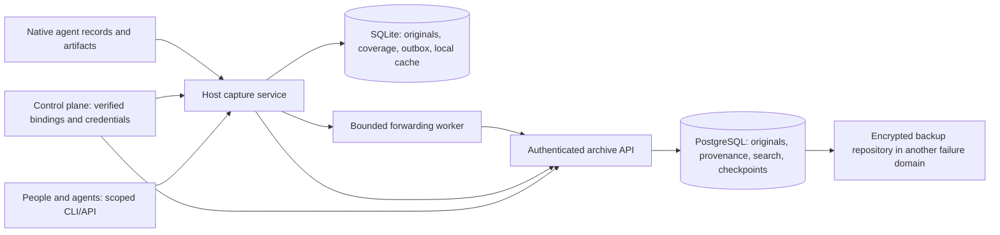

# Engineering evidence archive

[Architectural decisions](engineering-evidence-archive.decisions.md) · [Roadmap for the planner](../roadmaps/engineering-evidence-archive.md) · [Workstation architecture](agentic-developer-workstation.md#55-shared-evidence-archive-and-policy)

## 1. Problem and goals

People and engineering agents need original evidence while they work, before compaction, and after an interruption. The archive preserves available session records, tool results and artifacts; retrieves relevant passages with exact citations; and supports reviewed decisions and source-linked checkpoints. It records what was captured without making historical assertions authoritative.

The recommended architecture uses SQLite for durable capture and forwarding on each agent host, an authenticated archive service, PostgreSQL for shared originals and provenance, and encrypted backups in a separate failure domain. These are design proposals, not accepted engine or deployment decisions. The Owner's priorities are integrity, performance, reliability, security and low maintenance. Engine uniformity is not a selection criterion.

### 1.1 Role assignments

Owner: David Noble. Designer: Codex. Independent Reviewer: Antigravity, in the Engineering Evidence Archive Review conversation. The planner receives this design, its decision companion and roadmap; implementation owners retain Features #491–#496. No Observers are assigned. This design grants no implementation, publication, merge or cross-worker communication authority.

### 1.2 Observable goals

| Goal | Result the Owner can observe |
| --- | --- |
| Preserve evidence | Acknowledged capture survives a host-process restart; source identity, exact bytes and gaps remain inspectable |
| Retrieve useful context | A reviewed engineering question finds the rejected approach and its original result without loading the entire session |
| Preserve authority | Consumers distinguish an assertion, a captured observation, a proposed conclusion and an accepted decision |
| Recover deliberately | An independently restored archive resolves the same authorized citations and identifies its recovery boundary |
| Limit maintenance | Routine operation has bounded resource use, automatic retry, actionable alerts and a tested backup/upgrade runbook |

## 2. Constraints

[Engineering evidence archive (#490)](https://github.com/NobleFactor/noblefactor-engprod/issues/490) supplies the subsystem requirements. Its six existing implementation Features (#491–#496) are provisional: this design and subsequent review establish whether their capability boundaries need to change. Current approved policy, designs, source revisions, schedules and checkpoints keep their respective authority. Original transcripts and credentials remain private; public documentation and verification fixtures contain synthetic or explicitly cleared material.

Capture storage lives outside disposable sandboxes. Agents receive scoped service access rather than raw database mounts or archive credentials. Shared services may be placed on another host, on the same physical host, or on a suitable remote service, but placement cannot change receipt meanings or authorization. A remote database cannot substitute for disconnected local durability.

The Owner withdrew the earlier storage-uniformity preference; [workstation W6](agentic-developer-workstation.decisions.md#w6) records that scoped correction. [D4](agentic-developer-workstation.decisions.md#d4) remains the archive layout and recovery question. This design recommends a concrete candidate while leaving its unaccepted choices and qualification evidence explicit.

## 3. Context and scope

The archive serves human investigation and persistent designer, planner, coder, reviewer and auditor sessions. Capture adapters read authorized records where each native host actually runs. The workstation control plane supplies verified role/environment bindings and service lifecycle. The archive supplies evidence, retrieval and checkpoint storage; it does not replace the control plane, execute retrieved instructions, decide whether a claim is true, or recover an unavailable native session database by assertion.

The first usable interface is a small CLI for people and agents over the same versioned API. The intended commands are ingest/import, search, source/context, checkpoint, coverage and health. Native adapters perform bounded incremental capture; a whole-session JSON upload is not the capture contract. Each supported host or export format needs its own qualified source adapter. Initial candidates are Claude Code, Codex, OpenCode and supplied exports. Antigravity exports are inputs; native Antigravity capture requires its own adapter qualification.

Hardware acquisition, inference sizing, a general knowledge ontology, semantic/vector search, automated policy rewriting and active-active database operation are outside this design. The archive implementation belongs in an approved implementation repository, not as Go source in this engineering-documentation repository.

## 4. Solution strategy

Preserve source bytes before parsing or screening them, commit payload and forwarding obligation together, and transfer them with replay-safe identities. Keep local durability, central custody, index readiness and off-machine recoverability as separate facts. The local store also holds an authorized, bounded retrieval cache; it is not a second authoritative global archive.

Use an archive API between every host and shared storage. The API owns ingestion validation, caller/scope enforcement, conflict handling, retrieval and custody receipts. The database can move without changing citation identity or giving agents database privileges. Reuse a single archive service codebase for host-facing and shared-service roles where practical; do not add a broker or distributed transaction coordinator for this workload.

PostgreSQL is the recommended shared store because originals, provenance, policy status and citation relationships can share a transactional and backup boundary. Bounded original chunks keep that boundary coherent for the first deployment. A separate artifact service remains a measured growth option. SQLite-only central storage is a viable alternative if its tested backup/recovery and concurrency behavior better meet the agreed workload and operating cost; the API and evidence contracts remain the same.

## 5. Components and interfaces

### 5.1 Host capture service

One supervised service per agent host owns source adapters, a serialized SQLite writer, bounded read connections, an outbox worker and local retrieval. A restricted service identity owns its files. The source adapter has the minimum access needed to read authorized native records; an agent token cannot grant it access to another session's files. Service health exposes capture coverage and delivery lag separately.

An ingestion transaction stores exact original chunks and a capture manifest, records trustworthy versus asserted associations, updates durable source coverage, and creates the forwarding obligation. A local acknowledgment is returned only after commit. Parser and index work can lag; an unsupported parser does not justify discarding preserved bytes or claiming searchable coverage.

### 5.2 Shared archive service

The shared service validates host identity and allowed source bindings, streams bounded chunks, verifies digests, and commits a complete capture manifest with its provenance and custody state. It derives secret-screened search records asynchronously from protected originals. Missing chunks keep a manifest incomplete and ineligible for a complete-capture receipt. A parser failure leaves the original retrievable to an authorized investigator with an explicit indexing gap.

PostgreSQL holds original chunks, artifact manifests, source/capture identities, normalized events, derived passages, authorization associations, receipt records, checkpoints, reviewed conclusions, policy references, redaction/deletion records and recovery metadata. Original rows are immutable in ordinary operation. Derived rows identify their parser and policy revisions and can be rebuilt without changing source citations.

### 5.3 API contracts

| Interface | Contract |
| --- | --- |
| Capture/import | Authenticated caller, bounded original chunks, source generation/range, digest and manifest; returns exact accepted identities and durability level |
| Receipt status | Idempotency/capture identity plus digest; reports pending, archive committed, backup covered, quarantine or conflict |
| Search | Authorized scope and bounded query; returns ranked passages, exact citations, source/representation revisions and visible coverage |
| Source/context | Stable citation and bounded expansion; independently authorizes the target and every returned neighbor/artifact |
| Checkpoint | Role/session identity, governing revisions, source-linked state and uncertainty; durable acknowledgment is distinct from acceptance |
| Coverage | Per-authorized-source captured and parsed boundaries, known gaps, capture time and delivery/backup lag |
| Administration | Separately authorized retry, quarantine disposition, retention/deletion, export and recovery operations; ordinary agents cannot invoke these |

All interfaces use bounded streaming, parameterized storage operations, finite request/query deadlines and explicit version negotiation. Result cursors bind scope, query and result revision; they cannot be reused to widen access. The first service exposes no arbitrary SQL, unrestricted filesystem access or user-supplied URL fetching for artifacts. Deployment-specific addresses and reachability are configuration tested for each host/sandbox topology.

## 6. Runtime and development workflow

### 6.1 Capture and disconnected operation

At startup the service verifies its database configuration, source inventory, bindings and credential state, then resumes pending captures and forwarding. Each adapter reads a stable source generation or bounded snapshot. A changed or truncated source opens a new generation rather than reusing earlier offsets. Partial trailing records may be preserved as bytes while remaining outside parsed-event coverage.

Capture and acknowledgment do not wait for the network. A disconnected host can continue preserving records and serving authorized local evidence within its capacity and credential policy. Results state that they cover a local subset and identify its age; they do not imply a search of the complete archive. Provider hooks can request a flush, but continuous capture and reconciliation are primary. Hook availability and whether a transition can be blocked require qualification on each pinned native host.

A source watermark advances only through durably preserved contiguous ranges. Known gaps have their own records and cannot be represented as captured content. A separate parsed watermark prevents a trailing partial record or parser failure from becoming a claim of complete retrieval coverage. The highest observed turn is never a completeness boundary by itself.

### 6.2 Forwarding, replay and conflict

The worker batches by encoded bytes and record count, applies finite timeouts, and persists exact per-item outcomes. Initial tuning candidates are 1 MiB original chunks and batches bounded by 4 MiB and 128 items; these are proposed limits to benchmark, not measured performance. No success path clears a whole pending batch merely because some items committed.

If a reply is lost, retrying the same logical identity and digest returns the earlier custody result. The same identity with different content is a conflict: retain both captures with their provenance, quarantine the disagreement, and do not overwrite the first original or silently acknowledge the second. A source revision explicitly identified as new evidence is different from an unexplained conflicting replay.

Transient failures use capped exponential backoff with full jitter. Rate limiting respects the service's bounded retry instruction. Authorization failures stop the affected delivery channel pending credential repair; malformed items are isolated without removing their payload or blocking independent valid items. Quarantine is durable state and a retention hold, not a deleted outbox row. Operator disposition is attributable and follows the deletion/reconciliation policy.

### 6.3 Ordinary investigation

A person or agent asks a scoped question, examines bounded matches and expands a citation to the surrounding exchange, paired tool result or original artifact. Online requests use the shared archive and merge any authorized pending local evidence by identity and digest. Offline requests use only locally available authorized representations. Index absence, incomplete capture, contradiction and supersession remain visible.

An extracted assertion is not an observation. A captured test result identifies its source and tested revision; a transcript saying a test passed remains an assertion unless supporting output is available. A proposed conclusion records supporting and conflicting evidence. Acceptance requires the existing human review/authorization process. Supersession links decisions and their rationale without rewriting the original history.

### 6.4 Before compaction and after interruption

Before a supported compaction or replacement, capture outstanding evidence, consult relevant earlier sources, review a role checkpoint and durably store it while useful context remains. The checkpoint includes objective, accepted decisions and reasons, rejected alternatives, uncertainty, policy/design/source revisions, verification evidence, pending external operations, unfinished work and the next action. Each material claim has a resolvable citation or an explicit evidence gap.

A failed capture or checkpoint is visible. A transition requiring durable evidence remains blocked when that durability is unavailable; an unsupported blocking hook is reported as a capability gap rather than a guarantee. Routine recovery restores the same native identity first. An Owner-approved successor follows the workstation fencing/approval contract; archived evidence supports reconstruction but does not prove that the native session or complete context was restored.

### 6.5 Release and storage pressure

A local original becomes eligible for ordinary eviction only after a verified archive receipt, backup-coverage receipt, applicable retention window, and absence of quarantine, reconciliation, legal/policy or deletion-processing holds. Eviction revalidates custody against the current archive generation and backup policy; a cached receipt beyond its validity period is insufficient. If that validation is unavailable, retain the copy. Cache usefulness is a separate retention reason. The payload/outbox/hold relationships enforce this condition transactionally; a cascading delete cannot turn a rejected item into a delivered one. Explicit approved deletion uses a different audited operation.

When capacity is threatened, first expire eligible cache copies and stop optional indexing work. Warn with backlog age, reserved space and the affected capability. At the hard capture reserve, reject new acknowledgments and block transitions requiring capture instead of deleting pending or quarantined originals. A bounded disk cannot guarantee unlimited disconnected work. Capacity is sized from measured ingest rate, maximum outage, quarantine allowance, cache policy, WAL growth and backup scratch space.

### 6.6 Engineering development workflow

During ordinary engineering work, participants consult relevant evidence, follow citations and record new observations for the actual artifact revision. A Reviewer evaluates the proposed conclusion against its sources; the Owner decides acceptance. Policy updates use reviewed rationale and preserve the prior rule's evidence, supporting common and role-specific reading without replaying the entire incident log. Retrieved text never grants authority to execute a command.

## 7. Deployment

The host capture service and persistent store run outside SBX on every machine that produces agent records. A Unix-domain socket with OS access controls is the preferred same-host path. A sandbox or microVM uses a qualified authenticated proxy/network path when it cannot reach that socket. No design guarantee depends on an untested special hostname or socket mount working across a VM boundary.

The shared API, PostgreSQL and backup agent can be colocated for the initial service, with distinct service identities and resource limits. The backup repository is in another qualified failure domain and contains client-side encrypted backups. Colocating local capture and the archive on one physical machine does not create two independent copies against machine loss. The API/database may move while archive identity and citations remain stable.

SQLite uses a local filesystem with WAL, synchronous FULL and foreign-key enforcement verified on every relevant connection. On macOS, qualify fullfsync and the actual storage path. Unknown pragmas must not be assumed effective. Read transactions and checkpoints are bounded and WAL growth is monitored. These durability choices follow [SQLite's pragma documentation](https://www.sqlite.org/pragma.html#pragma_synchronous); they still require fault testing on the deployed filesystem/device.

The embedded SQLite build must include the WAL-reset corruption fix, available in 3.51.3 or the documented maintained backports; verify the linked library rather than the shell executable. Its concurrency/checkpoint failure mode is documented in [SQLite's WAL notes](https://www.sqlite.org/wal.html#walreset). Database files are not shared between machines through a network filesystem.

PostgreSQL runs a qualified supported release with fsync and full_page_writes enabled and synchronous_commit enabled for custody transactions. An asynchronous application queue or unflushed write is not an archive receipt. See [PostgreSQL WAL configuration](https://www.postgresql.org/docs/19/runtime-config-wal.html). Service-to-database connections validate certificate chains and endpoint identity; the corresponding libpq requirement is [verify-full](https://www.postgresql.org/docs/19/libpq-ssl.html#LIBPQ-SSL-PROTECTION).

Backups use qualified pgBackRest base backups and continuous WAL archiving with repository encryption. A candidate build must include the random-subkey fix and subsequent encrypted-repository metadata fixes; 2.60.1 is the research baseline, not a claim of deployment. The [upstream release notes](https://pgbackrest.org/release.html) identify those fixes. Storage destination, supported platform, retention and key custody require qualification before custody release depends on them.

## 8. Shared concepts

### 8.1 Identity and provenance

Persist an archive identity independent of its hostname and a producer identity independent of sandbox lifetime. A capture identifies provider, host, native session, source artifact/generation and exact byte/message range, plus a digest of the original bytes. Use a versioned, unambiguous identity encoding. Repository, role, schedule and source revision associations include their authority/basis; unknown or merely client-asserted associations remain marked as such.

Hashes establish byte equality and detect later modification; they do not prove source authenticity or the truth of a claim. Capture manifests identify complete versus partial artifacts and missing attachments. Derived representations retain original locators, parser versions and screening-policy revisions. Native message identity, source revision and capture identity are distinct so reprocessing cannot silently change an existing citation.

### 8.2 Durability and recovery receipts

| Receipt or state | What it establishes | What it does not establish |
| --- | --- | --- |
| Local durable | Exact original bytes, coverage and forwarding obligation committed on the host's qualified store | Survival of loss of that host/storage device |
| Archive committed | The authenticated archive committed the exact original/manifest and provenance under its durability policy | An independent backup or searchable representation |
| Index ready | A particular authorized, screened representation is available at an identified parser/policy revision | Completeness of source capture or acceptance of its claims |
| Backup covered | A verified retained backup chain covers that archive commit barrier, with recoverable keys and an identified repository/failure domain | An unlimited retention promise or proof that every future restore will succeed |

Receipts bind archive/producer identity, capture identity, original digests, manifest completeness, policy revision and custody generation. A lost response is reconciled by identity and digest. They are authenticated service assertions, not assertions supplied by the ingesting agent. Restore and approved deletion can invalidate a formerly usable custody state; the service exposes current validity and reconciles affected local copies before release.

For PostgreSQL, record a conservative WAL flush barrier after the custody transaction commits, with database-system/timeline lineage. A pre-commit LSN is not a commit receipt. [PostgreSQL's administrative functions](https://www.postgresql.org/docs/19/functions-admin.html#FUNCTIONS-ADMIN-BACKUP) provide WAL-position observations; the application must qualify its barrier protocol. Backup coverage requires a usable base backup and uninterrupted retained WAL through that barrier on the correct lineage, not merely an archiver success counter. [PostgreSQL's PITR contract](https://www.postgresql.org/docs/19/continuous-archiving.html) explains the base-backup/WAL dependency.

During an archive outage, a locally acknowledged record remains vulnerable to destruction of the only host copy until independent custody exists. The interface states that exposure. Zero loss under simultaneous host destruction and disconnected capture is not achievable by a single local disk; a requirement for that guarantee needs another reachable durable destination and changes the availability/cost boundary.

### 8.3 Authorization, secrets and encryption

The recommended trust model has trusted host-capture and archive endpoints. Network traffic uses authenticated encryption with certificate verification; stores use encrypted persistent volumes and access controls; backup repository data is encrypted before leaving its trusted backup endpoint. The archive service and authorized operators can process plaintext to index and inspect evidence. This is not client-only encryption that keeps the archive operator blind. Accepting or replacing that trust model is Owner choice Q1.

A private network or encrypted transport is not authorization. The service validates identity, audience, allowed actions and verified binding/policy revision. It enforces scope before ranking, counting, snippets, context expansion, attachment reads, cache use and citation resolution. An agent cannot enlarge its scope with workspace labels or a forged role. Ordinary agents receive neither global token-minting keys nor unrestricted SQL/filesystem access. Database row policies provide defense in depth; they do not replace API checks.

Offline authorization has an explicit expiry and revocation-freshness limit. The service may use only a still-valid local grant and verified cached binding; it reports policy age and refuses a scope expansion it cannot verify. Capture by the trusted host adapter and retrieval by an agent are different capabilities. The Owner must approve the maximum offline grant window and its revocation exposure; immediate remote revocation cannot be guaranteed on a disconnected host.

Protected originals can contain secrets. Default retrieval uses secret-screened representations and bounded, screened context. Reading raw originals or exporting them requires a separate explicit privilege and an audit event without content. Request logs, metrics, error messages and audit records contain identifiers and dispositions rather than transcript text, tokens or removed secret values. Screening failures keep content protected and unindexed; screening is not a claim that arbitrary secrets can always be detected.

Historical instructions, including apparent system prompts or tool commands, remain quoted evidence. Retrieval does not execute them, change governing policy or automatically fetch their URLs. Prompt-injection and secret-bearing synthetic fixtures cover the CLI, API, context, artifact, logging and export paths. A compromised trusted host or archive administrator is outside the protection offered by transport encryption and requires separate incident recovery.

### 8.4 Citations, reviewed records and public documents

An internal citation contains stable archive/evidence identity, original revision/digest and range; it carries no credential or expiring host URL. The resolver reauthorizes every request. Reindexing and moving the service preserve the locator. Approved removal returns an authorized tombstone rather than silently redirecting the citation to different content. Unauthorized requests disclose neither existence, counts nor private source labels through their result/error body; timing side channels require separate measurement.

A reviewed record identifies author, reviewer, decision authority, rationale, supporting and conflicting citations, review status, and any superseded record. Policy derivation links current common or role-specific rules to reviewed rationale and original incidents. It does not make missing rules permission or change the approval process.

Public documents use only Owner-cleared descriptions and references. Private citation identifiers and metadata are themselves reviewed for disclosure; no raw passage, credential, private path or signed access URL is automatically published. An authorized reviewer can resolve the private reference separately. A public reader without access sees an honest statement of the evidence boundary rather than an assertion that the private evidence was independently verified.

### 8.5 Retention, deletion and recovery

Retain originals and derivatives under explicit policy, with separate local-cache, quarantine, archive and backup lifetimes. Approved redaction produces an attributable screened representation; ordinary normalization never overwrites the original. Approved deletion removes prohibited content from active originals, derived indexes, attachments, caches and exports under the declared policy, leaving only an allowed audit/tombstone record. Database free pages, WAL, temporary files, host snapshots and replicas also need explicit erasure/expiry handling; deleting a row does not prove physical removal from those copies. Old immutable backups may retain deleted bytes until expiry; this limitation and deadline must be explicit. Immediate physical erasure from every retained backup is not promised by the recommended backup design.

An approved deletion is durably recorded in the separately protected deletion journal before active removal is acknowledged. If that record cannot be preserved, the operation remains incomplete. Before a restored archive serves traffic, recover and replay the current deletion/revocation journal and invalidate stale receipts, indexes and grants; unavailable journal recovery keeps retrieval closed. Restore testing verifies citation resolution, scoped retrieval, original digests, checkpoint continuity and deletion enforcement. A backup succeeds operationally only when its files and keys can support the defined recovery procedure. The deletion journal and key recovery materials require protection and an independent recovery path too.

The central backup and WAL policy uses [pgBackRest's documented encryption, retention and restore facilities](https://pgbackrest.org/user-guide.html). Local-store backup uses a consistent snapshot through the [SQLite Online Backup API](https://www.sqlite.org/backup.html), encrypted by the qualified host-backup mechanism; copying a live main database alone is not the backup contract. Local-only pending/quarantined evidence has a separately visible backup exposure.

## 9. Significant decisions

The [decision companion](engineering-evidence-archive.decisions.md) records the rationale and alternatives for local SQLite capture, the archive API, PostgreSQL originals/provenance, separate recovery receipts and safe release, trusted endpoints, and encrypted backup operations. All archive architecture selections remain proposed until the Owner explicitly accepts them. Workstation W6 is the accepted removal of a constraint, not acceptance of this architecture.

The recommendation minimizes independent services and consistency boundaries while retaining a path to change engines or move large artifacts after measured need. It accepts one central database's maintenance and restore responsibilities. It does not claim that a comparative workload benchmark, fault test or deployment has already established the recommendation's performance or reliability.

## 10. Quality requirements

| Scenario | Required observable behavior | Evidence before implementation acceptance |
| --- | --- | --- |
| Power/process interruption | Every acknowledged local capture survives the qualified failure; unacknowledged input can be retried | Crash/power-cut tests on the actual filesystem/device and pinned embedded library |
| Lost delivery reply | Replay returns the same custody result without duplicate originals or widened authorization | Fault injection before/after archive commit and response delivery |
| Conflict or poison item | Preserve conflicting/quarantined bytes; continue independent valid work; no automatic purge | Synthetic conflicts, invalid records and storage-pressure tests across restart |
| Incomplete source | Missing turns, attachments and trailing bytes remain visible; parsed coverage does not outrun capture | Adapter fixtures for append, truncate, replace, missing data and version changes |
| Useful retrieval | Locate a rejected approach, original result and surrounding context with exact references | Reviewed engineering-question set, including identifiers, paths and command flags |
| Unauthorized or malicious retrieval | Reject forged scope; prevent disclosure through results/counts/artifacts/context; retrieved instructions gain no authority | Cross-scope, secret and prompt-injection fixtures across online/offline paths |
| Independent recovery | Restore selected custody boundary, enforce deletions, resolve citations and reconcile pending operations | Timed restore on another host with independently recovered keys |
| Routine maintenance | Detect capture/backup lag and capacity risk; upgrade or rebuild derived indexes without source/citation loss | Operator walkthrough and upgrade/rollback evidence with stated staff time |

Numeric targets are proposals for Owner review: local durable acknowledgment p95 at or below 100 ms for a 64 KiB capture delta with eight concurrent producers; first-page shared search p95 at or below one second for ten concurrent callers over one million representative passages. Use an identified SSD host, data mix and encrypted storage configuration, report tail latency and resource use, and include backup/index load. These are qualification targets, not measurements or deployment promises.

Recovery-point/time objectives, maximum disconnected interval, expected archive growth and acceptable maintenance time remain unapproved. Size and tune against an agreed workload before accepting a storage choice. A configured threshold, successful unit test or healthy process is not evidence of those service objectives.

## 11. Risks and open choices

| ID | Owner decision or required evidence | Consequence while open |
| --- | --- | --- |
| Q1 | Trust the archive to process plaintext, or require client-only encryption with an untrusted archive operator | The recommendation supports the trusted-endpoint profile; blind-server search would require a different design |
| Q2 | Workload, artifact sizes/growth, disconnected interval and maintenance budget | Storage recommendations and numeric targets remain conditional; no capacity or cost claim is accepted |
| Q3 | Scope defaults, offline grant lifetime and permitted revocation delay | Qualify safe offline retrieval without implying immediate remote revocation |
| Q4 | Required recovery point/time, backup destination, failure-domain independence and key recovery custodian | Backup coverage and eviction cannot be qualified until these are established |
| Q5 | Retention, quarantine disposition and deletion deadlines, including retained backup expiry | Do not enable automatic deletion or promise immediate erasure from old backups |
| Q6 | Qualified host/VM reachability and each provider's capture/compaction capabilities | No generic hook or host-network guarantee; incomplete paths stay visible |
| Q7 | Approve or revise the proposed engines, original chunk placement and API contracts | Planner receives a coherent candidate and explicit alternatives, not an approved deployment |

SQLite serialization, long reads, artifact growth, database/WAL growth, screening blind spots and slow backups can violate the goals if capacity is assumed rather than measured. A shared central service is a single availability boundary; local capture reduces interruption impact but does not provide high availability for complete shared retrieval. Adding a standby, object service or second independent capture destination requires its own justified cost/recovery decision.

## 12. Glossary

| Term | Meaning |
| --- | --- |
| Original | Exact captured source bytes with immutable provenance, subject only to approved deletion |
| Capture manifest | Bounded source generation/ranges, chunk identities, digests, completeness and gaps |
| Outbox | Durable obligation to forward preserved evidence; it is not the only retained copy of the payload |
| Watermark | Boundary of durable contiguous coverage; parsed coverage is tracked separately |
| Custody receipt | Authenticated statement of a specific storage/recovery fact for exact evidence |
| Quarantine | Preserved evidence held for investigation/reconciliation and excluded from automatic purge |
| Representation | Versioned, derived and potentially secret-screened material linked to originals |
| Failure domain | A set of copies that can be lost together, such as one machine or one storage account |
| Checkpoint | Durable, source-linked role state supporting continuity without promoting assertions into facts |

## 13. Delivery references

The [roadmap](../roadmaps/engineering-evidence-archive.md) maps candidate capabilities and observable acceptance gates to capture (#491), catalog/provenance (#492), retrieval (#493), checkpoints (#494), reviewed traceability (#495), and protection/recovery (#496). The planner uses those inputs to define implementation issues and committed Schedules. [Feature: Evidence archive design (#622)](https://github.com/NobleFactor/noblefactor-engprod/issues/622) is the enabler under Epic #490. [Schedule: evidence archive design (#619)](https://github.com/NobleFactor/noblefactor-engprod/issues/619) orders [the design and decision records (#623)](https://github.com/NobleFactor/noblefactor-engprod/issues/623) before [the roadmap (#624)](https://github.com/NobleFactor/noblefactor-engprod/issues/624); the roadmap Task is blocked by the design Task. The accompanying roadmap is a draft for context, with its review and acceptance following the design. The live project owns execution order and progress. The handbook coder owns the shared terminology, templates and design-Schedule skill. This design contains no committed implementation issue order or implementation plan.

The private Antigravity draft and prototype informed investigation. Their earlier reported defects and SQL reproductions have not been independently qualified as deployment evidence. Architecture acceptance must rely on the explicit contracts and future reproducible evidence above, not on prototype build success. Existing plan PR #618 records preparation; the Owner subsequently clarified that the Designer's deliverables are this wanted-system design and its roadmap for planning.
