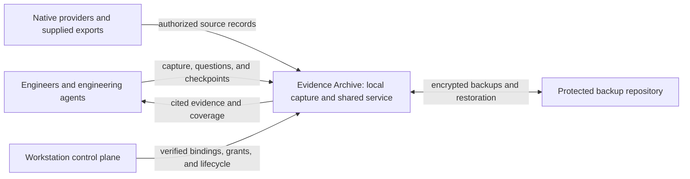
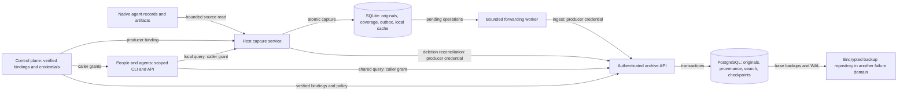
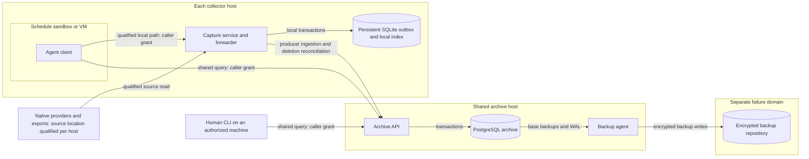

# Engineering evidence archive

[Architectural decisions](engineering-evidence-archive.decisions.md) · [Roadmap for the planner](../roadmaps/engineering-evidence-archive.md) · [Workstation architecture](agentic-developer-workstation.md#55-shared-evidence-archive-and-policy)

## 1. Problem and goals

People and engineering agents need original evidence while they work, before compaction, and after an interruption. The archive preserves available session records, tool results, and artifacts; retrieves relevant passages with exact citations; and supports reviewed decisions and source-linked checkpoints. It records what was captured without making historical assertions authoritative.

The recommended architecture uses SQLite for durable capture and forwarding on each agent host, an authenticated archive service, PostgreSQL for shared originals and provenance, and encrypted backups in a separate failure domain. These are design proposals, not accepted engine or deployment decisions. The Owner's priorities are integrity, performance, reliability, security, and low maintenance. Engine uniformity is not a selection criterion.

### 1.1 Stakeholders and role assignments

The following stakeholders use, operate, or govern the archive:

| Stakeholder | Need | Design response |
| --- | --- | --- |
| Engineers and persistent engineering agents | Find prior work, inspect exact evidence, and resume after interruption | Scoped search, stable citations, and source-linked checkpoints |
| People whose work is captured | Restrict access to private material and enforce approved removal | Verified scope, screened representations, and auditable deletion |
| Archive operators and recovery custodians | Run the service with bounded effort and recover usable evidence | Visible backlog, bounded storage, retained backups, and restore checks |
| Control-plane and provider-adapter maintainers | Integrate capture and role identity without granting excess access | Separate producer credentials, caller grants, and qualified source adapters |
| Reviewers, auditors, and the Owner | Distinguish evidence from assertions and decide acceptance | Provenance, conflicts, explicit approval states, and observable quality checks |

Owner: David Noble. Designer: Codex. Independent Reviewer: Antigravity, in the Engineering Evidence Archive Review conversation. The planner receives this design, its decision companion, and roadmap; implementation owners retain Features #491–#496. No Observers are assigned. This design grants no implementation, publication, merge, or cross-worker communication authority.

### 1.2 Observable goals

The following five quality goals reflect the Owner's priorities; section 10 defines the corresponding qualification scenarios:

| Goal | Result the Owner can observe |
| --- | --- |
| G1 Integrity | Exact captured bytes, source identity, and gaps remain inspectable; consumers distinguish observations, assertions, proposals, and accepted decisions |
| G2 Performance | Capture remains responsive, and a reviewed engineering question finds the rejected approach and its original result within the qualified latency target |
| G3 Reliability | Acknowledged local capture survives the qualified restart; an independent restore resolves the same citations and states its recovery boundary |
| G4 Security | Each retrieval enforces the caller's scope; secrets remain protected, approved deletions apply, and retrieved instructions gain no authority |
| G5 Low maintenance | Routine operation has bounded resource use, automatic retry, actionable alerts, and a tested backup and upgrade runbook |

### 1.3 Requirements and provisional Feature coverage

The table below traces the Epic's requirements to this design. It also evaluates the six filed implementation Features; their names and boundaries remain proposals until the Owner approves the resulting decomposition. The roadmap is not needed to establish this coverage.

| Requirement source | Required result | Coverage in this design | Proposed ownership and remaining gap |
| --- | --- | --- | --- |
| [Epic #490](https://github.com/NobleFactor/noblefactor-engprod/issues/490): original evidence, ordinary consultation, and reasoning before compaction | Preserve available exchanges, tool results, and artifacts; retrieve exact context; distinguish recorded claims from accepted conclusions | [Capture](#host-capture), [retrieval](#retrieval-views), [checkpoints](#checkpoints), [reviewed records](#citations-and-reviewed-records) | Keep all six capability areas. Provider coverage, retrieval usefulness, and missing-history behavior require qualification; stored volume alone is insufficient |
| [Capture and import #491](https://github.com/NobleFactor/noblefactor-engprod/issues/491) | Bounded, repeatable capture with source identity, original bytes, and explicit completeness and gaps | [Host capture](#host-capture), [capture while disconnected](#capture-disconnected), [forwarding](#forwarding-replay), [identities](#evidence-identities) | Own adapters, the local capture transaction, and producer side of forwarding. #492 owns the receiving side; both must satisfy one replay and receipt contract. Native provider hooks remain Q6 |
| [Catalog and provenance #492](https://github.com/NobleFactor/noblefactor-engprod/issues/492) | Stable originals, source ranges, parser versions, association status, and rebuildable derivatives | [Shared archive](#shared-archive), [conceptual data model](#data-model), [custody receipts](#custody-receipts) | Refine this Feature to shared custody and provenance: include archive ingestion, conflict records, and receipt issuance. Its current PostgreSQL-specific name should become engine-neutral while Q7 remains open |
| [Search and retrieval #493](https://github.com/NobleFactor/noblefactor-engprod/issues/493) | Scoped metadata filters, useful engineering-text search, bounded results, exact citations, and context | [API contracts](#api-contracts), [retrieval views](#retrieval-views), [authorization](#authorization), [citations](#citations-and-reviewed-records) | Own the *command-line interface (CLI)* and query contracts for shared and local retrieval, including local full-text search and literal identifier search (SQLite's FTS5 full-text search module in the local candidate), independent cursors, and coverage reporting. #496 supplies the policy enforced on both paths; Q2, Q3, and Q7 remain open |
| [Consultation and checkpoints #494](https://github.com/NobleFactor/noblefactor-engprod/issues/494) | Capture, consult, and preserve source-linked role state before supported compaction or replacement | [Checkpoint identity, revision, and readiness](#checkpoints), [deployment](#deployment) | Own the checkpoint API and provider integration. Depend on #491 and #492 for cited evidence and #493 for consultation; workstation identity and fencing remains an external contract. Q6 requires host-specific proof |
| [Reviewed traceability #495](https://github.com/NobleFactor/noblefactor-engprod/issues/495) | Supporting and conflicting evidence, review status, supersession, policy rationale, and safe private citations | [Evidence and authority separation](#retrieval-views), [conceptual model](#data-model), [reviewed records and public references](#citations-and-reviewed-records) | Retain this distinct capability. It owns reviewed-record behavior and policy links, without becoming authority to rewrite policy or treat summaries as accepted facts |
| [Protection, operations, and recovery #496](https://github.com/NobleFactor/noblefactor-engprod/issues/496) | Protected originals, authorization, screened retrieval, deletion, independent restore, and operability | [Authorization](#authorization), [deletion and recovery](#deletion-and-recovery), [quality scenarios](#quality-requirements) | Retain it as a requirement on the first usable slice. It owns access and deletion policy, the deletion journal, backups, recovery, and operations; Q1 and Q3–Q5 constrain acceptance |

The design retains six capability areas, with explicit refinements to #492 and #493 rather than a seventh Feature solely for an API component. The proposed name for #492 is Shared evidence custody and provenance, with the scope above. Local offline retrieval becomes explicit in #493. These are recommendations for roadmap review and planning, not changes already made to the issues. The following table assigns the contracts that cross those boundaries:

| Shared contract | Responsible capability | Required collaboration |
| --- | --- | --- |
| Archive service and ingestion and receipt API | #492 owns shared service lifecycle and the receiving protocol | #491 owns the host sender; #496 defines identity, deletion, and recovery requirements |
| Query API and local and shared CLI results | #493 owns retrieval behavior on both stores | #492 supplies stable evidence and index identities; #496 supplies authorization and screening policy |
| Checkpoint revision and dependency API | #494 owns checkpoint behavior and readiness | #491 and #492 supply cited originals; the workstation supplies verified role identity and fencing |
| Deletion propagation and late replay rejection | #496 owns policy, journal, and per-host completion | #492 enforces central ingestion and read barriers; #491 applies notices to local payloads and outbox operations; #493 invalidates query views |

## 2. Constraints

The following constraints bound the proposed architecture. The existing implementation Features remain provisional; their current titles do not approve a storage engine or final decomposition.

| Constraint | Explanation | Source |
| --- | --- | --- |
| Preserve evidence and its limits | Captured originals, provenance, and explicit gaps support investigation; stored assertions do not become accepted facts | [Epic #490](https://github.com/NobleFactor/noblefactor-engprod/issues/490) and provisional Features #491–#495 |
| Retain existing authority | Approved policies, designs, source revisions, schedules, and checkpoints keep their respective authority | [Workstation archive contract](agentic-developer-workstation.md#55-shared-evidence-archive-and-policy) |
| Protect private material | Original transcripts and credentials remain private; public documents and verification fixtures use synthetic or explicitly cleared material | [Protection and recovery Feature #496](https://github.com/NobleFactor/noblefactor-engprod/issues/496) |
| Keep capture outside disposable sandboxes | Scoped service access replaces raw database mounts or archive credentials; a remote database cannot supply disconnected local durability | [Workstation archive contract](agentic-developer-workstation.md#55-shared-evidence-archive-and-policy) |
| Preserve contracts across placement | Local, remote, or colocated shared services retain the same receipt meanings and authorization rules | [Archive storage question D4](agentic-developer-workstation.decisions.md#d4) |
| Evaluate each store by its job | The former storage-uniformity preference is withdrawn; replacement engines and deployment choices remain proposed | [Owner-approved withdrawal W6](agentic-developer-workstation.decisions.md#w8) |

## 3. Context and scope

### 3.1 Business context

The archive serves human investigation and persistent designer, planner, coder, reviewer, and auditor sessions. Capture adapters read authorized records where each native host actually runs. The workstation control plane supplies verified role and environment bindings and service lifecycle. The archive supplies evidence, retrieval, and checkpoint storage; it does not replace the control plane, execute retrieved instructions, decide whether a claim is true, or recover an unavailable native session database by assertion.

The context diagram treats the archive subsystem as one boundary and shows its external partners:

### 3.2 Technical context

The first usable interface is a small CLI for people and agents over the same versioned API. Its intended command groups are `ingest` and `import`, `search`, `source` and `context`, `checkpoint`, `coverage`, and `health`. Native adapters perform bounded incremental capture; a whole-session JSON upload is not the capture contract. Each supported host or export format needs its own qualified source adapter. Initial candidates are Claude Code, Codex, OpenCode, and supplied exports. Antigravity exports are inputs; native Antigravity capture requires its own adapter qualification.

The following interfaces connect those partners to the subsystem:

| Partner | Technical connection | Boundary |
| --- | --- | --- |
| People and agents | Caller-authenticated API; optional local capture endpoint | Shared queries go directly to the archive as the caller; local queries use a separate local grant |
| Native providers and exports | Authorized incremental file reads or supplied export streams | Each adapter reports its supported formats and completeness limits |
| Workstation control plane | Verified role and environment bindings, credentials, and lifecycle controls | Client-supplied labels do not create authority; native session recovery remains outside the archive |
| Backup repository and custodian | Encrypted backup writes, retained recovery material, and restore access | Keys and retained copies require recovery paths independent of the protected host |

### 3.3 Scope exclusions

Hardware acquisition, inference sizing, a general knowledge ontology, semantic or vector search, automated policy rewriting, and active-active database operation are outside this design. The archive implementation belongs in an approved implementation repository, not as Go source in this engineering-documentation repository.

## 4. Solution strategy

The collector preserves source bytes before parsing or screening them. It commits each payload and its forwarding obligation together, then transfers them with replay-safe identities. Local durability, central custody, index readiness, and off-machine recoverability remain separate facts. The local store also holds an authorized, bounded retrieval cache; it is not a second authoritative global archive.

An archive API separates each host from shared storage. It validates ingestion, enforces caller scope, handles conflicts, returns evidence, and issues custody receipts. The database can move without changing citation identity or giving agents database privileges. Host and shared services reuse one codebase where practical. The initial architecture needs no broker or distributed transaction coordinator.

PostgreSQL is the recommended shared archive. Originals, provenance, policy status, and citation relationships share one transaction and backup boundary. Persistent SQLite outboxes handle the separate job of disconnected capture on collector hosts. Both stores use *write-ahead logging (WAL)* for recovery. A separate artifact service remains an option after measured growth justifies it. [Decision E3](engineering-evidence-archive.decisions.md#e3) records central SQLite as a considered alternative; the recommendation here remains PostgreSQL.

## 5. Components and interfaces

The building-block view shows the components and their authenticated interactions:

The CLI queries the shared API directly as the caller. It can also query a local capture service with a separate grant for that endpoint. A person on a machine without the capture service uses the shared API directly. The first version has no host-service proxy for shared queries: a host's producer credential is never substituted for a person's or agent's retrieval grant. Producer credentials permit only their registered capture, receipt, and reconciliation operations; they grant no general search or token-minting authority.

### 5.1 Host capture service

One supervised service per agent host owns source adapters, a serialized SQLite writer, bounded read connections, an outbox worker, and local retrieval. A restricted service identity owns its files. The source adapter has the minimum access needed to read authorized native records; an agent token cannot grant it access to another session's files. Service health exposes capture coverage and delivery lag separately.

An ingestion transaction stores exact original chunks and a capture manifest, records trustworthy versus asserted associations, updates durable source coverage, and creates the forwarding obligation. A local acknowledgment is returned only after commit. Parser and index work can lag; an unsupported parser does not justify discarding preserved bytes or claiming searchable coverage.

The initial local retrieval cache contains screened representations of that host's captured evidence. The CLI does not persist arbitrary shared-query results into it. This keeps its purge responsibility within the host's registered source bindings; a later cache of evidence captured on other hosts would need an explicit holder-registration and deletion-notification contract before use.

### 5.2 Shared archive service

The shared service validates host identity and allowed source bindings, streams bounded chunks, verifies digests, and commits a complete capture manifest with its provenance and custody state. It derives secret-screened search records asynchronously from protected originals. Missing chunks keep a manifest incomplete and ineligible for a complete-capture receipt. A parser failure leaves the original retrievable to an authorized investigator with an explicit indexing gap.

PostgreSQL holds original chunks, artifact manifests, source and capture identities, normalized events, derived passages, authorization associations, receipt records, checkpoints, reviewed conclusions, policy references, redaction and deletion records, and recovery metadata. Original rows are immutable in ordinary operation. Derived rows identify their parser and policy revisions and can be rebuilt without changing source citations.

### 5.3 API contracts

The following interfaces define authenticated inputs and observable results:

| Interface | Contract |
| --- | --- |
| Capture and import | Verified producer binding, bounded original chunks, source generation and range, digest, and manifest; returns an exact disposition for each item: archived, retry, quarantined conflict, or deleted |
| Receipt status | Capture identity plus digest; reports current local, archive, and backup facts, conflict identity, deletion status, and index readiness separately |
| Search | Caller grant; filters for repository, schedule, session, provider, time interval, and evidence type; bounded natural-language or exact-identifier query; returns passages, exact citations, source and index revisions, and coverage |
| Source and context | Stable citation and bounded expansion; independently authorizes the target and every returned neighbor and artifact |
| Checkpoint | Verified stream identity, expected parent revision, governing revisions, cited dependencies, and uncertainty; distinguishes local durability, central readiness, and independent recoverability |
| Coverage | Per-authorized-source captured and parsed boundaries, known gaps, capture time, and delivery and backup lag |
| Deletion reconciliation | Authenticated, producer-scoped journal changes after a stored position; returns a complete-through position or requires full inventory reconciliation |
| Administration | Separately authorized retry, quarantine disposition, retention and deletion, export, and recovery operations; ordinary agents cannot invoke these |

All interfaces use bounded streaming, parameterized storage operations, finite request and query deadlines, and explicit version negotiation. Each search cursor binds caller scope, query, filters, index revision, and deletion and policy position; a change that invalidates that view requires a new query. Cursors cannot widen access. The first service exposes no arbitrary SQL, unrestricted filesystem access, or user-supplied URL fetching for artifacts. Deployment-specific addresses and reachability are configuration tested for each host and sandbox topology.

Engineering-text retrieval preserves paths, command flags, commit hashes, issue identifiers, and symbols. Provide an explicit literal or exact-identifier mode alongside natural-language full-text search; English stemming alone is insufficient. Document case and path-separator rules, and treat an ambiguous hash prefix as several possible matches rather than a unique identity. The same query and filter contract applies to PostgreSQL and local SQLite, with any unsupported filter or source-format limitation reported explicitly. Qualification uses representative code, paths, flags, and identifiers as well as ordinary prose.

### 5.4 Conceptual data model

The following identities and relationships apply independently of physical table names. Local and central stores share evidence identities, but retain their own delivery, indexing, and recovery state.

| Entity and location | Primary identity | Mutability and relationships |
| --- | --- | --- |
| Source generation — local and central | Producer, provider, native session, source artifact, and generation | An append, truncation, or replacement creates explicit generation and range facts; verified and asserted repository, revision, role, and schedule associations remain distinguishable |
| Logical capture binding — central, with a local source binding | Logical capture identity | A unique, atomic first-commit binding selects one complete validated variant. A different digest creates a conflict and never replaces that binding; incomplete uploads cannot claim the committed identity |
| Original capture variant and chunks — local and central | Logical capture identity plus original digest; chunk identity and range within its manifest | Exact bytes remain immutable except approved deletion. Distinct digests for one logical identity are separate variants, not overwrites. Manifests refer to complete chunks and explicit gaps |
| Normalized event and passage — local and central | Capture variant, original range, parser, and representation revisions | Derived and rebuildable; preserve tool-call and result relationships and source timestamps with their basis. Index readiness never replaces original capture coverage |
| Forwarding operation — local | Operation ID, kind, capture or checkpoint revision, and digest | Durable state references its retained payload. Pending, awaiting backup, quarantined, and deleted dispositions are distinct; retry state cannot delete the payload |
| Receipt and conflict — local and central | Capture variant, archive identity, archive generation, and receipt or conflict ID | Receipts bind their exact durability fact and policy. A conflict links the prior committed variant and the incoming retained variant; neither identity is silently reassigned |
| Retention and reconciliation hold — local and central | Capture variant, hold ID, reason, and authority | Holds reference retained payloads. Automatic eviction cannot clear a hold to make a delete succeed; explicit approved deletion follows its separately audited path |
| Scope binding and grant — verified centrally, bounded copies locally | Subject or producer, permitted source or scope, audience, actions, and policy revision | Carries issuer, expiry, and association basis. Producer bindings and retrieval grants are separate; client-supplied labels do not create authority |
| Checkpoint stream and revision — local and central | Schedule, environment, and verified role-instance identity; revision ID, parent revision, and fencing generation | Revisions are immutable. A guarded stream-head update selects the latest revision; dependencies link exact original variants and ranges and determine readiness |
| Reviewed record — central with authorized local copies | Record ID and revision, supporting and conflicting citations, and review identity | Assertion, observation, proposal, acceptance, and supersession are explicit states. Review does not rewrite original evidence |
| Deletion intent and host purge status — central, independent journal, and local applied position | Deletion ID, ordered journal position, and permitted identity or source selectors | A durable intent blocks matching ingestion and reads. Hosts record contiguous application and purge acknowledgments; permitted tombstones remain sufficient to reject late re-import |
| Backup chain and coverage — central with bounded local receipt copies | Repository and failure-domain identity, database and timeline lineage, retained chain, and covered barrier | Coverage refers to specific capture or checkpoint commits and recoverable keys. Expiry, restore, and key or repository loss require reconciliation |

Local payload, forwarding, and hold references use restrictive deletion constraints; they do not cascade from payload removal. The single writer's ordinary eviction transaction checks current receipts, retention, and every hold, removes only eligible terminal bookkeeping, then removes the payload. It cannot first discard a pending or quarantined obligation or hold merely to satisfy a foreign key. Approved deletion uses an explicit privileged transaction that records the tombstone and cancellation before removing archive-owned bytes. These invariants require tests at the storage boundary as well as API tests.

## 6. Runtime and development workflow

### 6.1 Capture and disconnected operation

At startup the service verifies its database configuration, source inventory, bindings, and credential state, then resumes pending captures and forwarding. Each adapter reads a stable source generation or bounded snapshot. A changed or truncated source opens a new generation rather than reusing earlier offsets. Partial trailing records may be preserved as bytes while remaining outside parsed-event coverage.

Capture and acknowledgment do not wait for the network. A disconnected host can continue preserving records and serving authorized local evidence within its capacity and credential policy. Results state that they cover a local subset and identify its age; they do not imply a search of the complete archive. Provider hooks can request a flush, but continuous capture and reconciliation are primary. Hook availability and whether a transition can be blocked require qualification on each pinned native host.

A source watermark advances only through durably preserved contiguous ranges. Known gaps have their own records and cannot be represented as captured content. A separate parsed watermark prevents a trailing partial record or parser failure from becoming a claim of complete retrieval coverage. The highest observed turn is never a completeness boundary by itself.

### 6.2 Forwarding, replay, and conflict

The worker batches by encoded bytes and record count, applies finite timeouts, and persists exact per-item outcomes. Initial tuning candidates are 1 MiB original chunks and batches bounded by 4 MiB and 128 items; these are proposed limits to benchmark, not measured performance. No success path clears a whole pending batch merely because some items committed.

If a reply is lost, retrying the same logical identity and digest returns its current disposition, including a later deletion. Before accepting a first capture or replay, central ingestion checks current deletion selectors for that identity, source generation and range, and policy scope. Ingestion and deletion use the same source-generation and policy-scope guards; locking only a newly assigned capture ID is insufficient. The selector check and custody commit serialize with intent creation, including broad scope deletions and newly registered generations. If ingestion commits first, deletion removes it; if the intent commits first, ingestion returns `deleted` and creates no new original, index entry, or success receipt. A new client-generated ID does not authorize re-importing a prohibited source range.

The same logical identity with different content is a conflict. Central ingestion durably retains the incoming complete variant and its provenance in quarantine, links it to the prior committed variant, and returns the incoming identity, digest, and conflict ID. The first committed original keeps its identity and remains readable with a visible conflict marker when current authorization and deletion policy permit. The incoming quarantined variant is excluded from ordinary search; a separately authorized investigation can inspect it. A source revision explicitly identified as new evidence is different from an unexplained conflicting replay. The following table defines the host's response to each per-item disposition:

| Per-item response | Host transaction and subsequent action |
| --- | --- |
| Archived or duplicate with the same digest | Store the verified receipt and mark the operation awaiting required backup coverage; retain the payload under the release rules |
| Conflict with durable central quarantine receipt | Store the conflict ID, retain local bytes and the forwarding obligation, add a quarantine hold, and set its state to quarantined; automatic retries stop |
| Deleted with an authoritative matching deletion notice | Apply that deletion locally, cancel the matching forwarding operation, and remove archive-owned bytes and derivatives under the approved policy; this is deletion, not successful delivery |
| Transient failure or lost response | Keep the pending operation and bytes; retry or reconcile by exact identity and digest |
| Invalid or unauthorized response | Retain the item and expose the failure; no unverified receipt or deletion request releases bytes |

A lost conflict response therefore causes an idempotent retry that returns the same conflict ID; it cannot cause an endless new-conflict loop or silently drop local evidence. Resuming a quarantined item requires an attributable disposition. The service never implements conflict resolution as last-writer-wins replacement of an existing citation.

Transient failures use capped exponential backoff with full jitter. Rate limiting respects the service's bounded retry instruction. Authorization failures stop the affected delivery channel pending credential repair; malformed items are isolated without removing their payload or blocking independent valid items. Quarantine is durable state and a retention hold, not a deleted outbox row. Operator disposition is attributable and follows the deletion and reconciliation policy.

### 6.3 Ordinary investigation

A person or agent asks a scoped question, examines bounded matches, and expands a citation to the surrounding exchange, paired tool result, or original artifact. The CLI makes shared queries directly with the caller's archive grant and local queries with a grant for the local service. Offline requests use only locally available authorized representations. A producer credential is never used to expand the caller's access.

The first interface presents two labeled result streams: shared archive and local pending evidence, with independent cursors, index and read boundaries, and authorized counts. It does not claim one global rank, snapshot, or exact union count. The CLI collapses results with the same capture identity and digest within the displayed view and identifies central custody when present; different digests remain an explicit conflict. A record moving between stores during paging can appear again or enter a later query. The interface reports the independent coverage boundaries and lets the caller restart for a fresh view instead of implying a coordinated cross-store snapshot.

Each store's cursor fixes a bounded result view and order and expires under stated resource limits. Every page and citation expansion rechecks current authorization and deletion state; a changed policy or deletion position invalidates the view and requires a new query. Quarantined local variants never enter ordinary results. Locally preserved but unindexed or unscreened originals appear only in authorized coverage and status information; they do not become unscreened search hits. Exact-source access still requires its own privilege. Index absence, incomplete capture, contradiction, and supersession remain visible.

An extracted assertion is not an observation. A captured test result identifies its source and tested revision; a transcript saying a test passed remains an assertion unless supporting output is available. A proposed conclusion records supporting and conflicting evidence. Acceptance requires the existing human review and authorization process. Supersession links decisions and their rationale without rewriting the original history.

### 6.4 Before compaction and after interruption

Before a supported compaction or replacement, the capture and checkpoint flow follows this order while useful context remains:

1. The collector captures outstanding evidence.
2. The role consults relevant earlier sources.
3. The role reviews its checkpoint. It covers the objective, accepted decisions and reasons, rejected alternatives, uncertainty, governing policy, design, and source revisions, verification evidence, pending external operations, unfinished work, and next action.
4. The host durably stores that checkpoint and reports the exact readiness level described below. Each material claim has a resolvable citation or an explicit evidence gap.

Checkpoint lookup uses the verified schedule, environment, and role-instance identity, not an arbitrary role label or a host timestamp. Multiple workers with the same role have distinct role-instance identities. Each immutable revision names its expected parent, native session, governing revisions, fencing generation, and exact citation dependencies. A central stream-head update compares the expected parent and current fencing generation. A stale parent or successor is a version conflict: retain the proposal and expose the conflict without replacing the current ready head. Lookup reports the latest ready revision and any pending or incomplete newer revision separately. Ready describes available evidence, not acceptance of the checkpoint's conclusions.

Local checkpoint acknowledgment requires the checkpoint and every cited local original and range to be durably present, or an explicit gap to be recorded. Its forwarding operation records the cited dependencies. Central readiness requires central custody of those exact dependencies, current authorization and deletion checks, and the guarded checkpoint-head commit. Forward originals first; a checkpoint arriving early receives a `pending-dependencies` result and cannot become a portable ready checkpoint. A deleted or quarantined dependency leaves it incomplete until an authorized revision removes or explicitly accounts for that gap. Deletion invalidates affected ready pointers and cached views.

Same-host compaction can rely on a locally durable checkpoint and its local dependencies within the stated local-loss exposure. Switching hosts requires a centrally ready revision; independent recovery additionally requires backup coverage for the checkpoint and its dependencies. A local acknowledgment never proves either condition. An Owner-approved incomplete handoff must identify its accepted gaps explicitly; it is not presented as a ready checkpoint with resolvable citations.

A failed capture or checkpoint is visible. A transition requiring durable evidence remains blocked when that durability is unavailable; an unsupported blocking hook is reported as a capability gap rather than a guarantee. Routine recovery restores the same native identity first. An Owner-approved successor follows the workstation fencing and approval contract; archived evidence supports reconstruction but does not prove that the native session or complete context was restored.

### 6.5 Release and storage pressure

A local original becomes eligible for ordinary eviction only after a verified archive receipt, backup-coverage receipt, applicable retention window, and absence of quarantine, reconciliation, legal, policy, or deletion-processing holds. Eviction revalidates custody against the current archive generation and backup policy; a cached receipt beyond its validity period is insufficient. If that validation is unavailable, retain the copy. Cache usefulness is a separate retention reason. The payload, outbox, and hold relationships enforce this condition transactionally; a cascading delete cannot turn a rejected item into a delivered one. Explicit approved deletion uses a different audited operation.

When capacity is threatened, the service first expires eligible cache copies and stops optional indexing work. Its warnings identify backlog age, reserved space, and the affected capability. At the hard capture reserve, it rejects new acknowledgments and blocks transitions requiring capture while retaining pending and quarantined originals. A bounded disk cannot guarantee unlimited disconnected work. Capacity is sized from measured ingest rate, maximum outage, quarantine allowance, cache policy, WAL growth, and backup scratch space.

### 6.6 Engineering development workflow

During ordinary engineering work, participants consult relevant evidence, follow citations, and record new observations for the actual artifact revision. A Reviewer evaluates the proposed conclusion against its sources; the Owner decides acceptance. Policy updates use reviewed rationale and preserve the prior rule's evidence, supporting common and role-specific reading without replaying the entire incident log. Retrieved text never grants authority to execute a command.

## 7. Deployment

The following deployment view maps the components to collector hosts, the shared archive host, and a separate backup destination. The workstation calls its schedule sandbox SBX. A *virtual machine (VM)* may form part of that sandbox boundary.

Provider record locations remain subject to adapter qualification; this view does not select them. The host capture service and persistent store run outside SBX on every machine that produces agent records. A Unix-domain socket with operating-system access controls is the preferred same-host path. A sandbox or microVM uses a qualified authenticated network path when it cannot reach that socket. No design guarantee depends on an untested special hostname or socket mount working across a VM boundary.

The following placement rules apply even when collector and archive services share a physical machine:

| Location | Components and retained state | Required boundary |
| --- | --- | --- |
| Each collector host | Capture adapters, forwarder, original payloads, local index, and outbox | Persistent host storage outside the disposable sandbox; one service owns local writes |
| Schedule sandbox or VM | Role's client and work environment | Scoped local and shared API grants; no raw database mount or archive credentials |
| Shared archive host | Archive API, PostgreSQL, and backup agent | Separate service identities and resource limits; authenticated, certificate-checked database connections |
| Separate failure domain | Encrypted backup repository | Loss of the protected host must not destroy its only usable backup; Q4 also requires an independent key recovery path |

The shared API, PostgreSQL, and backup agent can be colocated for the initial service, with distinct service identities and resource limits. The backup repository is in another qualified failure domain and contains client-side encrypted backups. Colocating local capture and the archive on one physical machine does not create two independent copies against machine loss. The API and database may move while archive identity and citations remain stable.

SQLite uses a local filesystem with WAL, `synchronous=FULL`, and foreign-key enforcement verified on every relevant connection. On macOS, qualify `fullfsync` and the actual storage path. Unknown pragmas must not be assumed effective. Read transactions and checkpoints are bounded and WAL growth is monitored. These durability choices follow [SQLite's pragma documentation](https://www.sqlite.org/pragma.html#pragma_synchronous); they still require fault testing on the deployed filesystem and device.

The embedded SQLite build must include the WAL-reset corruption fix, available in 3.51.3 or the documented maintained backports; verify the linked library rather than the shell executable. Its concurrency and checkpoint failure mode is documented in [SQLite's WAL notes](https://www.sqlite.org/wal.html#walreset). Database files are not shared between machines through a network filesystem.

PostgreSQL runs a qualified supported release with `fsync` and `full_page_writes` enabled and `synchronous_commit` enabled for custody transactions. An asynchronous application queue or unflushed write is not an archive receipt. See [PostgreSQL WAL configuration](https://www.postgresql.org/docs/19/runtime-config-wal.html). Service-to-database connections validate certificate chains and endpoint identity; the corresponding libpq requirement is [`verify-full`](https://www.postgresql.org/docs/19/libpq-ssl.html#LIBPQ-SSL-PROTECTION).

Backups use qualified pgBackRest base backups and continuous WAL archiving with repository encryption. A candidate build must include the random-subkey fix and subsequent encrypted-repository metadata fixes; 2.60.1 is the research baseline, not a claim of deployment. The [upstream release notes](https://pgbackrest.org/release.html) identify those fixes. Storage destination, supported platform, retention, and key custody require qualification before custody release depends on them.

The cited SQLite, PostgreSQL 19, and pgBackRest documentation was checked live on 2026-11-21. The SQLite WAL notes identify the 3.51.3 fix and maintained backports; pgBackRest's release page identifies 2.60.1, released 2026-11-16, as the current stable baseline. These references support candidate selection and the stated durability and encryption contracts; they do not qualify an installed library, operating system, backup chain, or restore procedure.

## 8. Shared concepts

### 8.1 Identity and provenance

The archive retains an identity independent of its hostname; each producer retains an identity independent of sandbox lifetime. A capture identifies the provider, host, native session, source artifact, generation, exact byte or message range, and original digest. Identity encoding is versioned and unambiguous. Repository, role, schedule, and source revision associations include their authority and basis; unknown or merely client-asserted associations remain marked as such.

Hashes establish byte equality and detect later modification; they do not prove source authenticity or the truth of a claim. Capture manifests identify complete versus partial artifacts and missing attachments. Derived representations retain original locators, parser versions, and screening-policy revisions. Native message identity, source revision, and capture identity are distinct so reprocessing cannot silently change an existing citation.

### 8.2 Durability and recovery receipts

The following states describe distinct durability and readiness facts; none substitutes for another:

| Receipt or state | What it establishes | What it does not establish |
| --- | --- | --- |
| Local durable | Exact original bytes, coverage, and forwarding obligation committed on the host's qualified store | Survival of loss of that host or storage device |
| Archive committed | The authenticated archive committed the exact original and manifest and provenance under its durability policy | An independent backup or searchable representation |
| Index ready | A particular authorized, screened representation is available at an identified parser and policy revision | Completeness of source capture or acceptance of its claims |
| Backup covered | A verified retained backup chain covers that archive commit barrier, with recoverable keys and an identified repository and failure domain | An unlimited retention promise or proof that every future restore will succeed |

Receipts bind archive and producer identity, capture identity, original digests, manifest completeness, policy revision, and custody generation. A lost response is reconciled by identity and digest. They are authenticated service assertions, not assertions supplied by the ingesting agent. Restore and approved deletion can invalidate a formerly usable custody state; the service exposes current validity and reconciles affected local copies before release.

After a PostgreSQL custody transaction commits, the archive records a conservative WAL flush barrier with the database-system identity and timeline. A *log sequence number (LSN)* observed before commit is not a commit receipt. [PostgreSQL's administrative functions](https://www.postgresql.org/docs/19/functions-admin.html#FUNCTIONS-ADMIN-BACKUP) provide WAL-position observations; the application must qualify its barrier protocol. Backup coverage requires a usable base backup and uninterrupted retained WAL through that barrier on the correct lineage, not merely an archiver success counter. [PostgreSQL's point-in-time recovery (PITR) contract](https://www.postgresql.org/docs/19/continuous-archiving.html) explains the dependency on both a base backup and retained WAL.

During an archive outage, a locally acknowledged record remains vulnerable to destruction of the only host copy until independent custody exists. The interface states that exposure. Zero loss under simultaneous host destruction and disconnected capture is not achievable by a single local disk; a requirement for that guarantee needs another reachable durable destination and changes the availability and cost boundary.

### 8.3 Authorization, secrets, and encryption

The recommended trust model has trusted host-capture and archive endpoints. Network traffic uses authenticated encryption with certificate verification; stores use encrypted persistent volumes and access controls; backup repository data is encrypted before leaving its trusted backup endpoint. The archive service and authorized operators can process plaintext to index and inspect evidence. This is not client-only encryption that keeps the archive operator blind. Accepting or replacing that trust model is Owner choice Q1.

A private network or encrypted transport is not authorization. The service validates identity, audience, allowed actions, and verified binding and policy revision. It enforces scope before ranking, counting, snippets, context expansion, attachment reads, cache use, and citation resolution. An agent cannot enlarge its scope with workspace labels or a forged role. Ordinary agents receive neither global token-minting keys nor unrestricted SQL or filesystem access. Database row policies provide defense in depth; they do not replace API checks.

Local and archive grants have distinct audiences and are validated independently. The local service uses its producer identity only for capture delivery, its receipts, and deletion reconciliation within registered source bindings. It cannot use that identity to answer shared queries for a less privileged caller. A future query proxy would need explicit audience-bound delegation and independent archive enforcement; there is no implicit delegation in this design.

Offline authorization has an explicit expiry and revocation-freshness limit. The service may use only a still-valid local grant and verified cached binding; it reports policy age and refuses a scope expansion it cannot verify. Capture by the trusted host adapter and retrieval by an agent are different capabilities. The Owner must approve the maximum offline grant window and its revocation exposure; immediate remote revocation cannot be guaranteed on a disconnected host.

Protected originals can contain secrets. Default retrieval uses secret-screened representations and bounded, screened context. Reading raw originals or exporting them requires a separate explicit privilege and an audit event without content. Request logs, metrics, error messages, and audit records contain identifiers and dispositions rather than transcript text, tokens, or removed secret values. Screening failures keep content protected and unindexed; screening is not a claim that arbitrary secrets can always be detected.

Historical instructions, including apparent system prompts or tool commands, remain quoted evidence. Retrieval does not execute them, change governing policy, or automatically fetch their URLs. Prompt-injection and secret-bearing synthetic fixtures cover the CLI, API, context, artifact, logging, and export paths. A compromised trusted host or archive administrator is outside the protection offered by transport encryption and requires separate incident recovery.

### 8.4 Citations, reviewed records, and public documents

An internal citation contains the stable archive identity, evidence identity, original revision, digest, and range; it carries no credential or expiring host URL. The resolver reauthorizes every request. Reindexing and moving the service preserve the locator. Approved removal returns an authorized tombstone rather than silently redirecting the citation to different content. Unauthorized requests disclose neither existence, counts, nor private source labels through their result or error body; timing side channels require separate measurement.

A reviewed record identifies author, reviewer, decision authority, rationale, supporting and conflicting citations, review status, and any superseded record. Policy derivation links current common or role-specific rules to reviewed rationale and original incidents. It does not make missing rules permission or change the approval process.

Public documents use only Owner-cleared descriptions and references. Private citation identifiers and metadata are themselves reviewed for disclosure; no raw passage, credential, private path, or signed access URL is automatically published. An authorized reviewer can resolve the private reference separately. A public reader without access sees an honest statement of the evidence boundary rather than an assertion that the private evidence was independently verified.

### 8.5 Retention, deletion, and recovery

Policy defines separate lifetimes for local cache copies, quarantine, the archive, and backups. Approved redaction produces an attributable screened representation; ordinary normalization never overwrites the original. Approved deletion removes prohibited content from active originals, derived indexes, attachments, caches, and exports, leaving only an allowed audit or tombstone record. Database free pages, WAL, temporary files, host snapshots, and replicas also need explicit erasure or expiry handling; deleting a row does not prove physical removal from those copies. Old immutable backups may retain deleted bytes until expiry; this limitation and deadline must be explicit. Immediate physical erasure from every retained backup is not promised by the recommended backup design.

The service processes an approved deletion in this order:

1. It commits a pending intent using the same coordination as ingestion for the affected identities, source generations, and policy scopes. That intent blocks matching reads and new custody commits.
2. It durably records the deletion ID and permitted selectors in the separately protected journal. Repeating a journal write with the same deletion ID is idempotent.
3. It completes active removal and records the journal position with that removal.

The API acknowledges acceptance only after the independent journal entry is durable; a lost acknowledgment is reconciled from that journal. If journal persistence or removal fails, the intent stays blocking and deletion remains incomplete. This order avoids requiring an atomic commit across PostgreSQL and the independent journal.

Registered hosts retain their last contiguous applied deletion position. On authenticated online startup or reconnection, each host follows these steps:

1. It pauses forwarding and retrieval.
2. It fetches producer-scoped journal changes through an identified server position.
3. If the feed has a gap or is unavailable, the host completes a full authenticated reconciliation of its source inventory before proceeding.
4. In one local transaction, it records the authoritative tombstones and cancels matching outbox operations. It removes matching archive-owned payloads and derived or cached copies, then invalidates affected checkpoint and query views. It advances the applied position only after all relevant changes through that point have been applied.
5. It resumes retrieval and forwarding only after reconciliation completes. A connected host with an unresolved gap remains closed to both operations.

The host's purge acknowledgment identifies the deletion IDs and applied position without returning content. Sending that acknowledgment does not split the local purge transaction.

A disconnected restart may serve its local subset only under a still-valid offline grant and a previously verified deletion position within the approved freshness window. An unknown position, detected gap, expired grant, or restored store cannot use that exception. Capture may continue under its separate authorization, with known deletion selectors applied to source rereads. This preserves the stated bounded offline behavior without claiming immediate propagation of a remote deletion.

The server checks deletion intent and tombstones on every ingestion, duplicate replay, and exact-source read, not merely during restore. A registered offline host therefore cannot resurrect a deleted capture when it returns. Tombstone retention must cover possible replays, outstanding hosts, and retained restore sources; pruning requires evidence that no permitted replay or restore can bypass the deletion. Retiring a host credential does not authorize a fresh producer to reuse its deleted source history without reconciliation. Permitted tombstones retain only the metadata the deletion policy allows. This contract covers known evidence identities and source ranges; it does not claim recognition of every possible re-expression of deleted information as unrelated new content.

Deletion status distinguishes central blocking and removal from each host's pending or acknowledged purge and from physical expiry of WAL, snapshots, and backups. An offline host cannot be forced to erase bytes immediately; the approved offline grant window bounds continued retrieval and Q5 sets the required deletion deadline. Restored local stores must reconcile before serving too. Native provider stores and copies outside the archive's control are reported as separate retention boundaries, not silently claimed erased.

A restored archive keeps ingestion and retrieval closed until recovery has replayed the current deletion and revocation journal and invalidated stale receipts, indexes, checkpoint heads, and grants. Unavailable journal recovery keeps both interfaces closed. Restore testing verifies citation resolution, scoped retrieval, original digests, checkpoint dependencies, and deletion enforcement. A backup succeeds operationally only when its files and keys can support this procedure. The deletion journal and key recovery materials require protection and an independent recovery path too.

The central backup and WAL policy uses [pgBackRest's documented encryption, retention, and restore facilities](https://pgbackrest.org/user-guide.html). Local-store backup uses a consistent snapshot through the [SQLite Online Backup API](https://www.sqlite.org/backup.html), encrypted by the qualified host-backup mechanism; copying a live main database alone is not the backup contract. Local-only pending or quarantined evidence has a separately visible backup exposure.

## 9. Significant decisions

The [decision companion](engineering-evidence-archive.decisions.md) records the rationale and alternatives for local SQLite capture, the archive API, PostgreSQL originals and provenance, separate recovery receipts and safe release, trusted endpoints, and encrypted backup operations. All archive architecture selections remain proposed until the Owner explicitly accepts them. Workstation W6 is the accepted removal of a constraint, not acceptance of this architecture.

The recommendation minimizes independent services and consistency boundaries while retaining a path to change engines or move large artifacts after measured need. It accepts one central database's maintenance and restore responsibilities. It does not claim that a comparative workload benchmark, fault test, or deployment has already established the recommendation's performance or reliability.

## 10. Quality requirements

The following scenarios qualify the [observable goals G1–G5](#observable-goals). Their evidence describes tests still required before implementation acceptance:

| Scenario | Goals | Required observable behavior | Evidence before implementation acceptance |
| --- | --- | --- | --- |
| Power or process interruption | G1, G3 | Every acknowledged local capture survives the qualified failure; unacknowledged input can be retried | Crash and power-cut tests on the actual filesystem and device and pinned embedded library |
| Lost delivery reply | G1, G3 | Replay returns the same custody result without duplicate originals or widened authorization | Fault injection before or after archive commit and response delivery |
| Conflict or poison item | G1, G3 | Preserve conflicting or quarantined bytes; continue independent valid work; no automatic purge | Synthetic conflicts, invalid records, and storage-pressure tests across restart |
| Lost conflict reply | G1, G3 | Retried variant returns the same conflict ID; host records a durable quarantine hold and stops automatic retries; prior citations retain identity and display conflict | Inject loss after central quarantine commit and restart both participants |
| Offline replay after deletion | G1, G4 | Apply deletion changes locally before forwarding; central intent or tombstone rejects a racing or renamed-ID replay of the same source range | Disconnect a host, delete centrally, race reconnect and replay with deletion, and restore an older local store |
| Caller and producer credential confusion | G4 | Shared queries retain the caller's authority; the producer grant cannot retrieve broader evidence or mint caller grants | Separate-audience grants, a host with broader capture access than the caller, and a caller without a local service |
| Paging over changing stores | G1, G2, G4 | Independent cursors and counts and index boundaries remain explicit; policy or deletion changes invalidate the affected view; quarantine and unscreened bytes stay excluded | Advance delivery and indexing between pages, inject a conflict and deletion, and verify returned metadata and restart behavior |
| Checkpoint before its evidence | G1, G3 | Local durability is reported accurately; central readiness waits for exact cited dependencies and a valid parent and fencing generation | Reorder checkpoint and original uploads, race parent updates, delete a dependency, and attempt a cross-host resume |
| Incomplete source | G1 | Missing turns, attachments, and trailing bytes remain visible; parsed coverage does not outrun capture | Adapter fixtures for append, truncate, replace, missing data, and version changes |
| Useful retrieval | G1, G2 | Locate a rejected approach, original result, and surrounding context with exact references | Reviewed engineering-question set, including identifiers, paths, and command flags |
| Unauthorized or malicious retrieval | G4 | Reject forged scope; prevent disclosure through results, counts, artifacts, or context; retrieved instructions gain no authority | Cross-scope, secret, and prompt-injection fixtures across online and offline paths |
| Independent recovery | G1, G3, G4 | Restore selected custody boundary, enforce deletions, resolve citations, and reconcile pending operations | Timed restore on another host with independently recovered keys |
| Routine maintenance | G3, G5 | Detect capture lag, backup lag, and capacity risk; upgrade or rebuild derived indexes without source or citation loss | Operator walkthrough with upgrade and rollback evidence with stated staff time |

The following numeric targets for G2 are proposals for Owner review. They use the *95th percentile (p95)* of request latency:

1. Local durable acknowledgment: p95 at or below 100 ms for a 64 KiB capture delta with eight concurrent producers.
2. First-page shared search: p95 at or below one second for ten concurrent callers over one million representative passages.

Qualification identifies the *solid-state drive (SSD)*, host, data mix, and encrypted storage configuration. It reports tail latency and resource use with backup and index load included. These are qualification targets, not measurements or deployment promises.

Recovery-point and recovery-time objectives, maximum disconnected interval, expected archive growth, and acceptable maintenance time remain unapproved. Size and tune against an agreed workload before accepting a storage choice. A configured threshold, successful unit test, or healthy process is not evidence of those service objectives.

## 11. Risks and open choices

The following choices require Owner decisions or qualification evidence before implementation acceptance:

| ID | Owner decision or required evidence | Consequence while open |
| --- | --- | --- |
| Q1 | Trust the archive to process plaintext, or require client-only encryption with an untrusted archive operator | The recommendation supports the trusted-endpoint profile; blind-server search would require a different design |
| Q2 | Workload, artifact sizes and growth, disconnected interval, and maintenance budget | Storage recommendations and numeric targets remain conditional; no capacity or cost claim is accepted |
| Q3 | Scope defaults, offline grant lifetime, and permitted revocation delay | Qualify safe offline retrieval without implying immediate remote revocation |
| Q4 | Required recovery point and time, backup destination, failure-domain independence, and key recovery custodian | Backup coverage and eviction cannot be qualified until these are established |
| Q5 | Retention, quarantine disposition, and deletion deadlines, including retained backup expiry | Do not enable automatic deletion or promise immediate erasure from old backups |
| Q6 | Qualified host and VM reachability and each provider's capture and compaction capabilities | No generic hook or host-network guarantee; incomplete paths stay visible |
| Q7 | Approve or revise the proposed engines, original chunk placement, and API contracts | Planner receives a coherent candidate and explicit alternatives, not an approved deployment |

The following risks are ordered for qualification. Priority reflects the consequence described here, not a measured likelihood or an approved capacity estimate:

| Risk | Priority | Goals affected | Measure and required evidence |
| --- | --- | --- | --- |
| Loss of the only disconnected host copy | High | G1, G3 | Report the exposure until independent custody exists; test the selected backup and recovery boundary before local release |
| Deletion misses an offline host or retained recovery copy | High | G1, G4 | Test reconnect reconciliation, late replay rejection, restore journals, and the approved backup-expiry deadline |
| Backlog exhausts local capture space | High | G1, G3 | Size reserves from measured outages and ingest rates; test rejection of new acknowledgments while pending and quarantined evidence remains retained |
| Screening or scope checks expose private evidence | High | G4 | Exercise malicious input and cross-scope requests across results, counts, attachments, context, logs, and exports |
| Long reads, serialized writes, or indexing delay exceed latency targets | Medium | G2, G5 | Bound readers and queries; measure the representative concurrent workload with indexing and backups running |
| Shared archive outage prevents complete retrieval | Medium | G3 | Expose local-only coverage and qualify restoration; a standby requires a separate availability and cost decision |
| Artifact, database, or WAL growth increases maintenance effort | Medium | G2, G5 | Measure growth, backup duration, and operator effort; add separate artifact storage only after its benefit justifies coordination and recovery costs |

## 12. Glossary

The following terms describe the archive's evidence, authority, and recovery contracts:

| Term | Meaning |
| --- | --- |
| Original | Exact captured source bytes with immutable provenance, subject only to approved deletion |
| Capture manifest | Bounded source generation and ranges, chunk identities, digests, completeness, and gaps |
| Outbox | Durable obligation to forward preserved evidence; it is not the only retained copy of the payload |
| Watermark | Boundary of durable contiguous coverage; parsed coverage is tracked separately |
| Custody receipt | Authenticated statement of a specific storage or recovery fact for exact evidence |
| Quarantine | Preserved evidence held for investigation or reconciliation and excluded from automatic purge |
| Representation | Versioned, derived, and potentially secret-screened material linked to originals |
| Failure domain | A set of copies that can be lost together, such as one machine or one storage account |
| Checkpoint | Durable, source-linked role state supporting continuity without promoting assertions into facts |
| Checkpoint stream | Schedule, environment, and verified role-instance identity with guarded revision order and explicit readiness |
| Capture variant | One logical capture identity plus a specific original digest; conflicting variants keep distinct immutable bytes |
| Deletion position | Ordered journal point through which a host has applied every relevant deletion; a gap cannot be skipped |
| Grant | Issuer-authenticated permission binding a subject to an endpoint audience, allowed actions, scope, policy revision, and expiry |
| Hold | Recorded reason that prevents ordinary release of a retained payload; approved deletion follows its separate audited path |
| Tombstone | Permitted record of removed evidence that blocks matching replay and explains an authorized missing citation without retaining prohibited content |
| Disposition | Per-item result of delivery or reconciliation, such as archived, retry, quarantined conflict, or deleted |
| Selector | Permitted rule matching affected evidence identities, source generations and ranges, or policy scopes for deletion enforcement |
| Fencing generation | Control-plane revision identifying the authorized role runtime; a stale generation cannot update the checkpoint head |
| Cursor | Scope-bound reference to a bounded, ordered query view that expires or becomes invalid when its policy or deletion position changes |
| Write-ahead log (WAL) | Recovery log that can preserve committed changes before they reach the main database files; durability still depends on the effective commit settings and qualified storage |
| Log sequence number (LSN) | Position in PostgreSQL's WAL; an observed position alone does not prove that a particular transaction committed |
| Point-in-time recovery (PITR) | Recovery from a usable base backup and the necessary retained WAL to an identified recovery boundary |

## 13. Delivery references

The [roadmap](../roadmaps/engineering-evidence-archive.md) maps candidate capabilities and observable acceptance gates to capture (#491), catalog and provenance (#492), retrieval (#493), checkpoints (#494), reviewed traceability (#495), and protection and recovery (#496). The planner uses those inputs to define implementation issues and committed Schedules. [Schedule: evidence archive design (#619)](https://github.com/NobleFactor/noblefactor-engprod/issues/619) owns this design's delivery and progress. [Shared context and five specialist roles (#558)](https://github.com/NobleFactor/noblefactor-engprod/issues/558) and [PR #616](https://github.com/NobleFactor/noblefactor-engprod/pull/616) own the shared role, template, and design-Schedule guidance. [Preparation history](../plans/doc/490-evidence-archive-design.md) records the Owner's scoped direction, reviews, and relationship to that handbook work.

The private Antigravity draft and prototype informed investigation. Their earlier reported defects and SQL reproductions have not been independently qualified as deployment evidence. Architecture acceptance must rely on the explicit contracts and future reproducible evidence above, not on prototype build success.
