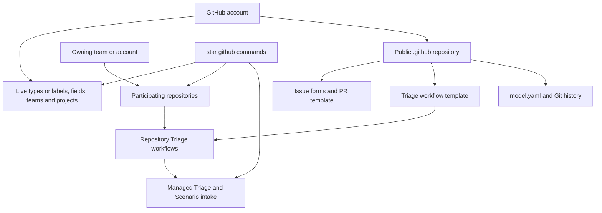

# Issue model storage and access

[Up: Issue data model](index.md)

GitHub holds each account's live issue model and work records. The account's public `.github` repository holds shared forms, workflow templates and a versioned model backup. Repository workflows and the `star github` extension use those resources within the account's ownership and access boundaries.

## 1. Account boundaries

Each organization or user account has its own model. Managed project rows, product parent links and blocked-by relationships stay within that account. These are our model boundaries, not a claim that GitHub forbids every cross-account link.

Work waiting on another account uses a stand-in issue in its own account. The stand-in references the external work by URL; local blocked-by relationships point to it. An account does not place another account's private work in its own projects.

An organization's owning team is identified through its Maintain role on a repository. User-account repositories participate through the `issue-model` topic. Participation determines which repositories the commands manage; it does not grant access to them.

## 2. Account representations

| Concern | Organization | User account |
| --- | --- | --- |
| Issue type | Native issue type | One lowercase type label |
| Single-select attributes | Native issue fields | One lowercase label from each attribute family |
| Parent and dependency | Native sub-issue and blocked-by links | The same links |
| Repository ownership | Team Maintain role | Account ownership and collaborator access |
| Project responsibility | Account-owned project linked to its accountable team | Account-owned project |
| Project source | Four organization templates | Corresponding project copies |
| Shared file resources | Public `.github` repository | Public `.github` repository |

Type and attribute rules are in [Hierarchy](1-hierarchy.md) and [Attributes](2-attributes.md). Native issue fields and label attributes are not project-field substitutes. In particular, a row-level Priority would not follow an issue when it moves.

The diagram shows responsibilities and data access. It does not grant the CLI, a workflow or an agent authority beyond its credentials and approved assignment.

## 3. Authoritative locations

| Information | Authoritative location |
| --- | --- |
| Organization type definitions and issue fields | Organization GitHub settings |
| Type and attribute labels | Each participating repository |
| Issue Type, attributes, assignees, body and state | The issue |
| Product parent and blocked-by dependencies | Native issue relationships |
| Collection membership, Step, Beat, Iteration and Status | Project rows and fields |
| Schedule deliverable, completion criteria and amendments | Schedule issue |
| Scenario goal, walk and Features exercised | Scenario issue |
| Project structure and shared configuration | Account templates, reconciled to their copies |
| Team ownership and grants | GitHub team, repository and project relationships |
| Issue forms | Account `.github/ISSUE_TEMPLATE` directory |
| Triage workflow template | Account `workflow-templates` directory |
| PR and community-health templates | Account `.github` repository |
| Installed intake workflow | Each participating repository's `.github/workflows/triage.yml` |
| Intake destination | Repository variable `TRIAGE_PROJECT_URL` |
| Model backup | `model.yaml` in the account's `.github` repository |

Shared issue forms and PR files use GitHub's account fallback where applicable. A repository-local override takes precedence and must not accidentally create a second definition. The Triage workflow is installed explicitly from its account template; the design does not depend on a user-account template appearing in GitHub's template picker.

The `.github` repository participates in the model and follows its repository quality gates. [Model synchronization](6-the-asset-and-its-sync.md) owns reading live state, applying definitions and publishing backups. Commands needing the model read GitHub; the backup is not a runtime cache.

## 4. Triage workflow

The workflow runs on issue opening or transfer. It identifies the issue's Type or type label, reads the form's Area and supplies the appropriate initial Severity while preserving an existing value.

The collection command creates a Schedule or Scenario issue's own row. The intake workflow skips those collection issues. A finding that identifies an open Scenario in the same account is routed to that Scenario's project option. Other intake goes to `TRIAGE_PROJECT_URL`. When the Scenario reference cannot be used, route the finding to Triage and record why.

The workflow copies Area into the organization field or the user-account label. A missing Area remains a classification fault; a form alone is not a guarantee on every filing path. An issue typed after opening needs triage to establish the corresponding Severity.

Keep body parsing bounded, handle normal line endings and end-of-body conditions, and impose the workflow's timeout. The shared workflow contract uses a five-minute job limit. Repository project-row changes are not an assumed Actions trigger for this intake path.

### 4.1 Credentials

The organization workflow uses the account's automation GitHub App. NobleFactor supplies `NOBLEFACTOR_AUTOMATION_APP_ID` and `NOBLEFACTOR_AUTOMATION_APP_PRIVATE_KEY` as organization secrets available to the participating repositories. The workflow needs project writes, issue writes and issue-field reads; the configured App may have other responsibilities outside this workflow.

The user-account workflow uses the repository secret `ADD_TO_PROJECT_PAT` for project access. Its configured path uses a classic token with `project` and, for private repositories, `repo`. The workflow's own `GITHUB_TOKEN` has `issues: write` for label updates.

Every account that takes part in triage identifies its token, and `star github model apply` refuses an account that doesn't, before it writes anything ([ACCESS-006](4-storage-and-reach.decisions.md#access-006)). Which token an account has, and what it's used for and permits, can change; that it has one can't. The model's token record ([section 6, § 1.1](6-the-asset-and-its-sync.md#the-asset)) names the token and where each value comes from, and the [credentials guide](../../reference/issue-tracking-credentials.md) says how to make, check and renew each kind.

A token acts with its issuing account's access; its reach can exceed this workflow's needs. Do not treat a repository secret as proof that the token is restricted to that repository. Secret values do not belong in model files or logs. Renewal replaces the GitHub secret; the credential inventory owns renewal procedures and access review.

## 5. Participant access

| Participant | Required access |
| --- | --- |
| Organization team member | Organization and team membership; team Maintain on owned repositories; Write on the team's four projects |
| User-account collaborator | Collaboration on participating repositories and Write on the account's four projects |
| Participant linking parents across repositories | Required issue-management access to both repositories |
| Organization owner | Administration of account-level settings and grants |
| Account administrator configuring model support | Access required for repository settings, workflows and secret installation |

Team membership is the normal grant for work in an organization's owned repositories and projects. Project Write permits edits to fields and views; account administration retains settings and access management. Repository and project permissions remain separate.

Public repository visibility does not grant a participant permission to manage its issues. A cross-team parent link depends on access to both repositories, not merely visibility. Provision any required account membership before granting team work.

[Who can do what](../../issue-standards.md#who-can-do-what) defines the complete role policy. GitHub access permits an operation; the engineering process determines whether the participant is authorized to perform it.

## 6. Labels and model scope

Labels are repository resources. The model records participating repositories' labels, not an organization-wide label tier or the defaults copied into newly created repositories. Types are capitalized; type and attribute labels use lowercase.

Model application can reconcile a repository's own backup labels or the label families defined by its account-kind reference. It must not carry another account's repository labels across account boundaries. [Apply](6-the-asset-and-its-sync.md) defines pruning limits and stable identity handling.

## 7. Validation boundaries

Native field types and issue relationships provide only part of the model's validation. The shared rules also require correct parent levels, Area, completion evidence except on Scenarios, Severity by Type, Resolution only on closed issues, restricted `good first issue` use, valid collection placement, Step numbers and dependency records.

The user-account label representation additionally needs checks for exactly one Type and no conflicting values in an attribute family. A model type with an invalid `Level N:` or `Collection:` description is a model error, rather than an issue fault.

Filing commands, triage and the sweep have distinct responsibilities. The [hierarchy](1-hierarchy.md#34-validation-and-sweep) and [attribute rules](2-attributes.md#4-validation-and-sweep) define the sweep and its Scenario exceptions. It reports faults and returns affected issues for human decisions; it does not choose a conflicting label or silently repair policy.

## 8. Quality, decisions and delivery references

Account-boundary checks must prevent managed cross-account placement while preserving explicit references to external work. Access failures must identify the failing boundary without changing credentials or hiding partial outcomes. Shared files and workflow copies must agree with their authoritative source.

The [decision companion](4-storage-and-reach.decisions.md) explains account boundaries, shared resources and grant ownership. The retained [delivery reference](4-storage-and-reach.status.md) preserves deployment observations and migration records separately from this architecture.
