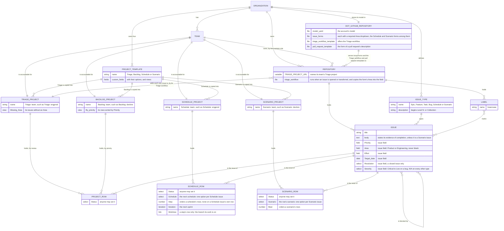
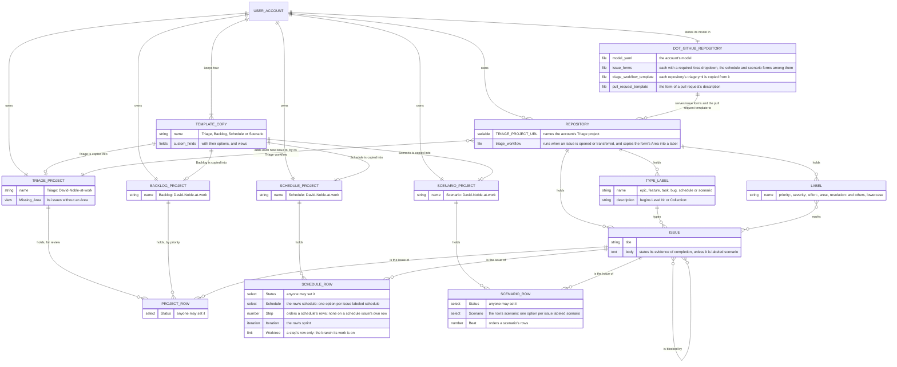

# 4. Storage and reach

This section covers an organization's account and a user account. For each it states where each part of the account's
data model lives in GitHub, where the model itself is stored, and what GitHub enforces. Before 2026-11-02, NobleFactor's
records reached into a user's repository. That is kept as a record in § What reaches personal, below.

## Accounts: organizations and individuals

Ruled 2026-11-02. A GitHub account belongs to an organization, such as NobleFactor, or to a user, such as
David-Noble-at-work. Accounts are separate. Each has its own issues, projects, labels and data model. No project,
sub-issue link or blocked-by link crosses accounts. There may be many accounts of each kind, and every one has its own
model in its own `model.yaml`.

Ruled 2026-11-02: each account's model file is stored in that account's `.github` repository, NobleFactor/.github or
David-Noble-at-work/.github. GitHub treats a public repository named `.github` as the account's own. It serves that
repository's default community health files and issue templates to every repository of the account. Both repositories
exist, and both are public. The organization's ruleset requires the quality-gate check. Ruled 2026-11-03:
NobleFactor/.github gets a quality-gate check of its own, so it follows the organization's ruleset like every other
repository.

Ruled 2026-11-03: an account's file templates, which are its issue forms, its Triage workflow template and its pull
request template, are stored in its `.github` repository, and every document that talks about one of them refers to it
there. Read from GitHub on 2026-11-03, NobleFactor/.github and David-Noble-at-work/.github each hold `README.md`, the
six issue forms in `.github/ISSUE_TEMPLATE` (bug, epic, feature, scenario, schedule and task) and the Triage workflow
template in `workflow-templates` (`triage.yml` and `triage.properties.json`). NobleFactor/.github also holds
`.github/workflows/quality-gate.yml`. Since 2026-11-09 NobleFactor/.github also holds NobleFactor's model file,
`model.yaml`, which star reads from there; its pull request template; and `CONTRIBUTING.md`, `SECURITY.md` and
`SUPPORT.md` (NobleFactor/noblefactor-engprod#431, NobleFactor/.github#3). David-Noble-at-work/.github holds the same
for its account since the same day, and runs its own Triage workflow (NobleFactor/noblefactor-engprod#441, which
stands in for David-Noble-at-work/personal#311; David-Noble-at-work/.github#1).

Ruled 2026-11-03: the model is a YAML description of an account's data model, and it is a cache. star queries the model
instead of asking GitHub the same questions again. [Section 6](6-the-asset-and-its-sync.md) states what the model holds
and what it leaves out.

### An organization's account

`DOT_GITHUB_REPOSITORY` is the account's `.github` repository. `TRIAGE_PROJECT_URL` is a repository variable.

Ruled 2026-11-03: Threads are renamed Scenarios. The issue type Thread is now Scenario, the Thread template is the
Scenario template, and what was a thread is a scenario.

NobleFactor keeps four project templates: Triage (project 23), Backlog (project 24), Schedule (project 7) and Scenario
(project 8, the former Thread template). Ruled 2026-11-03: each team has four projects, Triage, Backlog, one Schedule
project and one Scenario project, copied from these templates. Each is named for its kind and its team: Triage:
engprod, Backlog: engprod, Schedule: engprod and Scenario: engprod, and the same four for devlore. Triage: engprod
(project 5) and Triage: devlore (project 6) were brought to the Triage template on 2026-11-02. There is no longer a
project per schedule or a project per scenario. Ruled 2026-11-03: the team that owns a project is accountable for it,
and GitHub's link between a project and its team is the record. A template's description says nothing about star.
Status is a field on every project row, and anyone may set it.

Ruled 2026-11-03: the team's Schedule project holds its committed tasks and bugs. Its single-select Schedule field names
the schedule each row belongs to. The field has one option per schedule, named for that schedule's Schedule issue, and
the Schedule issue holds the schedule's deliverable and exit criteria. Step orders the rows within a schedule, and a
Schedule issue's own row has no step. GitHub's Iteration field gives each row its sprint, for scrums and sprint review.
The Schedule template has no Next column: Next was deleted from the template and from every schedule on 2026-11-02.
Every row but a Schedule issue's own gets its step number and its dependencies, as blocked-by links, when it is added,
and steps are worked in step order. A step's Worktree cell links to the branch its work is on, and the step's own issue
records that it merged or closed.

Ruled 2026-11-03: the team's Scenario project holds its features. Its single-select Scenario field names the scenario
each row belongs to. The field has one option per scenario, named for that scenario's Scenario issue. Beat orders the
rows within a scenario. Ruled 2026-11-04, in place of the ruling of 2026-11-03 that a scenario's rows are features,
whose story its Scenario issue told: the team's Scenario project holds its scenarios, each with its Scenario issue's own
row. The Scenario issue summarizes an end-user goal and names in its body the features the scenario exercises, and the
scenario's other rows are the tasks and bugs logged while walking it, each with its Beat, the point in the walk where it
turned up, until it moves to its team's Triage project or onto a schedule. A logged item names its scenario in its body,
as "Found while walking #N", and the Triage workflow will add it to the scenario instead of to the team's Triage project
(#448; [section 3](3-collections.md#the-schedule-and-scenario-fields)). A Scenario issue states no evidence of
completion, since a scenario never ends (§ Where each part lives, below).

Ruled 2026-11-03: the team's Backlog project holds accepted work not yet scheduled, ordered by priority. The team's
Triage project is where every issue is reviewed and a triage decision made (§ Triage, below).

NobleFactor/.github is where NobleFactor's model file and its file templates are stored: its issue forms, the forms for
the Schedule and Scenario types among them, its Triage workflow template, which offers the Triage workflow (§ Triage,
below), and its pull request template. GitHub serves its default community health files and issue templates to every
repository of NobleFactor. What it held on 2026-11-03 is in § Accounts, above.

### A user account

`DOT_GITHUB_REPOSITORY` is the account's `.github` repository, and `TEMPLATE_COPY` is a project the account keeps to
copy new projects from. `TRIAGE_PROJECT_URL` is a repository variable.

Ruled 2026-11-03: a user account and an organization have exactly the same data model, apart from what GitHub offers
organizations only. A user account lacks four things an organization has, and something else stands in for each:

- **Issue types.** A user account has none. Its type is a lowercase label in each of its repositories: epic, feature,
  task, bug, schedule or scenario. Ruled 2026-11-03: the label thread is now scenario. The description of epic,
  feature, task or bug begins `Level N:`, which gives its level: epic is level 0, feature level 1, and task and bug
  level 2. The descriptions of schedule and scenario begin `Collection:`, as the organization's Schedule and Scenario
  types do. GitHub does not hold an issue to one label.
- **Issue fields.** A user account has none: GitHub's GraphQL schema, read on 2026-11-03, says `createIssueField` makes
  a field in an organization, and its `User` type has no issue fields. So a label stands in for each single-select issue
  field, one label per option, named `<field>:<option>` in lowercase: priority:urgent, priority:high, priority:medium
  and priority:low; severity:critical, severity:high, severity:medium, severity:low and severity:n/a; effort:high,
  effort:medium and effort:low; area:product and area:engineering; and resolution:declined, resolution:duplicate and
  resolution:invalid. The priority, severity and effort labels were made on 2026-11-03 in personal and
  David-Noble-at-work/.github, each colored and described as its option is; the area and resolution labels were already
  there. The label severity:n/a, the stand-in for Severity's N/A (ruled 2026-11-04), colored `cfd3d7` and described
  "Severity: not applicable, the issue is not a bug", is made in both by the script of #303's closing pull request. Its
  area labels are area:product and area:engineering, and no others (ruled 2026-11-03). The priority labels follow the
  options of NobleFactor's Priority field, Urgent, High, Medium and Low, which are GitHub's own. A date field has no
  stand-in, since a label cannot hold a date: Target date has no counterpart in a user account, and Start date is
  unused. A project field is no stand-in either: its value is on the project's row, not on the issue, so it does not go
  with the issue from project to project. The Priority project field on Backlog: David-Noble-at-work (its project 6) and
  on the account's Backlog copy (its project 5) was deleted on 2026-11-03; neither project had rows.
- **Teams.** A user account has none. Ruled 2026-11-03: a user account's projects are its owner's. It has the same four
  projects a team has: Triage: David-Noble-at-work, its project 3, and Backlog: David-Noble-at-work, Schedule:
  David-Noble-at-work and Scenario: David-Noble-at-work. Ruled 2026-11-04: in place of membership in a team, a new
  participant is a collaborator on each participating repository, personal and David-Noble-at-work/.github, and a writer
  on each of the account's four projects (§ Triage, below).
- **Project templates.** A user account cannot mark a project as a template. Ruled 2026-11-03: David-Noble-at-work
  instead keeps copies of NobleFactor's four templates, Triage, Backlog, Schedule and Scenario, and a new project is
  copied from one of them in GitHub. Its copies of Schedule, Scenario (the former Thread), Triage and Backlog are its
  projects 1, 2, 4 and 5.

The rest is as in an organization. Its projects, rows and fields are the same: Status on every row, Schedule, Step,
Iteration and Worktree on its Schedule project's rows, and Scenario and Beat on its Scenario project's rows. Ruled
2026-11-03: every project of a kind is configured the same way, and compared that day, each of the twenty, NobleFactor's
four templates, its teams' eight projects and the account's four copies and four projects, matches its kind's template
([section 3](3-collections.md#four-projects-per-team)), except for the Area and Priority columns, issue fields that the
account's Triage and Backlog projects lack. Its sub-issue and blocked-by links run between its own repositories
only. Its `.github` repository, David-Noble-at-work/.github, is where the account's model file and its file templates
are stored: its issue forms, those for issues labeled schedule and scenario among them, its Triage workflow template
and its pull request template. GitHub's documentation describes workflow templates kept in an organization's `.github`
repository and says nothing about a user account's (§ Triage, below). Whether GitHub offers this one to personal has
not been checked; either way, David-Noble-at-work/personal#315 copies personal's `triage.yml` from it. GitHub serves its
default community health files and issue templates to every repository of the account. What it held on 2026-11-03 is
in § Accounts, above.

What a user account lacks was read from GitHub on 2026-10-21 (§ What reaches personal, below). That only an
organization's project can be a template is GitHub's own description of `markProjectV2AsTemplate`.

### Triage

Ruled 2026-11-03: a Triage project has no triage epic, and there is no Triage issue type. Each team owns its Triage
project, and a user account owns its own. The three Triage projects are Triage: engprod (NobleFactor project 5), Triage:
devlore (NobleFactor project 6) and Triage: David-Noble-at-work (David-Noble-at-work project 3). A new issue of any kind
goes into its team's Triage project, or in a user account the account's. The triage epics
NobleFactor/noblefactor-engprod#142, NobleFactor/devlore-cli#1188 and David-Noble-at-work/personal#313 are retired.
Ruled 2026-11-04: a task or a bug logged while walking a scenario goes into the scenario whose walk found it instead of
into Triage, and the Triage workflow will put it there (#448; § An organization's account, above).

Ruled 2026-11-03: the Triage project is where every issue is reviewed and a triage decision made. The decision either
declines the work or moves the issue to the team's Backlog, Schedule or Scenario project. A declined issue is closed as
completed, with Resolution Declined in NobleFactor or the resolution:declined label in a user account. Ruled 2026-11-04:
triage removes the issue's row from its Triage project as part of its decision, and an issue someone closes outside
triage stays in its Triage project until triage decides its disposition. The sweep (#436) will remove no Triage row:
#436's Done-when no longer has star remove an issue once it is classified or closed, as its comment of 2026-11-04
records. Read on 2026-11-04, 78 of Triage: engprod's 178 rows were closed issues, and they are triage's to decide
([section 3](3-collections.md#triage-and-the-backlog)).

**Who moves an issue.** Ruled 2026-11-04, on the plan's questions 4 and 9. Any member of a team can see all of the
team's issues and do all of its work in its four projects: triage, the backlog, scheduling and scenarios. So the one
grant a new participant needs is membership in the team, whose roles carry the rest: the maintain role on each
repository the team owns, and the write role on each of its four projects, which the script of #303's closing pull
request sets. Adding a person to NobleFactor needs a seat first: its Team plan has one seat, filled (read 2026-11-04). A
user account has no teams; there, a new participant is a collaborator on each participating repository, personal and
David-Noble-at-work/.github, and a writer on each of the account's four projects. The full table is
[issue-standards.md § Who can do what](../../issue-standards.md#who-can-do-what).

**How an issue moves.** Ruled 2026-11-04: an issue is a row of at most one of its account's Triage, Backlog, Schedule
and Scenario projects, whichever team owns them, and is on at most one schedule or scenario. Epics and features are
never rows of a Backlog, Schedule or Scenario project: a new one reaches Triage like every new issue and, once
classified, leaves Triage for no project. The hierarchy holds it, and its tasks and bugs are what reach the Backlog and
the schedules, from which a work item's parent link leads to its feature and its epic. The only rows of a Schedule or
Scenario project that are not tasks or bugs are the Schedule and Scenario issues themselves. Every move is one act: the
issue gets its row in the project it goes to, with that project's fields set, and loses its row in the project it
leaves. Out of Triage, declined work is closed as completed with Resolution Declined, and accepted tasks and bugs go to
the Backlog with their Priority or onto a schedule. From the Backlog, work goes onto a schedule highest Priority first,
with the schedule's option, the next step or the step the schedule's owner gives it, Status Open and its blocked-by
links. A committed schedule takes it only by its owner's amendment, recorded in the Schedule issue.
`star github schedule add` (#438), built on 2026-11-12, makes that move in one command. An issue on another team's
project is assigned to
an accountable member of that team: GitHub allows up to 10 assignees on an issue, any organization member who can read
the repository among them (GitHub's documentation on assigning issues, read 2026-11-04), and all five of NobleFactor's
participating repositories are public. The person whose name is on an issue moves it to another team the way any move is
made, in one act, between its team's Triage project or schedule and the other team's: triage to triage, triage to
schedule, schedule to triage, or schedule to schedule. This supersedes in part the ruling of 2026-10-22, on the plan's
question 4, that work for another team gets a tracking issue. The sweep (#436) will return to its team's Triage project,
or in a user account to the account's, an issue in more than one of the account's projects, whichever team owns them,
the Scenario projects included, or on more than one schedule or scenario, and an epic or a feature that is a row of a
Backlog, Schedule or Scenario project; it will leave a scenario's rows alone but for those two rules (§ What GitHub does
not enforce, below). How the sweep will handle an issue that is in a scenario and in another project, without taking a
scheduled item off its schedule, is #436's to design. The Backlog shows its order in a view named By priority, sorted by
Priority, which the script of #303's closing pull request makes in Backlog: engprod, Backlog: devlore and the Backlog
template; David-Noble-at-work's Backlog has no Priority field to sort by, since a user account has no issue fields. That
settles how a triage decision is carried out and how an issue is kept in one project at a time
([section 3](3-collections.md#triage-and-the-backlog)).

Ruled 2026-11-03: a new issue reaches its team's Triage project through a GitHub Actions workflow in each repository.
The workflow runs when an issue is opened or transferred, and uses actions/add-to-project. GitHub's built-in auto-add
workflow is not used. Since 2026-11-03 none of the twenty projects of the four kinds (§ A user account, above) has a
built-in workflow: every project of a kind is configured the same way (ruled 2026-11-03), and GitHub's API can delete a
built-in workflow but can't make one or turn one on, so all were deleted that day, "Auto-add sub-issues to project" in
Triage: devlore among them ([section 3](3-collections.md#triage-and-the-backlog)). Each repository's
`TRIAGE_PROJECT_URL` variable names its team's Triage project, from the team mapping: the team with the maintain role on
a repository owns it. A Triage workflow template in each account's `.github` repository offers the workflow. Read on
2026-11-03, GitHub's documentation [describes workflow templates kept in an organization's `.github` repository](
https://docs.github.com/en/actions/how-tos/reuse-automations/create-workflow-templates) and says nothing about a user
account's. Whether GitHub offers David-Noble-at-work/.github's Triage workflow template to personal has not been
checked; either way, David-Noble-at-work/personal#315 copies personal's `triage.yml` from it.

Ruled 2026-11-03: issues we file ourselves will go through `star github issue` once it is built (#338), the one path
that will classify an issue as it is made.

**How the Triage workflow signs in** differs by account, as read from GitHub on 2026-11-03. In NobleFactor, the workflow
template takes a token from the noblefactor-automation GitHub App, through actions/create-github-app-token and the
organization secrets `NOBLEFACTOR_AUTOMATION_APP_ID` and `NOBLEFACTOR_AUTOMATION_APP_PRIVATE_KEY`, which every
NobleFactor repository can read. The app's installation on NobleFactor has organization projects read and write, issue
fields read, and issues read and write, beside contents write, metadata read and pull requests write, on all of
NobleFactor's repositories. GitHub's [list of GitHub App permissions](
https://docs.github.com/en/rest/authentication/permissions-required-for-github-apps) puts an organization's projects
under the organization permission Projects, its issue fields under the organization permission Issue Fields, and an
issue's field values under the repository permission Issues. Nothing has used the new permissions yet: the first Triage
workflow run in a NobleFactor repository will prove them.

In a user account, the workflow adds the issue to the Triage project with a personal access token kept in the
repository secret `ADD_TO_PROJECT_PAT`, and adds the area label with the workflow's own `GITHUB_TOKEN`, which the job
gives `issues: write` and nothing else; David-Noble-at-work's template has done so since 2026-11-04
(David-Noble-at-work/personal#315). The personal access token must be a classic token. GitHub [lists access to a user
account's projects among the things fine-grained tokens can't do](
https://docs.github.com/en/authentication/keeping-your-account-and-data-secure/managing-your-personal-access-tokens),
and its [list of fine-grained token permissions](
https://docs.github.com/en/rest/authentication/permissions-required-for-fine-grained-personal-access-tokens) has
Projects only among organization permissions. The README of
[actions/add-to-project](https://github.com/actions/add-to-project) says a classic token needs the project scope, and
the repo scope as well for a private repository. personal is private, so its token has both.

A classic token acts as the account that made it. David-Noble-at-work is an admin of NobleFactor, so a token it makes
can also reach NobleFactor's repositories and projects, unless NobleFactor blocks classic tokens, which was not checked.
A token made by a second account that can see only personal and write only to Triage: David-Noble-at-work would reach
nothing else. personal's token was made and stored on 2026-11-03: a classic token with the repo and project scopes. Its
note, `ADD_TO_PROJECT_PAT in David-Noble-at-work/personal, for its Triage workflow`, names the secret that holds it and
the repository that keeps the secret. No copy is kept outside the secret. When it expires or leaks, it is regenerated on
GitHub's token page, which keeps its note and scopes, and stored again with
`gh secret set ADD_TO_PROJECT_PAT --repo David-Noble-at-work/personal`.

Both `.github` repositories take part in triage from 2026-11-03, and both accept issues. The engprod team was given the
maintain role on NobleFactor/.github that day, and its `TRIAGE_PROJECT_URL` names Triage: engprod;
David-Noble-at-work/.github has the topic issue-model, and its `TRIAGE_PROJECT_URL` names Triage: David-Noble-at-work.
So seven repositories have `TRIAGE_PROJECT_URL` set: NobleFactor/noblefactor-engprod, NobleFactor/.github,
NobleFactor/devlore-cli, NobleFactor/devlore-registry, NobleFactor/devlore.noblefactor.com, David-Noble-at-work/personal
and David-Noble-at-work/.github. On 2026-11-03 none of the seven had `.github/workflows/triage.yml`. personal got it on
2026-11-04, in David-Noble-at-work/personal#320, and its live test passed that day: a test issue,
David-Noble-at-work/personal#321, became a row of Triage: David-Noble-at-work and got `area:engineering` from
`github-actions[bot]`. The same change made David-Noble-at-work's template drop carriage returns before reading the
Area, stop looping forever on a body that ends at the Area heading, and stop its job after five minutes.
NobleFactor's template still has the reader that loops. [This section's status](4-storage-and-reach.status.md)
records where each repository stands.

Ruled 2026-11-03: an issue with a blank Area is an error, and it is caught at three points:

- **At filing.** `star github issue` will refuse to file an issue without an Area (#338). Each issue form in the
  account's `.github` repository has a required Area dropdown, and the Triage workflow copies its answer into the issue
  when the issue is opened: personal's adds the area:product or area:engineering label today, and NobleFactor's will set
  the Area field once #447 and #448 land. The form checks the Area in a public repository; GitHub enforces a form's
  required fields only there (GitHub's form schema documentation, read 2026-11-04). In a private repository, which today
  is only personal, nothing checks it at filing until `star github issue` does.
- **At triage.** Each Triage project has the Area field (in a user account, the area: labels, in its Labels column) and
  a view named Missing Area. Both were made on 2026-11-03. Read on 2026-11-04, no view shows the field or the column,
  and the script of #303's closing pull request shows them in every view of the Triage projects. No issue leaves Triage
  without an Area.
- **Afterward.** A scheduled sweep (#436) will return any open issue without an Area to its team's Triage project, or in
  a user account to the account's. It waits on #452, which will give every open issue an Area first: read 2026-11-04
  before #452 and #453 were filed, 9 of the 528 open issues in NobleFactor's five participating repositories had an
  Area, and 5 of personal's 42.

Ruled 2026-11-03: the team that owns a project is accountable for it, and GitHub's link between a project and its team
is the record. A user account's projects are its owner's.

GitHub Actions cannot run a workflow when a project row changes. `projects_v2_item` is a webhook event for
organization webhooks and GitHub Apps only.

### The rest of the ruling

The rest of the ruling of 2026-11-02 settles the plan's question 17:

- **No link crosses accounts.** No project, sub-issue link or blocked-by link crosses accounts. Work that waits on
  another account's issue waits on a stand-in issue in its own account. The stand-in names the other issue by URL, and
  the blocked-by link points at the stand-in.
- **personal's steps leave NobleFactor's schedules** for schedules that David-Noble-at-work owns, one for each
  NobleFactor schedule they came from. Each new schedule's own issue is labeled schedule, and its row has no step. Since
  2026-11-03 each such schedule is an option of the Schedule field in Schedule: David-Noble-at-work, not a project of
  its own. A NobleFactor step that depends on one of them waits on a stand-in issue in NobleFactor
  (noblefactor-engprod#428, David-Noble-at-work/personal#309). NobleFactor/noblefactor-engprod#441, step 7 of issue
  tracking, iteration 1, is such a stand-in for David-Noble-at-work/personal#311. The account's first schedule was made
  on 2026-11-03 (below). Building a schedule for each NobleFactor schedule personal's steps came from is
  David-Noble-at-work/personal#309, which gives personal its own records. It is open and has no plan.
- **The model is the same in both kinds of account,** except where a user account lacks what an organization has:
  issue types, issue fields, teams and project templates, as listed above.
- **star tells the two kinds apart** by the repository's owner, wherever GitHub's API differs: reading types, finding
  projects, reading teams, writing a type, and holding an issue to one type (noblefactor-engprod#426).

Ruled 2026-11-03: David-Noble-at-work has schedules of its own, as each NobleFactor team does, and personal's steps go
on them. That settles where a new personal issue's step goes, which was open earlier that day. Made 2026-11-03 and read
back: David-Noble-at-work/personal#314, "Schedule: issue tracking, iteration 1", labeled schedule and area:engineering;
a Schedule field on Schedule: David-Noble-at-work (its project 7), whose first option, "issue tracking, iteration 1",
is named for personal#314; and David-Noble-at-work/personal#315, the task that adds personal's Triage workflow, as its
step 1. Scenario: David-Noble-at-work (its project 8) got its Scenario field the same day. Its first option,
placeholder, names a placeholder scenario, David-Noble-at-work/personal#316, in its description. On the owner's order
the same day, the account's Schedule copy (its project 1) got its Schedule field the same way: its one option,
placeholder, names a placeholder schedule, David-Noble-at-work/personal#319, in its description
([section 3](3-collections.md#the-schedule-and-scenario-fields)).

## What reaches personal

This section records what GitHub lets an organization's records reach in a user's repository. Since 2026-11-02 the
model uses none of it: § Accounts, above.

Read with `gh api graphql` on 2026-10-21, read-only:

| | NobleFactor/noblefactor-engprod | David-Noble-at-work/personal |
| --- | --- | --- |
| The viewer can see issue fields | yes | no |
| Issue fields | 4: Priority, Effort, Start date, Target date | none |
| Issue types | Task, Bug, Feature | none |
| One issue's field values | read (#301) | a server error (#259) |

The viewer was David-Noble-at-work, who owns personal and is an admin of NobleFactor. A write test, setting
NobleFactor's Priority on personal#259, was not run. What reaches personal from the organization is projects: a
NobleFactor project held personal#259 as a row, with a custom field set on it, on 2026-10-20.

GitHub's links reach across owners too. The write test of 2026-10-22 linked David-Noble-at-work/personal#157 as a
sub-issue of a NobleFactor issue (§ The choice it turns on, below). Within a repository, nine blocked-by links were
made on 2026-10-22 through `POST .../issues/{n}/dependencies/blocked_by` and read back. Across repositories and owners,
75 were made on 2026-11-01, personal#289 blocked by devlore-cli#527 among them. On 2026-11-02, 26 sub-issue links, 58
project rows and 2 blocked-by links crossed between NobleFactor and David-Noble-at-work. Their removal is
noblefactor-engprod#428.

On 2026-11-03, 60 rows of NobleFactor projects were David-Noble-at-work/personal issues: 38 in Triage: engprod (15 of
them open), 11 in Schedule: engprod (1 open) and 11 in Schedule: devlore (5 open). A project row records who added it.
All 38 rows in Triage: engprod were added by GitHub's built-in auto-add workflow, 36 on 2026-10-26 and two, personal#307
and personal#308, on 2026-11-02 at 17:41 UTC. The 22 schedule rows are the 22 steps of five schedules among the 58 rows
of 2026-11-02 (the plan's question 17), and the board migration of 2026-11-03 carried them from the old schedule
projects onto Schedule: engprod and Schedule: devlore. NobleFactor/noblefactor-engprod#428, which takes them out, is
still open, and so is David-Noble-at-work/personal#309, which gives personal its own records first.

## Where each part lives

| Part | Where it lives in an organization's account | What GitHub enforces | In a user account |
| --- | --- | --- | --- |
| Type | GitHub's issue type (ruled 2026-10-22): Epic, Feature, Task, Bug, Schedule or Scenario | one type per issue | a lowercase type label: epic, feature, task, bug, schedule or scenario. GitHub enforces nothing |
| Parent | GitHub's sub-issue link (ruled 2026-10-22), between the account's own repositories | one parent per sub-issue | the same link, between the account's own repositories |
| Priority | the issue field Priority (ruled 2026-11-03), on issues of every type, Schedule and Scenario included | the field's type, and one value | the labels priority:. GitHub enforces nothing |
| Severity | the issue field Severity, on issues of every type: Critical, High, Medium or Low on a bug, never N/A, and N/A on every other type. The first four were ruled and made 2026-11-03 ([section 2](2-attributes.md#the-attributes)); N/A was ruled 2026-11-04, and the script of #303's closing pull request adds it. An issue with no type yet waits for triage; when triage gives it a type other than Bug, triage sets its Severity to N/A, and the sweep (#436) will catch a miss (ruled 2026-11-04) | the field's type, and one value | the labels severity:critical to severity:low, and severity:n/a, which the script of #303's closing pull request makes. GitHub enforces nothing |
| Area: whether the issue's own work is product or engineering | the issue field Area, with the options Product and Engineering (made 2026-11-03), on issues of every type, and never blank | the field's type, and one value. It does not enforce a value on every issue, and a form's required Area dropdown holds only in a public repository | the labels area:product and area:engineering. GitHub enforces nothing |
| Effort, Target date | the issue fields Effort and Target date (ruled 2026-11-03). Start date is not used: when work really started is in each issue's history | the field's type, and one value | for Effort, the labels effort:. GitHub enforces nothing. Target date has none: a label cannot hold a date (§ A user account) |
| Why an issue was closed | the issue field Resolution, a single select: Declined, Duplicate or Invalid (ruled 2026-11-03), only on a closed issue | the field's type, and one value | a label named `resolution:<name>`: resolution:declined, resolution:duplicate or resolution:invalid, only on a closed issue. GitHub enforces nothing |
| `good first issue` | the label `good first issue`, held per repository, on tasks and bugs only (ruled 2026-11-04): it tells a newcomer they can pick the issue up, and only a task or a bug is a single piece of work | nothing | the same. personal gets the label from the script of #303's closing pull request, so both accounts hold it |
| The other labels | labels, held per repository | nothing | the same |
| A new issue, until its triage decision | a row of the team's Triage project, added by each repository's Triage workflow (ruled 2026-11-03), but for a task or a bug logged while walking a scenario, which the Triage workflow will add to that scenario in the team's Scenario project instead (ruled 2026-11-04; #448) | nothing | the same, in Triage: David-Noble-at-work, or for a logged item in Scenario: David-Noble-at-work |
| Accepted work not yet scheduled | a row of the team's Backlog project, ordered by priority (ruled 2026-11-03), which its view By priority shows sorted by Priority; the script of #303's closing pull request makes the view (ruled 2026-11-04) | nothing | the same, in Backlog: David-Noble-at-work, which has no Priority field to sort by |
| A schedule's rows, steps, sprints and status | the team's one Schedule project (ruled 2026-11-03), which holds its committed tasks and bugs: Status on every row, Schedule, a single select naming the row's schedule, Step, a number, Iteration, GitHub's iteration field, and Worktree, a link to the branch the step's work is on | the field's type | the same, in Schedule: David-Noble-at-work |
| A scenario's rows, beats and status | the team's one Scenario project (ruled 2026-11-03), which holds its Scenario issues and the tasks and bugs found while walking them, and no feature (ruled 2026-11-04): Status on every row, Scenario, a single select naming the row's scenario, and Beat, the point in the walk where a row turned up | the field's type | the same, in Scenario: David-Noble-at-work |
| Waits on | GitHub's blocked-by link, between the account's own repositories. A step's dependencies are set as blocked-by links when its row is added | the link | the same |
| A schedule's deliverable and exit criteria, and a scenario's end-user goal, its example and the features it exercises | its own issue's body, the issue typed Schedule or Scenario, with an issue form in the account's `.github` repository; #453 will bring both accounts' Scenario forms to the scenario as ruled 2026-11-04 | nothing | the same, the issue labeled schedule or scenario |
| Evidence of completion | every issue's own body but a Scenario issue's (ruled 2026-11-02 and 2026-11-04), in its Evidence of completion section, which every issue form in both accounts has today (ruled 2026-11-04). A Scenario issue states none, since a scenario never ends, and #453 will put how to walk it, the example the Scenario issue gives, in place of each Scenario form's Evidence of completion section | a form's required Evidence of completion section, at filing in a public repository only | the same. personal is private, so nothing checks it there at filing until `star github issue` does (#338) |
| The model | a `model.yaml` in NobleFactor/.github | nothing | a `model.yaml` in David-Noble-at-work/.github |

Ruled 2026-11-03: Area tells engineering work from product work, and it has two values only, product and engineering.
Area goes on issues of every type and describes the issue's own work, so an epic, a feature and the tasks and bugs
under them can each have a different Area: a CI bug fixed during a product feature is engineering. What product work
and engineering work each cover, tests among engineering's, and what each may hold, is in
[issue-standards.md § Product and engineering](../../issue-standards.md#product-and-engineering). Release notes come
from the closed product issues in a release, not from the hierarchy.

## Where each part is defined

The owner, 2026-10-22: "I would like as much as possible to be drawn from the org: NobleFactor by default. We then
look to teams, and finally repositories." GitHub gives the three levels different powers, so the split follows what
each can hold: the organization defines, a team owns and is granted, a repository carries.

| Part | Defined at | In the model | Reaches a repository by |
| --- | --- | --- | --- |
| Issue types: Epic, Feature, Task and Bug, each with its level, and Schedule and Scenario, whose descriptions begin `Collection:` | the organization, nowhere else | `types` | GitHub, every repository of the organization |
| Projects: the Triage, Backlog, Schedule and Scenario templates (NobleFactor projects 23, 24, 7 and 8), with their custom fields, options and views | the organization | `projects` | rows, from the organization's own repositories only |
| Who is accountable for a project, each of a team's four among them | the team that owns it, by GitHub's link between the project and its team (ruled 2026-11-03) | `teams` | GitHub's permissions |
| Labels: each repository's own, as pull reads them | a repository only. GitHub has no organization label, and an organization's default labels, which GitHub copies only into a new repository, are not in the model | `labels`, per repository | `push` |
| The account's file templates: its issue forms, the Schedule and Scenario forms among them, its Triage workflow template and its pull request template | the account's `.github` repository (ruled 2026-11-03; [section 6](6-the-asset-and-its-sync.md) § One model per account) | not in the model | GitHub's fallback, for the issue forms and the pull request template; for the Triage workflow, each repository's own `.github/workflows/triage.yml`, made from the template |
| The model file | the account's `.github` repository: NobleFactor/.github | the file itself | star, which queries it instead of asking GitHub again ([section 6](6-the-asset-and-its-sync.md)) |

Ruled 2026-11-03: the model leaves out issues, the projects made from templates, each team's Triage, Backlog, Schedule
and Scenario projects among them, and every project's built-in workflows. The built-in workflows are fixed GitHub
functions with arguments, and since 2026-11-03 none of the twenty projects of the four kinds has one (§ Triage, above).
GitHub Actions cannot run a workflow when a project row changes: `projects_v2_item` is a webhook event for organization
webhooks and GitHub Apps only.

Ruled 2026-11-03: an account's model holds its issue fields, as it holds its issue types and labels. NobleFactor's
issue fields are Priority, Effort, Target date, Resolution, Area and Severity, and its Start date field stays unused. A
user account has no issue fields, so its model holds none; a label stands in for each option of a single-select field
(§ A user account).

A user account divides the same parts with what it has. It has no issue types: its type labels are labels like any
other, held in each repository with that repository's other labels, priority:, severity:, effort:, area: and
resolution: among them. It has no teams, so its projects are its owner's. It has no project templates, so it keeps
copies of the Triage, Backlog, Schedule and Scenario templates to copy new projects from, the Schedule, Scenario,
Triage and Backlog copies being David-Noble-at-work projects 1, 2, 4 and 5. Its `.github` repository,
David-Noble-at-work/.github, holds its model file and its file templates: its issue forms, its Triage workflow
template and its pull request template.

A team on GitHub holds rights, not definitions. It cannot be assigned an issue or own a label, but it can own a project
and hold GitHub's Triage role on a repository. So teams are where ownership and access are looked up. Labels have no
organization home, so they are held per repository (ruled 2026-11-03). The model records each repository's labels as
pull reads them, and push writes them back.

**Every repository an account owns is in its model.** Ruled 2026-11-03: pull takes the whole model, every repository the
account owns, and has no `--repo` option. On 2026-10-22 an organization custom property, `issue-model`, was proposed to
mark the repositories that take part and to version the model. It was set aside the same day: the owner judged
versioning too complex, and ruled that who takes part is asked only when it needs an answer, when building and reporting
on schedules and scenarios or filing a new issue. There is one model per account. Pull comes first, then push (ruled
2026-11-02), and each names its account with `--account`. Ruled 2026-11-03: pull's `--account` defaults from star
configuration, `github.account`, whose default is NobleFactor, and the option that names the model file is `--asset`.
Ruled 2026-11-03: pull reads the data model of any account, ours or not, and push writes a model to an account, where
that model becomes the account's data model. Ruled 2026-11-09 (#426): GitHub is the model, and `get`, `diff`, `apply`,
`backup` and `restore` replace pull and push, each naming its account, with no default account and no `--asset`
([section 6](6-the-asset-and-its-sync.md#github-is-the-model)).

**Proving that a repository takes part.** On 2026-10-22 the owner asked that the tooling be able to refuse to file an
issue in a repository, or to make one of its issues a row, when that repository does not take part, and suggested
keeping a digest or an ETag as reason to believe that it does.

Ruled 2026-11-03: a repository takes part in the data model when a team has the maintain role on it, in an organization,
or when it has the topic issue-model, in a user account.

Whether star reads GitHub by ETag before every operation, or answers from the model until the next pull, will be decided
with the tooling, noblefactor-engprod#426 and #437.

## Labels

A label belongs to one repository. GitHub has no organization label, and an organization's default labels are not part
of the model (ruled 2026-11-03). Each repository's labels are part of its account's model, which GitHub holds and the
account's `.github` repository backs up, and `apply` writes them (#437). `apply` takes the place of push and of
`star github labels sync`, which #437 removed on 2026-11-10. Ruled 2026-11-10: `apply` writes a repository's labels
from its account's own backup, or from a reference, and never carries another account's, since that account's
repositories are its own. A reference names labels only for a user account, whose labels stand in for issue fields; an
organization's issue tracking runs on its issue fields. With a reference, `--prune` removes only labels of the kinds
the reference names, and `good first issue`, the one label the sweep reads in an organization, is left to GitHub, which
gives it to every new repository.

Ruled 2026-11-03: labels are lowercase, and issue types are capitalized, as GitHub names them. The labels that remain
are lowercase: a user account's type labels, and its severity:, priority:, effort: and area: labels, such as
severity:critical, priority:urgent and area:product. The `Epic:`, `Thread:` and `ClaudeJudgmentError:` labels were
removed from both accounts on 2026-11-03. Sub-issue parent links and project rows replace the first two. The kind
labels epic, feature, task and bug left NobleFactor's 12 repositories on 2026-11-03 (§ The choice it turns on, below).
David-Noble-at-work keeps its type labels, because they are its types.

devlore-cli's seven finer Area labels, architecture, CLI, code quality, error handling, git, meta and testing, were
deleted on 2026-11-03. The hierarchy carries those distinctions now. Architecture work is a task, or a feature with
product value, within an epic. A bug is not filed against the architecture: an architecture task is logged to address
a bug in a feature.

Ruled 2026-11-03: there is no wontfix or declined label. Why a closed issue was not done is recorded where the
account can hold it. In NobleFactor, an organization, it is the issue field Resolution, a single select with the
options Declined, Duplicate and Invalid. NobleFactor has no resolution: labels, and no duplicate or invalid labels:
they were deleted from its 12 repositories on 2026-11-03. In David-Noble-at-work, a user account with no issue fields,
it is a label named `resolution:<name>`: resolution:declined, resolution:duplicate and resolution:invalid. There the
last two replace the duplicate and invalid labels. A resolution goes only on a closed issue. The model records it, the
Resolution field among an organization's issue fields and the resolution: labels among a user account's labels. An
issue that was not done is closed as completed, with its Resolution, or in a user account its resolution: label,
saying why. GitHub's not_planned close reason is not used.

Ruled 2026-11-03: the model holds an organization's issue fields, so NobleFactor's model holds the Resolution field
with its options Declined, Duplicate and Invalid.

Before the model, the labels were defined in `labels.yaml`, in the issue-labels design
(NobleFactor/noblefactor-engprod#320, approved 2026-10-19, still on its branch). That file defined each label once, and
`star github labels sync` put it in every repository the scheme covered. On 2026-10-21 the owner ruled that the labels
be defined and stored as YAML assets in noblefactor-engprod. That was superseded on 2026-11-02: each account's model,
with its labels, is stored in that account's own `.github` repository.

## The choice it turns on

This section records the choice of 2026-10-22. It was superseded on 2026-11-02 by § Accounts, above: each account has
its own model, and nothing syncs from one account into another.

Ruled 2026-10-22: the hierarchy has three tiers, is modeled with the parent-child relation between issues, and is
based on the issue type. Epics contained chores and features, and features contained bugs and tasks. Ruled 2026-11-02:
Chore is retired, and the hierarchy is Epic (level 0), then Feature (level 1), then Task or Bug (level 2). So Type is
GitHub's issue type, and the parent is GitHub's sub-issue link. The issue type is an organization's feature. The
sub-issue link is one every account has. Each account uses its own issue types or type labels, and sub-issue links
among its own repositories. For personal, the owner ruled on 2026-10-22 that star offers syncs in one direction, and
that personal would have to sync to take part. So, on 2026-10-22:

- Retired 2026-11-02: **GitHub's own types and links in the organization's repositories, labels in personal.** The
  organization's record was to be the truth, and `star github` was to sync it one way into personal's labels. Nothing
  syncs from NobleFactor into personal now, and each account has its own model.
- Not taken: moving personal's tracked work into an organization repository.

The sub-issue link is in use within noblefactor-engprod since 2026-10-20, and **it crosses**: the write test of
2026-10-22, on the closed duplicate noblefactor-engprod#355 as parent, linked NobleFactor/devlore-cli#918 across
repositories and David-Noble-at-work/personal#157 across owners through `POST .../issues/355/sub_issues`, read both
back from `GET .../sub_issues` and from each child's `parent` field, and removed both through `DELETE
.../sub_issue`; the record is a comment on #355. The test shows that GitHub lets the link cross repositories and
owners. Since 2026-11-02 the model makes no link across accounts, and personal's issues get parents within
David-Noble-at-work only. The 26 sub-issue links that crossed accounts on 2026-11-02 are listed for removal under
noblefactor-engprod#428. The parent markers, such as **Feature:**, were the old scheme's form
([section 5](5-from-todays-scheme.md)).

Ruled 2026-11-03: the old scheme's last three pieces retire, and their retirement was done in GitHub the same day:

- **The parent markers and schedule footers** came out of 725 issue bodies. 47 issues got the sub-issue parent their
  marker named. Where a marker and an existing sub-issue link disagreed, the link stands.
- **The step and beat tables** in 14 Schedule and Scenario issues gave way to a line that names the issue's board and
  its option there.
- **The kind labels** epic, feature, task and bug left NobleFactor's 12 repositories, after each of 672 issues got the
  issue type its label named. David-Noble-at-work keeps its type labels, because they are its types.

The second half of the test, a single-select option updated by id, passed on 2026-10-26 under #377. On project 4, an
update that sent each option with its id renamed the options in place, and every row kept its value
([section 6](6-the-asset-and-its-sync.md) § Risk).

## What GitHub does not enforce

Ruled 2026-11-03: issues are classified by issue type, in the hierarchy Epic, Feature, then Task or Bug. Enforcement is
lax, and there are no compliance checks. Ruled 2026-11-04, superseding that in part: the sweep (#436) will check the
rules every day and return an issue that breaks one to its team's Triage project, and will still block no filing and
correct nothing by itself (below).

GitHub enforces none of the model's rules over labels, and only some of its rules over issue types and issue fields. In
an organization, GitHub holds an issue to one issue type, and an issue field to one value. In a user account, where
type, priority, severity, effort, area and resolution are labels, GitHub holds an issue to none of these: one type
label, and at most one label each of priority:, severity:, effort:, area: and resolution:. In both kinds of account
GitHub does not enforce:

- the level a parent sits on, for the hierarchy's types: Epic, Feature, Task and Bug, or epic, feature, task and bug;
- an Area on every issue, caught at filing in a public repository, at triage and afterward instead (§ Triage, above);
- an Evidence of completion section in every issue but a Scenario issue, which a form requires at filing only in a
  public repository (ruled 2026-11-04);
- a Severity on every typed issue, by its type: Critical, High, Medium or Low on a bug, never N/A, and N/A on every
  other type (ruled 2026-11-04);
- a resolution only on a closed issue: the Resolution field in an organization, a resolution: label in a user account;
- `good first issue` only on a task or a bug (ruled 2026-11-04);
- an issue in at most one of its account's Triage, Backlog, Schedule and Scenario projects, whichever team owns them,
  and on at most one schedule or scenario, and no epic or feature a row of a Backlog, Schedule or Scenario project
  (ruled 2026-11-04; § Triage, above);
- a step number on every row of a Schedule project but a Schedule issue's own, which has none;
- each step's dependencies, set as blocked-by links when its row is added.

Ruled 2026-11-04: the sweep (#436) will check the attribute rules. It will return to its team's Triage project, or in a
user account to the account's, any open issue that breaks one, as it will return an issue that isn't fully classified:
an issue with no Area; a bug whose Severity is N/A or blank, or an issue of another type whose Severity isn't N/A; a
Resolution, or in a user account a resolution: label, on an open issue; two labels of one attribute, such as two
priority: labels, in a user account; `good first issue` on an issue that isn't a task or a bug; and an issue other than
a Scenario issue with no Evidence of completion section. It will return, too, an issue that breaks another rule of the
model: an issue in more than one of the account's Triage, Backlog, Schedule and Scenario projects, whichever team owns
them, or on more than one schedule or scenario; an epic or feature that is a row of a Backlog, Schedule or Scenario
project; an issue whose row on a schedule has no step, other than a Schedule issue's own; and an issue with a sub-issue
or blocked-by link into another account. [issue-standards.md § Well
classified](../../issue-standards.md#well-classified) gives every rule it will check. It will leave a scenario's rows
alone ([section 3](3-collections.md#the-schedule-and-scenario-fields)) but for two of them, an epic or a feature that is
a row of a Scenario project and an issue that is a row of a scenario and of another of the account's projects, whichever
team owns it: every other rule will wait until an item logged while walking a scenario moves out, when it gets its type
and parent. How it will handle an issue that is in a scenario and in another project, without taking a scheduled item
off its schedule, is #436's to design. It will run every day as a scheduled GitHub Actions workflow in each account's
`.github` repository, with the credentials the Triage workflow uses, and comment on each issue it returns, naming the
rule it broke. The sweep will block no filing and correct nothing by itself: triage fixes the issue by hand. A hierarchy
type whose description names no level is a fault of the model, not of an issue, and pull and push will check it (#426
and #437).

Ruled 2026-11-03: a Schedule or Scenario issue has no parent. Epic is at the top of the hierarchy, and Schedule and
Scenario are its two peers there.

Nothing corrects an issue by itself: when an issue carries two type labels, which is right is a judgment, and a tool
that picks one hides the fault. The Gemini write-up's loop that corrects the remote state by itself is therefore not
adopted.
