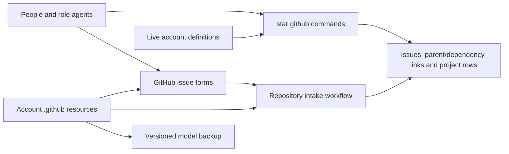

# Issue data model

The issue model gives people and agents one way to describe work, commit it to a Schedule, record findings from Scenarios and verify delivery. GitHub owns the work records; shared commands and workflows maintain them under the engineering process.

## 1. Purpose and goals

Work must have a clear product or engineering purpose, a place in the hierarchy, an accountable owner and evidence appropriate to its type. Planning and testing must be able to organize the same work without duplicating issues or changing their product parents.

A Schedule coordinates changing work through a stable issue identity, ordered Steps and Owner amendments. A Scenario describes a repeatable user journey and records the gaps and defects found during its walk. Both can span Features and repositories within one account.

## 2. Constraints

Each account owns its model and managed work. Parent links, blocked-by relationships and managed project rows stay within that account; external dependencies use local stand-in issues with explicit references.

Organizations use native issue types and fields. The user-account representation uses lowercase type and attribute labels, with project copies in place of organization templates. The workflow means the same thing in both representations.

GitHub access and engineering authority are separate. Repository and project grants permit an operation; the approved process governs whether an agent may perform it.

## 3. Context

The model operates within GitHub accounts. The extension runs on the developer or agent host, and intake runs through repository Actions workflows. The account's shared repository supplies file resources and backup history.

## 4. Strategy

Use native records for identity, state, parentage and dependencies. Keep the work breakdown separate from collection placement: Epic → Feature → Task or Bug describes ownership, while project rows describe intake, planning, execution or discovery.

Read live model definitions when commands need them. Preserve resource IDs during configuration changes. Keep a versioned backup of definitions without treating it as a backup of work data.

Record changes to Schedule commitments and Scenario findings where their readers can see them. Detect incomplete or conflicting state explicitly; do not silently infer approval or successful recovery.

## 5. Components and responsibilities

| Component | Responsibility |
| --- | --- |
| [Hierarchy](1-hierarchy.md) | Types, parents, intake exceptions and completion gates |
| [Attributes](2-attributes.md) | Severity, Priority, Area, Resolution and account representations |
| [Collections](3-collections.md) | Four project kinds, membership, order and ownership |
| [Storage and access](4-storage-and-reach.md) | GitHub resource locations, shared files, credentials and grants |
| [Model commands](6-the-asset-and-its-sync.md) | Read, compare, reconcile, back up and restore definitions |
| [Workflow](7-the-workflow-before-and-after.md) | Filing, planning, execution, Scenario discovery and evidence |
| [Schedule commands](8-the-schedule-commands.md) | Collection identity, reads, closure, reopening and plan links |
| [Scenario commands](9-the-scenario-commands.md) | Walkthroughs, findings, Beat and retirement |
| [Issue commands](10-the-issue-commands.md) | Filing, project movement, closure and reopening |

The [issue standard](../../issue-standards.md) owns classification policy, and the [engineering handbook](../../engineering/index.md) owns the work process. This architecture explains the resources and behavior supporting them.

## 6. Runtime

Filing validates the selected form and issue metadata. Intake routes ordinary work to Triage and recognized Scenario findings to their Scenario. Classification admits work to Backlog or an approved Schedule; a move records the source departure and destination.

Schedule changes maintain consecutive Steps and amendment records. Scenario findings retain their origin and walkthrough Beat after movement. Closing work records its evidence or Resolution and updates the appropriate rows. Reopening restores visible work and its closed ancestors and Schedules according to the command contract.

Preflight and readback detect faults but do not make a sequence of GitHub writes atomic. Commands have different retry behavior. Follow their explicit failure guidance and inspect the known result before another mutation.

## 7. Deployment

The developer environment supplies the GitHub extension and `gh` credentials. Organization workflows use the configured automation App; user-account workflows use their configured project token and workflow permissions.

Public account `.github` repositories own forms, workflow templates, PR templates and model backups. Participating repositories run installed intake workflow copies and name their Triage destination. Model application reconciles shared project configuration while preserving each project's execution data.

Qualification uses the dedicated organization and user sandbox accounts. Installed host capabilities, credentials, repository settings and workflow behavior need evidence for that deployment.

## 8. Shared concepts

An issue's repository-qualified key is stable while Step numbers change. Type and parent define its product hierarchy; attributes stay with it across moves. Project fields describe collection placement and order.

A classified issue has one Type, the required parent and attributes. Triage and originating Scenarios provide the defined intake exceptions. A managed issue has at most one Backlog, Schedule or Scenario home across its account; a temporary Triage fault row may coexist with it under the [placement rule](../../issue-standards.md#placement).

Closed status and completion evidence are different facts. A Feature's child work can be closed before its independent checks and lead sign-off are complete. A Scenario is retired when its journey no longer applies; it is not a delivery checklist.

## 9. Decisions

Significant choices and reasons are recorded with the [hierarchy](1-hierarchy.decisions.md), [attributes](2-attributes.decisions.md), [collections](3-collections.decisions.md), [storage](4-storage-and-reach.decisions.md), [workflow](7-the-workflow-before-and-after.decisions.md) and the [Schedule](8-the-schedule-commands.decisions.md), [Scenario](9-the-scenario-commands.decisions.md) and [issue](10-the-issue-commands.decisions.md) command designs.

Migration steps and historical observations belong in the [migration plan](../../plans/chore/303-issue-data-model.md) and its [retained reference](5-from-todays-scheme.md). They are not alternate definitions of the system.

## 10. Quality scenarios

| Situation | Required result |
| --- | --- |
| Work is filed without required classification data | The supported filing command refuses it; other intake paths expose it for triage |
| Work enters a committed Schedule | Record its approved amendment, placement and dependencies |
| A Step is inserted among closed and open work | Preserve issue identities and consecutive numbering |
| A Scenario finding moves into delivery | Preserve its origin and remove the prior active membership |
| A native resource is renamed | Retain its ID and assignments; identify text consumers |
| A command stops between writes | Expose the partial result without a false guarantee about retry |
| A model backup is restored | Restore definitions and state the limits on work-data recovery |

## 11. Risks and limits

Label exclusivity and many classification rules need validation beyond native GitHub constraints. The sweep reports violations and routes them to Triage with the Scenario exceptions; triage owns correction.

Concurrent changes, lost responses and multi-request writes can leave partial state. Deletion can destroy assignments or row values that a definition backup cannot restore. The single-select option capacity requires a retention decision for long-lived collection projects.

API limitations can leave manual configuration work. Record it explicitly and verify it separately. The [rewrite review](../../engineering/review/rewrite-review.md) tracks consistency findings; implementation and verification records belong in their approved plans.

## 12. Glossary

| Term | Meaning |
| --- | --- |
| Account | GitHub organization or user owning a model and its work |
| Type and level | Issue classification and position in the Epic/Feature/Task-or-Bug hierarchy |
| Parent | Native issue relationship to the next higher product level |
| Attribute | Issue-level metadata that remains meaningful outside a collection |
| Triage | Managed intake project and the decision process for incoming work |
| Backlog | Accepted unscheduled work, plus classified Epics and Features until closure |
| Schedule | Stable commitment issue and its ordered project rows |
| Step | Consecutive execution position within a Schedule |
| Scenario | Repeatable user journey and its recorded findings |
| Beat | Walkthrough step that found an item; 0 before the first step |
| Collection option | Project-field value joining rows to their Schedule or Scenario |
| Model backup | Versioned definitions; excludes issues and execution rows |
