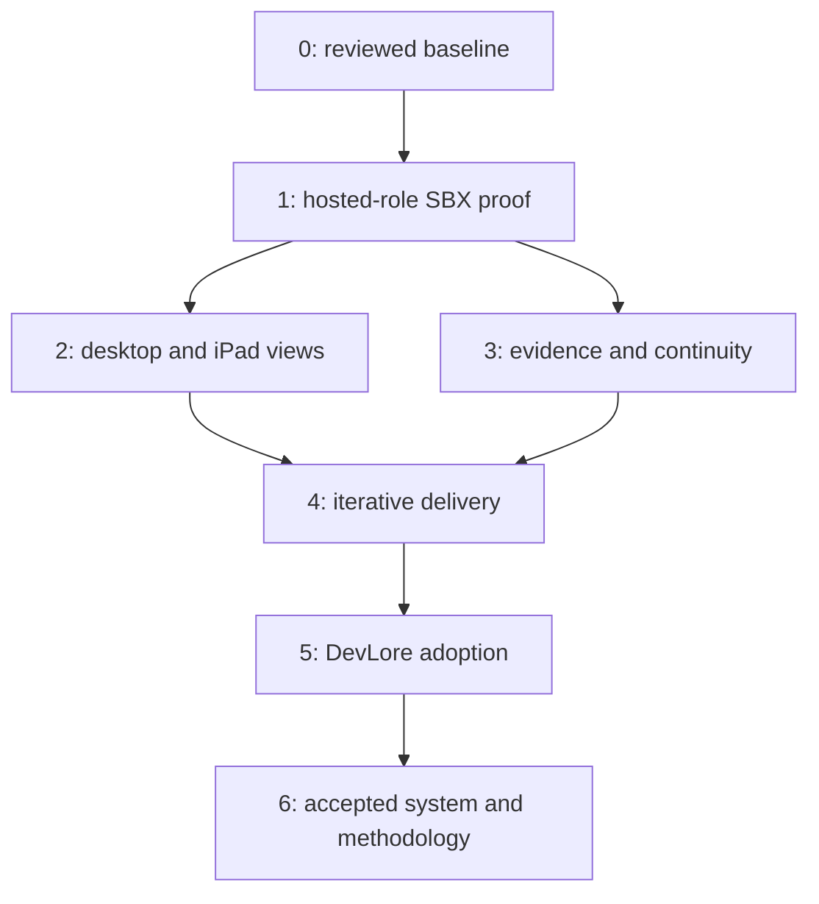

# Agentic developer workstation roadmap

This roadmap takes the [workstation design](../architecture/agentic-developer-workstation.md) from hosted-role proofs in SBX to an accepted environment and development methodology. It gives the planner outcomes, owners, dependencies, qualification scenarios and unresolved choices. Plans define the changes; Owner-approved schedules order their issues.

## 1. Goal and success criteria

Deliver five persistent roles on Claude, Codex and OpenCode inside one SBX environment per schedule, with desktop/iPad editor views, durable work, original evidence and DevLore lifecycle management. Start with hosted models and the available Mac mini or Minisforum; the Minisforum shares capacity with centralized logging.

Two acceptance boundaries apply:

- Design handoff: the Owner accepts a buildable architecture, roadmap and first useful increment for [Workstation architecture and delivery plan (#521)](https://github.com/NobleFactor/noblefactor-engprod/issues/521).
- System and methodology: real work demonstrates delivery, independent closing review, continuity, recovery and lifecycle management. The owning teams review the resulting procedures, rules and skills.

Measure accepted-change latency, human intervention, blocking intervals, correction cycles, repeated investigations, evidence gaps and recovery outcomes. Agree numerical thresholds with the Owner before using them as gates.

## 2. Epic structure and ownership

| Epic | Owns this part of delivery |
| --- | --- |
| [Agent-assisted engineering (#456)](https://github.com/NobleFactor/noblefactor-engprod/issues/456) | Roles, common host-driver model, sandbox requirements, and independent closing-review methodology |
| [Engineering evidence archive (#490)](https://github.com/NobleFactor/noblefactor-engprod/issues/490) | Capture/import, PostgreSQL provenance/catalog, scoped retrieval, source-linked checkpoints, protection and recovery |
| [Engineering handbook, agent rules and skills (#526)](https://github.com/NobleFactor/noblefactor-engprod/issues/526) | Current procedural authority, measured role reading sets, host entry points, standards, and skills/tooling |
| [Agentic workstation integration (#514)](https://github.com/NobleFactor/noblefactor-engprod/issues/514) | Developer experience, schedule continuity, workspace/build integration, continuous compliance, operations, and this design baseline |
| [Local inference and capacity qualification (#515)](https://github.com/NobleFactor/noblefactor-engprod/issues/515) | Separate future model-serving, benchmarking, hardware, and procurement qualification |

Schedules can draw Tasks/Bugs from several Features while preserving native parents, dependencies and ownership. The [issue standard](../issue-standards.md) and [issue model](../architecture/issue-data-model/index.md) own classification and planning representation. Runtime bindings reference those records.

DevLore owns the lifecycle product interface. Identify its reviewed contract and product-side work before scheduling adoption. Prototype integration consumes the existing host-driver and SBX contracts, with an explicit path to DevLore.

## 3. Integration features

| Feature | Deliverable in this roadmap | Principal integration |
| --- | --- | --- |
| [A1 — Developer control and schedule continuity (#517)](https://github.com/NobleFactor/noblefactor-engprod/issues/517) | Launcher, environment/role bindings, editor shell profiles and role-view attachment, retained sessions, safe replacement and reconciliation | Host drivers #459, roles #460, checkpoints #494 |
| [A2 — Protected workspaces and cross-platform execution (#518)](https://github.com/NobleFactor/noblefactor-engprod/issues/518) | Durable private workspaces, controlled writers, immutable inputs, identified build/test targets | SBX/permanent-work contract #458 |
| [A3 — Continuous compliance and exact-snapshot commit gate (#519)](https://github.com/NobleFactor/noblefactor-engprod/issues/519) | Coherent-edit findings, correction/recheck, deterministic and model evidence, permission bound to actual integrated inputs | #456 methodology and A2 snapshots; #457 retains closing review |
| [A4 — Engineering-service operations and recovery (#520)](https://github.com/NobleFactor/noblefactor-engprod/issues/520) | Supervision, access, credentials, quotas, telemetry, restoration, editor-service and lifecycle integration | Archive operations #496; eventual DevLore lifecycle |
| [A5 — Workstation architecture and delivery plan (#521)](https://github.com/NobleFactor/noblefactor-engprod/issues/521) | Reviewed architecture, roadmap, ownership, decisions, acceptance criteria, and first actionable increment | The existing documents and cooperating epics |

A1/A4 integrate editor backends, shell profiles and attachment; A2 supplies sandbox/workspace protections. The common driver remains owned by [Agent hosts (#459)](https://github.com/NobleFactor/noblefactor-engprod/issues/459). Native servers manage sessions and internal execution; lifecycle integration manages the selected servers and authoritative role bindings.

The [archive design](../architecture/engineering-evidence-archive.md), its [decision records](../architecture/engineering-evidence-archive.decisions.md) and [planner roadmap](engineering-evidence-archive.md) supply the proposed subsystem contract and acceptance evidence. Use the archive's existing owners: [capture (#491)](https://github.com/NobleFactor/noblefactor-engprod/issues/491), [catalog/provenance (#492)](https://github.com/NobleFactor/noblefactor-engprod/issues/492), [retrieval (#493)](https://github.com/NobleFactor/noblefactor-engprod/issues/493), [checkpoints (#494)](https://github.com/NobleFactor/noblefactor-engprod/issues/494), [decision traceability (#495)](https://github.com/NobleFactor/noblefactor-engprod/issues/495) and [protection/recovery (#496)](https://github.com/NobleFactor/noblefactor-engprod/issues/496).

[Role entry points (#528)](https://github.com/NobleFactor/noblefactor-engprod/issues/528) owns approved startup and post-compaction reading across hosts. Review methodology findings through [Engineering handbook, agent rules and skills (#526)](https://github.com/NobleFactor/noblefactor-engprod/issues/526) and [Agent-assisted engineering (#456)](https://github.com/NobleFactor/noblefactor-engprod/issues/456). Prototype behavior becomes policy through review.

## 4. Separate future inference track

[Local inference and capacity qualification (#515)](https://github.com/NobleFactor/noblefactor-engprod/issues/515) retains [model qualification (#522)](https://github.com/NobleFactor/noblefactor-engprod/issues/522), [serving/admission (#523)](https://github.com/NobleFactor/noblefactor-engprod/issues/523), [workload/energy measurement (#524)](https://github.com/NobleFactor/noblefactor-engprod/issues/524) and [hardware/deployment qualification (#525)](https://github.com/NobleFactor/noblefactor-engprod/issues/525).

The Owner can schedule that work independently and use evidence from the hosted-model environment. It is outside the initial platform's prerequisites and acceptance. Choosing an agent host does not authorize model serving or a purchase.

## 5. Delivery waves and gates

Waves express dependencies and exit evidence. The planner proposes focused schedules and can group related steps; the Owner approves amendments as findings change the work.

| Wave | Useful increment and owners | Exit evidence |
| --- | --- | --- |
| **0 — Review and hand off** | A5: accept problem/goals, architecture, scenarios, open decisions, and the first implementation increment; identify the pre-schedule transition | **G0:** owner-reviewed baseline, responsibilities, walkthrough scope, and actionable work for the planner |
| **1 — Prove agents in SBX** | #459/#460/#458 with A1/A2/A4: one schedule environment, five separate role contexts, all three host paths through editor-launched SBX profiles, durable work, current required reading, minimal capture/checkpoint, and supervision | **G1:** versioned server/session/binding manifest; bounded work on each host; first-use role creation and later detach/reattach to the same session; host-managed agent execution; permanent work survives an ordinary restart; gaps and unsupported capabilities are explicit |
| **2 — Prove multi-device views** | A1/A2/A4: launcher outside the stopped sandbox; independent editor servers and role shell profiles inside it; authenticated desktop and iPad editor connections | **G2:** all eight stable startup combinations and I1–I4 interaction outcomes; concurrent opens converge on the same roles; uncertain creation/submission outcomes are reconciled; scoped view/editor/host controls preserve unaffected work; cross-view approvals resolve consistently; native endpoints stay private; clipboard, resizing, and browser suspension have demonstrated behavior |
| **3 — Integrate evidence and role continuity** | #491–#496/#528 with A1/A4: PostgreSQL catalog, scoped retrieval, citation expansion, reviewed reading sets, pre-compaction consultation, and recoverable checkpoints | **G3:** retrieve a rejected approach and its original result; correct a checkpoint using earlier evidence; restore unfinished work; qualify startup/post-compaction reading on each supported host; prove scoped access, idempotency, citation-preserving restore, and owner-approved session succession after exhausted restoration |
| **4 — Qualify iterative delivery** | A1/A2/A3 and #456/#457/#526: changing steps, short PR cycles, independent role work, findings/correction, exact-snapshot gates, and closing review | **G4:** a real assignment proceeds through amendments and multiple merges without a global session reset; stale evidence is rejected; repair effort is measured; a Feature receives independent audit/review and owner sign-off |
| **5 — Adopt DevLore lifecycle** | DevLore lifecycle owner with A1/A4 and archive operations: replace prototype lifecycle operations with reviewed DevLore resources/contracts | **G5:** create, attach, stop, resume, replace, and recover an environment through DevLore; preserve schedule/role/evidence identity and pending-operation state; demonstrate upgrade recovery or rollback |
| **6 — Accept the environment and methodology** | Integration and cooperating owners: repeat real scenarios on the selected existing deployment; review handbook/rules/skills and operational procedures | **G6:** owner accepts the documented methodology and installed configuration after repeated delivery, resource-sharing, outage, restore, and upgrade demonstrations; remaining limitations have explicit owners |

Basic supervision, credentials, approved reading, permanent work and evidence preservation accompany the first proof. Wave 2 qualifies the complete remote-editor topology; Wave 3 completes archive/policy integration. Neither permits the prototype to lose evidence until a later wave.

Waves 2 and 3 can run in parallel after Wave 1 establishes their minimum contracts. Discover the DevLore interface and align prototype contracts early; complete adoption after delivery and operations have been exercised.

### 5.1 First actionable implementation increment

The first build increment is Wave 1. Decompose these packages under their existing owners, with plans and Owner review:

1. Qualify an existing machine and pinned SBX setup. Provision permanent private work storage, protect canonical clones and establish basic supervision.
2. Establish stable schedule/environment/role bindings and selected servers. Open profiles to create five separate role sessions on demand across Claude, Codex and OpenCode. Record versions, server/session identities, model access, instructions, permissions and bounded work outcomes.
3. Exercise each host through an editor-launched guest profile and the common role-view launcher. Disconnect and reattach to the recorded session, preserving bounded work and pending questions.
4. Capture originals, results and a source-linked checkpoint on permanent storage. State coverage and unsupported hooks; a complete search UI can follow later.
5. Deliver a capability/failure record and measured gaps that make the editor and evidence work actionable.

A missing host capability becomes classified work and an Owner-reviewed dependency. Keep the gate unmet until the required behavior is demonstrated.

## 6. Scenario walkthroughs and qualification obligations

The first proposed schedule walks S1–S3 using available capabilities and authorized bounded prototypes. Its result is observed methodology, capability evidence and classified implementation gaps. A correctly identified blocker is useful evidence while the corresponding deployment gate remains open.

Use [Portable tooling (#152)](https://github.com/NobleFactor/noblefactor-engprod/issues/152) and its [membership record](https://github.com/NobleFactor/noblefactor-engprod/issues/152#issuecomment-6661940131) as the pattern: a developer journey, cross-owner dependencies, retained evidence and discovered work that moves into execution schedules. The [Scenarios project](https://github.com/orgs/NobleFactor/projects/27/views/2) holds persistent Scenario records. S1–S8 below are proposed narrative IDs.

| Proposed scenario | Walk and evidence to retain | Main requirements |
| --- | --- | --- |
| S1 — Design becomes scheduled work | Start without a schedule; review design/roadmap; planner proposes issues/plans and one or several schedules; demonstrate the environment transition without duplicate planning authority | R1, R2, R10 |
| S2 — Five roles use three hosts | Create one schedule sandbox and selected host servers; open profiles to create roles on demand, inspect server/session bindings, perform bounded work, detach and resume; qualify shared-server session separation and host-managed execution | R2, R3, R6, R9 |
| S3 — Leave the desktop for an iPad | Walk the eight stable editor/server/binding startup combinations; open two profiles on the desktop and corresponding iPad views; exercise concurrent opens, uncertain responses, pending approval, last-view detach, and connection loss against the same sessions | R1, R2, R4 |
| S4 — The schedule changes during delivery | Discover a dependency, propose an amendment, update the owner-approved steps, merge increments, retain useful contexts, and complete independent closing review | R1, R2, R7, R10 |
| S5 — Evidence changes the next decision | Retrieve original reasons/results for a rejected approach, detect a checkpoint omission before compaction, reload role instructions, and resume with citations and uncertainty intact | R5, R6 |
| S6 — An interruption is recovered | Exercise viewing-device disconnect/sleep, SBX-machine sleep/reboot, editor/agent failure, sandbox recreation, repairable resume failure, archive outage, disk pressure, and an uncertain remote write; preserve original session identity and reconcile interrupted work | R1, R2, R5, R9 |
| S7 — DevLore takes lifecycle ownership | Adopt an existing prototype environment, operate it through DevLore, then restore/upgrade without changing authoritative identities | R8, R10 |
| S8 — Recover from loss of a native session | Accidentally delete the coder's native session data; exhaust restoration, obtain owner approval, fence the original session, and reconstruct one authoritative successor from surviving work and archived evidence; retain identity, approval, citations, and gaps | R1, R2, R3, R5, R6, R10 |

File and classify findings through the approved [issue command path](../architecture/issue-data-model/10-the-issue-commands.md). Associate findings with the Scenario and Beat using the supported move operation; Beat N is step N and Beat 0 is before the walk. Preserve the reason, native origin relationship and evidence as findings move to Triage, Backlog or an Owner-approved Schedule. The [Scenario command contract](../architecture/issue-data-model/9-the-scenario-commands.md) defines movement and cleanup.

Create walkthrough Tasks/Bugs under their owning Features. A Scenario remains a persistent behavioral record rather than a Schedule step. The Owner reviews each proposed schedule's scope and exit criteria.

### 6.1 S8. Disaster recovery after loss of a native session

The developer must continue the same schedule/role after native conversation loss and exhausted restoration. Use an isolated fixture where accidental deletion destroys the coder's session data while the schedule, worktree, reviewed plan and shared evidence survive. Include corruption and storage-destruction variants.

A1 coordinates [host drivers (#459)](https://github.com/NobleFactor/noblefactor-engprod/issues/459), A2 durable workspaces and A4 recovery. Archive capture/retrieval/checkpoints/recovery supply identified evidence; role entry points load current instructions. Establish known native IDs, completed/pending work, a checkpoint and measured capture coverage.

Walk these beats:

1. Open the Coder profile. Show the failed recovery against its recorded binding. Repeated/concurrent opens retain that identity and cannot silently create a replacement.
2. Diagnose configuration, credentials, connectivity, mounts and compatibility. Attempt restoration from retained native state and backups. Successful restoration resumes the original ID through S6; retain a separate exhausted-restoration variant.
3. Present original identity, restoration attempts, surviving work, capture watermarks/gaps and proposed successor configuration. Record explicit Owner approval. Pending or denied approval leaves replacement blocked.
4. Prevent the original runtime/binding from authorizing actions before the successor acts. Failed fencing leaves recovery blocked. Serialize creation/cutover and reconcile a lost reply before retrying. Record both native IDs and their relationship.
5. Load approved common/role instructions; inspect the actual plan/worktree. Retrieve checkpoints and cited originals, reconcile unfinished/uncertain operations and report recoverable context and gaps.
6. Attach desktop and iPad views through the new binding and complete a bounded authorized action. A returning old runtime cannot regain authority.

Retain the incident and restoration attempts, approval, original/successor IDs, binding revision/cutover time, fencing and duplicate-prevention results, citations, capture gaps and reconciliation results. Exercise denied/pending approval, failed fencing, concurrent attachment, lost replies and return of the original runtime on each pinned host.

The [session-succession contract](../architecture/agentic-developer-workstation.md#disaster-recovery-and-session-succession) owns the invariant. S6 preserves original identity through ordinary disconnect, sleep and process faults. S8 uses evidence to reconstruct working context after native restoration is exhausted; it cannot promise a complete native backup. Produce reviewed recovery procedures through the handbook owner.

### 6.2 Interaction acceptance cases

The architecture defines [I1–I7](../architecture/agentic-developer-workstation.md#58-interaction-lifecycle), their states, ownership, durable operations and eight startup combinations. These are design case IDs for decomposition under existing Scenarios and Features.

| Interaction | Scenario and delivery coverage | Observable acceptance result |
| --- | --- | --- |
| [I1 — Prepare environment and editor](../architecture/agentic-developer-workstation.md#i1-prepare-the-environment-and-editor) | S1/S2/S3; minimal G1, complete G2 | Repeated/concurrent opens reuse one authoritative environment and intended editor backend; failed authentication/storage readiness reports a specific state without starting roles |
| [I2 — Create or resume role](../architecture/agentic-developer-workstation.md#i2-create-or-resume-a-role-including-concurrent-opens) | S2/S3; first-use G1, concurrent/unknown paths G2 | Two simultaneous first opens create one role conversation; later opens/resume keep its native ID; lost creation or binding-write outcomes reconcile or remain blocked without duplicate creation |
| [I3 — Attach/reconnect/detach](../architecture/agentic-developer-workstation.md#i3-attach-reconnect-and-release-terminal-views) | S3/S6; G2 | Desktop/iPad views resolve the same conversation and pending state; last-view closure preserves role identity/work; reconnect reconciles history and uncertain submissions |
| [I4 — Work and approvals](../architecture/agentic-developer-workstation.md#i4-work-and-approvals-across-views) | S3/S4; G2 | Input receives an identified native ordering/result; one approval answer resolves the exact request across views; late/stale answers cannot authorize another action; unknown submission/approval outcomes are not blindly replayed |
| [I5 — Scoped stop/resume](../architecture/agentic-developer-workstation.md#i5-stop-suspend-and-resume-at-the-intended-scope) | S3/S6/S7; prototype controls G2, DevLore adoption G5 | View, editor, role, host-server, and SBX stops affect their declared scope; other resources continue; stale reconnects cannot reverse a deliberate stop; retained conversations resume under their original IDs |
| [I6 — Failure recovery](../architecture/agentic-developer-workstation.md#i6-recover-failures-while-preserving-identity) | S5/S6/S8; evidence/restore G3, deployment failures G6 | Storage/archive/provider/authentication faults expose the affected capability; spool replay preserves evidence identity; interrupted effects are reconciled; unresolved binding/native loss follows the recorded recovery path |
| [I7 — Configuration and delegation](../architecture/agentic-developer-workstation.md#i7-configuration-native-session-controls-and-delegation) | S2/S4/S5; managed views G2, delivery G4 | Conflicting configuration and native session-switch requests preserve the role binding; the managed attachment enforces its native identity; delegated children have parent identities/evidence and cannot replace a top-level role |

For each case, record initial environment/editor/server/binding/view states, actor/authority, operation ID, requested action, expected binding revision, observed result, native identities and evidence. Exercise refusal and unknown-outcome paths alongside successful cases. A stopped conversation retains its identity.

An intentionally unresolved-outcome case can pass when it demonstrates the required refusal. A missing required capability remains an open gate. Keep versioned evidence for each host/editor path.

### 6.3 Host capability matrix

| Capability | Claude | Codex | OpenCode |
| --- | --- | --- | --- |
| Separate execution from views | Owner-reported behavior and documented remote access; qualify native SBX attachment | Documented app-server foundation; qualify retained thread/runtime | Documented shared server foundation; qualify the pinned deployment |
| Shared server with independent role sessions | Documented multi-session server mode; qualify separate contexts/configuration and host-managed execution | Documented multi-thread server; qualify separate contexts/configuration and host-managed execution | Documented shared server; qualify separate contexts/configuration and host-managed execution |
| Multiple views of one live session | Demonstrate profile-launched native views | Demonstrate simultaneous profile-launched TUIs; protocol subscriptions alone are insufficient evidence | Demonstrate profile clients bound to the same native session |
| Startup and start-or-attach reconciliation | Demonstrate applicable eight-state cases, concurrent first opens, and lost creation-response recovery | Demonstrate the same cases with native thread discovery and persisted IDs | Demonstrate the same cases with native session discovery and persisted IDs |
| No-view continuity and input/approvals | Test disconnection and pending questions | Test subscription/idle-unload strategy, approval routing, input ordering, and disconnection | Test server/session lifetime, input ordering, approvals, and disconnection |
| Reading/capture/checkpoint/recovery | Qualify startup and post-compaction reading, capture coverage, supported hooks, and restoration | Qualify the same contracts on its own APIs and supported hooks | Qualify the same contracts on its own APIs and supported hooks |
| Disaster recovery and approved succession | Demonstrate S8: restore first, approval, fencing, successor, retained history and gaps | Demonstrate S8 with native thread IDs and reconciled creation outcomes | Demonstrate S8 with native session IDs and reconciled creation outcomes |

Use the [host-driver references](../architecture/agentic-developer-workstation.md#53-common-host-driver-contract) as documented foundations. Record each capability as demonstrated, documented but untested, unsupported or inconclusive, with pinned version/configuration and evidence. Qualify the editor → profile → guest-local host path, including reconnect without exposing native endpoints to developer devices.

## 7. Planner handoff and cross-epic contracts

The designer supplies architecture/requirement IDs, the roadmap, scenario narratives, owners, open choices, capability evidence and the first useful increment. The planner returns classified issues, dependencies, plans, proposed schedules/exit criteria and decisions requiring Owner review.

A roadmap can produce several schedules, each with one execution sandbox and shared authorized services. PRs and editor connections retain their shorter lifetimes.

| Contract | Minimum information and invariant | Owner |
| --- | --- | --- |
| Environment/role binding | Schedule/environment/role identity; host-server instance and native session ID; binding revision; creation intent/outcome; assignment; one authoritative session; approved and fenced disaster-recovery succession | A1 with #459 |
| Editor/view attachment | Separate client/editor-server/view states; identity/endpoint; profile and guest launcher; authenticated scope; native ID and binding revision; independent presentation; I1–I4 startup, reconnect, history/submission reconciliation, and no-view behavior | A1/A4 with #459 |
| Runtime operation receipt | Operation/target identity; actor and authority reference; expected binding revision; requested action; pending/unknown/completed result; observed native outcome and evidence references | A1/A4 with #459 |
| Workspace/review input | Repository/base/snapshot; writer authority; permanent storage; identified checks and integrated content | A2 with #458 |
| Reading set | Approved common/role requirements, versions, measured size, scope, and startup/post-compaction load evidence | #526/#528; role authority from #460 |
| Evidence/checkpoint | Original locators, capture watermarks/gaps, policy/source identity, decisions/uncertainty, pending operations, next action, and recovery approval/original-successor trace | #490/#494, integrated by A1 |
| Compliance receipt | Snapshot/base, policy/check environment, coverage, verdict, findings, correction and supersession | A3; closing review remains #456/#457 |
| Lifecycle/recovery | Environment/host-server desired and observed states; native host ownership of execution; I5 target scope and stale-request fencing; retained state; I6 outcome reconciliation; compatible restore manifests; restore-before-replace policy, approval, succession records, and release rules | A4 with DevLore and #496 |
| Methodology change | Scenario evidence, proposed procedure/rule/skill, authoritative home, review and adoption | #526 with #456 |

Use the [current planning commands](../architecture/issue-data-model/8-the-schedule-commands.md) and verify native records after writes. Prose links alone do not establish parent relationships. Existing issue, plan, Git, PR, approval, status and worktree boundaries continue to govern the work.

## 8. Decisions and dependencies to resolve

[D1–D6](../architecture/agentic-developer-workstation.decisions.md#d1) retain their identifiers across design, roadmap and plans.

| Decision | Resolve by | Required result |
| --- | --- | --- |
| D1 — Pre-schedule runtime and transition | Wave 0 / S1 | Reviewed representation and adoption/split behavior; no artificial schedule prerequisite or silent exception to schedule isolation |
| D2 — Editor and transport | Before G2 | Pinned editor/backend, role profiles and guest launcher, independent instance/client/view state, authenticated desktop/iPad path, private native endpoints, all eight startup combinations, and demonstrated coexistence/resource budget |
| D3 — Host capability and input/approval behavior | Wave 1, completed for each claimed capability before its gate | Evidence matrix; shared-server role configuration; supported lifecycle hooks; native session discovery and switch handling; creation/submission reconciliation; subscription policy; explicit failures and S8 succession enforcement |
| D4 — Archive layout and recovery | Minimal durability in Wave 1; full contract before G3 | Original/catalog boundary, authorization, retention, capture acknowledgments, native restore versus evidence reconstruction, and S8 evidence/gap trace |
| D5 — Placement and resource budgets | First deployment, rechecked at G6 | Existing-machine support, shared logging headroom, quotas, backup destination, and agreed acceptance thresholds |
| D6 — DevLore interface and adoption | Interface discovery early; adoption before G5 | Reviewed lifecycle contract, product-side owners/dependencies, migration and recovery evidence |

Inventory implemented, reusable, experimental and missing capabilities. Compare candidate issues' scope and dependencies with the hosted-model design, then propose necessary amendments for Owner review. Treat optional inference work and its acceptance separately. A written issue is not evidence that an installed command supports its operation.

## 9. Planning and acceptance

Before scheduling a package, establish its promised outcome, owning Feature, prerequisites, plan/design links, permissions, test environment and observable completion evidence. Walkthroughs can refine the design, roadmap and methodology through Owner review.

Track implementation, review, publication, merge, deployment and verification separately. Accept the design baseline through G0 and the full environment/methodology through G6; each cooperating Feature retains its own completion criteria.

The [source design plan](../plans/doc/521-workstation-design.md) and [handbook rewrite plan](../plans/doc/581-schedule-command-consumers.md) retain transition and review history. This roadmap owns the delivery dependency outline; GitHub Schedules own committed execution order and progress.
