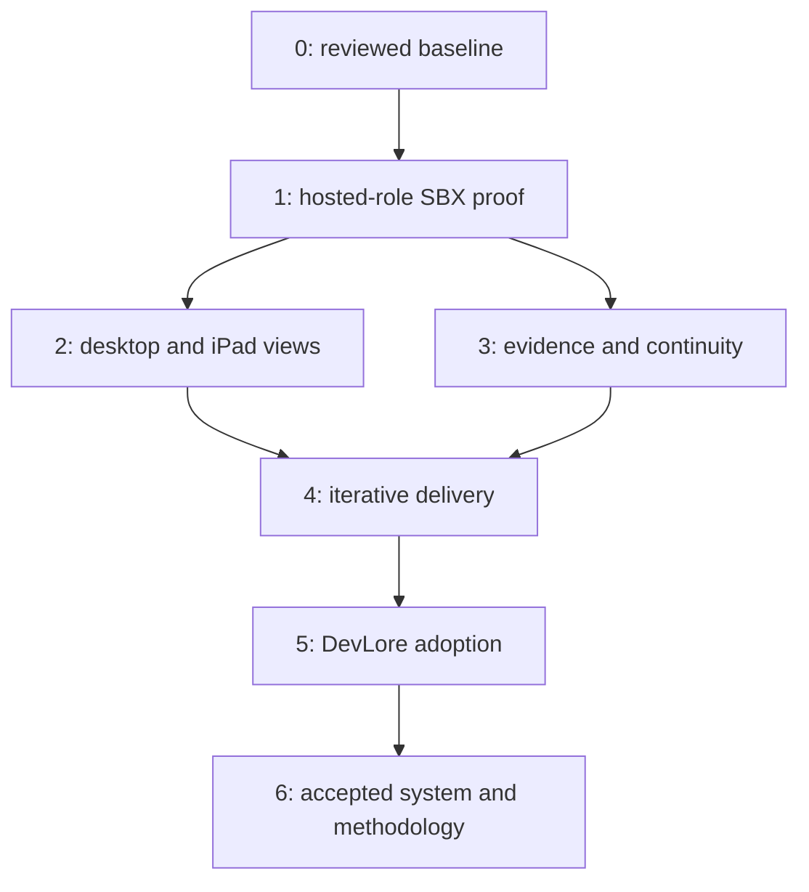

# Agentic Developer Workstation — Roadmap

| Document control | Value |
| --- | --- |
| Revision | 0.8 — concrete interaction acceptance cases |
| Owner | NobleFactor Engineering Productivity |
| Handoff | Designer to planner, for owner review and schedule proposals |
| Architecture | [System architecture and development workflow](../architecture/agentic-developer-workstation.md) |
| Design work | [Workstation architecture and delivery plan (#521)](https://github.com/NobleFactor/noblefactor-engprod/issues/521) |
| Status | Draft delivery baseline; implementation plans and schedule commitments require their normal review |

The designer delivers a reviewed problem statement, goals, solution, workflow, system
architecture, proposed scenarios, and this roadmap. The planner turns those assets into
classified issues, plans, dependencies, and one or more schedules. The current design work
began without a schedule; creating the first schedule is part of the handoff.

## 1. Goal and success criteria

Deliver a human-directed development methodology and the environment that supports it:
five persistent specialist roles on Claude, Codex, and OpenCode inside one SBX sandbox per
schedule; editor-launched shell profiles for desktop/iPad views; durable work and retrievable
original evidence;
iterative delivery with frequent merges; and eventual DevLore lifecycle management.

Start with hosted models and existing hardware. The available machines are a Mac mini and
a Minisforum system; the latter shares capacity with centralized logging. New hardware and
local inference are outside this delivery path.

Success is an accepted, tested, compliant change with useful continuity and less repair.
Measure accepted-change latency, human intervention, correction cycles, repeated
investigations, evidence gaps, and recovery outcomes. Agree numerical thresholds with the
owner before using them as gates; this roadmap does not invent latency or recovery promises.

There are two acceptance boundaries:

- **Design handoff:** the owner accepts a buildable architecture/roadmap baseline and first
  actionable increment, satisfying Workstation architecture and delivery plan (#521).
- **System and methodology:** the qualified environment carries real work through the
  documented process, including independent closing review, recovery, and DevLore lifecycle
  management. Procedures, rules, and skills are reviewed under their owning epic.

## 2. Epic structure and ownership

These are cooperating peer epics. A schedule can draw Tasks/Bugs from several Features;
each issue retains its owning Feature/Epic and native relationships.

| Epic | Owns this part of delivery |
| --- | --- |
| [Agent-assisted engineering (#456)](https://github.com/NobleFactor/noblefactor-engprod/issues/456) | Roles, common host-driver model, sandbox requirements, and independent closing-review methodology |
| [Engineering evidence archive (#490)](https://github.com/NobleFactor/noblefactor-engprod/issues/490) | Capture/import, PostgreSQL provenance/catalog, scoped retrieval, source-linked checkpoints, protection and recovery |
| [Engineering handbook, agent rules and skills (#526)](https://github.com/NobleFactor/noblefactor-engprod/issues/526) | Current procedural authority, measured role reading sets, host entry points, standards, and skills/tooling |
| [Agentic workstation integration (#514)](https://github.com/NobleFactor/noblefactor-engprod/issues/514) | Developer experience, schedule continuity, workspace/build integration, continuous compliance, operations, and this design baseline |
| [Local inference and capacity qualification (#515)](https://github.com/NobleFactor/noblefactor-engprod/issues/515) | Separate future model-serving, benchmarking, hardware, and procurement qualification |

GitHub's issue/schedule/scenario model remains owned by its existing work. Use
[issue standards](../issue-standards.md) and current tooling; do not create a second planning
database or a new issue type for the workstation.

DevLore owns the eventual lifecycle implementation through its resource/control-plane
contracts. The planner must identify the reviewed product interface and its owning work
before scheduling adoption. Initial prototypes integrate existing engprod drivers and SBX
contracts rather than wait for a complete new subsystem or become a competing permanent manager.

## 3. Integration features

The existing Feature boundaries under Agentic workstation integration remain the planner's
ownership map. Editor-server work and UI attachment integrate through A1/A4, with sandbox
and workspace obligations through A2; they do not create another host-driver implementation.
Compatible editors launch the same guest-side role-view entry point through their profile
formats and connection backends. Developer devices connect to editors; native role-host
listeners stay private to SBX. The native servers manage their assigned sessions and internal
execution processes; the control plane manages server lifecycle and authoritative role bindings.
Roles are created on demand through start-or-attach, independently of editor/view lifetimes.

| Feature | Deliverable in this roadmap | Principal integration |
| --- | --- | --- |
| [A1 — Developer control and schedule continuity (#517)](https://github.com/NobleFactor/noblefactor-engprod/issues/517) | Launcher, environment/role bindings, editor shell profiles and role-view attachment, retained sessions, safe replacement and reconciliation | Host drivers #459, roles #460, checkpoints #494 |
| [A2 — Protected workspaces and cross-platform execution (#518)](https://github.com/NobleFactor/noblefactor-engprod/issues/518) | Durable private workspaces, controlled writers, immutable inputs, identified build/test targets | SBX/permanent-work contract #458 |
| [A3 — Continuous compliance and exact-snapshot commit gate (#519)](https://github.com/NobleFactor/noblefactor-engprod/issues/519) | Coherent-edit findings, correction/recheck, deterministic and model evidence, permission bound to actual integrated inputs | #456 methodology and A2 snapshots; #457 retains closing review |
| [A4 — Engineering-service operations and recovery (#520)](https://github.com/NobleFactor/noblefactor-engprod/issues/520) | Supervision, access, credentials, quotas, telemetry, restoration, editor-service and lifecycle integration | Archive operations #496; eventual DevLore lifecycle |
| [A5 — Workstation architecture and delivery plan (#521)](https://github.com/NobleFactor/noblefactor-engprod/issues/521) | Reviewed architecture, roadmap, ownership, decisions, acceptance criteria, and first actionable increment | The existing documents and cooperating epics |

The archive's canonical Features are [capture (#491)](https://github.com/NobleFactor/noblefactor-engprod/issues/491),
[catalog/provenance (#492)](https://github.com/NobleFactor/noblefactor-engprod/issues/492),
[retrieval (#493)](https://github.com/NobleFactor/noblefactor-engprod/issues/493),
[checkpoints (#494)](https://github.com/NobleFactor/noblefactor-engprod/issues/494),
[reviewed decision traceability (#495)](https://github.com/NobleFactor/noblefactor-engprod/issues/495),
and [protection/recovery (#496)](https://github.com/NobleFactor/noblefactor-engprod/issues/496).
Use those owners directly.

[Role entry points (#528)](https://github.com/NobleFactor/noblefactor-engprod/issues/528)
owns startup and post-compaction reading on all three hosts. The handbook draft remains under
review until adopted. Methodology findings go through #526; a successful prototype does not
silently change engineering policy.

## 4. Separate future inference track

Keep the existing [B1 model qualification (#522)](https://github.com/NobleFactor/noblefactor-engprod/issues/522),
[B2 serving/admission (#523)](https://github.com/NobleFactor/noblefactor-engprod/issues/523),
[B3 workload/energy measurements (#524)](https://github.com/NobleFactor/noblefactor-engprod/issues/524),
and [B4 hardware/deployment qualification (#525)](https://github.com/NobleFactor/noblefactor-engprod/issues/525)
under Local inference and capacity qualification (#515).

They can consume evidence from the hosted-model environment if the owner later schedules them.
They do not block the initial platform or its acceptance. Selecting a host such as OpenCode
does not itself select local inference or authorize a purchase.

## 5. Delivery waves and gates

Waves describe dependencies and acceptance, not deadlines or a fixed role sequence. The planner
proposes focused schedules and may work several related steps together. The owner amends
committed schedules as findings change their scope.

| Wave | Useful increment and owners | Exit evidence |
| --- | --- | --- |
| **0 — Review and hand off** | A5: accept problem/goals, architecture, scenarios, open decisions, and the first implementation increment; identify the pre-schedule transition | **G0:** owner-reviewed baseline, responsibilities, walkthrough scope, and actionable work for the planner |
| **1 — Prove agents in SBX** | #459/#460/#458 with A1/A2/A4: one schedule environment, five separate role contexts, all three host paths through editor-launched SBX profiles, durable work, current required reading, minimal capture/checkpoint, and supervision | **G1:** versioned server/session/binding manifest; bounded work on each host; first-use role creation and later detach/reattach to the same session; host-managed agent execution; permanent work survives an ordinary restart; gaps and unsupported capabilities are explicit |
| **2 — Prove multi-device views** | A1/A2/A4: launcher outside the stopped sandbox; independent editor servers and role shell profiles inside it; authenticated desktop and iPad editor connections | **G2:** all eight stable startup combinations and I1–I4 interaction outcomes; concurrent opens converge on the same roles; uncertain creation/submission outcomes are reconciled; scoped view/editor/host controls preserve unaffected work; cross-view approvals resolve consistently; native endpoints stay private; clipboard, resizing, and browser suspension have demonstrated behavior |
| **3 — Integrate evidence and role continuity** | #491–#496/#528 with A1/A4: PostgreSQL catalog, scoped retrieval, citation expansion, reviewed reading sets, pre-compaction consultation, and recoverable checkpoints | **G3:** retrieve a rejected approach and its original result; correct a checkpoint using earlier evidence; restore unfinished work; qualify startup/post-compaction reading on each supported host; prove scoped access, idempotency, citation-preserving restore, and owner-approved session succession after exhausted restoration |
| **4 — Qualify iterative delivery** | A1/A2/A3 and #456/#457/#526: changing steps, short PR cycles, independent role work, findings/correction, exact-snapshot gates, and closing review | **G4:** a real assignment proceeds through amendments and multiple merges without a global session reset; stale evidence is rejected; repair effort is measured; a Feature receives independent audit/review and owner sign-off |
| **5 — Adopt DevLore lifecycle** | DevLore lifecycle owner with A1/A4 and archive operations: replace prototype lifecycle operations with reviewed DevLore resources/contracts | **G5:** create, attach, stop, resume, replace, and recover an environment through DevLore; preserve schedule/role/evidence identity and pending-operation state; demonstrate upgrade recovery or rollback |
| **6 — Accept the environment and methodology** | Integration and cooperating owners: repeat real scenarios on the selected existing deployment; review handbook/rules/skills and operational procedures | **G6:** owner accepts the documented methodology and installed configuration after repeated delivery, resource-sharing, outage, restore, and upgrade demonstrations; remaining limitations have explicit owners |

Basic supervision, credentials, approved policy loading, permanent work, and evidence
preservation accompany Wave 1. Even the first host proof uses an editor-launched shell profile
inside SBX; Wave 2 qualifies the complete remote editor topology. Wave 3 completes the broader
evidence/policy integration; it is not permission
to lose prototype evidence or work until then. Full archive and handbook completion need not
precede the first role-host experiment.

Waves 2 and 3 can advance in parallel after the minimal Wave 1 contracts exist. DevLore
interface discovery and prototype contract alignment start early; adoption completes after
the operational and delivery contracts have been exercised.

### First actionable implementation increment

The first build increment is the Wave 1 vertical slice. The planner decomposes these work
packages into issues under their existing Feature owners, with plans and owner review:

1. Qualify one existing host and a pinned SBX setup; provision permanent private work storage
   with protected canonical clones and basic service supervision.
2. Establish stable schedule/environment/role bindings and selected native host servers.
   Open profiles to create five independent role sessions on demand, using an assignment
   that exercises Claude, Codex, and OpenCode. Let the hosts manage their session execution.
   Record exact versions, server and session identities, model access, instructions,
   permissions, and outcomes.
3. Exercise each host's attachment/capture path from an editor-launched shell profile inside
   SBX. The profile calls the common role-view launcher and resolves the existing role binding.
   Disconnect a view and reattach to that same session while preserving bounded work and
   visible pending questions.
4. Capture original records/results and a source-linked checkpoint on permanent storage.
   Declare coverage and unsupported hooks; a complete search UI is not required yet.
5. Produce the capability/failure manifest and measured gaps that make the Wave 2 editor
   and Wave 3 evidence tasks actionable.

A discovery that a host cannot satisfy a required behavior becomes classified work and an
owner-reviewed dependency. It does not become a passing gate or an unannounced host substitution.

## 6. Scenario walkthroughs and qualification obligations

The owner's proposed first schedule is a focused set of walkthroughs. Use the pattern in
[Portable tooling (#152)](https://github.com/NobleFactor/noblefactor-engprod/issues/152):
a concrete developer journey, dependencies across feature owners, evidence of where it
breaks, and discovered work that can move into execution schedules. Its
[project-membership record](https://github.com/NobleFactor/noblefactor-engprod/issues/152#issuecomment-6661940131)
preserves that transition. The [Scenarios project](https://github.com/orgs/NobleFactor/projects/27/views/2)
holds the team's scenarios; the following are proposed narratives, not filed Scenario IDs.

| Proposed scenario | Walk and evidence to retain | Main requirements |
| --- | --- | --- |
| S1 — Design becomes scheduled work | Start without a schedule; review design/roadmap; planner proposes issues/plans and one or several schedules; demonstrate the environment transition without duplicate planning authority | R1, R2, R10 |
| S2 — Five roles use three hosts | Create one schedule sandbox and selected host servers; open profiles to create roles on demand, inspect server/session bindings, perform bounded work, detach and resume; qualify shared-server session separation and host-managed execution | R2, R3, R6, R9 |
| S3 — Leave the desktop for an iPad | Walk the eight stable editor/server/binding startup combinations; open two profiles on the desktop and corresponding iPad views; exercise concurrent opens, uncertain responses, pending approval, last-view detach, and connection loss against the same sessions | R1, R2, R4 |
| S4 — The schedule changes during delivery | Discover a dependency, propose an amendment, update the owner-approved steps, merge increments, retain useful contexts, and complete independent closing review | R1, R2, R7, R10 |
| S5 — Evidence changes the next decision | Retrieve original reasons/results for a rejected approach, detect a checkpoint omission before compaction, reload role instructions, and resume with citations and uncertainty intact | R5, R6 |
| S6 — An interruption is recovered | Exercise viewing-device disconnect/sleep, SBX-machine sleep/reboot, editor/agent failure, sandbox recreation, repairable resume failure, archive outage, disk pressure, and an uncertain remote write; preserve original session identity and reconcile interrupted work | R1, R2, R5, R9 |
| S7 — DevLore takes lifecycle ownership | Adopt an existing prototype environment, operate it through DevLore, then restore/upgrade without changing authoritative identities | R8, R10 |
| S8 — Recover from loss of a native session | Accidentally delete the coder's native session data; exhaust restoration, obtain owner approval, fence the original session, and reconstruct one authoritative successor from surviving work and archived evidence; retain identity, approval, citations, and gaps | R1, R2, R3, R5, R6, R10 |

A proposed first schedule walks S1–S3 using the capabilities currently available and bounded
prototypes where authorized. Its deliverable is an observed methodology draft, capability
matrix, evidence, and classified implementation gaps. A blocked walkthrough is a useful
finding, but it does not satisfy the corresponding deployment gate. The owner reviews the
first schedule's actual scope and exit criteria; this document adds no project rows.

As walkthroughs proceed, record each finding against its scenario/beat, preserve original
evidence, and classify the work under its owning Feature. When an item moves to Triage or a
schedule, retain its origin and the movement record under current issue standards. Review
methodology changes through #526 and #456; do not turn a prototype's behavior into policy by default.

### S8 — Disaster recovery after loss of a native session

**Developer goal.** Continue the same schedule and role after a disaster destroys the native
conversation and restoration cannot recover it. The driving example is self-inflicted loss:
the developer accidentally deletes the coder's persistent session data. The schedule,
worktree, reviewed plan, and shared engineering evidence survive. Corruption or destruction
of the session's storage are additional variants. This is a proposed qualification scenario,
not a claim that a particular host reports an unrecoverable conversation error.

**Owners and prerequisites.** Developer control and schedule continuity (#517) coordinates
host drivers (#459), durable workspaces (#518), and operations/recovery (#520). Archive
capture/retrieval/checkpoints/recovery (#491/#493/#494/#496) supply identified evidence;
role entry points (#528) load current instructions. Use an isolated recovery fixture with
known session IDs, completed and pending work, a checkpoint, and measured capture coverage.

Walk these beats and retain the evidence:

1. **Discover the loss.** Open the Coder profile through an editor. The launcher resolves the
   original binding and reports the failed recovery. Repeated or concurrent profile opens
   preserve that binding and cannot silently start a replacement.
2. **Attempt restoration.** Diagnose the failure and attempt recovery from retained native
   state and available backups. Rule out repairable configuration, credentials, connectivity,
   mount, and host-compatibility problems. If restoration succeeds, resume the same native
   session and finish through S6; exercise a separate variant where restoration is exhausted.
3. **Request a recovery decision.** Present the original session identity, restoration
   attempts, surviving work, evidence watermarks/gaps, and the proposed successor's
   host/configuration. Record the owner's explicit approval; denied or pending approval
   leaves the role blocked for replacement.
4. **Establish sole authority.** Fence the original runtime and binding before authorizing
   the successor to act. If fencing cannot be established, stay blocked. Serialize creation
   and cutover; reconcile a lost response before retrying so multiple views cannot create
   competing successors. Record both native IDs and their succession relationship.
5. **Reconstruct working context.** Load approved common/role instructions and inspect the
   actual plan and worktree. Retrieve checkpoints and cited original evidence, then reconcile
   unfinished work and uncertain operations. Report which decisions and context can be
   recovered and which are missing; an archive is not a promise of a complete native backup.
6. **Continue through the same role profile.** Attach desktop and iPad views to the successor
   through the current binding and complete a bounded owner-authorized action. A later
   return of the original runtime cannot recover its former authority.

**Acceptance evidence.** Preserve the incident and failed restoration record, owner approval,
original/successor IDs, binding revision and cutover time, fencing/duplicate-prevention
results, checkpoint and source citations, evidence gaps, and the successor's reconciliation
of current work. Demonstrate the pending/denied-approval and failed-fencing refusal paths,
concurrent attachment, lost-response reconciliation, and return of the old runtime. Repeat
the applicable paths on Claude, Codex, and OpenCode under the pinned capability matrix.
The original identity remains in the historical record even when its conversation is lost.

The [architecture's recovery contract](../architecture/agentic-developer-workstation.md#disaster-recovery-and-session-succession)
defines the invariant. Routine disconnect, sleep, and process restart belong to S6 and retain
the original session identity. The archive's distinct responsibility in S8 is to supply
evidence for reconstruction once original-session restoration is exhausted. The walkthrough
also produces reviewed recovery procedures under Engineering handbook, agent rules and
skills (#526). Add its bounded Tasks/Bugs to an owner-reviewed schedule when its prerequisites
are available; the Scenario itself remains a persistent record.

### Interaction acceptance cases

The [architecture's interaction lifecycle](../architecture/agentic-developer-workstation.md#58-interaction-lifecycle)
defines the state model, eight stable startup combinations, activity diagrams, durable
operation/ownership contracts, and concrete I1–I7 walkthroughs. These are design case IDs,
not filed issues or additional Scenario records. The planner decomposes bounded walks
under the existing scenario and Feature owners:

| Interaction | Scenario and delivery coverage | Observable acceptance result |
| --- | --- | --- |
| [I1 — Prepare environment and editor](../architecture/agentic-developer-workstation.md#i1-prepare-the-environment-and-editor) | S1/S2/S3; minimal G1, complete G2 | Repeated/concurrent opens reuse one authoritative environment and intended editor backend; failed authentication/storage readiness reports a specific state without starting roles |
| [I2 — Create or resume role](../architecture/agentic-developer-workstation.md#i2-create-or-resume-a-role-including-concurrent-opens) | S2/S3; first-use G1, concurrent/unknown paths G2 | Two simultaneous first opens create one role conversation; later opens/resume keep its native ID; lost creation or binding-write outcomes reconcile or remain blocked without duplicate creation |
| [I3 — Attach/reconnect/detach](../architecture/agentic-developer-workstation.md#i3-attach-reconnect-and-release-terminal-views) | S3/S6; G2 | Desktop/iPad views resolve the same conversation and pending state; last-view closure preserves role identity/work; reconnect reconciles history and uncertain submissions |
| [I4 — Work and approvals](../architecture/agentic-developer-workstation.md#i4-work-and-approvals-across-views) | S3/S4; G2 | Input receives an identified native ordering/result; one approval answer resolves the exact request across views; late/stale answers cannot authorize another action; unknown submission/approval outcomes are not blindly replayed |
| [I5 — Scoped stop/resume](../architecture/agentic-developer-workstation.md#i5-stop-suspend-and-resume-at-the-intended-scope) | S3/S6/S7; prototype controls G2, DevLore adoption G5 | View, editor, role, host-server, and SBX stops affect their declared scope; other resources continue; stale reconnects cannot reverse a deliberate stop; retained conversations resume under their original IDs |
| [I6 — Failure recovery](../architecture/agentic-developer-workstation.md#i6-recover-failures-while-preserving-identity) | S5/S6/S8; evidence/restore G3, deployment failures G6 | Storage/archive/provider/authentication faults expose the affected capability; spool replay preserves evidence identity; interrupted effects are reconciled; unresolved binding/native loss follows the recorded recovery path |
| [I7 — Configuration and delegation](../architecture/agentic-developer-workstation.md#i7-configuration-native-session-controls-and-delegation) | S2/S4/S5; managed views G2, delivery G4 | Conflicting configuration and native session-switch requests preserve the role binding; the managed attachment enforces its native identity; delegated children have parent identities/evidence and cannot replace a top-level role |

Record initial environment/editor/server/binding/view states, actor and authority scope,
operation ID, requested action, expected binding revision, observed transition, native
identities, and supporting evidence. Exercise refusal and unresolved-outcome cases alongside
successful paths. Starting or unknown states require reconciliation; a stopped session is
not a never-created role.

A walkthrough that correctly reports an intentionally injected unresolved outcome can
satisfy that refusal case. An unsupported required capability remains a gap and does not
satisfy its deployment gate. Keep the capability record for each pinned host/editor path.

### Host capability matrix the planner must obtain

| Capability | Claude | Codex | OpenCode |
| --- | --- | --- | --- |
| Separate execution from views | Owner-reported behavior and documented remote access; qualify native SBX attachment | Documented app-server foundation; qualify retained thread/runtime | Documented shared server foundation; qualify the pinned deployment |
| Shared server with independent role sessions | Documented multi-session server mode; qualify separate contexts/configuration and host-managed execution | Documented multi-thread server; qualify separate contexts/configuration and host-managed execution | Documented shared server; qualify separate contexts/configuration and host-managed execution |
| Multiple views of one live session | Demonstrate profile-launched native views | Demonstrate simultaneous profile-launched TUIs; protocol subscriptions alone are insufficient evidence | Demonstrate profile clients bound to the same native session |
| Startup and start-or-attach reconciliation | Demonstrate applicable eight-state cases, concurrent first opens, and lost creation-response recovery | Demonstrate the same cases with native thread discovery and persisted IDs | Demonstrate the same cases with native session discovery and persisted IDs |
| No-view continuity and input/approvals | Test disconnection and pending questions | Test subscription/idle-unload strategy, approval routing, input ordering, and disconnection | Test server/session lifetime, input ordering, approvals, and disconnection |
| Reading/capture/checkpoint/recovery | Qualify startup and post-compaction reading, capture coverage, supported hooks, and restoration | Qualify the same contracts on its own APIs and supported hooks | Qualify the same contracts on its own APIs and supported hooks |
| Disaster recovery and approved succession | Demonstrate S8: restore first, approval, fencing, successor, retained history and gaps | Demonstrate S8 with native thread IDs and reconciled creation outcomes | Demonstrate S8 with native session IDs and reconciled creation outcomes |

The [architecture's host-driver section](../architecture/agentic-developer-workstation.md#53-common-host-driver-contract)
links the primary technical sources and states the current evidence boundary. Record each
matrix entry as demonstrated, documented but untested, unsupported, or inconclusive, with
version and evidence. Qualify the editor-to-profile-to-local-host path, including reconnect
with no developer-device access to the native host listener. Do not erase host differences
behind a common interface.

## 7. Planner handoff and cross-epic contracts

The handoff contains the architecture and requirement IDs, this roadmap, proposed scenario
narratives, interface owners, open decisions, current capability evidence, and the first
implementation increment. The planner returns classified work, dependencies, issue plans,
schedule proposals and exit criteria, and decisions requiring owner review.

Each schedule is a bounded commitment. The planner preserves room for iterative amendments,
keeps one schedule associated with one execution sandbox, and avoids allocating separate
sandboxes merely for editor connections or PRs. A roadmap may produce several schedules;
each gets its own environment while sharing authorized policy and evidence services.

| Contract | Minimum information and invariant | Owner |
| --- | --- | --- |
| Environment/role binding | Schedule/environment/role identity; host-server instance and native session ID; binding revision; creation intent/outcome; assignment; one authoritative session; approved and fenced disaster-recovery succession | A1 with #459 |
| Editor/view attachment | Separate client/editor-server/view states; identity/endpoint; profile and guest launcher; authenticated scope; native ID and binding revision; independent presentation; I1–I4 startup, reconnect, history/submission reconciliation, and no-view behavior | A1/A4 with #459 |
| Runtime operation receipt | Operation/target identity; actor and authority reference; expected binding revision; requested action; pending/unknown/completed result; observed native outcome and evidence references | A1/A4 with #459 |
| Workspace/review input | Repository/base/snapshot; writer authority; permanent storage; identified checks and integrated content | A2 with #458 |
| Reading set | Approved common/role requirements, versions, measured size, scope, and startup/post-compaction load evidence | #526/#528; role authority from #460 |
| Evidence/checkpoint | Original locators, capture watermarks/gaps, policy/source identity, decisions/uncertainty, pending operations, next action, and recovery approval/original-successor trace | #490/#494, integrated by A1 |
| Compliance receipt | Snapshot/base, policy/check environment, coverage, verdict, findings, correction and supersession | A3; closing review remains #456/#457 |
| Lifecycle/recovery | Environment/host-server desired and observed states; native host ownership of execution; I5 target scope and stale-request fencing; retained state; I6 outcome reconciliation; compatible restore manifests; restore-before-replace policy, approval, succession records, and release rules | A4 with DevLore and #496 |
| Methodology change | Scenario evidence, proposed procedure/rule/skill, authoritative home, review and adoption | #526 with #456 |

Existing process governs issue classification, plan commits and owner review, Git commands,
PR execution, status updates, and repository-write restrictions. The planner must use the
current filing path and verify native records; a prose parent link is not a native relationship.
No issues, schedules, approvals, or dependencies are created by publishing this roadmap.

## 8. Decisions and dependencies to resolve

Use the architecture's D1–D6 decision IDs when decomposing work:

| Decision | Resolve by | Required result |
| --- | --- | --- |
| D1 — Pre-schedule runtime and transition | Wave 0 / S1 | Reviewed representation and adoption/split behavior; no artificial schedule prerequisite or silent exception to schedule isolation |
| D2 — Editor and transport | Before G2 | Pinned editor/backend, role profiles and guest launcher, independent instance/client/view state, authenticated desktop/iPad path, private native endpoints, all eight startup combinations, and demonstrated coexistence/resource budget |
| D3 — Host capability and input/approval behavior | Wave 1, completed for each claimed capability before its gate | Evidence matrix; shared-server role configuration; supported lifecycle hooks; native session discovery and switch handling; creation/submission reconciliation; subscription policy; explicit failures and S8 succession enforcement |
| D4 — Archive layout and recovery | Minimal durability in Wave 1; full contract before G3 | Original/catalog boundary, authorization, retention, capture acknowledgments, native restore versus evidence reconstruction, and S8 evidence/gap trace |
| D5 — Placement and resource budgets | First deployment, rechecked at G6 | Existing-machine support, shared logging headroom, quotas, backup destination, and agreed acceptance thresholds |
| D6 — DevLore interface and adoption | Interface discovery early; adoption before G5 | Reviewed lifecycle contract, product-side owners/dependencies, migration and recovery evidence |

Some current issue descriptions retain model-serving/hardware assumptions from the earlier
draft. The planner should propose any issue-scope/dependency amendments needed to align them
with this hosted-model baseline for owner review. Do not claim the optional inference work
completed or silently rewrite its acceptance requirements.

The designer/planner must also inventory implemented, reusable, experimental, and missing
capabilities. An issue describing an operation is not evidence that a deployed command supports it.

## 9. Review and delivery record

This revision replaces the earlier local-inference-first delivery sequence with hosted-model
proofs on existing hardware, adds the pre-schedule design transition, makes independent
editor instances, guest-side shell profiles, and shared role views explicit, integrates
#526's authority, and uses
scenario walkthroughs to develop the methodology. Existing Feature ownership is preserved.

On 2026-11-13 the owner approved explicit replacement after original-session restoration is
exhausted and identified disaster recovery, including self-inflicted loss, as its driving
scenario. S8 records that decision; S6 retains routine recovery of the original session.

During owner review of design PR #544, the owner approved depicting shared native host
servers managing sessions and internal execution, then requested the complete interaction
lifecycle. The owner then requested filling those gaps with concrete interactions. This
revision defines I1–I7 actor/action/outcome walkthroughs, ownership and operation receipts,
concurrent startup, reconnect, approval and host lifecycle diagrams, scoped stop/resume,
and observable acceptance results. It does not select a local capture-spool storage engine.

Acceptance of the architecture baseline closes A5 only through its normal owner-reviewed
evidence on develop. Acceptance of later waves and cooperating Features is separate.
The architecture links here for delivery sequencing; this roadmap is the single dependency
outline rather than a second implementation plan or schedule database.
